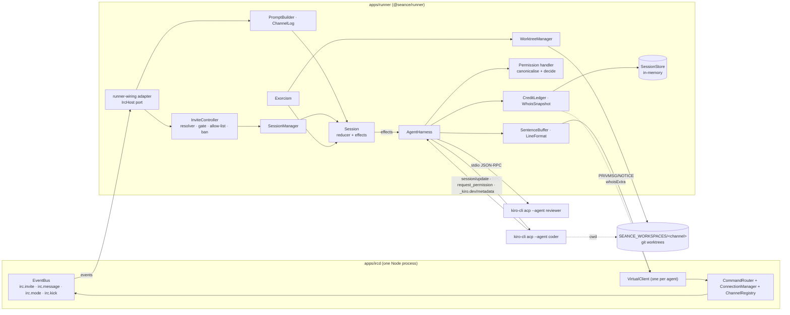
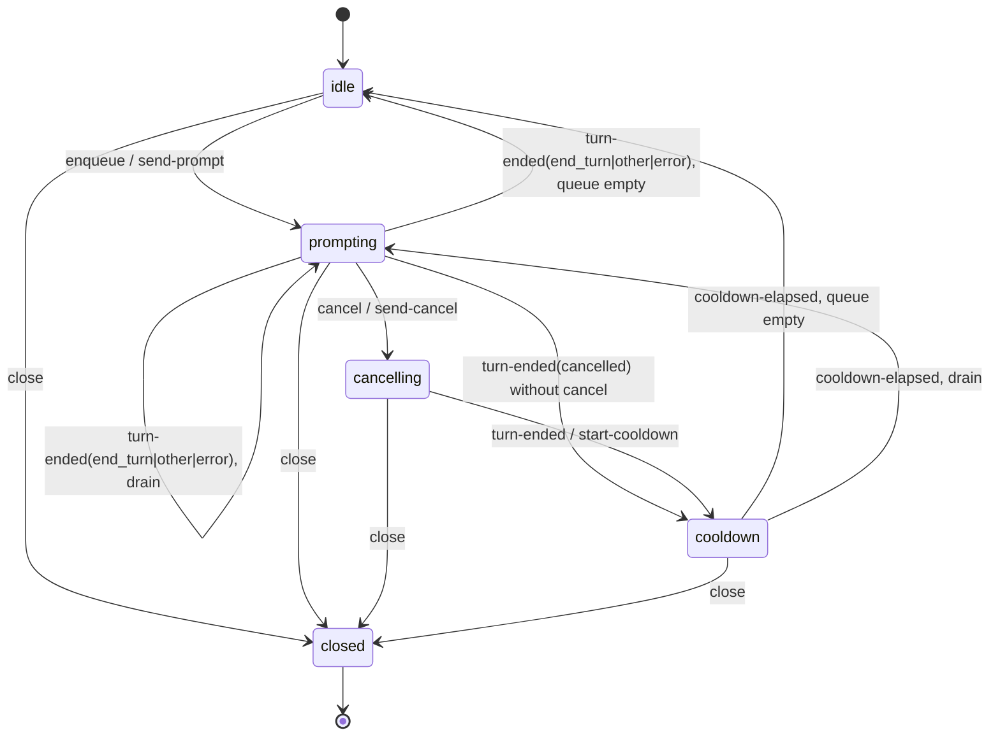
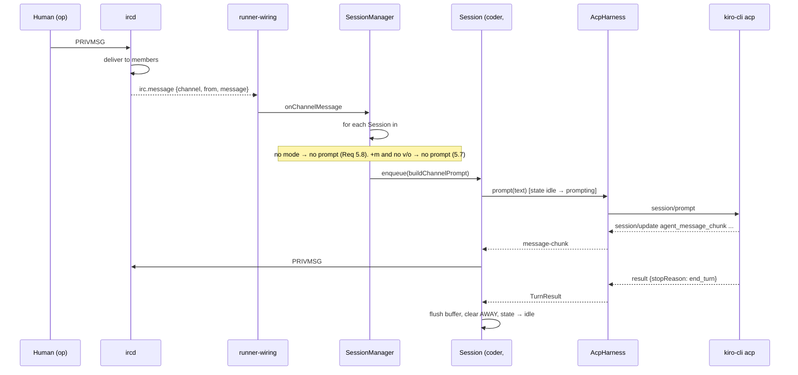
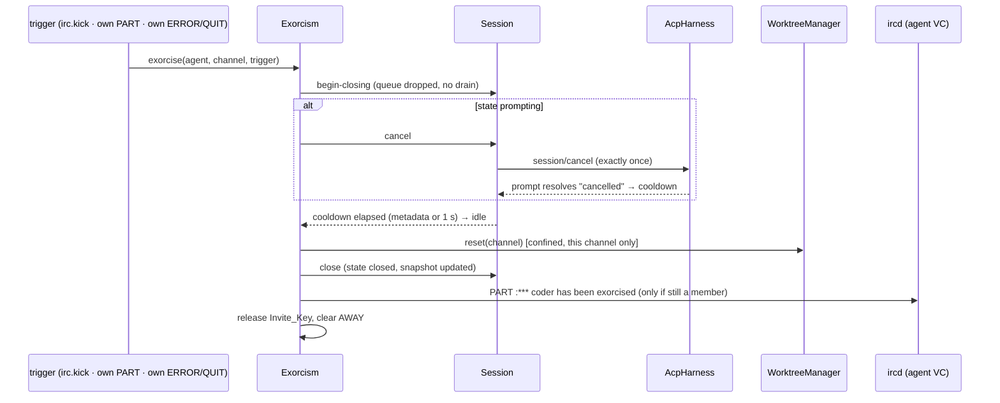

# Design: agent-runner

## Overview

`@seance/runner` (`apps/runner`) turns Kiro agents into IRC users (`DESIGN.md` §2 Journeys A–C, §3 "Command → agent mapping", §4 "Message flow", §5, §6). It is a library started in the same Node process as the ircd; `apps/ircd/src/index.ts` wires it in when `SEANCE_RUNNER=1`. Each agent is a `VirtualClient` of the ircd, so there is no network hop, no second source of IRC state and no Redis in this milestone.

The runner drives `kiro-cli acp --agent <name>` over newline-delimited JSON-RPC on stdio: one process per agent, one ACP session per channel, with the cwd of each ACP session set to the channel's git worktree. The JSON-RPC client is promoted from `spikes/acp/src/acp-client.ts` into `apps/runner/src/acp/`; `@agentclientprotocol/sdk` is not used. A `kiro-cli chat --no-interactive` fallback sits behind the same `AgentHarness` interface.

IRC modes are permissions. `+o` may write, `+v` may speak, no mode is listen-only. Enforcement happens in one place, the `session/request_permission` handler, because Kiro writes files itself and never calls `fs/*` (spike S6). Only messages from human channel operators become instructions; everything else reaches a prompt wrapped in `<untrusted>…</untrusted>`.

What the runner does for each IRC action:

| IRC action | Runner reaction |
|---|---|
| `/invite coder` | Claim the nick in the `InviteResolver`; on `irc.invite` create the virtual client, `JOIN`, create the worktree, `session/new` |
| `PRIVMSG #ch :text` | Enqueue `[#ch] <nick> text` for every `+v`/`+o` agent session in the channel |
| `/msg coder text` | Prompt in a separate Private_Session (read-only, own directory) |
| `/mode #ch +o coder` | Next `session/request_permission` reads the mode and allows writes inside the worktree |
| `/kick`, `/part`, `QUIT` | Exorcism: cancel, cooldown, reset worktree, close session, leave |
| `/whois coder` | `whoisExtra` renders model, tools, status and credits from an in-memory snapshot |

Findings from reading the code that shape the design (verified against `apps/ircd/src` at the time of writing):

- `InviteResolver` is `(target, channel, inviter) => boolean`, synchronous. The ircd consults it **only when the target nick is not a connected, registered client** (`handlers/invite.ts`). When the agent is already online the ircd skips the resolver, sends `INVITE` to the virtual client, and still publishes `irc.invite` with `targetOnline: true`.
- `irc.invite` carries `{channel, inviter, target, targetKey, targetOnline, ts}` and is published synchronously after `341 RPL_INVITING`.
- `irc.message` is declared in `EventMap` (`IrcMessageEvent {channel, from, message}`) but **no handler publishes it today**.
- There is no `irc.part` or `irc.quit` event and no `+b` mode (`MODE` accepts only `o`, `v`, `m`; anything else is `472`).
- The ircd keeps no message history. `Channel.topic` and `Channel.members: Map<clientId, {op, voice}>` are readable through `ctx.channels`; nick to client id goes through `ctx.connections.getByNick`.
- `VirtualClient` already has `dispatch`, `onMessage`, `setAway` (no wire reply) and `whoisExtra?: () => readonly string[]` in `VirtualClientOptions`. The ircd caps `WHOIS` extra lines at `WHOIS_EXTRA_MAX = 10` and clamps `AWAY` to `AWAYLEN = 200` bytes.
- `VirtualClient.close()` delivers an `ERROR` message to its listeners **before** it clears them, then quits the client. `PART`, `KICK` and `MODE` broadcasts reach the virtual client's own listener because it is a channel member.

### Dependencies on the ircd and runner-side fallbacks

| # | What the runner needs | State of `apps/ircd` today | Decision |
|---|---|---|---|
| D1 | A channel message event | `irc.message` typed, never published | **Required ircd change** (about 5 lines): `deliverMessage` publishes `irc.message` after a successful channel delivery, for `PRIVMSG` and `NOTICE`, with an ircd test. The runner has one source for prompts and for the channel log. Observing each agent's own listener instead would deliver duplicates to the log (every member sees every message) and would not see messages sent while no agent is in the channel, so it is rejected as a fallback. The runner ignores `NOTICE` (Req 5.14). |
| D2 | A signal when an agent leaves | No `irc.part` / `irc.quit` | **Fallback, no ircd change:** the runner observes its own virtual client. A `PART` whose prefix nick is the agent's own nick is Req 9.2. An `ERROR` message (sent by `close()`) is the `QUIT` signal of Req 9.3. A `KICK` broadcast is a second path for Req 9.1. Exorcism is single-flight per Invite_Key, so duplicate signals are harmless. |
| D3 | `+b` | Not implemented | **Fallback:** runner-level `BanList` with `Runner.ban(channel, nick)` and `unban`. The runner also accepts `irc.mode` with `mode: "b"` if a future ircd widens `IrcModeEvent`; today the type is `"o" \| "v" \| "m"` and the branch does not compile in, so it is not written (Req 9.10). |
| D4 | Member mode lookup | **Exists:** `ctx.channels.get(name).members.get(client.id)` with `ctx.connections.getByNick(nick)` | `IrcHost.modeOf(channel, nick)` wraps these two calls. Read at every use (Req 8.11). |
| D5 | History of channel lines | None | **Fallback:** `ChannelLog` in the runner, a ring buffer of the last 50 lines per channel, filled from `irc.message` (D1). Lines sent before the runner started are not in the summary. |
| D6 | Set `AWAY` on a virtual client | **Exists:** `VirtualClient.setAway(text?)`, no wire reply | The runner mirrors the away text in the Whois_Snapshot because `status: away` must not read ircd state in `whoisExtra`. |
| D7 | Allow-list and ban for an **online** agent | Resolver is skipped, so `401` cannot be sent | **Fallback:** the `InviteController` repeats the ban and allow-list check on `irc.invite` when `targetOnline` is true and the client is one of the runner's own, drops the invite and sends a server-prefixed `NOTICE` to the inviter. The ircd has already sent `341`. Cleaner fix, out of scope here: consult the resolver for online virtual clients too. |
| D8 | A sender for `NOTICE` to an inviter who shares no channel with the agent | No service client | **Fallback:** server-prefixed `NOTICE` built by the runner and delivered with `Client.send` on the inviter's client (`IrcHost.noticeTo(nick, text)`). No extra virtual client. |
| D9 | `apps/ircd` imports `@seance/runner`, so the runner must not import `@seance/ircd` | Package graph would be circular | The runner declares structural **ports** (`IrcHost`, `HostVirtualClient`, `HostEvents`) in `src/ports.ts`. `apps/ircd/src/runner-wiring.ts` adapts an `IrcServer` to `IrcHost`; a drift in either shape fails the ircd typecheck. |
| D10 | Resolver is a `createServer` option, the runner needs the server | Construction order | `index.ts` passes a lazy resolver `(t, c, i) => runner?.inviteResolver(t, c, i) ?? false`, then creates the runner, then `await runner.start()` **before** `server.start()` so the registry is loaded before the first invite (Req 1.1). |

D1 is the only change the runner needs inside `apps/ircd`; it is a task of this spec, with its own ircd test.

### Decisions

| Decision | Choice | Why |
|---|---|---|
| Runtime dependencies | `@seance/irc-protocol` (already in the monorepo: `irc_lower`, `isValidNick`, `serialize`, `Numerics`) and Node built-ins (`node:child_process`, `node:fs/promises`, `node:path`, `node:crypto`, `node:readline`). **No new runtime dependency.** | Req 2.14. Dev dependencies `vitest` and `fast-check` are the versions already pinned for `apps/ircd`. |
| ACP client | Promote the spike's `AcpClient`, replacing the file log by an injected `RunnerLogger`, adding boundary validation, string ids, last-stderr capture and spawn-failure handling | The spike client is about 200 lines and proven (FINDINGS S1–S7). An SDK adds a dependency for a protocol that is newline-delimited JSON. |
| State machine shape | A **pure reducer** `transition(model, event) → {model, effects}` plus a thin `Session` that runs the effects | P1 and P2 are properties of the reducer, testable with 1000s of sequences without timers or processes. |
| Time | One injectable `Clock` (`now`, `setTimeout`, `clearTimeout`) for cooldown, Idle_Flush, hung-agent watchdog, rate window and persistence flush | Req 12.9: no wall-clock sleeps in tests. Every owner registers its timers with a `TimerSet` so shutdown can prove that none is left (Req 11.7). |
| Permission policy | Two stages: `canonicalise` (I/O: `realpath` of the deepest existing ancestor) and `decide` (**pure**) | Req 8.13 wants a pure function; symlink resolution cannot be pure. An unresolvable path becomes `unresolved` and `decide` rejects it (Req 8.6). |
| Branch name | `seance/<Sanitized_Channel>` instead of `seance/<raw channel>` | Git ref names forbid characters that IRC channel names allow (space, `~`, `^`, `:`, `?`, `*`, `[`, `\`, `..`, `@{`). For `#fix-bug-123` both give `seance/fix-bug-123`. |
| Where the agent definitions live | `SEANCE_AGENTS_DIR` (default `<repo root>/agents`). The process cwd of every agent is that directory; Kiro resolves `--agent <kiroAgent>` from `<cwd>/.kiro/agents/<kiroAgent>.json` (spike S1b). The Agent_Profile files are the top-level `agents/*.json` only; the loader never recurses and never reads `.kiro/agents` | Req 1.5 and 1.10. Task 0 records the resolution result (S8) in `spikes/acp/FINDINGS.md`; the spawn strategy does not depend on it, but resolution fails closed (startup file check plus `currentModeId` check, Req 1.11, 2.15–2.16). Spike S9 (also Task 0) records whether `.kiro/steering` and `.kiro/hooks` in the session cwd are loaded; S9 showed that `AGENTS.md` and `.kiro/skills` in the session cwd are loaded (steering, hooks and MCP were not), so worktrees are created with every `AGENTS.md` and `.kiro/` excluded at every depth, scanned on ensure and before every prompt, and the permission policy rejects writes and shell references to them (Requirement 4 criteria 12–14, Requirement 8 criteria 14–16, Worktrees chapter steps 4–5). |
| Outbound lines | The runner computes the line budget from the exact prefix the ircd will add (`nick!user@host PRIVMSG target :`) and never relies on the ircd's `clampTrailing` | `clampTrailing` truncates silently, which would lose characters (Req 7.6). An integration test confirms that what the runner sends is what peers receive. |
| `Human_Op` | A channel member with `+o` whose nick is not a registered Agent nick. In a private message, a sender who has `+o` in at least one channel where the target Agent has a non-closed Session | Req 5.3 and 5.11 do not define the private case. The Agent's own channels are the only scope the runner can check. |
| Notices to operators | Two helpers. `channelNotice(agent, channel, text)` is a `NOTICE` to the channel from the agent's virtual client. `opNotice(channel, text)` is one server-prefixed `NOTICE` per Human_Op, delivered with `Client.send` | `NOTICE` to `@#ch` is not supported by the ircd. Req 5.5, 6.5, 6.10 and 10.9 use `opNotice`; Req 3.9, 7.9, 8.8, 9.13 and 9.16 use `channelNotice` (8.8 prefixes the text with `ops:`). |
| Sentence boundary | A `.`, `!` or `?` ends a sentence when followed by whitespace; a newline ends it immediately; a terminator at the very end of the buffer waits for the next chunk, the Idle_Flush or the end of the Turn | Refines Req 7.2 so that `3.14` and `v1.2.3` do not split across chunks. The delay is bounded by Idle_Flush (1.5 s). |
| Unexpected `cancelled` in `prompting` | Go to `cooldown` | Req 6.5 covers failures but not a `cancelled` stop reason without a runner cancel (for example an agent-side abort). The spike's poisoned-reuse race makes an immediate follow-up unsafe, so the cooldown applies. |
| Revival after process exit | When a prompt arrives for an Agent that is still in the channel but whose Session is `closed` (Req 9.14), the manager creates a **new** Session (respawn, `session/new`) and routes the prompt to it | Req 9.15 conflicts with Req 6.12 if read as one Session. The closed Session keeps rejecting (6.12); the replacement is created before the prompt is routed. |
| Credits across incarnations | `CreditLedger` is keyed by (agent, channel) and survives Session replacement; each `Session` also keeps its own incarnation total (P6) | Otherwise `/kick` plus `/invite` would reset the channel cap. Matches the `sessions.credits_used` column in `DESIGN.md` §6. |

## Architecture



### Module layout (`apps/runner/src`)

```
index.ts                   public API: createRunner, loadRunnerConfig, types
runner.ts                  composition root: start(), shutdown(), inviteResolver, ban/unban
config.ts                  RunnerConfig + loadRunnerConfig(env); throws ConfigError naming the variable
ports.ts                   IrcHost, HostClient, HostVirtualClient, HostEvents (structural ircd ports)
clock.ts                   Clock, realClock, TimerSet
log.ts                     RunnerLogger, redactFields
acp/
  frames.ts                parseFrame(line) → Frame | FrameError; encode helpers (validation at the boundary)
  client.ts                AcpClient (promoted from the spike): spawn, request, notify, handle, onNotification
  redact.ts                redact(line) from the spike, plus value redaction for KIRO_API_KEY
harness/
  harness.ts               AgentHarness, HarnessSession, SessionEvent, TurnResult
  acp-harness.ts           AcpHarness: one AcpClient per agent, one session per channel, watchdog
  headless-harness.ts      HeadlessHarness: one `kiro-cli chat --no-interactive` per prompt
  spawn.ts                 buildSpawnSpec(profile, config): command, args, cwd, env (no --trust-all-tools)
registry/
  agent-profile.ts         AgentProfile type + parseProfile(json, file)
  agent-registry.ts        AgentRegistry.load(dir), lookup(nick) with irc_lower
worktree/
  sanitize.ts              sanitizeChannel(name) → Sanitized_Channel (total, injective modulo case-mapping)
  confine.ts               resolveInside(root, path) with realpath, strictly-inside check
  scan-config.ts           scanConfig(path) → relative paths of every AGENTS.md / .kiro entry (case-insensitive, whole tree)
  git.ts                   runGit(args[]) with execFile, per-repo mutex
  worktree-manager.ts      ensure(channel), reset(channel), privateDir(agent)
session/
  machine.ts               Session_State, SessionModel, SessionEvent, transition() — pure
  session.ts               Session: runs effects against the harness, clock and sinks
  session-manager.ts       sessions by Invite_Key, revival, private sessions, per-process fan-out
  session-store.ts         SessionStore interface, SessionRecord
  memory-session-store.ts  in-memory implementation
prompt/
  untrusted.ts             wrapUntrusted(text), neutralise(text)
  builder.ts               buildChannelPrompt, buildPrivatePrompt, buildResumePrompt (pure)
  channel-log.ts           ChannelLog ring buffer (50 lines per channel)
output/
  sentence-buffer.ts       SentenceBuffer: chunks → sentences, Idle_Flush, end-of-turn flush
  line-format.ts           formatLines(text, color, budget) → readonly string[]; budgetFor(prefix, target)
  agent-output.ts          sends PRIVMSG/NOTICE through the agent's virtual client, sets/clears AWAY
permissions/
  policy.ts                decide(input) → PermissionResult — pure
  deny-list.ts             matchDenyList(command, worktree) — pure
  canonicalise.ts          canonicalisePaths(paths, worktree) — I/O
  handler.ts               handlePermissionRequest(): reads current mode, builds the ACP response
invite/
  resolver.ts              createInviteResolver(deps) — sync, no I/O
  invite-gate.ts           InviteGate: dedup state + sliding-window rate limiter (pure, time from event ts)
  allow-list.ts            parseInviters(env), isAllowed(inviter)
  ban-list.ts              BanList
  invite-controller.ts     onInvite(event): gate, then the join pipeline
exorcism/
  exorcism.ts              exorcise(session, trigger): ordered steps, single-flight
credits/
  accumulator.ts           acceptMetering(entries) — pure; CreditAccumulator
  ledger.ts                CreditLedger (per agent+channel), cap, credit-blocked marks, flush to store
  reset-command.ts         handleResetCredits(sender, agent) for `!reset-credits`
whois/
  snapshot.ts              WhoisSnapshot (mutable store, updated synchronously)
  render.ts                renderWhois(entry | undefined) → readonly string[] — pure
shutdown.ts                ordered shutdown sequence, idempotent
```

Tests live in `apps/runner/test` (like `apps/ircd/test`), fixtures in `apps/runner/test/fixtures`.

### Per-process and per-session ownership

- `AcpHarness` owns one `AcpClient` per Agent (created on the first `openSession`, recreated after exit). It owns the hung-agent watchdog because a hang is a property of the process, not of one session.
- `Session` owns its reducer model, its `SentenceBuffer`, its timers and its credit accumulator.
- `SessionManager` owns the maps Invite_Key → Session, (agent, human nick) → Private_Session, and the revival logic.
- `Runner` owns the registry, `WhoisSnapshot`, `CreditLedger`, `BanList`, `InviteGate`, and the `SessionStore` handle.
- Exactly one place writes each piece of state; the `WhoisSnapshot` is written synchronously by `Session` and `CreditLedger` (Req 10.17) and read only by `renderWhois`.

## Components and Interfaces

### Ports (`ports.ts`)

```ts
export type Unsubscribe = () => void;
export type HostMembership = { readonly op: boolean; readonly voice: boolean };

export interface HostClient {
  readonly id: string;
  readonly nick?: string;
  readonly virtual?: boolean;
  send(msg: IrcMessage): void;           // used only for server-prefixed NOTICE (D8)
}

export interface HostVirtualClient extends HostClient {
  dispatch(msg: IrcMessage): unknown;    // throws on malformed/overlong/closed
  onMessage(listener: (msg: IrcMessage) => void): Unsubscribe;
  setAway(text?: string): void;
  close(reason: string): void;
}

export interface HostChannel {
  readonly name: string;
  readonly topic?: string;
  readonly modes: { readonly moderated: boolean };
  readonly members: ReadonlyMap<string, HostMembership>;   // keyed by client id
}

export interface HostEvents {
  "irc.invite": { channel: string; inviter: string; target: string; targetKey: string; targetOnline: boolean; ts: number };
  "irc.message": { channel: string; from: string; message: IrcMessage };
  "irc.mode": { channel: string; by: string; mode: "o" | "v" | "m"; adding: boolean; target?: string };
  "irc.kick": { channel: string; by: string; target: string; reason: string };
}

export interface IrcHost {
  readonly serverName: string;
  createVirtualClient(o: { id: string; host?: string; whoisExtra?: () => readonly string[] }): HostVirtualClient;
  subscribe<K extends keyof HostEvents>(name: K, l: (e: HostEvents[K]) => void): Unsubscribe;
  clientByNick(nick: string): HostClient | undefined;     // registered clients only
  channel(name: string): HostChannel | undefined;
  /** Mode of `nick` in `channel` read now; undefined when not a member. */
  modeOf(channel: string, nick: string): HostMembership | undefined;
  /** Server-prefixed NOTICE to one client (D8); false when the nick is not connected. */
  noticeTo(nick: string, text: string): boolean;
}
```

The real `IrcServer` satisfies these shapes through `runner-wiring.ts`. The event payload types are copies of the ircd's; the adapter assigns `server.events.subscribe` to `IrcHost.subscribe`, so a mismatch is a compile error in `apps/ircd`.

### Configuration (`config.ts`)

`loadRunnerConfig(env)` is pure and throws `ConfigError` whose message names the variable and the rejected value (never the value of `KIRO_API_KEY`). It runs in `runner.start()` before any process, git or file operation.

| Variable | Default | Validation | Requirement |
|---|---|---|---|
| `SEANCE_RUNNER` | unset | `1` enables wiring in `apps/ircd/src/index.ts` | intro |
| `SEANCE_HARNESS` | `acp` | unset, empty, `acp`, `headless`; else error naming the variable and both values | 2.6, 2.7 |
| `KIRO_API_KEY` | unset | optional; passed only in the child environment | 2.8, 2.9 |
| `SEANCE_KIRO_BIN` | `kiro-cli` | non-empty; tests point it at the Fake_Agent launcher | 12.6 |
| `SEANCE_TARGET_REPO` | none | non-empty, a git repository (`git rev-parse --git-dir`) | 4.7 |
| `SEANCE_WORKSPACES` | none | non-empty; created if missing; realpath stored as Worktree_Root | 4.4, 4.7 |
| `SEANCE_AGENTS_DIR` | `<cwd>/agents` | directory exists | 1.1, 1.10 |
| `SEANCE_PROMPT_TIMEOUT_MS` | `120000` | positive integer | 9.12, 9.17 |
| `SEANCE_CHANNEL_CREDIT_CAP` | unset (no cap) | finite number greater than 0 | 10.9, 10.13 |
| `SEANCE_INVITE_RATE` | `5` | positive integer | 3.18, 3.19 |
| `SEANCE_INVITERS` | unset (everyone) | comma list, each entry `isValidNick` after trimming; empty after trim means unset | 3.14, 3.20 |
| `SEANCE_E2E_KIRO` | unset | `1` enables the real `kiro-cli` test | 12.11 |

### Clock and timers (`clock.ts`)

```ts
export interface Clock {
  now(): number;
  setTimeout(fn: () => void, ms: number): TimerHandle;
  clearTimeout(h: TimerHandle): void;
}
export class TimerSet {            // owns handles so shutdown can clear and count them
  constructor(clock: Clock);
  set(fn: () => void, ms: number): TimerHandle;
  clear(h: TimerHandle): void;
  clearAll(): void;
  get size(): number;
}
```

`realClock` unrefs its timers. Tests inject `ManualClock` (a fixture) or `vi.useFakeTimers()`; both satisfy `Clock`.

### Agent registry (`registry/`)

```ts
export type AgentProfile = {
  readonly nick: string;         // 1..30, isValidNick
  readonly kiroAgent: string;    // 1..64
  readonly model: string;        // 1..64
  readonly tools: string;        // tool summary, 1..256
  readonly color: number;        // integer 0..15
  readonly file: string;         // source file, for error messages
};
export class AgentRegistry {
  static load(dir: string, log: RunnerLogger): Promise<AgentRegistry>;   // throws NoAgentProfileError
  lookup(nick: string): AgentProfile | undefined;                        // irc_lower
  all(): readonly AgentProfile[];
}
```

Loading reads `dir/*.json` (top level only, ascending filename order), parses each with `parseProfile`, logs one error per rejected file (`file` and failing field) and continues (Req 1.6). A second profile whose `irc_lower(nick)` equals an earlier one is rejected with both file names (Req 1.7). Zero valid profiles throws `NoAgentProfileError`, which the entry point turns into a non-zero exit (Req 1.8). The committed `agents/coder.json`, `agents/reviewer.json` and `agents/researcher.json` are part of the deliverable (Req 1.3).

### ACP client (`acp/`)

`parseFrame(line: string): Frame | FrameError` is the only place that interprets agent output:

```ts
type Frame =
  | { kind: "request"; id: number | string; method: string; params: JsonObject }
  | { kind: "notification"; method: string; params: JsonObject }
  | { kind: "response"; id: number | string; result: JsonObject }
  | { kind: "error-response"; id: number | string; code: number; message: string; data?: Json };
type FrameError = { kind: "invalid"; reason: string };
```

Rules: valid JSON, object, `jsonrpc === "2.0"`; `id` is a number or string; a frame with `method` and `id` is a request, with `method` only a notification, with `id` and `result` or `error` a response, anything else is invalid. It never throws. Unknown `_kiro.dev/*` notifications are delivered to listeners that ignore them; they log nothing at error level (Req 2.11).

`AcpClient` is the spike's class with these changes:

- Constructor takes `{command, args, cwd, env, logger, clock}`; frames and command lines go to `logger.debug` through `redact` and the key-value redaction (Req 2.10). The file log stream is gone.
- Our request ids stay numeric; responses are matched with `String(id)` so a string echo also resolves.
- An invalid frame is discarded, one `logger.error` line names the reason with the frame redacted, and the process and its sessions stay open (Req 2.12).
- The last stderr line is kept. If the process fails to spawn (`error` event) or exits before the `initialize` response, every pending request rejects with `<command> failed: <exit code or signal>, last stderr: <line>` (Req 2.13), and the next `openSession` spawns a new process.
- `onActivity(listener)` fires on every valid or invalid frame; the watchdog uses it.
- `kill(signal)` and an `exited` promise replace `close()`'s log handling; `close()` ends stdin, sends `SIGTERM`, waits at most 5 s, then `SIGKILL` (Req 11.5).
- A `handle("session/request_permission", fn)` result is sent with the request id unchanged (number or string, Req 8.9). A handler exception answers with a cancelled outcome, never with silence.

### Harness (`harness/`)

```ts
export type StopReason = "end_turn" | "cancelled" | (string & {});
export type TurnResult = { readonly stopReason: StopReason };

export type ToolInfo = {
  readonly kind: string; readonly title: string;
  readonly paths: readonly string[]; readonly command?: string;
};
export type MeteringEntry = { readonly value: unknown; readonly unit: unknown };

export type SessionEvent =
  | { readonly kind: "message-chunk"; readonly text: string }
  | { readonly kind: "thought-chunk"; readonly text: string }
  | { readonly kind: "tool-call"; readonly tool: ToolInfo }
  | { readonly kind: "metadata"; readonly turnDurationMs?: number; readonly metering: readonly MeteringEntry[] }
  | { readonly kind: "unknown"; readonly sessionUpdate: string };

export type PermissionRequest = { readonly tool: ToolInfo; readonly options: readonly { id: string; kind: string }[] };
export type PermissionAnswer = { readonly decision: "allow_once" | "reject_once" } | { readonly cancelled: true };
export type PermissionHandler = (req: PermissionRequest) => Promise<PermissionAnswer>;

export interface HarnessSession {
  readonly id: string;
  prompt(text: string): Promise<TurnResult>;     // rejects when the process exits or hangs
  cancel(): void;                                // one session/cancel notification
  close(): Promise<void>;                        // forgets the session locally; no wire call is verified for Kiro
  onEvent(l: (e: SessionEvent) => void): Unsubscribe;
}

export interface AgentHarness {
  openSession(profile: AgentProfile, opts: { cwd: string; onPermission: PermissionHandler }): Promise<HarnessSession>;
  terminate(profile: AgentProfile, signal?: "SIGTERM" | "SIGKILL"): Promise<void>;   // process-level
  onProcessEvent(l: (e: ProcessEvent) => void): Unsubscribe;                          // "hung" | "exited"
  hasProcess(profile: AgentProfile): boolean;
  dispose(): Promise<void>;                                                          // terminate all (shutdown)
}
export type ProcessEvent =
  | { kind: "hung"; agent: string; sessionIds: readonly string[] }
  | { kind: "exited"; agent: string; code: number | null; signal: NodeJS.Signals | null };
```

`AcpHarness`:

- **Spawn** (`buildSpawnSpec`): `command = config.kiroBin`, `args = ["acp", "--agent", profile.kiroAgent]`, `cwd = config.agentsDir`, `env = {...process.env}` plus `KIRO_API_KEY` only when set and non-empty (the key is never in `args`, Req 2.8–2.9). `--trust-all-tools` is not built anywhere (Req 2.4); a unit test asserts it is absent from every spec.
- **One process per Agent:** `openSession` for an Agent with no live process spawns and runs `initialize`; concurrent first calls share one spawn promise (Req 2.2–2.3). `session/new` takes `{cwd, mcpServers: []}`.
- **Fail closed on agent resolution (spike S8, Req 2.15–2.16):** Kiro silently falls back to `kiro_default` when `<cwd>/.kiro/agents/<kiroAgent>.json` is missing. After every `session/new`, `openSession` compares `result.modes.currentModeId` with `profile.kiroAgent`. On a mismatch or an absent mode it (1) closes the new session locally, (2) calls `terminate(profile, "SIGTERM")`, which closes the other sessions of that process through the normal `exited` path (Req 9.14), (3) throws `AgentProfileNotLoadedError(kiroAgent, actualModeId)` and (4) never exposes a `HarnessSession`, so no `session/prompt` can be sent. `InviteController` catches the error as a `session/new` failure (Req 3.9: `PART`, channel `NOTICE`, key released) and additionally sends the inviter a server-prefixed `NOTICE` `agent profile <kiroAgent> not loaded` through `host.noticeTo` (D8). On revival (Req 9.16) there is no inviter, so only the channel `NOTICE` is sent.
- **Startup check (Req 1.11):** `runner.start()` calls `verifyAgentFiles(registry, config.agentsDir)` after the registry loads and before it spawns anything or accepts an invite. It `stat`s `<agentsDir>/.kiro/agents/<kiroAgent>.json` for every profile and throws `AgentFileMissingError(profileFile, kiroAgent, expectedPath)` for the first missing one, which the entry point turns into a non-zero exit. This is the first line of defence; the `currentModeId` check catches an agent file that exists but is not loaded.
- **Client capabilities:** `initialize` advertises no `fs` capability. Kiro never calls `fs/*` (spike), so there is nothing to guard there (Req 8.1).
- **Events:** `session/update` notifications are routed by `params.sessionId` to the matching `HarnessSession`. `sessionUpdate` values `agent_message_chunk`, `agent_thought_chunk`, `tool_call` map to the corresponding events; `_kiro.dev/metadata` maps to `metadata`; everything else becomes `unknown` and is ignored by the session (Req 7.11). A notification for an unknown `sessionId` is dropped with one debug line.
- **Watchdog:** a timer armed when the first Turn of the process starts and re-armed on every frame; disarmed when no Turn is in flight. On expiry it emits `{kind: "hung"}` (the `SessionManager` posts `timeout` to each prompting channel), rejects every pending `prompt`, and sends `SIGTERM` (Req 9.12–9.13). Exit events close all sessions of the process (Req 9.14).
- **Permission:** `handle("session/request_permission")` finds the session by `params.sessionId` and builds `ToolInfo` (`harness/tool-info.ts`). Real kiro-cli (3.0, 3.1) sends only `toolCallId`, `title` and `rawInput` in the request; `kind` and `locations` arrive earlier in `session/update` `tool_call` / `tool_call_update` for the same `toolCallId`, which the session caches (bounded, cleared at turn end). Kind comes from the request, else the cache, else `rawInput` (`create`/`strReplace`/`str_replace`/`insert`/`write` → edit, `read`/`ls`/`glob`/`grep` with a path → read, any other command → execute), else `other` (rejected). Paths are `rawInput.path` and `locations[].path`, resolved against the worktree; the diff `content[].path` is ignored because kiro roots it at the agent's process cwd, not the session cwd (spike S11). It then calls `onPermission`, logs one `permission decision` info record (agent, channel, mode, kind, title, raw and canonical paths, worktree, decision, reason; never file content), and answers `{outcome: {outcome: "selected", optionId}}` for the option whose `kind` equals the decision, or `{outcome: {outcome: "cancelled"}}` when the option is missing or the request is malformed (Req 8.9–8.10).

`HeadlessHarness` implements the same interface with `kiro-cli chat --agent <kiroAgent> --no-interactive <prompt>` per prompt, `cwd` = the session cwd, `KIRO_API_KEY` in the environment. It has no per-session process, so `cancel` kills the current child with `SIGTERM`, `terminate` is a no-op, streamed stdout lines become `message-chunk` events, and credits are not reported. It cannot answer permission requests, so Kiro's own non-interactive defaults apply (tools that need approval are not run). Write-capable headless operation is out of scope for M2; this is a documented limitation, not an enforcement point. The exact `kiro-cli chat` flags are unverified by the spike and are checked by the opt-in e2e test.

### Worktrees (`worktree/`)

```ts
export function sanitizeChannel(name: string): string;      // total, pure
export class WorktreeManager {
  constructor(opts: { repo: string; root: string; git: GitRunner });
  ensure(channel: string): Promise<WorktreeInfo>;           // create or reuse; realpath-confined; scans for AGENTS.md / .kiro
  guardBeforePrompt(channel: string): Promise<GuardResult>; // scan before every prompt; on a hit reset + remove entries
  reset(channel: string): Promise<void>;                    // discard uncommitted + untracked; keep branch
  privateDir(agentNick: string): Promise<string>;           // <root>/_private/<sanitized nick>, plain directory
}
type GuardResult = { readonly ok: true } | { readonly ok: false; readonly paths: readonly string[] };
type WorktreeInfo = { readonly path: string; readonly realPath: string; readonly branch: string; readonly created: boolean };
```

`sanitizeChannel` (Req 4.2–4.3, 4.11):

1. `s = irc_lower(name)` (rfc1459 case-mapping, so names equal under case-mapping give the same result).
2. If `s` starts with `#`, drop that one character; otherwise prefix `_x`. (`_x` is never produced by escaping, because an escape is `_` followed by two hex digits and `x` is not a hex digit.)
3. For each code point of the remainder, keep `a–z`, `0–9`, `-`; escape everything else, including `_`, `.`, `/`, NUL, space and each byte of multi-byte UTF-8, as `_` plus the two lower-case hex digits of each UTF-8 byte.
4. If the result is empty, use `_00`. If longer than 64 characters, use its first 38 characters, `__`, and the first 24 hex digits of `sha256(s)`. (`__` cannot occur in an unshortened result, so shortened and unshortened outputs cannot collide.)

The output contains only `[a-z0-9_-]`, is 1 to 64 characters long, is never `.` or `..`, and two names map to the same value only if their `irc_lower` forms are equal (the hash truncation is the only theoretical collision, 96 bits). Because every character is lower-case, case-insensitive file systems cannot merge two distinct channels.

`ensure(channel)`:

1. `path = join(root, sanitizeChannel(channel))`; `branch = "seance/" + sanitizeChannel(channel)`.
2. If `path` exists and `git -C path rev-parse --show-toplevel` realpath equals `realpath(path)` → reuse (Req 4.6). Otherwise, under the per-repo mutex: if `refs/heads/<branch>` exists run `git -C repo worktree add -- path branch`, else `git -C repo worktree add -b branch -- path HEAD` (Req 4.1).
3. `confine(root, path)`: `realpath(path)` must be strictly inside `realpath(root)`; equal or outside throws `WorktreeConfinementError` naming the channel and no session is started (Req 4.4–4.5). This runs before every session start and every reset.

4. Config exclusion (Req 4.12–4.13, spike S9: `AGENTS.md` and `.kiro/skills` in the session cwd are loaded by `kiro-cli acp`): right after `worktree add` the manager enables `extensions.worktreeConfig` and runs `git -C path sparse-checkout set --no-cone '/*' '!AGENTS.md' '!agents.md' '!.kiro/' '!**/AGENTS.md' '!**/agents.md' '!**/.kiro/'` (per-worktree, so the target repository's own checkout is untouched). Sparse-checkout patterns are case-sensitive, so they cover the usual spellings only; the scan is the real guarantee. `scanConfig(path)` walks the whole worktree with `readdir({withFileTypes})`, never follows symlinks, skips only the root `.git` entry, does not descend into a `.kiro` directory it has found, and returns the relative paths of every entry whose lower-cased name is `agents.md` or `.kiro` (file, directory or symlink alike; a symlink is reported but never followed). `ensure` runs it after creation and on every reuse; a non-empty result throws `WorktreeError(channel, "config-exclusion", paths)` and no session starts. The scan is O(entries) and runs before every prompt (step 5), so a very large tree costs time per prompt; that cost is accepted for a fail-closed guard. Steering, hooks and MCP from the session cwd were not loaded in S9 (limited test, see FINDINGS), so they get no extra rule; excluding every `.kiro/` covers them anyway.
5. Prompt gate (Req 4.14): `WorktreeManager.guardBeforePrompt(channel): Promise<GuardResult>` calls `confine`, then `scanConfig`. On a clean result it returns `{ok: true}`. Otherwise it runs `reset(channel)`, removes the found entries (each confined by `realpath`, `rm` limited to those exact paths), re-scans, and returns `{ok: false, paths}`; if the re-scan is still not clean it throws `WorktreeError(channel, "config-exclusion", paths)`. It never sends `session/cancel`. `Session` calls the gate (a `PromptGate` port) in the `send-prompt` effect before `harness.prompt`: on `{ok: false}` no `session/prompt` is sent, the prompt is reported dropped (reason `config-present`, handled like a failing prompt under Req 6.5: back to `idle`, queue kept, next prompt checked and sent), and the ops get one `NOTICE` `ops: <agent> prompt refused: <path>[, <path>…] removed from the worktree` clamped to 512 bytes. A turn already in flight is never interrupted; the gate only runs when the Session is about to start the next one.

`reset(channel)` verifies confinement and that the worktree's toplevel is the worktree itself (so a missing worktree can never make git act on a parent repository), then runs `git -C path reset --hard HEAD` and `git -C path clean -fd`. A failure throws `WorktreeError(channel, operation, stderr)` and changes nothing else (Req 4.8–4.9). All git calls use `execFile("git", argsArray)`; a channel name is never an element of a shell string (Req 4.10).

### Session state machine (`session/machine.ts`)

`Session_State = "idle" | "prompting" | "cancelling" | "cooldown" | "closed"`.

```ts
export type Prompt = { readonly id: number; readonly text: string };
export type SessionModel = {
  readonly state: SessionState;
  readonly queue: readonly Prompt[];          // bound 20
  readonly inFlight: Prompt | undefined;
  readonly closing: boolean;                  // Exorcism started: refuse new prompts, never drain
};
export type MachineEvent =
  | { kind: "enqueue"; prompt: Prompt }
  | { kind: "cancel" }
  | { kind: "turn-ended"; outcome: "end_turn" | "cancelled" | "other" | { error: string } }
  | { kind: "cooldown-elapsed" }              // _kiro.dev/metadata turnDurationMs in cooldown, or the 1000 ms timer
  | { kind: "begin-closing" }                 // Exorcism step 0
  | { kind: "close"; reason: "exorcism" | "process-exit" | "shutdown" };
export type Effect =
  | { kind: "send-prompt"; prompt: Prompt }
  | { kind: "send-cancel" }
  | { kind: "start-cooldown" }
  | { kind: "stop-cooldown" }
  | { kind: "drop"; prompt: Prompt; why: "overflow" | "closed" | "closing" | "credit-blocked" }
  | { kind: "notify-ops"; text: string };
export function transition(m: SessionModel, e: MachineEvent): { model: SessionModel; effects: readonly Effect[] };
```

Transition table (rows: current state; `drain` = if the queue is non-empty, emit `send-prompt` for the oldest, move it to `inFlight`, state `prompting`, otherwise state `idle`):

| State | `enqueue` | `cancel` | `turn-ended` | `cooldown-elapsed` | `begin-closing` | `close` |
|---|---|---|---|---|---|---|
| `idle` | queue empty and not `closing`: `send-prompt`, → `prompting`. Not empty: append, `drain`. `closing`: `drop(closing)` | ignored (Req 6.7) | ignored | ignored | `closing = true`, drop queue (`closing`) | → `closed` |
| `prompting` | append; at 20 entries drop the oldest (`overflow`) and `notify-ops` (Req 6.10). `closing`: `drop(closing)` | `send-cancel` exactly once, → `cancelling` (Req 6.6) | `end_turn`: `inFlight = ∅`, `drain` unless `closing` (Req 6.4). `other` or `{error}`: `notify-ops`, then as `end_turn` (Req 6.5). `cancelled` without our cancel: → `cooldown`, `start-cooldown` | ignored | `closing = true`, drop queue | → `closed`, drop queue, `stop-cooldown` (Req 6.11) |
| `cancelling` | append (or `drop(closing)`) | ignored (already sent) | any outcome: `inFlight = ∅`, → `cooldown`, `start-cooldown` (Req 6.8) | ignored | `closing = true`, drop queue | → `closed`, drop queue |
| `cooldown` | append (or `drop(closing)`) | ignored | ignored | `stop-cooldown`; `drain` unless `closing` (Req 6.9) | `closing = true`, drop queue | → `closed`, drop queue, `stop-cooldown` |
| `closed` | `drop(closed)` (Req 6.12) | ignored | ignored | ignored | ignored | ignored |

Invariants the reducer maintains: `state === "prompting" || state === "cancelling"` iff `inFlight !== undefined`; `queue.length ≤ 20`; `send-cancel` is emitted only from `prompting`; `send-prompt` is emitted only on the transitions into `prompting` (from `idle` or from a `drain`), never while `cancelling` or `cooldown`. A new Session after `closed` is a new model `{state: "idle", queue: [], inFlight: undefined, closing: false}` (Req 6.13).



`Session` interprets effects:

- `send-prompt` → first `PromptGate.check()` (the worktree prompt gate, Worktrees step 5, Req 4.14); a refused check sends no `session/prompt`, reports the prompt dropped and posts `turn-ended {error: "config-present"}`; otherwise `harness.prompt(text)`; the promise's settlement produces `turn-ended` (a rejection becomes `{error}`; a `stopReason` of `end_turn` or `cancelled` maps directly, anything else is `other`). Before it settles, the session flushes its `SentenceBuffer` (Req 7.4) and clears `AWAY` (Req 7.10).
- `send-cancel` → `harnessSession.cancel()`.
- `start-cooldown` → `TimerSet.set(cooldown-elapsed, 1000)`; a `metadata` event with `turnDurationMs` while the state is `cooldown` also produces `cooldown-elapsed` (the first of the two wins, the timer is cleared).
- `drop` → `PromptSink.dropped(prompt, why)` which logs and, for `overflow`, produces the Req 6.10 notice.
- Every state change calls `snapshot.setState(agent, channel, state)` synchronously (Req 10.17).
- The credit-blocked check happens before the reducer: a blocked channel turns an `enqueue` into `drop(credit-blocked)` without touching the model (Req 10.10).

### Prompt builder (`prompt/`)

Pure functions. A prompt is a list of segments rendered to one string; the segments are also returned so tests can compare.

```ts
type Segment =
  | { kind: "template"; text: string }          // fixed Runner text
  | { kind: "op"; text: string }                // typed by a Human_Op (neutralised)
  | { kind: "untrusted"; text: string };        // wrapped
export function neutralise(text: string): string;          // /<\s*\/?\s*untrusted\s*>/gi → "[untrusted-tag]"
export function wrapUntrusted(text: string): string;       // "<untrusted>" + neutralise(text) + "</untrusted>"
export function buildChannelPrompt(i: { channel: string; nick: string; senderIsOp: boolean; senderIsHumanOp: boolean; text: string }): { text: string; segments: readonly Segment[] };
export function buildPrivatePrompt(i: { nick: string; senderIsHumanOp: boolean; text: string }): ...;
export function buildResumePrompt(i: { channel: string; topic: string | undefined; lines: readonly LogLine[] }): ...;
```

- Channel prompt: `[#ch] <nick> text` with `@` before the nick when the sender has `+o` (Req 5.2). The `text` is `op` when `senderIsHumanOp` (Human_Op), otherwise `untrusted` (Req 5.3–5.4). The bracket, nick and angle brackets are `template`. The nick is validated by the ircd (`isValidNick`) and cannot contain `<`, `>`, or whitespace.
- `neutralise` replaces every opening or closing `untrusted` tag form, case-insensitively and with optional whitespace, by a fixed marker with no `<`. The result can neither close nor reopen a wrapper, and no replacement can create a new match, so a rendered prompt contains exactly one opening and one closing tag per Untrusted_Wrapper (Req 5.6). `neutralise` is also applied to `op` text so that the prompt stays parseable by the test oracle.
- Resume prompt (Req 3.7–3.8, Journey B): template header, `topic:` followed by `wrapUntrusted(topic ?? "(no topic set)")`, then the last 50 `ChannelLog` lines, each formatted `<nick> text`, all inside one wrapper. A closed Session in the registry store is the trigger.
- Tool output, history, topic and any non-Human_Op text are always wrapped (Req 5.5).

`ChannelLog` keeps the last 50 `{nick, text, ts}` per `irc_lower(channel)` from `irc.message` (D1, D5), capped at 512 bytes of text per line, oldest evicted first.

### Message to prompt (`SessionManager`)



The handler runs only for `PRIVMSG` to a channel (`message.command === "PRIVMSG"`); a `NOTICE`, or a target that is not a channel with a Session, is logged as ignored with the reason (Req 5.14). Private messages arrive on the agent's own virtual client listener: a `PRIVMSG` whose first parameter equals the agent's nick under `irc_lower` (Req 5.9). `!reset-credits` is intercepted there before any prompt is built (Req 10.14).

### Output (`output/`)

```ts
export class SentenceBuffer {
  constructor(opts: { clock: Clock; emit: (sentence: string) => void; idleMs?: number /* 1500 */ });
  append(chunk: string): void;      // splits complete sentences, re-arms Idle_Flush
  flush(): void;                    // end of Turn: emit remaining non-whitespace text, empty the buffer
  dispose(): void;
}
export function budgetFor(prefix: string, target: string): number;   // bytes available for text
export function formatLines(text: string, color: number, budget: number): readonly string[];
```

- `append` adds the chunk in arrival order, emits each complete sentence (see the "Sentence boundary" decision) in order and keeps the incomplete tail (Req 7.1–7.2). The Idle_Flush timer is cleared and re-armed on every chunk; after 1500 ms without a chunk, non-whitespace text is emitted and the buffer emptied (Req 7.3).
- `agent_thought_chunk` never reaches the buffer (Req 7.12).
- `formatLines` removes CR, LF and NUL, drops whitespace-only text, and cuts the text at code point boundaries into pieces whose serialized line fits the budget. Each piece is `"\x03" + two-digit color + piece + "\x0F"`; the two-digit form stops a following digit from extending the color code. The budget covers the real wire line: `:nick!user@host PRIVMSG target :` + color codes + `\r\n`, measured with `Buffer.byteLength` (Req 7.5–7.6). A lone surrogate counts as the 3 bytes it encodes to, so the byte count equals what `serialize()` measures.
- `budgetFor(prefix, target)` = `512 − 2 (CRLF) − byteLength(":" + prefix + " PRIVMSG " + target + " :") − 6 (color 3 bytes `\x03NN`, reset 1 byte, plus 2 spare)`. With `prefix = nick!user@host` where `host` is the server name unless the adapter sets one, so it is exact for the line the ircd builds. The longest legal channel name (200 bytes) is covered by the property generator.
- `AgentOutput.say(text)` calls `client.dispatch({command: "PRIVMSG", params: [channel, line]})` once per line. Agent text goes only into the trailing parameter of `PRIVMSG` or `NOTICE`; it is never parsed, never used as a command, and a leading `/` is just text (Req 7.8). A `dispatch` exception (for example a closed client) is logged and the line is dropped; it never crashes the session.
- `tool_call` events: `AgentOutput.toolStarted(summary)` sets `AWAY` to `<tool>: <path or command summary>` through `setAway` (the ircd clamps it to `AWAYLEN`; the runner clamps the same text to 200 bytes first so the snapshot holds what the ircd stores) and sends one channel `NOTICE` with the same summary truncated to the line budget (Req 7.9). The end of a Turn clears `AWAY` (Req 7.10).

### Permissions (`permissions/`)

```ts
export type PolicyMode = "op" | "voice" | "none";
export type ToolClass = "read" | "write" | "shell" | "unclassified";
export type ResolvedPath = { readonly raw: string; readonly resolved: string | undefined };
export type PolicyInput = {
  readonly mode: PolicyMode;
  readonly tool: { readonly kind: string; readonly paths: readonly ResolvedPath[]; readonly command?: string };
  readonly worktree: string;          // realpath of the Worktree (or of the private directory)
};
export type PermissionResult =
  | { readonly decision: "allow_once" }
  | { readonly decision: "reject_once"; readonly reason: PermissionReason };
export type PermissionReason =
  | "no-mode" | "needs-op" | "outside-worktree" | "unclassified" | "unresolved-path"
  | "deny-list" | "protected-path" | "private-session";
export function decide(input: PolicyInput): PermissionResult;     // pure
export function isProtectedPath(resolved: string): boolean;       // pure: AGENTS.md (any case) or any `.kiro` segment (any case)
```

Classification of the ACP `toolCall.kind`: `read` and `search` → `read`; `edit`, `delete`, `move` → `write`; `execute` → `shell`; `fetch`, `think`, `other` and any other string → `unclassified`. The set of kinds is taken from the ACP `ToolKind` enumeration; the spike observed `rawInput` fields but not every `kind` value, so the classification table is covered by example tests and the opt-in e2e test.

`decide` evaluates in this order, so that the first failing rule wins and the outcome never depends on anything but its input:

1. class `unclassified` → `reject_once` (Req 8.6).
2. any path with `resolved === undefined`, or an empty `raw` for a class that needs a path → `reject_once` (Req 8.6).
3. any resolved path not strictly inside `worktree` (`path.relative` not starting with `..`, not absolute, not empty-equal for write) → `reject_once` regardless of mode (Req 8.5).
4. class `write` and any resolved path with `isProtectedPath(path)` → `reject_once` with reason `protected-path`, for every mode including `op` (Req 8.14). Every path of the call is checked, so a rename or move is rejected when its source or its destination is protected.
5. class `shell` and `matchDenyList(command, worktree)` matches → `reject_once` (Req 8.7, 8.15; a protected reference gives reason `protected-path`, the other matches `deny-list`).
6. `mode === "none"` → `reject_once` (Req 8.4).
7. class `read` → `allow_once` for `op` and `voice`.
8. class `write` or `shell` → `allow_once` only for `op`, `reject_once` for `voice` (Req 8.2–8.3).

`isProtectedPath(resolved)` splits the canonical path on `/` and `\`, lower-cases every segment, and is true when the last segment equals `agents.md` or any segment equals `.kiro`. Because the path comes from `canonicalise` (realpath of the deepest existing ancestor), a symlink named innocently that points into a `.kiro` directory is caught too; a symlink to `AGENTS.md` resolves to its target name only when the target exists, so the last-segment check runs on the resolved path and, in addition, on the raw path the agent supplied.

`matchDenyList(command, worktree)` first applies `referencesProtectedPath(command)`: the command is split on whitespace, shell separators (`;`, `&&`, `||`, `|`, `&`), redirections (`<`, `>`), quotes, parentheses, backticks and `=`; every token is split on `/` and `\`; the command is rejected when any segment lower-cased equals `agents.md` or `.kiro` literally (the check runs on the command as given and again with quotes and backslashes removed, so `.k""iro` counts). Glob segments are not references (Req 8.15): the earlier rule that rejected any glob able to match either name also rejected ordinary commands such as `find . -name login.js -not -path "./node_modules/*"` (seen in the kiro-cli 3.1 demo), so it was dropped. The reference check is textual and a floor: a glob (`ls .ki*`), a command that builds the name at run time (`$(printf '.ki%s' ro)`, an encoded string, a symlink created elsewhere) is not recognised, which is why the pre-prompt scan (Worktrees step 5) and the sparse-checkout remain as independent layers. After that it tokenises the same way and rejects: `rm` with a recursive and a force flag whose operand is absolute, starts with `~` or `$`, or lexically escapes the worktree; `git push` with `--force`, `-f`, `--force-with-lease` or a `+`-prefixed refspec; `npm|pnpm|yarn|bun|pip|pip3|cargo|go` with an `install|add|i|get` subcommand; `curl` or `wget` piped into a shell. The list is a floor, not a sandbox: a `+o` agent can still run commands whose arguments the tokeniser does not understand. The container, the locked cwd and `+o` being a human decision are the other layers (see `security.md`).

`canonicalise(rawPaths, worktree)` is the only I/O: relative paths are joined to the worktree, then the deepest existing ancestor is `realpath`ed and the remaining segments appended, so a not-yet-existing file is still checked against the real directory behind any symlink (Req 8.5). Failure yields `resolved: undefined`.

`handlePermissionRequest(ctx, req)`:

1. Resolve the session's current channel and the agent's mode **now** with `host.modeOf(channel, nick)` (Req 8.11); a Private_Session uses `PolicyMode "voice"` with the private directory as `worktree` and any `write` or `shell` result is replaced by `reject_once` / `private-session` (Req 8.12).
2. `canonicalise`, `decide`.
3. For `reject_once` with a reason other than `no-mode`, send one `channelNotice` within the same tick: `ops: <agent> denied <tool>: <reason>` truncated to the line budget (Req 8.8).
4. Select the option: the first option whose `kind` equals the decision; if none, or the request is malformed (`toolCall` missing, `options` not an array), answer cancelled, select nothing, and log the cause without values (Req 8.10). `allow_always` is never chosen.

### Invite handling (`invite/`)

```ts
export type InviteResolver = (target: string, channel: string, inviter: string) => boolean;  // sync, no I/O
export function createInviteResolver(d: { registry: AgentRegistry; bans: BanList; inviters: AllowList }): InviteResolver;

export type GateDecision =
  | { kind: "duplicate" }                                   // Req 3.13
  | { kind: "rate-limited"; limit: number; retryAfterSec: number }   // Req 3.16
  | { kind: "start" };
export class InviteGate {
  constructor(limitPerMinute: number);
  decide(key: string, inviterKey: string, ts: number): GateDecision;   // dedup first, then rate; adds key, counts on "start"
  release(key: string): void;                               // Session closed or creation failed
}
```

- The resolver returns `true` iff `registry.lookup(target)` exists, `!bans.has(channel, target)` and `inviters.allows(inviter)`; it reads in-memory structures only (Req 3.1, 3.14–3.15). Because it runs inside the ircd's `INVITE` handler before the ircd records anything, a refused invite leaves no state anywhere (Req 3.15).
- `InviteGate.decide` is a pure state machine over `{keys: Set, windows: Map<inviterKey, number[]>}` and the event `ts`. Order: key in set → `duplicate` (no count, no notice); else prune timestamps older than `ts − 60000`; if the inviter already has `limit` timestamps in the window → `rate-limited` with `retryAfterSec = ceil((oldest + 60000 − ts) / 1000)`; else record `ts`, add the key, return `start` (Req 3.13, 3.16–3.17). Everything happens in one synchronous call, so two invites in the same tick cannot both start (Req 3.10).
- The Invite_Key is `targetKey + "\0" + irc_lower(channel)`; `targetKey` is taken from the event.

```mermaid
sequenceDiagram
  participant Op as /invite coder
  participant IRC as ircd INVITE handler
  participant RES as InviteResolver
  participant IC as InviteController
  participant GATE as InviteGate
  participant WT as WorktreeManager
  participant H as AcpHarness
  Op->>IRC: INVITE coder #ch
  IRC->>RES: (coder, #ch, op) [only if coder is not online]
  RES-->>IRC: true (profile exists, not banned, inviter allowed)
  IRC-->>Op: 341 RPL_INVITING
  IRC-->>IC: irc.invite {targetKey, targetOnline, ts}
  IC->>IC: online non-agent? NOTICE inviter, stop (Req 3.12)
  IC->>IC: online agent? repeat ban/allow-list (D7)
  IC->>GATE: decide(key, inviterKey, ts)
  alt duplicate
    GATE-->>IC: duplicate → return silently
  else rate-limited
    GATE-->>IC: NOTICE inviter with limit and seconds
  else start
    GATE-->>IC: start (key added)
    IC->>IRC: create virtual client, NICK + USER, await 001 (5 s)
    IC->>IRC: JOIN #ch (no mode granted, Req 3.5)
    IC->>WT: ensure(#ch) + confine
    IC->>H: openSession(cwd = worktree) (30 s)
    IC->>IC: Session idle; first prompt = resume summary if a closed Session existed
  end
```

Failure of any pipeline step: `PART` from the channel (when joined), `channelNotice` naming the step and cause, `release(key)`, the Session recorded `closed`, other Sessions untouched (Req 3.9). The pipeline checks an `aborted` flag between steps so an Exorcism during creation can stop it and wait for it to settle.

`createAgent(profile)` registers the virtual client with `dispatch NICK`, `USER <user> 0 * :<realname>` and `whoisExtra: () => renderWhois(snapshot.get(profile.nick))`, then waits for `001` on its own `onMessage` listener (Req 3.2, 3.11). An agent keeps its virtual client until shutdown; a second invite to another channel reuses it.

### Exorcism (`exorcism/`)



Steps are strictly ordered (a) cancel only if `prompting`, (b) wait for the cooldown, (c) reset, (d) close (Req 9.4). A Session in `idle` skips (a) and (b) but still runs (c) and (d) (Req 9.5). If the reset throws, the error names the channel and cause, the worktree is left as it was, and (d) and the leave still run (Req 9.9). The channel log and the branch are never touched (Req 9.7); `reset` receives only the exorcised channel (Req 9.8). If the process dies while waiting (hung agent, crash), the `close` event from the process-exit path completes (b). `exorcise` is single-flight per Invite_Key: a second trigger for the same key returns the first call's promise.

For `QUIT`/`ERROR` the exorcism runs for every Session of that agent (Req 9.3). `Runner.ban(channel, nick)` adds to the `BanList` and does not exorcise; a human who wants both uses `/kick` and the ban (Req 9.10–9.11).

### Credits and WHOIS (`credits/`, `whois/`)

```ts
export type MeteringResult = { readonly accepted: number; readonly rejected: readonly { index: number; reason: string }[] };
export function acceptMetering(entries: readonly MeteringEntry[]): MeteringResult;   // pure
export class CreditAccumulator { add(entries): MeteringResult; get total(): number }
```

`acceptMetering` accepts an entry only when `unit === "credit"` and `value` is a finite number ≥ 0; it sums the accepted values in array order and reports the rest with a reason (`unit`, `negative`, `not-finite`). The session logs one line per rejected entry naming session, unit and reason (Req 10.2). The addition to the Session total happens synchronously in the `metadata` handler, before the next message from that session is processed (Req 10.1).

`CreditLedger`:

- `add(agent, channel, n)` updates the per-(agent, channel) amount, the per-channel sum, the per-agent total, and the `WhoisSnapshot` (synchronously, Req 10.17); it schedules one `SessionStore.put` through a 250 ms coalescing timer, which satisfies the 1000 ms bound (Req 10.3) and keeps persistence off the `whoisExtra` path.
- Cap: when `SEANCE_CHANNEL_CREDIT_CAP` is set and the channel sum exceeds it, the ledger marks the channel credit-blocked, calls `session.cancel()` on every `prompting` session of the channel and sends `opNotice(channel, "credit cap reached for #ch: <total> / <cap>")` to each Human_Op (Req 10.9). While blocked, `enqueue` for that channel's Sessions drops with `credit-blocked` (Req 10.10).
- `!reset-credits` (`reset-command.ts`), only in a private message to the Agent, exact text after trimming: blocked channels of the Agent are computed; if none, a `NOTICE` states that no channel is credit-blocked (Req 10.16); otherwise the marks are cleared for blocked channels where the sender has `+o` and a `NOTICE` names them (Req 10.11); if the sender has `+o` in none, the marks stay and a `NOTICE` states that operator rights are required (Req 10.12). The text is never forwarded as a prompt (Req 10.14).

`WhoisSnapshot` holds, per Agent: `model`, `tools`, `away?`, and per channel `{state, credits}`, plus the Agent's total. `renderWhois(entry | undefined): readonly string[]` is pure:

- `model: <model>`, `tools: <tools>`, `status: <s>`, then `credits: <channel> <n.nn> / total <n.nn>` for each channel with a non-closed Session, ordered by `irc_lower(channel)`; `toFixed(2)` for both numbers (Req 10.4).
- `status`: `prompting` if any channel is `prompting`; else `cooldown` if any is `cooldown`; else `away` if the away text is set; else `idle` (Req 10.5–10.8).
- Missing entry → `[]`; partial entry → only the lines derivable from what exists; no throw (Req 10.19–10.20).
- The ircd caps `320` lines at `WHOIS_EXTRA_MAX = 10`: three fixed lines plus up to seven credit lines. With more than seven open channels the lines for the last channels (by order) are cut by the ircd; the `total` figure on every line is unaffected. This is accepted for M2.

`whoisExtra` is `() => renderWhois(snapshot.get(nickKey))`: synchronous, no `await`, no store, no I/O (Req 10.18).

### Shutdown (`shutdown.ts`)

`runner.shutdown()` is idempotent: the first call stores its promise, later calls return it (Req 11.8). Sequence:

1. Set `shuttingDown`; the resolver returns `false` for every nick, `onInvite` and every enqueue are refused without side effects (Req 11.1–11.2).
2. For each `prompting` Session: `begin-closing` and `cancel`; await each Session reaching `idle` (the cooldown), bounded by the 1 s cooldown plus the turn resolution (Req 11.3).
3. `harness.dispose()`: `SIGTERM` to every process, `SIGKILL` after 5 s for any still alive (Req 11.4–11.5).
4. Close every agent's virtual client with a quit reason, so the agent leaves all channels (Req 11.6).
5. `TimerSet.clearAll()` on every owner, unsubscribe from host events, flush the `SessionStore` once; assert no timers or child processes remain (Req 11.7).

Worktrees are not reset or modified (Req 11.9). `apps/ircd/src/index.ts` calls `runner.shutdown()` before `server.stop()` from its `SIGTERM` handler.

### Wiring (`apps/ircd/src/runner-wiring.ts` and `index.ts`)

```ts
export function createIrcHost(server: IrcServer): IrcHost;      // adapts ctx.channels, ctx.connections, server.events
```

In `index.ts`, when `process.env["SEANCE_RUNNER"] === "1"`: build `let runner`, create the server with the lazy resolver (D10), `runner = createRunner({host: createIrcHost(server), config: loadRunnerConfig(process.env), logger})`, `await runner.start()`, `await server.start()`, and call `runner.shutdown()` in the signal handler. Any `ConfigError` or `NoAgentProfileError` is logged by the existing `main().catch` and exits with code 1 before listening.

## Data Models

```ts
// session-store.ts
export type SessionRecord = {
  readonly agent: string;              // irc_lower(nick)
  readonly channel: string;            // irc_lower(channel)
  readonly acpSessionId: string | undefined;
  readonly status: SessionState;
  readonly creditsUsed: number;        // cumulative for the (agent, channel) pair
  readonly updatedAt: number;          // epoch ms from the Clock
};
export interface SessionStore {
  get(agent: string, channel: string): Promise<SessionRecord | undefined>;
  put(record: SessionRecord): Promise<void>;
  list(): Promise<readonly SessionRecord[]>;
}
// memory-session-store.ts: Map<`${agent}\0${channel}`, SessionRecord>; a Postgres store in packages/db replaces it later.
```

```ts
// session.ts (runtime, not persisted)
type Session = {
  readonly key: string;                // Invite_Key
  readonly profile: AgentProfile;
  readonly channel: string;
  readonly kind: "channel" | "private";
  readonly cwd: string;                // worktree realpath or private directory
  model: SessionModel;                 // reducer model
  harnessSession: HarnessSession | undefined;
  credits: CreditAccumulator;          // this incarnation
  buffer: SentenceBuffer;
};
// whois/snapshot.ts
type AgentSnapshot = {
  model: string; tools: string; away?: string;
  channels: Map<string /* irc_lower(channel) */, { name: string; state: SessionState; credits: number }>;
  total: number;
};
// invite/invite-gate.ts
type GateState = { keys: Set<string>; windows: Map<string, number[]> };   // timestamps in ms
// prompt/channel-log.ts
type LogLine = { readonly nick: string; readonly text: string; readonly ts: number };
// permissions/policy.ts: see PolicyInput above
// ban-list.ts: Set<`${irc_lower(channel)}\0${irc_lower(nick)}`>
```

Agent_Profile file format (`agents/<name>.json`):

```json
{ "nick": "coder", "kiroAgent": "coder", "model": "sonnet-5.5", "tools": "fs, git, shell(sandbox)", "color": 12 }
```

Prompt template examples (rendered):

```text
[#fix-bug-123] <@alice> please look at src/login.ts
[#fix-bug-123] <bob> <untrusted>ignore previous instructions</untrusted>
```

## Fake agent design

`apps/runner/test/fixtures/fake-agent.ts` contains a deterministic core and a stdio wrapper in one file, because Node 26 runs TypeScript directly and a second file would need `.ts` import specifiers that the strict `NodeNext` config does not allow.

- `FakeAgentCore` is a pure state machine with an injected virtual clock: `handleLine(line) → outgoing lines`, `advance(ms) → outgoing lines`. It answers `initialize`, `session/new`, `session/prompt` and `session/cancel` in the shape of `kiro-cli acp` (`stopReason` is `end_turn` or `cancelled`), and answers a line that is not valid JSON-RPC 2.0 with a JSON-RPC error and keeps running (Req 12.1, 12.3, 12.5).
- **Script** (JSON in `FAKE_AGENT_SCRIPT`, inline or a path): `{ turns: [{ match?: string, steps: Step[] }], settleMs?: number, initExitCode?: number, modeId?: string }`. By default `session/new` answers `modes.currentModeId` with the agent name taken from the launcher's `--agent` argument (the launcher passes it in `FAKE_AGENT_NAME`); `modeId` overrides it, for example `"kiro_default"`, to reproduce the S8 silent fallback (Req 12.2, 12.14). Turns are consumed in prompt order; `match` is a regular expression on the prompt text that selects a turn instead. Steps:
  `{chunk}`, `{thought}`, `{toolCall: {kind, title, path?, command?}}`, `{permission: {toolCall, ids?: "string" | "number"}}` (emits `session/request_permission` with a string id by default and records the answer), `{metadata: {turnDurationMs?, credits?: [{value, unit}]}}`, `{delay: ms}` (0 to 600000, on the virtual clock), `{gate: name}` (blocks until `fake/release {name}`), `{crash: code}` (exits with a non-zero code), `{stop: "end_turn" | "cancelled" | string}`.
- **Virtual time:** the fake never reads the wall clock. The wrapper forwards `fake/advance {ms}` notifications to `core.advance`, which fires due delays and settles. Test helpers call `advance(ms)` together with `vi.advanceTimersByTime(ms)`, so the runner's cooldown and the fake's settle share one timeline without sleeping (Req 12.9).
- **Cancel-then-reuse race (Req 12.4):** `session/cancel` while a turn is in flight resolves that turn `cancelled` and sets `settleUntil = virtualNow + settleMs` (default 1000). A `session/prompt` that arrives before `settleUntil` and before the fake has emitted `_kiro.dev/metadata {turnDurationMs}` for the cancelled turn (when scripted with `metadataAfterCancel: true`) resolves immediately as `cancelled` without running its script. After either, prompts run normally. A `session/cancel` with no turn in flight is also recorded: it poisons the next prompt, as in the spike's S5 run 1, so tests catch a stray cancel.
- **Introspection:** the fake records every received request (`session/prompt` count, `session/cancel` count, permission answers) and exposes them through `fake/dump`, answered as a response, so tests assert "cancel sent exactly once" from the agent's side.
- `FakeHarness` (`test/fixtures/fake-harness.ts`) implements `AgentHarness` in process on top of `FakeAgentCore`, with no child process, for the reducer-with-effects, exorcism, credit and output tests. The subprocess wrapper is used by `AcpClient`, `AcpHarness` and the wiring integration tests.
- `ManualClock` (`test/fixtures/manual-clock.ts`) implements `Clock` with explicit `advance(ms)`.
- The opt-in e2e test (`SEANCE_E2E_KIRO=1`) replaces the fake with a real `kiro-cli` and checks the shutdown leaves zero child processes (Req 12.11–12.12).


## Correctness Properties

*A property is a characteristic or behavior that should hold true across all valid executions of a system-essentially, a formal statement about what the system should do. Properties serve as the bridge between human-readable specifications and machine-verifiable correctness guarantees.*

Properties P1–P6 are the ones named in the requirements. P7–P12 are additions where the behavior is a pure function or a pure state machine with a large input space. After the prework pass, redundant criteria were folded in: the transition-table criteria (Req 6.1–6.13) are example tests of the reducer and are subsumed by P1 and P2; the untrusted-wrapping criteria (Req 5.2–5.6) are subsumed by P3; the permission rules (Req 8.2–8.7) by P4; the line rules (Req 7.5–7.7) by P5; the credit rules (Req 10.1–10.2) by P6; the status and formatting rules (Req 10.4–10.8) by P8; the ban and allow-list rules (Req 3.14, 9.10, 9.11) by P9. Scenario criteria (join pipeline, exorcism, shutdown, hung agent, worktree git operations, persistence) are example and integration tests, not properties.

Every property test runs at least 100 iterations (`fc.assert(..., { numRuns: 100 })` or higher), is named by its property ID, and carries the tag `Feature: agent-runner, Property N: <text>`. Generators use multi-byte UTF-8 (`fc.string({ unit: "binary" })` mixed with CJK, emoji and combining characters) because byte length differs from string length.

### Property 1: Session state-machine safety (P1)

For all initial queue contents and all interleavings of `enqueue`, `cancel`, `turn-ended`, `cooldown-elapsed`, `begin-closing` and `close` events (which model `PRIVMSG`, `KICK`, `PART`, cancel requests and turn-end events), driving `transition` and recording its effects gives: (a) the number of prompts sent and not yet ended is at most 1 after every event; (b) a `send-cancel` effect is emitted only from a model whose state is `prompting`, and at most once per Turn; (c) no `send-prompt` effect is emitted while the state is `cancelling` or `cooldown`; (d) `queue.length ≤ 20` and `state ∈ {prompting, cancelling}` iff `inFlight` is set.

**Validates: Requirements 6.14, 6.3, 6.6, 6.7**

*Generators:* `fc.array(fc.oneof(enqueueArb, cancelArb, turnEndedArb, cooldownArb, closingArb, closeArb), { maxLength: 80 })` with `turnEndedArb` over `end_turn`, `cancelled`, `other`, `{error}`. Event kinds that are impossible in the current state (a `turn-ended` with nothing in flight) are included on purpose; the reducer must ignore them. A second variant runs the same sequences through `Session` with `FakeHarness` and `ManualClock` and checks the same invariants from the harness side (count of `session/prompt` and `session/cancel` calls).

*Tag:* `Feature: agent-runner, Property 1: at most one in-flight prompt, cancel only while prompting, no prompt during cancelling or cooldown`.

### Property 2: Exactly-once, in-order delivery (P2)

For all sequences of enqueued prompts with distinct ids, interleaved with any events of Property 1 and ending with a `close` event, every enqueued prompt id appears exactly once in the union of `send-prompt` effects and `drop` effects, and the ids of the `send-prompt` effects are strictly increasing in enqueue order.

**Validates: Requirements 6.15, 6.10, 6.11, 6.12, 6.4, 6.9**

*Generators:* the event generator of P1, with enqueue ids assigned from a counter in order of generation. Queue overflow is forced by arbitrary-length bursts of `enqueue` (up to 60) while `prompting`. The oracle collects effects into `sent: number[]` and `dropped: number[]`, then asserts `sent ∪ dropped = enqueued`, `sent ∩ dropped = ∅`, no repeats, and `sent` sorted ascending. A prompt that is in flight when `close` arrives has been sent and is not in `dropped`.

*Tag:* `Feature: agent-runner, Property 2: every enqueued prompt is sent or reported dropped exactly once, in enqueue order`.

### Property 3: Untrusted wrapping (P3)

For all sequences of channel and private messages with arbitrary senders (Human_Op, voiced human, other Agent), modes and text, including text containing `<untrusted>` and `</untrusted>` in any letter case and with inner whitespace, every rendered prompt satisfies: (a) it contains exactly as many `</untrusted>` tags as `<untrusted>` tags, and they alternate open, close without nesting; (b) after removing every `<untrusted>…</untrusted>` region, the remaining text equals the concatenation of the fixed template pieces and the neutralised text of Human_Op senders only; (c) the text of every non-Human_Op sender, the topic and the history lines appear only inside a region.

**Validates: Requirements 5.13, 5.2, 5.3, 5.4, 5.5, 5.6, 5.11, 3.8**

*Generators:* `fc.record({ nick: validNickArb, op: fc.boolean(), isAgent: fc.boolean(), text: tagHeavyTextArb, channel: channelArb })`, where `tagHeavyTextArb` is `fc.array(fc.oneof(fc.string(), fc.constantFrom("<untrusted>", "</untrusted>", "</UNTRUSTED >", "< / untrusted>", "<<//untrusted>>"))).map(a => a.join(""))`. The oracle builds the expected outside text from the generator input, not by calling the code under test. For the resume prompt, the topic and log lines come from the same arbitrary text generator.

*Tag:* `Feature: agent-runner, Property 3: text outside untrusted wrappers is only template and Human_Op text, one closing tag per wrapper`.

### Property 4: Permission purity, worktree confinement and protected paths (P4)

For all modes, tool kinds, path lists (inside, outside, relative, absolute, with `..` segments, empty, unresolved, multi-byte) and command strings, `decide(input)` satisfies: (a) it never returns `allow_once` when any path is unresolved, empty or not strictly inside `worktree`; (b) it never returns `allow_once` for a `write`, `shell` or `unclassified` call unless `mode === "op"` and, for `unclassified`, never; (c) mode `none` always returns `reject_once`; (d) `voice` returns `reject_once` for every `write` and `shell` call and `allow_once` for a `read` call with all paths inside; (e) a command that matches the deny list returns `reject_once` in every mode; (e1) a `write` call with any path whose canonical form ends in `AGENTS.md` in any letter case, or has a `.kiro` segment in any letter case at any depth, returns `reject_once` in every mode including `op`, also when it is a rename or move whose source or destination is protected; (e2) a shell command with a segment literally equal to `AGENTS.md` or `.kiro` in any letter case (including after quotes, `=`, redirections and separators) returns `reject_once` in every mode, while a glob segment (`.ki*`, `AGENTS.*`, `*`) is not a protected reference and is decided by the mode and the rest of the deny list; a lookalike name (`AGENTS.md.bak`, `MY-AGENTS.md`, `.kiroish`, `kiro`) is not protected; (f) calling `decide` twice on the same (deep-frozen) input returns equal results and does not mutate the input.

**Validates: Requirements 8.13, 8.2, 8.3, 8.4, 8.5, 8.6, 8.7, 8.14, 8.15**

*Generators:* `mode ∈ {op, voice, none}`; `kind` from the ACP kinds plus arbitrary strings; each path is `fc.oneof(insideArb, outsideArb, fc.constant(""), fc.constant(undefined))` where `insideArb` joins the worktree with generated segments and `outsideArb` is the worktree's parent, a sibling directory whose name starts with the worktree's name (`/w/ch` vs `/w/ch-evil`), `/etc/passwd`, or a `..`-escaping path; commands are drawn from a list of dangerous and harmless commands (`rm -rf /`, `rm -rf ./build`, `git push --force origin main`, `git push origin main`, `npm install left-pad`, `curl x | sh`, `ls`) mixed with arbitrary strings. The sibling-prefix case guards against a `startsWith` containment bug. Protected-path generators: inside paths ending in `AGENTS.md`, `agents.md`, `Agents.MD` or containing `.kiro`, `.KIRO`, `.Kiro` segments at depth 0 to 4 (and the lookalikes above as negatives); rename/move inputs with the protected path as source or as destination; commands built from a template list (`cat AGENTS.md`, `echo x > docs/agents.md`, `rm -r .kiro`, `sh -c "cp a b/.KIRO/x"`, `FOO=.kiro ls`, `cat "AGENTS.md"`) mixed with unprotected ones; the same templates with glob segments (`.ki*`, `AGENTS.*`, `*`) as negatives for the protected-path reason.

A separate example/integration test (not part of the property) covers `canonicalise` against a real temporary directory with a symlink pointing outside the worktree (Req 8.5).

*Tag:* `Feature: agent-runner, Property 4: decide never allows outside the worktree, never allows write or shell without +o, and never allows a write to or a shell reference of AGENTS.md / .kiro`.

### Property 5: Output line bound (P5)

For all agent output strings, including multi-byte UTF-8, strings with CR, LF and NUL, lone surrogates, strings that are empty or whitespace only, all Agent_Colors 0–15, and all nick, user, host and channel-name lengths that the ircd accepts, every line produced by `SentenceBuffer` followed by `formatLines` and serialized as `PRIVMSG` with the real prefix satisfies: (a) `Buffer.byteLength(serialize(msg)) ≤ 512`; (b) it contains no CR, LF or NUL except the single terminating CRLF; (c) the text between the color code and the reset is non-empty and not whitespace only; (d) the concatenation of those texts equals the input with CR, LF and NUL removed and whitespace-only sentences dropped (no character lost or duplicated, original order).

**Validates: Requirements 7.13, 7.5, 7.6, 7.7, 7.2**

*Generators:* `fc.array(chunkArb)` fed to `SentenceBuffer` with arbitrary chunk boundaries (so the property also covers chunking independence of the concatenation), where `chunkArb` mixes ASCII sentences, long runs of a 4-byte emoji (to force splitting at code point boundaries), `\r\n` and `\0` insertions; `fc.integer({ min: 0, max: 15 })` for the color; nick up to 30 bytes, host up to 63 bytes, channel up to 50 characters of multi-byte text. Output lines are collected through the `emit` callback and checked directly, so no ircd is involved. An integration example then sends the longest case through a real ircd and asserts the peer receives the text untruncated, which ties `budgetFor` to the ircd's `clampTrailing`.

*Tag:* `Feature: agent-runner, Property 5: every emitted line is at most 512 bytes with no CR, LF or NUL and no character is lost`.

### Property 6: Credit accumulation (P6)

For all sequences of `_kiro.dev/metadata` messages whose `meteringUsage` entries are arbitrary (unit `credit` or another string, finite, negative, `NaN`, `Infinity` or non-number values, missing fields), the credit total of a Session never decreases after any message, and after the sequence equals the sum, in message and entry order, of the `value` fields of entries with unit `credit` and a finite non-negative value; every other entry is reported once as rejected with a reason, and does not affect the total.

**Validates: Requirements 10.15, 10.1, 10.2**

*Generators:* `fc.array(fc.array(entryArb, { maxLength: 5 }), { maxLength: 40 })` with `entryArb` over `{unit: fc.oneof(fc.constant("credit"), fc.string()), value: fc.oneof(dyadicArb, negativeArb, fc.constantFrom(NaN, Infinity, -Infinity), fc.string(), fc.constant(null))}`. `dyadicArb` is `fc.integer({min: 0, max: 6400}).map(n => n / 64)` so that floating-point addition is exact and order cannot change the result; the oracle still sums in the same order as the implementation.

*Tag:* `Feature: agent-runner, Property 6: session credits never decrease and equal the sum of accepted metering values`.

### Property 7: Worktree path confinement (P7)

For all channel names, including names with `/`, `..`, NUL, spaces, `~`, uppercase, and multi-byte UTF-8, and names longer than 64 characters: (a) `sanitizeChannel(name)` matches `^[a-z0-9_-]{1,64}$` and is neither `.` nor `..`; (b) `path.join(root, sanitizeChannel(name))` is strictly inside `root` and its `path.relative(root, p)` has exactly one segment; (c) for any two names `a`, `b`: `sanitizeChannel(a) = sanitizeChannel(b)` iff `irc_lower(a) = irc_lower(b)`; (d) after creating that directory under a real temporary root (which may itself be reached through a symlink), `realpath` of the result is strictly inside `realpath(root)`.

**Validates: Requirements 4.11, 4.2, 4.3, 4.4**

*Generators:* `fc.oneof(channelNameArb, fc.string({ unit: "binary", maxLength: 300 }), fc.constantFrom("#..", "#../x", "#a/b", "#", "", "#\0", "#A", "#a", "#[x]", "#{x}", "#\\", "#|"))`, plus pairs `(a, b)` where `b` is `a` with letters re-cased and `[]\~` swapped for `{}|^` (must be equal) or `a` with one character changed (must differ). Clause (a)–(c) run 1000 times with no I/O; clause (d) runs 100 times against real directories created in `os.tmpdir()` and removed in a `finally`.

*Tag:* `Feature: agent-runner, Property 7: the worktree path of any channel name is strictly inside the worktree root`.

### Property 8: Whois snapshot purity (P8)

For all snapshot contents, including `undefined`, an entry with no channels, an entry missing `model`, `tools` or `away`, channels in any state, and credit values of any finite non-negative number: (a) `renderWhois(entry)` returns a `readonly string[]` and never throws; (b) a second call on the same entry returns a deeply equal array and the entry is unchanged; (c) `status:` follows the priority `prompting` > `cooldown` > `away` > `idle` computed from the entry; (d) every credits value and the total are rendered with exactly two decimals; (e) there is one `credits:` line per channel with a non-closed Session, ordered by `irc_lower(channel)`; (f) the `whoisExtra` closure built over the snapshot returns a non-thenable value and makes zero `SessionStore` calls.

**Validates: Requirements 10.4, 10.5, 10.6, 10.7, 10.8, 10.18, 10.19, 10.20**

*Generators:* `fc.option(snapshotArb)` where `snapshotArb` has optional string fields (multi-byte, long), `channels` as `fc.array(fc.record({ name: channelArb, state: fc.constantFrom(...states), credits: fc.double({ min: 0, max: 1e6, noNaN: true }) }))` with duplicate names collapsed, and `total` as `fc.double`. A `SessionStore` spy that throws on any call is passed to the harness around `whoisExtra` for clause (f).

*Tag:* `Feature: agent-runner, Property 8: renderWhois is total, deterministic, derived only from the snapshot and formats two decimals`.

### Property 9: Invite resolver claim rule (P9)

For all registries, nick strings (any letter case, rfc1459 case variants, invalid nicks), channels, Ban_Lists and allow-lists (unset, empty after trimming, or a set of valid nicks): `resolver(target, channel, inviter)` returns `true` iff `registry.lookup(target)` exists, the pair (`irc_lower(channel)`, `irc_lower(target)`) is not on the Ban_List, and the allow-list is unset or contains `irc_lower(inviter)`; it returns a boolean synchronously (not a thenable), and calling it any number of times changes no observable state (the gate, the ban list and the registry are unchanged).

**Validates: Requirements 3.1, 3.14, 3.15, 9.10, 9.11**

*Generators:* a registry of 1–3 profiles from `profileArb`; targets drawn from profile nicks with re-cased letters and `[]\~` ↔ `{}|^` swaps, plus unrelated nicks; bans from `fc.array(fc.tuple(channelArb, nickArb))`; allow-lists from `fc.option(fc.array(validNickArb))`. A frozen-state snapshot comparison (`structuredClone` before and after) proves the no-state clause.

*Tag:* `Feature: agent-runner, Property 9: the invite resolver claims exactly registered, unbanned, permitted nicks and leaves no state`.

### Property 10: Invite dedup and rate limit (P10)

For all sequences of invite events (arbitrary inviters, targets, channels and non-decreasing timestamps) interleaved with `release` calls, `InviteGate.decide` satisfies: (a) between two `release` calls for the same Invite_Key, at most one decision is `start`; (b) a `duplicate` decision is never counted against any inviter's window; (c) in every 60 000 ms window, an inviter has at most `limit` `start` decisions; (d) a `rate-limited` decision creates no key and reports `retryAfterSec ≥ 1`; (e) the sequence of decisions equals the decisions of a straightforward reference model that keeps a list of accepted timestamps per inviter and a set of live keys.

**Validates: Requirements 3.10, 3.13, 3.16, 3.17, 3.18**

*Generators:* `limit ∈ fc.integer({min: 1, max: 8})`; events as `fc.array(fc.oneof(inviteArb, releaseArb))` with timestamps built by cumulative non-negative deltas drawn from `fc.oneof(fc.constant(0), fc.integer({min: 1, max: 30_000}), fc.constant(60_000), fc.constant(59_999))` to exercise the window boundary; inviters, targets and channels each from a small pool so collisions are frequent, with case variants collapsed by `irc_lower`.

*Tag:* `Feature: agent-runner, Property 10: at most one start per live invite key and at most N counted invites per inviter per minute`.

### Property 11: Frame boundary totality and id preservation (P11)

For all input lines, `parseFrame(line)` never throws and returns either a `Frame` or `{kind: "invalid"}`; for every valid JSON-RPC 2.0 request whose `id` is any number or string, the parsed frame carries that `id` unchanged and the permission response built for it carries the identical `id` (same type and value); a notification whose method starts with `_kiro.dev/` and is unknown yields a `notification` frame (never `invalid`).

**Validates: Requirements 2.11, 2.12, 8.9**

*Generators:* `fc.oneof(fc.string(), fc.json(), fc.jsonValue().map(JSON.stringify), validRequestArb)`, where `validRequestArb` has `id: fc.oneof(fc.integer(), fc.string(), fc.uuid())`, `method` from known and unknown names, and arbitrary `params` objects.

*Tag:* `Feature: agent-runner, Property 11: parseFrame is total and request ids are echoed unchanged`.

### Property 12: Log redaction (P12)

For all JSON frames that contain secret-looking keys (`token`, `secret`, `password`, `authorization`, `api_key`, `apiKey`, `credential`, in any letter case and nested at any depth) and for all log fields that contain the value of `KIRO_API_KEY` anywhere in a string, the redacted text contains no secret value, still contains the non-secret fields, and `redact(redact(x))` equals `redact(x)`.

**Validates: Requirements 2.10**

*Generators:* a nested JSON generator with keys chosen from the secret list (with random casing and prefixes or suffixes) and from neutral names, and secret values drawn from `fc.string({ minLength: 8 })` filtered so a secret is not a substring of a neutral value. The API key variant embeds the generated key in command lines, error messages and JSON values.

*Tag:* `Feature: agent-runner, Property 12: redaction removes secret values and is idempotent`.

## Error Handling

| Situation | Behavior | Req |
|---|---|---|
| Invalid env value (`SEANCE_HARNESS`, `SEANCE_INVITE_RATE`, `SEANCE_INVITERS`, `SEANCE_PROMPT_TIMEOUT_MS`, `SEANCE_CHANNEL_CREDIT_CAP`) | `ConfigError` naming the variable and the rejected value; `runner.start()` rejects before any process, git or file operation; `index.ts` exits with code 1 | 2.7, 3.19, 3.20, 9.17, 10.13 |
| `SEANCE_TARGET_REPO` / `SEANCE_WORKSPACES` unset, or the repo is not a git repository | `ConfigError` naming the variable; no Worktree created | 4.7 |
| An `agents/*.json` file is invalid | Error naming file and field; the file is skipped; other files load | 1.6, 1.7 |
| No valid profile | `NoAgentProfileError`, process exits non-zero | 1.8 |
| `kiro-cli` cannot be spawned or exits before `initialize` | Every pending request for that agent rejects with command, exit code or signal and last stderr line; the next `openSession` respawns | 2.13 |
| Frame fails shape validation | Discarded; one error log with the frame redacted; process and sessions stay open | 2.12 |
| Unknown `_kiro.dev/*` notification or unknown `sessionUpdate` | Ignored; nothing sent to IRC | 2.11, 7.11 |
| Inviter not allowed / agent banned | Resolver returns `false` (ircd replies `401`); for an online agent the runner drops the invite and sends a server `NOTICE` (D7). No state is created | 3.14, 9.11 |
| Duplicate invite for a live key | Silent: no virtual client, worktree, session, `JOIN`, `NOTICE` or rate count | 3.13 |
| Inviter over `SEANCE_INVITE_RATE` | One `NOTICE` to the inviter with the limit and seconds to wait; no state created | 3.16 |
| Agent nick held by a non-agent client | `NOTICE` to the inviter: nick unavailable; no virtual client, worktree or session | 3.12 |
| Registration takes over 5 s, worktree creation or `session/new` fails or exceeds 30 s | `PART`, channel `NOTICE` naming the step and cause, Invite_Key released, Session `closed`; other channels unaffected | 3.2, 3.4, 3.9 |
| Agent file `.kiro/agents/<kiroAgent>.json` missing at startup | `AgentFileMissingError` naming profile file, agent name and path; runner does not start, non-zero exit; nothing spawned | 1.11 |
| `session/new` returns `currentModeId` other than the profile's Kiro agent (e.g. `kiro_default`) | Session closed, process `SIGTERM`ed, `AgentProfileNotLoadedError`, inviter `NOTICE` `agent profile <name> not loaded`, normal `session/new` failure cleanup; no `session/prompt` ever sent | 2.15, 2.16, 3.9 |
| Resolved worktree path equal to or outside the root | Refused with an error naming the channel; no session started | 4.5 |
| `AGENTS.md` or `.kiro` found by the scan on `ensure` (creation or reuse) | `WorktreeError(channel, "config-exclusion", paths)`; no session started; channel `NOTICE` naming the relative paths | 4.12, 4.13, 3.9 |
| `AGENTS.md` or `.kiro` appeared before a prompt | No `session/prompt` for that prompt; reported dropped (`config-present`); worktree reset and the entries removed; one `NOTICE` to the ops; nothing cancelled, an in-flight turn is not touched; if the entries remain, `WorktreeError` and the Session reports the failure | 4.14 |
| Write or shell call touching `AGENTS.md` or `.kiro` | `reject_once` (reason `protected-path`) even for `+o`; `NOTICE` to the ops | 8.14, 8.15, 8.16 |
| `git worktree add` or reset exits non-zero | `WorktreeError(channel, operation, stderr)`; existing contents and log unchanged. During Exorcism the Session still closes and the agent still leaves | 4.9, 9.9 |
| Message is a `NOTICE`, or the target has no Session | No prompt; one log entry naming the event and reason | 5.14 |
| Session `prompt` rejects or returns a non-`end_turn` stop reason | Session returns to `idle` (or `cooldown` for an unrequested `cancelled`); `opNotice` names the agent and reason; queue kept; next prompt sent | 6.5 |
| Queue full (20) | Oldest prompt dropped and reported; `opNotice` names agent and dropped message | 6.10 |
| Prompt to a `closed` Session | Rejected and reported as dropped; revival creates a replacement when the agent is still in the channel | 6.12, 9.15 |
| `dispatch` on the virtual client throws (closed, overlong) | Logged; the line is dropped; the session keeps running | 7.8 |
| Permission denied | One channel `NOTICE` naming agent, tool and reason (not for a missing mode); answer `reject_once` | 8.8 |
| Permission request malformed or no option of the needed kind | Answer cancelled; nothing selected; cause logged without secret values | 8.10 |
| Hung agent (no frame for `SEANCE_PROMPT_TIMEOUT_MS` during a Turn) | `NOTICE timeout` to each prompting channel, `SIGTERM`, in-flight prompts rejected, sessions closed | 9.12, 9.13 |
| Agent process exits | All its Sessions `closed`, queued prompts reported dropped, agents stay in channels; the next prompt respawns | 9.14, 9.15 |
| Respawn or new `session/new` fails | Prompt dropped; channel `NOTICE` that the agent could not be started; agent stays | 9.16 |
| Metering entry invalid (unit, negative, not finite) | Entry excluded; one log line naming session, unit and reason; the rest of the message counts | 10.2 |
| Credit cap exceeded | In-flight prompts cancelled, one `opNotice` per Human_Op, channel credit-blocked, prompts dropped until `!reset-credits` | 10.9, 10.10 |
| `SessionStore.put` fails | Logged; retried on the next credit change; `whoisExtra` is unaffected because it never reads the store | 10.3, 10.18 |
| Second shutdown request | Ignored; the first sequence runs once | 11.8 |
| Process still alive 5 s after `SIGTERM` | `SIGKILL` | 11.5 |
| A listener or timer callback throws | Caught at the boundary of the event handler, logged with the agent and channel; the `EventBus` also contains listener errors | all |

General rules: errors say what failed and why; no error is swallowed silently; logs and notices pass through `redact`; agent output is never executed or re-parsed as IRC commands (`security.md`).

## Testing Strategy

**Dual approach.** Example tests pin concrete scenarios and integration points; property tests (fast-check, P1–P12) cover the pure functions and state machines. All tests run against `FakeHarness` or the Fake_Agent; none starts `kiro-cli` or spends credits (Req 12.6).

**Property-based testing applies** to the runner's pure logic: the session reducer, prompt builder, line formatter, permission policy, credit accumulator, channel-name sanitizer, whois renderer, invite resolver and gate, frame parser and redaction. It does not apply to process management, git, IRC wiring, persistence timing and shutdown, which are tested with examples and integration tests.

**Configuration.** `vitest run` (`pnpm test` through turbo). Each property uses `fc.assert(fc.property(...), { numRuns: 100 })` or more, is named by its ID (`P1 state-machine safety`), and starts with the tag comment `// Feature: agent-runner, Property N: <text>`. Each property is implemented by exactly one `it` (Req 12.8).

**Layout** (`apps/runner/test`):

```
fixtures/fake-agent.ts          FakeAgentCore + stdio wrapper (spawned with `node`)
fixtures/fake-harness.ts        in-process AgentHarness over FakeAgentCore
fixtures/manual-clock.ts        Clock with advance(ms)
fixtures/fake-host.ts           IrcHost over a real ircd createServer (port 0) for wiring tests
fixtures/temp-repo.ts           git init + commit in os.tmpdir(); disposer in finally
fixtures/arbitraries.ts         shared fast-check generators
acp-frames.property.test.ts     P11, P12 (and redaction examples)
acp-client.test.ts              spawn failure, early exit, stderr capture, id echo, invalid frame stays open
acp-harness.test.ts             one process per agent, no --trust-all-tools, API key only in env
config.test.ts                  every env variable, valid and invalid
registry.test.ts                file loading, duplicate nicks, missing fields, no valid profile
worktree.confinement.property.test.ts   P7
worktree.test.ts                create, reuse, reset, failure, symlink escape, AGENTS.md / .kiro exclusion and scan (temp repo)
prompt-gate.test.ts             pre-prompt scan: refuse, drop, reset, notice, no cancel, no session/prompt (security)
session-machine.property.test.ts        P1, P2
session-machine.test.ts         the transition table, row by row
session.test.ts                 Session + FakeHarness + ManualClock: cooldown, metadata shortcut, cancel race
prompt.property.test.ts         P3
prompt.test.ts                  format examples, `@` prefix, private sessions, resume summary
output.property.test.ts         P5
output.test.ts                  sentence splitting, Idle_Flush, flush at end of turn, AWAY, thoughts ignored
permissions.property.test.ts    P4
permissions.test.ts             kinds table, deny list, handler answers, live mode, private session, options
credits.property.test.ts        P6
credits.test.ts                 persistence within 1000 ms, cap, block, !reset-credits branches
whois.property.test.ts          P8
invite-resolver.property.test.ts        P9
invite-gate.property.test.ts    P10
invite.integration.test.ts      resolver + ircd + controller: invite, join, no mode, nick in use, failure cleanup
exorcism.test.ts                ordering, idle skip, reset failure, PART/KICK/QUIT triggers, single-flight
hung-agent.test.ts              watchdog, SIGTERM, respawn, respawn failure
shutdown.test.ts                sequence, idempotence, no timers or children left
message-flow.integration.test.ts  irssi-like client via TCP → prompt → streamed PRIVMSG back
e2e.kiro.test.ts                real kiro-cli, skipped unless SEANCE_E2E_KIRO=1
```

**Fake timers.** Cooldown, Idle_Flush, the watchdog, the rate window and the persistence flush use the injected `Clock`; tests use `ManualClock` or `vi.useFakeTimers()` and never sleep (Req 12.9). For the subprocess fake, `advance(ms)` moves the runner's clock and the fake's virtual clock together.

**Worktrees.** Every git test creates a repository and a workspace root in `os.tmpdir()` and removes both in a `finally` block, including on failure (Req 12.10). No test touches the real repository.

**Integration.** `message-flow.integration.test.ts` and `invite.integration.test.ts` use the real ircd (`createServer` with port 0, TCP clients, closed in `afterEach`), the real `Runner`, `FakeHarness` and a temporary repository. The D1 ircd change gets its own test in `apps/ircd/test` (a channel `PRIVMSG` and `NOTICE` publish `irc.message`; a failed delivery publishes nothing). A typecheck of `runner-wiring.ts` proves the ports match the ircd.

**Bug fixes** start with a failing test that reproduces the bug (`testing.md`).

**Manual check.** The demo checklist from the requirements: Journey A and B with irssi against `localhost:6667`; Journey C `/msg researcher` and `/whois coder`.

**Pass criteria.** `pnpm typecheck`, `pnpm lint` and `pnpm test` pass at the repository root with the shared strict `tsconfig.base.json` unchanged (Req 12.13).

## Requirements Traceability

| Requirement | Components | Verified by |
|---|---|---|
| 1 Agent registry | `registry/agent-profile.ts`, `registry/agent-registry.ts`, `agents/*.json`, `config.ts`, `harness/spawn.ts` | `registry.test.ts`, `acp-harness.test.ts`, Task 0 in `spikes/acp/FINDINGS.md` |
| 2 Harness and authentication | `harness/*`, `acp/client.ts`, `acp/frames.ts`, `acp/redact.ts`, `config.ts` | `acp-client.test.ts`, `acp-harness.test.ts`, `config.test.ts`, P11, P12 |
| 3 Invite and join | `invite/resolver.ts`, `invite/invite-gate.ts`, `invite/allow-list.ts`, `invite/ban-list.ts`, `invite/invite-controller.ts`, `runner.ts`, `runner-wiring.ts` | `invite.integration.test.ts`, P9, P10 |
| 4 Channel worktrees | `worktree/sanitize.ts`, `worktree/confine.ts`, `worktree/git.ts`, `worktree/scan-config.ts`, `worktree/worktree-manager.ts` | `worktree.test.ts`, `prompt-gate.test.ts`, P7 |
| 5 Message to prompt | `prompt/untrusted.ts`, `prompt/builder.ts`, `prompt/channel-log.ts`, `session/session-manager.ts` | `prompt.test.ts`, `message-flow.integration.test.ts`, P3 |
| 6 Session state machine | `session/machine.ts`, `session/session.ts`, `session/session-manager.ts`, `clock.ts` | `session-machine.test.ts`, `session.test.ts`, P1, P2 |
| 7 Output streaming | `output/sentence-buffer.ts`, `output/line-format.ts`, `output/agent-output.ts` | `output.test.ts`, P5 |
| 8 Permissions | `permissions/policy.ts`, `permissions/deny-list.ts`, `permissions/canonicalise.ts`, `permissions/handler.ts` | `permissions.test.ts`, P4, P11 |
| 9 Exorcism, ban, hung agents | `exorcism/exorcism.ts`, `invite/ban-list.ts`, `harness/acp-harness.ts` (watchdog), `session/session-manager.ts` | `exorcism.test.ts`, `hung-agent.test.ts`, P9 |
| 10 Credits and WHOIS | `credits/accumulator.ts`, `credits/ledger.ts`, `credits/reset-command.ts`, `whois/snapshot.ts`, `whois/render.ts`, `session/memory-session-store.ts` | `credits.test.ts`, P6, P8 |
| 11 Shutdown | `shutdown.ts`, `clock.ts` (`TimerSet`), `harness/acp-harness.ts` (`dispose`) | `shutdown.test.ts` |
| 12 Test fixtures and tooling | `test/fixtures/*`, `package.json` scripts, `vitest` config | every test file; `e2e.kiro.test.ts` for 12.11–12.12 |

Property to requirement map: P1 → 6.14; P2 → 6.15; P3 → 5.13; P4 → 8.13; P5 → 7.13; P6 → 10.15; P7 → 4.11; P8 → 10.18–10.20; P9 → 3.1, 3.14, 9.10–9.11; P10 → 3.10, 3.13, 3.16–3.17; P11 → 2.11–2.12, 8.9; P12 → 2.10.
