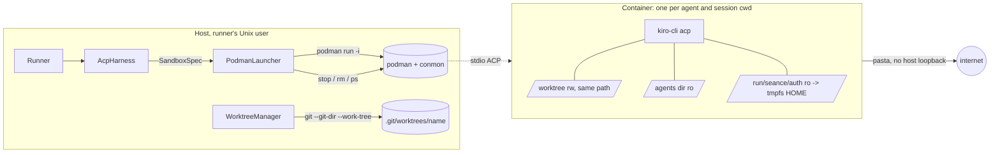
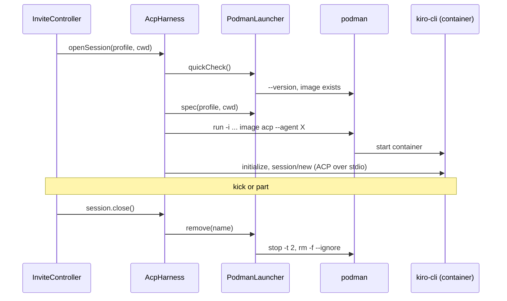

# Design Document

## Overview

In podman mode the runner starts every agent as `podman run -i ... <image> acp --agent <name>` instead of `kiro-cli acp --agent <name>` on the host. The ACP client does not change: it already spawns a command, speaks JSON-RPC on the child's stdio and kills the child's process group. What changes is what the command is, how many processes there are, and how they are cleaned up.



### Sources read

| Source | Used for |
|---|---|
| `apps/runner/src/harness/spawn.ts`, `acp-harness.ts`, `harness.ts`, `acp/client.ts` | spawn spec, per-agent process map, kill by process group, stderr capture |
| `apps/runner/src/runner.ts`, `config.ts`, `child-env.ts`, `invite/invite-controller.ts`, `exorcism/exorcism.ts` | wiring, validation style, env allow-list, failure path, session close |
| `apps/runner/src/worktree/worktree-manager.ts`, `git.ts` | how the host runs git inside agent-writable directories |
| `apps/ircd/src/index.ts`, `README.md` runner table | where `IRCD_PUBLIC` and the new variables belong |
| `spikes/acp/FINDINGS.md` (S8, S9, S11) | agent files resolve from the process cwd; permission paths |
| passt manual (`--map-host-loopback`, `--no-map-gw`) | the default maps the gateway to the host loopback unless told not to |
| Kiro docs and community notes | Linux login state lives under `~/.local/share/kiro-cli/`; refreshed tokens may stay in memory only (issue 4847); API keys exist for headless use |
| Local host | `podman` is not installed on the development Mac, so nothing here was executed |
| `apps/runner/test/fixtures/fake-agent.ts`, `fake-kiro` and `apps/ircd/test/runner/integration.ts` | how the Fake_Agent is launched and scripted, and which test helpers exist for the real-Podman suite |
| `apps/runner/src/index.ts` | what the ircd can import from `@seance/runner` |

## Architecture

### Trust zones

- **Host zone:** the Runner, the Ircd and `podman` run as one unprivileged Unix user. They own all IRC state, all git calls and the container lifecycle.
- **Container zone:** one `kiro-cli acp` process per (agent, session directory), non-root, no capabilities, read-only root, three bind mounts and two tmpfs.
- **Control path:** ACP JSON-RPC over the stdio of `podman run -i`. The Runner starts, stops and removes containers by name; it never relies on killing the `podman run` client alone.
- **Data path out of the container:** the worktree files (host git calls treat them as untrusted, see D4), ACP frames (validated at the existing boundary), and the network (pasta, no host loopback).

### Lifecycle



Any failure before `session/new` returns raises a `SandboxError`; the invite pipeline notifies the Human_Ops and cleans up as for other pipeline failures (R11).

## Decisions

| # | Decision | Why |
|---|---|---|
| D1 | One container per (agent, Session_Cwd). `AcpHarness` keys processes by `nick` in `none` mode and by `nick\0cwd` in podman mode. | A container's mounts are fixed at start. One container for all channels of an agent would need all worktrees mounted, which defeats the isolation. Cost: a 2 to 3 s process start per channel (spike S1), inside the 30 s `session/new` budget. |
| D2 | Three bind mounts, always: worktree rw, agents dir ro, auth ro. Plus tmpfs for `/tmp` and `$HOME`. | The brief asks for the worktree and auth. The agents dir is the one addition, forced by S8. It holds profiles (prompts, tool lists) and no secrets. |
| D3 | No git metadata in the container. | Mounting `.git/worktrees/<name>`, `objects/` or `refs/` exposes state shared by other channels, and `config.worktree` is read by the host's git. A single-file mount of a ref cannot work (git replaces refs by rename). Cost: no `git commit` inside the sandbox; the runner commits on the host instead (D17). |
| D4 | Host git calls use `--git-dir`/`--work-tree` recorded from the repository side, and `.git` is verified and restored before every prompt. | With the worktree writable from a container, the `.git` file is attacker-controlled input. Without D4 the escape is: rewrite `.git`, wait for the runner's next `git status`, get code execution through `core.fsmonitor` as the runner user. |
| D5 | The auth dir is mounted at `/run/seance/auth` and copied into tmpfs `$HOME` by the image entrypoint. | A direct read-only mount of an SQLite login database can fail (journal files) and token refresh cannot persist anyway (issue 4847). Staging works with both, and nothing returns to the host. |
| D6 | `--network=pasta:--no-map-gw,--ipv4-only`. The metadata endpoint, the VPC and non-allow-listed destinations are blocked by a host nftables rule on the runner's Unix user (D19); a Probe verifies them at every boot. | Rootless Podman has no destination filter. Pasta makes outbound connections from the host side, so a hop-limit trick does not help; only a host rule matched by user does. The Probe makes a missing rule a boot failure on a cloud VM. |
| D7 | Container identity: name `seance-<nick>-<hash>-<rand>` and three labels; stop/remove by name; sweep by label at start and shutdown; `--timeout` as a backstop. | Killing the `podman run` client is not enough (SIGKILL leaves the container). Names make removal precise, labels make a crash recoverable, the timeout ends orphans even when the runner never returns. |
| D8 | Preflight at `start()` plus cheap re-checks before every start; no fallback to host processes, ever. | Fail closed (brief). A podman removed after boot must not turn into a host spawn. |
| D9 | Mounts use `--mount type=bind,...`, not `-v`; paths with `,` `"` NUL CR LF are refused. | `--mount` is a CSV list, so a comma in a path would inject options. `-v` would hide that behind colon parsing. |
| D10 | Values never travel in argv: `-e NAME` only. | Keeps values out of `ps` and logs. `KIRO_API_KEY` is not forwarded at all (D18). |
| D11 | `--http-proxy=false`, `--no-hosts`, `--log-driver=none`, `--pull=never`. | Podman forwards host proxy variables by default; `/etc/hosts` leaks host names; the default log driver would store ACP traffic on disk; a pull at start is a supply-chain and latency risk. |
| D12 | Podman 5 or newer, Linux, rootless only. | Pasta is the default network from 5.0; `keep-id:uid=,gid=` needs 4.3 or newer. |
| D13 | Headless harness is refused in podman mode. | One process per prompt with no stable cwd; not worth a second sandbox path. |
| D14 | Every Podman spelling that may differ between versions lives in `apps/runner/src/sandbox/flags.ts` (mount option names, network value, userns value, tmpfs options). | Spike S12 cannot run on the development Mac. If a spelling is wrong, the fix is one file, and tests that compare to `flags.ts` constants stay valid. |
| D15 | A changed `.git` file is reported through the existing guard result: `guardBeforePrompt` returns `{ ok: false, paths: [".git"] }` after it restored the file and reset the worktree. | The Session already turns a failed guard into a dropped prompt and an ops notice, so no new notification path is added. |
| D16 | Host-only steps (running the spike scripts, the real-Podman suite, loading the nftables template, the VPS kick check) are operator steps listed in the Notes of `tasks.md`, not coding tasks. Spike S12 is task 0.4, marked "run on EC2", and no task depends on it. | They need a Linux host with Podman 5 and, for the nftables check, a cloud VM; the repository ships the scripts, the template and the tests. |
| D17 | Host-side commit after each `end_turn` of a `+o` agent in podman mode (Open Point 1, decision 1). `Session` gets an optional async `afterTurn` hook that runs between the end of `session/prompt` and `turn-ended`; `TurnCommitter` checks the mode and calls `WorktreeManager.commitTurn`, which uses the hardened git of D4 with hooks and signing off. | The agent keeps no git metadata (D3), yet Journey A's "coder commits" still works. Running inside the turn keeps the next prompt out until the commit is done, and only the runner's own git, with config it controls, touches the repository. Option C (a commit command for Human_Ops) stays a later spec. |
| D18 | The Kiro credential is only the read-only Auth_Dir mount (decision 2). `SEANCE_SANDBOX_AUTH_DIR` is required in podman mode; `KIRO_API_KEY` is never forwarded and never put in the `podman` process environment. | An environment variable is visible to every process in the container and to `podman inspect`; a staged copy in tmpfs is not. The agent can still read the staged files, which `docs/SANDBOX.md` names as the residual exfiltration risk. |
| D19 | Egress default deny on the host for the runner's user: DNS to the resolver, TCP 443 to an address set built from `sandbox/egress-allow.txt`, loopback for the runner's own services; `169.254.0.0/16` and the VPC CIDR dropped first (decision 3). In a public deployment the Probe also tries `SEANCE_SANDBOX_EGRESS_PROBES` (default `1.1.1.1:443`). | nftables filters addresses, so names are resolved by `seance-egress-refresh` on a timer. The Probe turns a missing default-deny rule into a boot failure on the public host without making podman mode unusable on a developer's Linux box. |
| D20 | `SEANCE_SANDBOX_IMAGE` must be `name@sha256:<digest>`; the image is built from `sandbox/Dockerfile`, whose `FROM` is pinned by digest (decision 5). | A tag can move; a digest cannot. `podman image inspect --format '{{.Digest}}'` gives the digest of a locally built image. |
| D23 | Node 26 and npm come into `sandbox/Dockerfile` by `COPY --from` a `node:26-bookworm-slim` stage pinned by the test image's digest; only `node` and the npm files (with `npx`) are copied, then the setuid strip runs (Node 25 and later images ship no corepack, so there is none to copy; task 21.3); npm is set offline with its cache in the tmpfs `$HOME` (Requirement 16, task 21). | `npm test` must run in the sandbox (demo blocker 2026-11-10). The same digest is already pulled by `deploy/bootstrap.sh`, a copy installs nothing from the network, and both images are bookworm, so the binary finds the same libraries. |
| D24 | The coder's instructions carry one mode-neutral git rule (Requirement 17): commit with git as usual; "not a git repository" means the Podman sandbox, where the runner commits after the turn. No runner code change, and the WHOIS `tools:` text stays as it is. | Production always runs podman, but `none` mode must keep committing through the agent (14.8). A rule the agent can apply from git's own message works in both modes without the runner templating the prompt. |
| D21 | Bind mounts carry `relabel=shared` (`:z`), except the private session directory, which carries `relabel=private` (`:Z`) (decision 6). | `:Z` gives the path a label private to one container; a second agent of the same channel, or any other container mounting the agents or auth directory, would then be denied. The spellings live in `flags.ts`. |

## Components and Interfaces

### Config (`apps/runner/src/config.ts`)

```ts
export type SandboxMode = "none" | "podman";
export interface PodmanSandboxConfig {
  readonly mode: "podman";
  readonly podmanBin: string;
  readonly image: string;       // name@sha256:<64 hex> (D20)
  readonly authDir: string;     // required (D18)
  readonly memory: string;      // e.g. "2g"
  readonly cpus: string;        // e.g. "2"
  readonly pids: number;
  readonly timeoutS: number;
  readonly kiroBin: string;     // command inside the image
  readonly egressProbes: readonly string[]; // "ip:port", Probe targets in a public deployment (D19)
}
export type SandboxConfig = { readonly mode: "none" } | PodmanSandboxConfig;
// RunnerConfig gains: readonly sandbox: SandboxConfig
```

`loadRunnerConfig` logs once that `SEANCE_KIRO_BIN` is ignored in podman mode.

`loadRunnerConfig` parses and validates (Requirement 1). `validateRunnerPaths` realpaths the auth dir and checks it is a directory.

### Production guard

```ts
// apps/runner/src/sandbox/guard.ts (pure)
export function assertSandboxForPublic(o: { public: boolean; runnerEnabled: boolean; sandbox: SandboxMode }): void;
```

`apps/ircd/src/index.ts` parses `IRCD_PUBLIC`, calls the guard before it opens a listener, and passes `publicDeployment` to `createRunner`, which calls the guard again in `start()`.

`assertSandboxForPublic`, `SandboxError` and `SandboxMode` are exported from `apps/runner/src/index.ts`, so `apps/ircd/src/index.ts` imports them from `@seance/runner`. `IRCD_PUBLIC` accepts unset, empty, `0` and `1`; any other value stops startup with a message naming the variable.

### Pinned flags (`apps/runner/src/sandbox/flags.ts`)

The file exports constants only (for example `MOUNT_RO`, `MOUNT_RW`, `MOUNT_NOSUID`, `MOUNT_NODEV`, `MOUNT_PROPAGATION`, `NETWORK`, `USERNS`, `TMPFS_TMP`, `TMPFS_HOME`). Their initial values are those of "The generated command". `podman-args.ts`, the launcher and the tests import them, and it is the only file edited after spike S12.

### Argument builder (`apps/runner/src/sandbox/podman-args.ts`, pure)

```ts
export interface PodmanRunInput {
  readonly config: PodmanSandboxConfig;
  readonly agentsDir: string;       // realpath
  readonly sessionCwd: string;      // realpath, inside the worktree root
  readonly worktreeRoot: string;    // realpath
  readonly containerName: string;
  readonly labels: { workspaces: string; agent: string };
  readonly kiroAgent: string;
  readonly forwardEnv: readonly string[];   // names only
}
export function buildPodmanRunArgs(i: PodmanRunInput): readonly string[]; // throws SandboxError("invalid-input")
```

It validates every string (no `,` `"` NUL CR LF in paths; `kiroAgent` pattern; env names `^[A-Z_][A-Z0-9_]*$` and in the allowed set), then emits the fixed flag list of Requirement 4 in a fixed order, using the constants of `flags.ts`. Nothing is built by string concatenation of untrusted text outside a `--mount` value or the final `--agent` value.

### Launcher (`apps/runner/src/sandbox/launcher.ts`)

```ts
export interface PodmanExec { run(bin: string, args: readonly string[], env: Env): Promise<{ code: number; stdout: string; stderr: string }>; }

export class PodmanLauncher {
  constructor(o: { config: PodmanSandboxConfig; agentsDir: string; worktreeRoot: string;
                   publicDeployment: boolean; exec?: PodmanExec; logger: RunnerLogger; random?: () => string });
  preflight(): Promise<void>;                        // R3, incl. Probe with an ephemeral host loopback listener, always closed
  quickCheck(): Promise<void>;                       // R3.5: version and image checks only
  spec(profile, sessionCwd, env): Promise<SandboxSpec>; // { command, args, cwd, env, containerName }
  remove(containerName: string): Promise<void>;     // stop -t 2, then rm -f --ignore; a failure is remembered for the next sweep
  sweep(): Promise<number>;                          // ps -a -q --filter labels, rm -f each, plus remembered names
}
```

`PodmanExec` defaults to `execFile` with the allow-listed environment; tests inject the fake. `SandboxSpec` extends `SpawnSpec` with `containerName`, so `AcpClient` is untouched.

- `remove` stops with `stop -t 2`, then runs `rm -f --ignore`. A removal that fails is remembered in a set and retried by the next `sweep`.
- Outside the label sweep, only names created in this run are removed.
- `quickCheck` re-runs the version and image checks only.
- `preflight` opens an ephemeral listener on the host's `127.0.0.1`, runs the Probe with that port (and, when `publicDeployment`, the egress probe targets) and always closes the listener.

### Host-side commit (`apps/runner/src/worktree/turn-committer.ts`, D17)

```ts
// WorktreeManager
commitTurn(channel: string, agent: string): Promise<
  | { readonly kind: "committed"; readonly sha: string; readonly files: number }
  | { readonly kind: "clean" }
  | { readonly kind: "refused"; readonly paths: readonly string[] }>;

// turn-committer.ts
export function createTurnCommitter(d: {
  host: Pick<IrcHost, "modeOf">; worktrees: Pick<WorktreeManager, "commitTurn">;
  logger: RunnerLogger; chanServ?: (channel: string, text: string) => void;
  opNotice: (channel: string, text: string) => void;
}): (agent: string, channel: string) => Promise<void>;   // never rejects
```

- `Session` gains `SessionDeps.afterTurn?: () => Promise<void>`. `#sendPrompt` awaits it only for `end_turn`, while the model is `prompting` and not `closing`, then posts `turn-ended`. A `send-cancel` effect while it runs sends nothing (the turn is over).
- `buildChannelSession` passes `afterTurn` when `ChannelSessionDeps.commitTurn` is set; `runner.ts` sets it only in podman mode. Private sessions never get it.
- `commitTurn` runs under the git mutex: `scanConfig` (hit → `refused`), `status --porcelain=v1 -z --untracked-files=all` (empty → `clean`), `add --all`, `commit` with the options of Requirement 14.2, `rev-parse --short=7 HEAD`. All through the hardened prefix of D4.

### Spawn and harness

- `spawn.ts`: `buildSandboxSpawnSpec` is a thin call to `launcher.spec`. Process env is `allowListedEnv(base)` plus `XDG_RUNTIME_DIR` plus the forwarded names; `extraEnv` names are forwarded by name.
- `acp-harness.ts`: `AcpHarnessOptions.sandbox?: PodmanLauncher`. `ensureProc(profile, cwd)` uses key `nick` (none) or `nick\0cwd` (podman). `Proc` gains `containerName?: string`. `openSession` calls `launcher.quickCheck()` first in podman mode and maps start failures to `SandboxError`. `AcpSession.close()` in podman mode terminates its process and awaits `launcher.remove(name)`. `onExit` always calls `remove` for a podman proc (idempotent). `terminate(profile)` iterates all procs of the agent. `dispose()` ends with `launcher.sweep()`.
- `runner.ts` passes `hardened: config.sandbox.mode === "podman"` to `WorktreeManager` and `publicDeployment` to the guard.
- `ProcessEvent`, `HarnessSession`, `AgentHarness` do not change.

### Runner and invite failure path

- `runner.ts` builds the launcher when `config.sandbox.mode === "podman"`, runs `preflight()` then `sweep()` in `setup()` before the first subscription, and `sweep()` in the shutdown sequence after the harness is disposed.
- `invite-controller.ts` and `reviveSession`: a `SandboxError` thrown by `openSession` is turned into the notice of Requirement 11 through the existing `notifyOps` and then rethrown as `StepError("session/new")`, so the existing cleanup (part, release the Invite_Key) runs unchanged.
- `exorcism.ts`: `closeHarnessSession(session)` already awaits the harness session close, which now removes the container (R10.1). A removal error is thrown into the existing `try/catch`, which logs it; the exorcism adds an ops notice for it.

### Worktree manager (host git hardening)

- `WorktreeManagerOptions.hardened: boolean` (true in podman mode).
- On create or first reuse, record `gitDir` per worktree from `git -C <repo> worktree list --porcelain`.
- A private `#git(realPath, args)` helper replaces the `["-C", realPath, ...]` prefixes. When hardened it emits `["--git-dir=<gitDir>", "--work-tree=<realPath>", ...]`, and `createGitRunner(repo, { hardened })` adds `GIT_CONFIG_GLOBAL=/dev/null` and `GIT_CONFIG_SYSTEM=/dev/null` to the environment when `hardened` is true.
- `guardBeforePrompt` first reads the `.git` file with `lstat` + `readFile`. On a mismatch it rewrites the file via a temp file and `rename` (no symlink follow), resets the worktree and returns `{ ok: false, paths: [".git"] }`, which the existing notification path reports (D15).

### Image (`sandbox/`, shipped in the repo)

- `sandbox/Dockerfile`: a `node` stage `FROM docker.io/library/node:26-bookworm-slim@sha256:<digest> AS node` and the image `FROM docker.io/library/debian:bookworm-slim@sha256:<digest>` (D20), `useradd -u 10001 agent`, `node` and the npm files copied from the `node` stage with the `npm` and `npx` links recreated (D23; no corepack, which Node 25+ images do not ship), `kiro-cli` binary copied from the build context, `seance-entry`, `seance-probe`, `nc` from netcat-openbsd, the setuid strip after the last copy, npm offline settings, `USER 10001`, `ENTRYPOINT ["/usr/local/bin/seance-entry"]`.
- `seance-entry`: if `/run/seance/auth` exists, `cp -a /run/seance/auth/. "$HOME/.local/share/kiro-cli/"`; then `exec "${SEANCE_KIRO_BIN:-kiro-cli}" "$@"`.
- `seance-probe <port> [ip:port ...]`: reads the default gateway from `/proc/net/route`; exit `10` if `<gateway>:<port>` connects, `11` if `169.254.169.254:80` connects, `13` if any extra target connects, `12` if `nc` is missing, `0` otherwise.
- `sandbox/seance-sandbox.nft`: the nftables template of D19 with placeholders `@RUNNER_USER@`, `@VPC_CIDR@`, `@RESOLVER@` and the empty set `seance_allow4`. Loaded by the operator, never by the runner.
- `sandbox/egress-allow.txt` and `sandbox/seance-egress-refresh`: the host names of the allow-list and the POSIX sh script that resolves them (`getent ahostsv4`) and replaces the set's elements in one `nft -f` transaction.
- Test image (`apps/runner/test/fixtures/sandbox/Dockerfile`): node base pinned by digest, `fake-agent.ts` and `fake-kiro` baked in, `kiro-cli` symlink, same entry and probe.

## The generated command

```
podman run -i --rm --name=seance-coder-1a2b3c4d-9f8e7d6c
  --label=io.seance.sandbox=1 --label=io.seance.workspaces=<16 hex> --label=io.seance.agent=coder
  --read-only --cap-drop=ALL --security-opt=no-new-privileges
  --pids-limit=256 --memory=2g --memory-swap=2g --cpus=2
  --user=10001:10001 --userns=keep-id:uid=10001,gid=10001
  --pull=never --http-proxy=false --no-hosts --log-driver=none
  --timeout=86400 --stop-timeout=2 --hostname=seance-agent
  --network=pasta:--no-map-gw,--ipv4-only
  --tmpfs=/tmp:rw,nosuid,nodev,noexec,size=256m
  --tmpfs=/home/agent:rw,nosuid,nodev,noexec,size=256m,U   # U: spike S12, owned by the keep-id user
  --mount=type=bind,src=<wt>,dst=<wt>,rw,bind-propagation=rprivate,nosuid,nodev,relabel=shared   # see note
  --mount=type=bind,src=<agents>,dst=<agents>,ro,bind-propagation=rprivate,nosuid,nodev,relabel=shared
  --mount=type=bind,src=<auth>,dst=/run/seance/auth,ro,bind-propagation=rprivate,nosuid,nodev,relabel=shared
  -e HOME=/home/agent -e TMPDIR=/tmp -e LANG -e TERM
  --workdir=<agents>
  <image>@sha256:<digest> acp --agent coder
```

For a private session the first mount ends in `relabel=private` instead (D21). `KIRO_API_KEY` never appears (D18).

Note: the option spellings in the `--mount`, `--tmpfs` and `--network` lines are the initial values of `flags.ts`. In a Podman `--mount` list the read-only option may need to be written `ro=true`. Spike S12 fixes the spelling against the installed Podman, and only `flags.ts` and `docs/SANDBOX.md` change. Constant environment values (`HOME`, `TMPDIR`) are literal `-e NAME=value` pairs; they are not host values.

## Data Models

Nothing is persisted. All state is in memory in the Runner process or in labels on containers.

```ts
export type SandboxErrorKind =
  | "podman-missing" | "podman-version" | "not-rootless" | "image-missing"
  | "auth-missing" | "probe-failed" | "invalid-input" | "start-failed" | "start-timeout";

export interface SandboxSpec extends SpawnSpec {
  readonly containerName: string;   // seance-<nick>-<8 hex of sha256(cwd)>-<8 random hex>
}

export interface ContainerRecord {   // in memory, one per live podman Proc
  readonly name: string;
  readonly agent: string;            // irc_lower(nick)
  readonly cwdKey: string;           // realpath of the session directory
  state: "starting" | "running" | "removing";
}
```

| Item | Where | Notes |
|---|---|---|
| Retry set | `PodmanLauncher`, `Set<string>` of container names whose removal failed | emptied by `sweep` |
| Labels | on the container | `io.seance.sandbox=1`, `io.seance.workspaces=<16 hex of sha256(Worktree_Root)>`, `io.seance.agent=<nick>` |
| Notice reasons | fixed table in `sandbox-notices.ts` | `podman not found`, `podman too old (need 5 or newer)`, `podman is not rootless`, `sandbox image not found`, `container failed to start`, `container start timed out`, `network isolation check failed` |
| Recorded git dir | `WorktreeManager`, `Map<channel key, string>` | read from the repository side, never from the worktree |

## Correctness Properties

All property tests use fast-check, at least 100 runs, named after the property ID.

### Property 1: Argv invariants

For any valid input, the argv contains each required flag exactly once; exactly three bind mounts, each with one relabel option (`private` for a private session directory, `shared` otherwise); mount sources and destinations equal the inputs; the element after the last flag is the image; what follows is exactly `acp --agent <kiroAgent>`; none of the forbidden flags of R4.2 occurs; no element contains NUL.

**Validates: Requirements 4.1, 4.2, 4.4, 5.1, 5.2**

### Property 2: No extra mounts, ever

For any input (including paths with spaces, `=`, `:` and a leading `-`), the multiset of `--mount` values is exactly the allowed set. Inputs with `,` `"` NUL CR LF in a path throw `SandboxError("invalid-input")` and produce no argv.

**Validates: Requirements 1.5, 5.1, 5.2, 5.3, 5.4**

### Property 3: Environment

Every `-e` element is `NAME` with `NAME` in the allowed set, or one of the two constant pairs; `KIRO_API_KEY` is never one of them, even when the input asks to forward it (it throws). For a random secret `KIRO_API_KEY` in the base environment, the secret does not occur in any argv element, in the `podman` process environment, in the `SandboxError` messages produced from that input, or in the notice text.

**Validates: Requirements 6.1, 6.2, 6.4**

### Property 4: Injection resistance

For arbitrary `kiroAgent`, nick and channel strings, every argv element that starts with `-` belongs to the fixed flag list or to the fixed `--agent`; an invalid `kiroAgent` throws.

**Validates: Requirements 4.4, 4.5**

### Property 5: Lifecycle model

Random sequences of open, close, kick, exit, hung and ban over the fake podman never leave a container that has no open session once the sequence is quiescent, and `dispose()` leaves none. A model counts expected containers per (agent, cwd).

**Validates: Requirements 8.1, 8.2, 10.1, 10.2, 10.4, 10.7**

### Property 6: Fail closed

For any injected failure (podman missing, bad version, not rootless, image missing, probe exit code, run exit 125/126/127, timeout), `openSession` rejects with a `SandboxError`, the fake records zero `run` calls that reached the Fake_Agent, and no host process is spawned.

**Validates: Requirements 3.6, 8.4, 11.1, 11.3**

## Error handling

| Failure | Behaviour |
|---|---|
| podman missing at boot | `start()` rejects (`podman-missing`); Ircd exits 1 |
| podman removed after boot | quick check fails; the invite gets the notice; no spawn |
| image missing | same, reason `sandbox image not found` |
| `podman run` exits 125, 126, 127 before `initialize` | `container failed to start` plus the last stderr line |
| `initialize` does not answer within the open budget | process killed, container removed, `container start timed out` |
| `podman rm` fails | logged, Human_Ops notified once, retried at the next sweep; exorcism reports the problem |
| Probe fails at boot | `start()` rejects (`probe-failed`) naming which check (loopback or metadata) |
| `IRCD_PUBLIC=1` without podman | exit 1 before any listener |
| `.git` file changed by the agent | notice to Human_Ops, file restored, worktree reset |
| Container ends by `--timeout` | treated as an exited process (`ProcessEvent` `exited`); the session revives on the next message through `reviveSession` |
| Container removal fails twice | the name stays in the retry set until a sweep removes it; the Human_Ops were notified once |

## Testing strategy

- **Unit:** `podman-args.test.ts`, `sandbox-config.test.ts`, `guard.test.ts`, `sandbox-paths.test.ts`, `sandbox-notices.test.ts`, a hardened-git test in `worktree-hardening.test.ts` (R9.5), `turn-commit.test.ts` against a temporary repository (R14, R12.7), and `sandbox-files.test.ts` for the digest pins and the probe and nft files (R12.8).
- **Property:** `podman-args.property.test.ts` (P1 to P4), `sandbox-lifecycle.property.test.ts` (P5, P6).
- **Fake podman:** `apps/runner/test/fixtures/fake-podman` (sh) records every call to a file and implements the subcommands of R12.3 with switches for: missing binary, old version, not rootless, missing image, probe exit codes 10 and 11, run exit 125, 126 and 127, slow start, and `rm` failure. Used by `sandbox-harness.test.ts` (kick removes the container, two channels give two containers, hung agent, process exit, `--timeout` exit and revival, failure notices, cleanup after a failed start) and by the launcher unit tests.
- **Integration (real Podman):** `apps/ircd/test/runner/sandbox.integration.test.ts`, guarded by `it.skipIf(!podmanAvailable)` with `podmanAvailable` computed once from `podman info`. Skipped runs print the reason. Needs the runner built first (`pnpm --filter @seance/runner build`) because ircd tests import it from `dist`.
- **Not tested here:** the nftables rule itself (host configuration). The Probe test only checks that the script exits `0` in a container without a cloud endpoint, and non-zero against a listener the test opens and maps (via a test-only `--map-gw` run).
- **Operator verification** (not code): the steps of the Notes in `tasks.md`; results go to `spikes/acp/FINDINGS.md` section S12.

## Open Points

All six were decided by the user on 2026-11-08; the decisions are recorded in `requirements.md` and in D16 to D21.

1. **Commits inside the sandbox.** Decided: no git inside the container; the runner commits on the host after each `end_turn` of a `+o` agent (option D with a host-side commit, D17, Requirement 14). Option C (a commit command for Human_Ops) is a later spec. Rejected earlier: (A) mounting git paths (D3, finding 4) and (B) a clone per channel.
2. **Credential exposure.** Decided: read-only mount only, never in an environment (D18). Residual risk, documented in `docs/SANDBOX.md`: the agent can read the staged credential and send it to an allowed host. Use a dedicated low-privilege login for the public host and rotate it after the event.
3. **Egress.** Decided: host default deny with `169.254.169.254` and the VPC CIDR dropped and HTTPS allowed only to the Kiro endpoints and package registries (D19, Requirement 7.3 to 7.8).
4. **Spike S12.** Decided: kept as task 0.4, marked "run on EC2", blocking nothing. The scripts (`s12-podman.ts`, `s12-kiro-auth.ts`) check pasta option syntax, `keep-id` syntax, `--mount` option spelling including `relabel`, `--timeout`, `--http-proxy=false`, kiro-cli with staged auth under a read-only root and stop/remove timing. Results go to `spikes/acp/FINDINGS.md` and may change spellings in `flags.ts`, not the design.
5. **Image supply.** Decided: `sandbox/Dockerfile` in the repository, base pinned by digest, runtime reference pinned by digest (D20). Still open for the operator: the `kiro-cli` binary is added to the build context by hand; its redistribution terms are not checked here.
6. **SELinux.** Decided: enforcing hosts are supported with relabelled mounts (D21). `:Z` is used only where one container mounts the path; shared paths take `:z` (finding 8). Verified only by the argv tests here; a run on an enforcing host is part of task 0.4.
