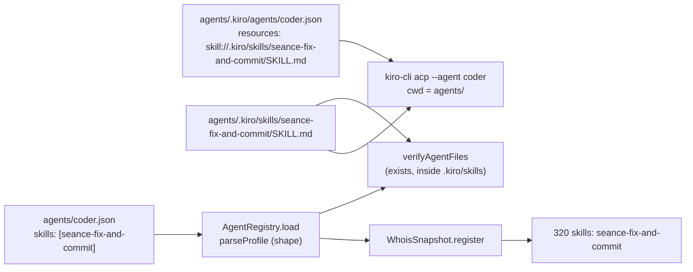

# Design Document: agent-skills

## Overview

Each Séance agent gets one Kiro skill, configured only in the repository's `agents/` directory. The runner learns the skill names from the profile, checks at startup that the files exist inside `agents/.kiro/skills`, and shows them in `WHOIS`. `kiro-cli` loads the skills through the agent config's `resources`. No ircd protocol change other than one new `320` text line; no web change.

| Piece | Where |
|---|---|
| Skills | `agents/.kiro/skills/{seance-fix-and-commit,seance-review-checklist,seance-cite-sources}/SKILL.md` |
| Kiro wiring | `resources` of `agents/.kiro/agents/{coder,reviewer,researcher}.json` |
| Registry | `skills` in `agents/*.json`; `parseProfile` in `apps/runner/src/registry/agent-profile.ts` |
| Startup check | `verifyAgentFiles` in `apps/runner/src/registry/verify-agent-files.ts` |
| WHOIS | `WhoisSnapshot.register` and `renderWhois` in `apps/runner/src/whois/` |

## Step 0: kiro-cli 3.1 skill syntax (spike result)

Sources: the Kiro agent configuration reference (kiro.dev, fetched as Markdown), the Kiro CLI docs through Context7, `kiro-cli agent validate` on throw-away configs (no prompts, no credits), and a static look at strings in the 3.1.0 binary.

| Question | Answer | How it was established |
|---|---|---|
| Are skills supported in `resources`? | Yes: a string starting with `skill://`. Only metadata (`name`, `description` from YAML front matter) loads at start; the body loads on demand | Configuration reference "Skill resources"; Context7 "Resources use URI schemes"; `agent validate` rejects `bogus://x` with "resource must start with file:// or skill://" and a number with "resource must be a string (file:// or skill://) or an object" |
| Exact syntax | `"skill://<path to SKILL.md>"`, for example `"skill://.kiro/skills/backend/SKILL.md"` | Configuration reference examples |
| Globs | Supported: `skill://.kiro/skills/**/SKILL.md`. The 3.1 binary's built-in default agent resources are `skill://.kiro/skills/*/SKILL.md` and `file://AmazonQ.md` | Reference ("Both support specific paths and glob patterns"); binary strings near `DEFAULT_AGENT_RESOURCES` |
| Relative to what? | The process cwd. The reference says "absolute or relative paths" without naming the base; its examples and the built-in defaults only fit cwd-relative, and the real journey `#skill-1` (task 5.3) confirmed it | Documentation, binary strings, then one real journey |
| Does `agent validate` check that the path exists? | No. A config naming `skill://.kiro/skills/nope/SKILL.md` validates with exit 0 | `agent validate` probe |

Decision: each config lists one exact, cwd-relative path, `skill://.kiro/skills/<name>/SKILL.md`. The runner's cwd for `kiro-cli` is `agents/` in both modes (`spawn.ts` and `--workdir=<agentsDir>` in podman mode), so the path names `agents/.kiro/skills/<name>/SKILL.md`. No globs, so an agent cannot pick up another agent's skill through its own resources. Because `agent validate` does not check existence, the runner's startup check and the consistency test are the only existence checks. `file://` is not needed.

## Architecture



The profile and the Kiro config name the same skill in two places on purpose: the runner never parses Kiro configs at runtime, and Kiro never reads Séance profiles. The consistency test ties them together.

## Components and Interfaces

- `AgentProfile.skills?: readonly string[]`. `parseProfile` always returns a list (`[]` when absent). It is optional in the type so profiles built in code (tests, private sessions) stay valid. `SKILL_NAME = /^[a-z0-9-]{1,40}$/`, `MAX_SKILLS = 8`. Errors: "must be an array of skill names", "must list at most 8 skills", "entry <value> must match ...", "lists "<name>" twice"; the shown value is clipped to 60 characters.
- `AgentSkillMissingError(profileFile, skill, expectedPath, detail)` from `verifyAgentFiles`, after the existing Kiro agent file check. Details: "cannot be read (...)", "is not a regular file", "resolves outside <skillsRoot>". It uses `realpath`, so a symlink cannot lead a skill out of the agents directory.
- `WhoisSnapshot.register(nick, { model, tools, skills? })` stores a copy of the list. `renderWhois` adds `skills: <names>` after `tools:` when the list is non-empty. `skillsLine` keeps whole names within `WHOIS_LINE_MAX_BYTES` (300) and ends with `, +N more` when they do not fit (eight 40-character names make 342 bytes).
- `InviteController` passes `profile.skills` at registration.
- Web: `reducer.whois.ts` collects every `320` text into `whois.special` and `WhoisLines` renders each with `IrcText`, matching no keys. No change.

### Reviewer and git

The reviewer's Kiro config has `tools: ["read"]` and no shell, and the runner rejects shell for a `+v` agent. In practice the reviewer therefore never runs `git diff HEAD~1`; the skill says to use it only when a shell tool and git work, and otherwise to review the files named in the request (or ask for them). Giving the reviewer a shell tool would widen its capabilities and is not part of this spec.

## Data Models

```jsonc
// agents/coder.json (Séance profile)
{ "nick": "coder", "kiroAgent": "coder", "model": "sonnet-5.5", "tools": "fs, git, shell(sandbox)", "color": 12,
  "skills": ["seance-fix-and-commit"] }
// agents/.kiro/agents/coder.json (Kiro agent config, excerpt)
{ "resources": ["skill://.kiro/skills/seance-fix-and-commit/SKILL.md"] }
```

```markdown
---
name: seance-fix-and-commit
description: How the coder fixes a bug and commits it in a Séance channel worktree. Use for any task that asks to fix, change or commit code.
---
```

## Correctness Properties

### Property 1: The skills line never exceeds the budget and never cuts a name

For any list of 1 to 8 distinct valid names, the `skills:` line is at most 300 bytes, and the shown names are a prefix of the list, each whole.

**Validates: Requirements 3.1, 3.2**

## Error Handling

- Invalid `skills` value: the profile is rejected and logged with file and field `skills`; other profiles still load (existing behaviour for every field). If no profile remains, `NoAgentProfileError` stops the start.
- Unknown skill, a directory instead of a file, or a symlink out of `.kiro/skills`: `AgentSkillMissingError`, the runner does not start (like `AgentFileMissingError`).
- A broken `skill://` path in a Kiro config cannot be caught by `kiro-cli agent validate`; the consistency test catches it in CI.

## Testing Strategy

- `apps/runner/test/agent-skills.test.ts`: field validation table (type, count, pattern, duplicates, clipping), registry skip and log, startup check (missing, directory, symlink escape, no skills), WHOIS line present, absent, copied, over-budget, and the property `P1`.
- `apps/runner/test/agent-skills-consistency.test.ts`: the committed `agents/` tree (Requirement 4) plus line limit, host paths, secrets and the trademark (built from fragments).
- `apps/ircd/test/runner/credits.integration.test.ts`: WHOIS of the fake-agent coder shows `skills: seance-fix-and-commit` right after the tools line.
- Existing tests unchanged.

## Open Points

Open Points 1 to 3 are closed by the real kiro-cli journey `#skill-1` (task 5.3, 2026-11-08): 11/11 checks passed, 0.36 credits. The coder answered in a 3-line report, committed `fix: handle null email in login`, and WHOIS showed `skills: seance-fix-and-commit`.

1. **Path base: closed.** `skill://` paths resolve relative to the process cwd (`agents/`), as configured; no change to the configs.
2. **Workspace auto-discovery: closed.** The coder worked with its own skill, as configured. The journey did not check whether the other agents also see this skill's description; that would be harmless (the skills are role-specific) and needs no change.
3. **Loading the body: closed.** The coder followed instructions that exist only in the skill body (the 3-line report and the Conventional Commit message), so the body loaded and no runner rejection blocked it. The permission policy stays unchanged.
4. **Reviewer git.** Still open by design; see "Reviewer and git".
