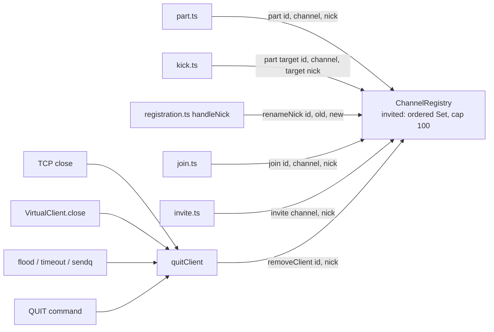

# Design Document

## Overview

Six localized fixes in `apps/ircd` for the review findings listed in `bugfix.md`. No change to `@seance/irc-protocol` or `apps/runner`. New logic is small and pure where possible (`sanitizeWhoisExtra`, `normalizeAway`, `logSocketError`) so it can be tested without sockets.

Two fixes carry real design weight:

- **Invited-set lifecycle (Finding 1).** `ChannelRegistry` becomes the single owner of the invite rules: cap, ordering, removal on leave, quit and rename. Handlers only pass the nick they already know.
- **WHOIS robustness (Finding 2).** The reply list is built into a caller-owned array and `318` is appended after the build, so no failure in the build can drop it.

## Glossary

- **Bug_Condition (C)**: Inputs that trigger one of the six findings; Finding 1 is formalised in `bugfix.md` as `isBugCondition_1`.
- **Property (P)**: The behaviour required for those inputs (Requirements 2.x).
- **Preservation**: Behaviour for all other inputs that must not change (Requirements 3.x).
- **Invited set**: `Channel.invited`, `irc_lower(nick)` keys per channel, insertion-ordered, capped at `INVITED_MAX`.
- **Resolver-claimed nick**: an unconnected nick accepted by `InviteResolver`; its record stays until the nick joins or is evicted.
- **Transient reset**: a socket error with code `ECONNRESET` or `EPIPE`.
- **quitClient**: the single exit path in `handlers/quit.ts` for every way a client disappears.

## Bug Details

### Bug Condition

Six independent conditions, one per finding:

```
FUNCTION isBugCondition(X)
  INPUT: X of type server operation
  OUTPUT: boolean

  RETURN isBugCondition_1(X)   // invited set leaks, grows, or lists a member (see bugfix.md)
      OR (X IS WHOIS AND whoisExtra() throws, is not an array, has non-string elements, or has > 10 strings)
      OR (X IS AWAY AND cleaned text is blank AND raw text is non-empty)
      OR (X IS accepted INVITE)                       // missing event fields; missing 301 when target is away
      OR (X IS source of away.ts, message.ts, registration.ts)  // local numeric/prefixOf copies
      OR (X IS TCP socket error with code IN {ECONNRESET, EPIPE})
END FUNCTION
```

### Examples

- Invite `bob` to `#a`, `bob` quits: `#a.invited` still holds `bob`. Expected: removed.
- 101 invites to one channel: set holds 101 keys. Expected: 100, oldest dropped.
- `whoisExtra: () => undefined`: `WHOIS` sends no `318`. Expected: one `318`, last.
- `AWAY :   `: reply `306` with blank away text. Expected: `305`, away cleared.
- Accepted `INVITE` of an away user: only `341`. Expected: `341` then one `301`.
- Client resets its TCP connection: an `error` log entry. Expected: a `debug` entry.

## Expected Behavior

### Preservation Requirements

**Unchanged Behaviors:**
- `JOIN` removes only the joiner's key; the last leaver deletes the channel and its set.
- Case and rfc1459-equivalent nicks share one entry.
- Resolver claims reply `341`, publish `irc.invite`, send no `INVITE` and stay recorded until join.
- Rejected `INVITE`s send one error and nothing else.
- Valid `whoisExtra` arrays of up to 10 strings, `AWAY` with real text, `PRIVMSG`/`NOTICE` `301` rules.
- All numerics and prefixes are byte-for-byte identical after the refactor.
- Non-transient socket errors still log at error level and destroy the socket.

**Scope:** every input outside the six conditions above is unaffected.

## Hypothesized Root Cause

1. **Registry never touched `invited` on exit**: `part`, `removeClient` and `NICK` handling ignore it, and `invite` uses a bare `Set.add` with no cap.
2. **Trust in `whoisExtra()` output**: `buildWhoisReplies` iterates the value unchecked, and `318` is the last item of the same build, so any throw loses it.
3. **Length check before cleaning**: `away.ts` tests raw `text.length`; `setAway` has no trim.
4. **Event and reply written for the minimum**: `invite.ts` publishes what was at hand and omits RFC 2812 `301`.
5. **Copy-paste helpers** in three handlers.
6. **One catch-all socket error log** in `tcp-transport.ts`.

## Fix Implementation

The per-finding changes, signatures and call sites are specified under Components and Interfaces below. Summary: registry-owned invite rules with nick-aware `part`/`removeClient`/`renameNick`; a pure `sanitizeWhoisExtra` and a `318` appended outside the build; one shared `normalizeAway`; two new `irc.invite` fields plus `301`; imports from `replies.ts`; optional `RouterLogger.debug` and a shared `logSocketError`.

## Architecture

All changes sit inside the existing layers. Handlers call `ChannelRegistry` and `ConnectionManager`; `quitClient` is the one exit path for every way a client disappears.



Every disconnect path already ends in `quitClient` (`quit.ts`): the `QUIT` command, `ConnectionManager` ping timeout via `client.close`, session flood and registration timeout, write-cap overflow, and `VirtualClientImpl.close`. Putting the invited cleanup inside `ChannelRegistry.removeClient`, which `quitClient` already calls, covers all of them with one call site. `ConnectionManager.remove` does not touch channels and stays unchanged.

## Components and Interfaces

| Finding | Change |
| --- | --- |
| 1 | `channel-registry.ts`: export `INVITED_MAX = 100`; `invite` does delete+add then evicts the oldest; `join`, `part`, `removeClient` take the nick; new `renameNick`. Call sites: `part.ts`, `kick.ts`, `quit.ts`, `registration.ts`. |
| 2 | `whois.ts`: pure `sanitizeWhoisExtra`, `WHOIS_EXTRA_MAX = 10`; `buildWhoisReplies` fills a caller-owned array and no longer appends `318`; `handleWhois` appends `318` after the build whatever happened. |
| 3 | `text-limits.ts`: new `normalizeAway`. Used by `away.ts` and `VirtualClientImpl.setAway`. |
| 4 | `event-bus.ts`: `IrcInviteEvent` gains `targetKey`, `targetOnline`. `invite.ts` sends `301` via `awayReply` after `341`. |
| 5 | `away.ts`, `message.ts`, `registration.ts` delete local `numeric`/`prefixOf` and import from `replies.ts`. |
| 6 | `command-router.ts`: `RouterLogger.debug?`. New `socket-errors.ts`. `tcp-transport.ts` (and `ws-transport.ts`) use it. `index.ts` implements `debug`. |

### Finding 1: invited-set lifecycle

**Structure.** `Channel.invited` stays a `Set<string>` of `irc_lower(nick)` keys. A JS `Set` iterates in insertion order, and `delete` then `add` moves a key to the end, so the first iterated key is always the oldest. No second structure is needed.

```ts
// channel-registry.ts
/** Most invite records kept per channel; the oldest is dropped first. Single source of truth. */
export const INVITED_MAX = 100;

class ChannelRegistry {
  join(clientId: string, name: string, nick?: string): JoinResult; // unchanged
  invite(name: string, nick: string): boolean;
  part(clientId: string, name: string, nick?: string): boolean;
  removeClient(clientId: string, nick?: string): readonly Channel[];
  /** Move invite records from `oldNick` to `newNick` for a registered client's NICK change. */
  renameNick(clientId: string, oldNick: string, newNick: string): void;
}
```

`part` and `removeClient` take an optional `nick`, the same shape as `join(clientId, name, nick?)`. Existing callers and tests that omit it keep compiling and keep the old behaviour; the production call sites always pass it.

**`invite`.** Compute `key = irc_lower(nick)`, then:

```ts
channel.invited.delete(key);     // re-invite moves to newest, single entry
channel.invited.add(key);
while (channel.invited.size > INVITED_MAX) {
  const oldest = channel.invited.values().next();
  if (oldest.done === true) break;
  channel.invited.delete(oldest.value);
}
```

A private `record(channel, key)` holds the delete/add/evict steps. `invite` and `renameNick` both use it, so the cap lives in one place.

**`part(clientId, name, nick?)`.** After `members.delete` succeeds: when `nick` is given, `channel.invited.delete(irc_lower(nick))`. If the channel is then empty it is deleted with its set (Req 3.2 unchanged). Other channels are not touched (Req 2.1).

**`removeClient(clientId, nick?)`.** Two passes over a snapshot of the channels: members are removed as today; when `nick` is given, its key is also deleted from every channel's invited set, member or not (Req 2.2). A channel that becomes empty is deleted after the invited cleanup.

**`renameNick(clientId, oldNick, newNick)`.** For each channel:

1. If `clientId` is a member: delete `newKey` from `invited` (no member may appear in the set). The old key cannot be present, because membership and an old-key entry never coexist.
2. Otherwise, if `oldKey !== newKey` and `invited.has(oldKey)`: delete `oldKey`, then `record(channel, newKey)`. If `newKey` was already present this leaves a single entry and the set shrinks by one. The renamed entry becomes the newest, consistent with re-invite.
3. Otherwise: no change. A rename where the old key was not invited adds nothing (Req 2.3).

A case-only rename has `oldKey === newKey` and changes no entry (step 2 is skipped; step 1 still applies and is a no-op because a member has no entry).

**Call sites.**

| File | Call |
| --- | --- |
| `part.ts` `partOne` | `ctx.channels.part(client.id, channel.name, client.nick)` |
| `kick.ts` `handleKick` | `ctx.channels.part(target.id, channel.name, target.nick)` |
| `quit.ts` `quitClient` | `ctx.channels.removeClient(client.id, client.nick)` |
| `registration.ts` `handleNick` | after `setNick` returns `ok` and `client.registered && oldNick !== undefined`: `ctx.channels.renameNick(client.id, oldNick, nick)`, before the `NICK` broadcast |

`quitClient` removes the nick even for a client that never registered. A resolver-claimed record whose nick an unregistered client briefly held can be dropped by that quit. This is harmless: invite records never gate `JOIN` (Req 3.4), and the runner already received `irc.invite`.

The renaming client's own pre-registration `NICK` (no `oldNick` on a registered client) skips `renameNick`: an unregistered client cannot be the target of an accepted invite, because `INVITE` requires a registered target or a resolver claim.

### Finding 2: WHOIS extra lines

```ts
// whois.ts
export const WHOIS_EXTRA_MAX = 10;

export interface SanitizedWhoisExtra {
  readonly lines: readonly string[];
  /** Human-readable problems, empty when `value` was a clean array of strings. */
  readonly problems: readonly string[];
}

/** Pure: never throws for any input. */
export function sanitizeWhoisExtra(value: unknown): SanitizedWhoisExtra;
```

Rules, in order:

1. `!Array.isArray(value)` gives `{ lines: [], problems: ["whoisExtra returned <type>, expected an array"] }`, where `<type>` is `"null"` for `null`, otherwise `typeof value` (`undefined`, `string`, `object`, ...).
2. Otherwise filter `typeof element === "string"`, keeping order. If any were dropped, add one problem: `"skipped <n> non-string element(s)"`.
3. Take the first `WHOIS_EXTRA_MAX` of the filtered list. The cap applies after filtering (Req 2.7). Truncation is not a problem and is not logged.

`stripControl` and `clampTrailing` still run per kept line when the `320` is built, so the byte-identical output for valid input (Req 3.6) holds. `Array.isArray` also reads a sparse array's holes as `undefined`, which the `typeof` filter drops.

`extraLines(ctx, client, target)` becomes:

```ts
if (target.whoisExtra === undefined) return [];
let value: unknown;
try { value = target.whoisExtra(); }          // exactly once per WHOIS
catch (error) { logWhoisExtra(...); return []; }
const { lines, problems } = sanitizeWhoisExtra(value);
if (problems.length > 0) ctx.logger.error({ command: "WHOIS", clientId, targetId, valueType, problems }, "...");
return lines;
```

`valueType` is `describeType(value)`: `"null"`, `"array"`, or `typeof value`. The log call is made once per WHOIS and never includes the element values (they are untrusted, and may be large).

**Guaranteed `318`.** `buildWhoisReplies(ctx, to, target, out)` pushes into the array it is given and no longer pushes `318`. `handleWhois` becomes:

```ts
const replies: IrcMessage[] = [];
try {
  buildWhoisReplies(ctx, client, target, replies);
} catch (error) {
  ctx.logger.error({ command: "WHOIS", clientId: client.id, targetId: target.id, error }, "...");
} finally {
  replies.push(endOfWhois(ctx, client, target)); // 318: always last, exactly once
}
for (const reply of replies) client.send(reply);
```

Replies built before the failure are kept, so the requester sees what was available and then `318` (Req 2.8). The connection stays open. If `client.send` itself throws, the connection is already unusable; the existing outer `catch` in `registerWhoisHandler` logs it. The `401` + `318` branch for unknown nicks is unchanged.

### Finding 3: AWAY normalization

```ts
// text-limits.ts
/** Cleaned AWAY text: control chars replaced, trimmed, clamped to AWAYLEN, no trailing space. "" means "not away". */
export function normalizeAway(text: string | undefined): string {
  if (text === undefined) return "";
  return clampBytes(stripControl(text).trim(), AWAYLEN).trimEnd();
}
```

Order matters. `stripControl` first turns CR, LF and NUL into spaces so they trim away. `trim` then `clampBytes` makes the stored text start with a non-space character, so the clamp cannot produce an empty string from non-empty input (any one code point is at most 4 bytes, far below `AWAYLEN`). The final `trimEnd` removes a space the clamp can expose at the cut.

- `away.ts`: `const away = normalizeAway(msg.params[0]); if (away === "") { delete client.away; 305 } else { client.away = away; 306 }`. The decision uses the normalized value, not `text.length`.
- `VirtualClientImpl.setAway`: `const clean = normalizeAway(text); if (clean === "") delete this.away; else this.away = clean;`.

`normalizeAway` only treats CR, LF, NUL and Unicode whitespace as blank. Other C0 control characters (for example `\x07`) are kept, as `stripControl` does today. Widening `stripControl` would change TOPIC, KICK and PRIVMSG output and is out of scope.

### Finding 4: INVITE event and `301`

```ts
// event-bus.ts
export type IrcInviteEvent = {
  readonly channel: string;
  readonly inviter: string;
  readonly target: string;
  /** `irc_lower(target)`: the case-mapped key, so consumers need not re-derive it. */
  readonly targetKey: string;
  /** True when the target is a registered connected client; false for a resolver-claimed nick. */
  readonly targetOnline: boolean;
  readonly ts: number;
};
```

In `handleInvite`, after `ctx.channels.invite(...)`:

1. `target.send(INVITE ...)` when `target !== undefined` (unchanged).
2. `client.send(341)` (unchanged).
3. `if (target !== undefined && target.away !== undefined) client.send(awayReply(ctx, client, target))`.
4. `ctx.events?.publish("irc.invite", { channel, inviter, target: targetNick, targetKey: irc_lower(targetNick), targetOnline: target !== undefined, ts })`.

`irc_lower` is imported from `@seance/irc-protocol` (already a dependency). `awayReply` clamps the away text against the real prefix and nick, so no new clamp logic is needed. Rejected invites return before step 1, so they send no `301` and publish nothing (Req 3.5). `apps/runner` has no consumer of `irc.invite` (searched), so adding two fields breaks nothing; the existing test only collects events, and new assertions check the new fields plus the old ones by value.

### Finding 5: shared reply helpers

Delete these local definitions and import from `replies.ts`:

| File | Removed | Import added |
| --- | --- | --- |
| `away.ts` | `numeric(ctx, client, code, text)` | `numeric` |
| `message.ts` | `numeric(ctx, client, code, ...rest)`, `prefixOf` | `numeric`, `prefixOf` |
| `registration.ts` | `numeric(ctx, client, code, ...rest)` | `numeric` |

The shared `numeric` has the same signature as the widest local copy (`...rest`) and builds `params: [client.nick ?? "*", ...rest]`; the shared `prefixOf` builds `nick!user@host` with the same fallbacks. Output is byte-identical (Req 3.11). `message.ts` already imports `awayReply` and `reflectedReply` from `replies.ts`, so its import line just grows. No import cycle: `replies.ts` imports only types from `command-router.ts` and `client.ts`, plus `text-limits.ts`.

Other handlers (`part`, `kick`, `join`, `quit`, `handleNick`) build `nick!user@host` inline instead of calling `prefixOf`. That is not a local helper copy, so it is outside this finding; the design leaves it alone to keep the diff small.

### Finding 6: logging of TCP resets

**Logger.** `RouterLogger` gains an **optional** `debug`:

```ts
export interface RouterLogger {
  error(fields: Readonly<Record<string, unknown>>, message: string): void;
  debug?(fields: Readonly<Record<string, unknown>>, message: string): void;
}
```

Optional, not required, because:

- About 30 test files build `{ error: () => {} }` literals. A required member would force edits in all of them with no behaviour gain, and would make the fix look larger than it is.
- A missing `debug` has an obvious meaning: diagnostics are off. Dropping a debug line is not swallowing an error; the `error` path is unchanged and still mandatory.
- `createServer` takes a `RouterLogger` from any embedder, and an optional member keeps that public type backward compatible.

Calls are `logger.debug?.(...)`. `exactOptionalPropertyTypes` is satisfied because tests that want a debug spy pass `{ error, debug }` and others omit the key.

**Helper.** New `src/socket-errors.ts`:

```ts
export const TRANSIENT_SOCKET_CODES: ReadonlySet<string> = new Set(["ECONNRESET", "EPIPE"]);

export function socketErrorCode(error: unknown): string | undefined; // string `code` or undefined
export function logSocketError(
  logger: RouterLogger,
  label: string,   // "TCP socket" | "WebSocket"
  clientId: string,
  error: Error,
): void;
```

`logSocketError` logs at `debug` with `{ clientId, code }` when `socketErrorCode(error)` is in the set; otherwise at `error` with `{ clientId, error }` and the existing message text `"<label> error for <id>: <message>"`. The caller still calls `socket.destroy()` right after (Req 2.13 and 3.12). `close` still releases the gate slot.

**Transports.** `tcp-transport.ts` replaces the inline `logger.error` in `socket.on("error")` with `logSocketError`. `ws-transport.ts` has the same pattern in its `socket.on("error")` handler, so it gets the same one-line change for consistency. This is trivially shared, but `ws` normally destroys the underlying socket on `ECONNRESET` itself and does not emit `error` for it, so the WebSocket change is defensive and has no failing-first reproduction; the helper's unit tests cover it. The refused-connection handlers (`socket.on("error", () => socket.destroy())`) log nothing and stay as they are.

**`index.ts`.** The process logger adds `debug`, which prints only when `process.env["IRCD_DEBUG"] === "1"` and applies the same `redact`. Any other value, including unset, disables it. This is read once at startup in `index.ts` (the process boundary), not in `ServerConfig`, because it only configures the logger.

## Data Models

No persistent data changes.

| State | Owner | Shape |
| --- | --- | --- |
| `INVITED_MAX` | `channel-registry.ts` | `100` |
| `Channel.invited` | `ChannelRegistry` | `Set<irc_lower(nick)>`, insertion-ordered, size at most `INVITED_MAX` |
| `WHOIS_EXTRA_MAX` | `whois.ts` | `10` |
| `IrcInviteEvent.targetKey`, `.targetOnline` | `event-bus.ts` | `string`, `boolean` |
| `RouterLogger.debug` | `command-router.ts` | optional function |
| `TRANSIENT_SOCKET_CODES` | `socket-errors.ts` | `{"ECONNRESET", "EPIPE"}` |
| `IRCD_DEBUG` | `index.ts` | `"1"` enables debug output; default off |

## Correctness Properties

The fast-check tests run at least 100 times each and carry a tag comment of the form `Feature: ircd-agent-commands-fixes, Property N: <text>`.

Property 1: Bug Condition - Invited-set invariant

_For any_ sequence of `INVITE`, `JOIN`, `PART`, `QUIT`, `NICK` and `KICK` (including resolver claims), the fixed server SHALL keep every channel's invited set at most `INVITED_MAX` entries, free of current members, and holding only keys that are a registered nick or a resolver-claimed nick that has not joined since.

**Validates: Requirements 2.1, 2.2, 2.3, 2.4**

Property 2: Bug Condition - WHOIS always terminates with one 318

_For any_ `whoisExtra` behaviour (throws, returns a non-array, returns mixed element types, returns arrays of any length), the fixed `WHOIS` handler SHALL reply with exactly one `318`, as the last reply, and at most 10 `320` lines, each equal to the `clampTrailing` of `stripControl` of a string element of the input, in input order.

**Validates: Requirements 2.5, 2.6, 2.7, 2.8**

Property 3: Bug Condition - AWAY normalization

_For any_ text, `normalizeAway(text)` SHALL equal the model `clamp(trim(strip(text)))`, be empty exactly when the stripped text is whitespace only, be at most `AWAYLEN` bytes, and have no leading or trailing whitespace; `AWAY :text` through the router and `VirtualClient.setAway(text)` SHALL leave the same `away` value, and the router SHALL reply `305` if and only if that value is empty. This property is optional and cheap.

**Validates: Requirements 2.9**

Property 4: Preservation - Unchanged behaviour outside the bug conditions

_For any_ input where the bug condition does NOT hold (valid `whoisExtra` arrays of up to 10 strings, non-blank `AWAY` text, rejected invites, non-invited `NICK` changes, non-transient socket errors), the fixed server SHALL produce the same replies, events and log levels as the original, preserving join/last-leaver invite semantics, rfc1459 shared entries, resolver-claim behaviour, `PRIVMSG`/`NOTICE` `301` rules and byte-identical numerics and prefixes.

**Validates: Requirements 3.1, 3.2, 3.3, 3.4, 3.5, 3.6, 3.7, 3.8, 3.9, 3.10, 3.11, 3.12, 3.13**

No properties for Findings 4 to 6: they are fixed, finite behaviours that example tests cover completely.

### P1 harness

The test drives the real router through `createServer(loadConfig({}), { error })` with `createVirtualClient`, plus a model of the rules. A small fixed pool keeps collisions frequent:

- Nicks: a pool of about 6 including case and rfc1459 variants (`Bob`, `bob`, `a[b`, `a{b`, `x`, `y`) folded by an independent `fold` as in `channel-invite.property.test.ts`.
- Channels: `#a`, `#b`.
- Resolver: `inviteResolver: (target) => claimable.has(fold(target))`, where `claimable` is a fixed subset of the pool, so a nick is claimable only when not connected.
- Operations, as a discriminated union generated with `fc.array(op, { maxLength: 60 })`: `connect(nick)` (NICK + USER), `join(client, channel)`, `part`, `quit` (`client.close`), `nick(client, newNick)`, `kick(op, target, channel)`, `invite(op, target, channel)`.

The model holds, per channel, the ordered list of keys, the member set per client, the registered nick per client, and a `claimed` set per channel (keys added by a resolver-accepted invite and not yet joined). After every operation:

1. Real invariant checks read `server`'s `ChannelRegistry` (reachable through the channel list) and assert size, no member nick (using each member's current `client.nick`), and every key is registered (via `connections.isNickInUse`) or in `claimed`.
2. The ordered keys equal the model list, which also pins the oldest-first eviction and re-invite ordering.

With a pool of about 6 nicks the property never reaches 100 entries, because `INVITED_MAX` is a module constant. The cap is therefore pinned by the example and unit tests (99, 100, 101 invites), and by a second `ChannelRegistry`-level property that invites from a pool of 150 distinct nicks and checks the size and oldest-first order against the model.

### P2 harness

Arbitrary `whoisExtra`: `fc.oneof` of a thrower, `undefined`, `null`, a string, a plain object, a number, and `fc.array(fc.oneof(fc.string({ unit: "grapheme" }), fc.integer(), fc.constant(null), fc.object()), { maxLength: 30 })`. Build one server, register a requester and a target virtual client with that `whoisExtra`, dispatch `WHOIS`, and assert on the received messages. Expected `320` lines are computed by the test from the input with its own filter and `slice(0, 10)`.

## Error Handling

| Condition | Behaviour |
| --- | --- |
| `whoisExtra()` throws | Log with `WHOIS`, client id, target id and the error; send the other replies and `318`. |
| `whoisExtra()` returns a non-array | Log with `WHOIS`, client id, target id and the value type; no `320`; other replies and `318` still sent. |
| `whoisExtra()` returns mixed types | Log once with the skipped count; keep string elements in order. |
| `whoisExtra()` returns more than 10 usable strings | First 10 sent; the rest ignored without a log. |
| Any other throw while building WHOIS replies | Log; replies built so far plus one `318` are sent. |
| `ChannelRegistry` operations on a missing channel or client | Return `false` or no-op as today; `renameNick` and `removeClient` never throw for unknown ids. |
| `AWAY` text blank after cleaning | Clear away, reply `305`. |
| TCP `ECONNRESET` or `EPIPE` | Debug log with client id, destroy socket; no error entry. |
| Other TCP socket error | Error log as before, destroy socket. |
| `RouterLogger` without `debug` | Transient resets are dropped; the socket is still destroyed and the slot released. |

Errors are never swallowed: every failure path above logs or replies, except two deliberate quiet cases (WHOIS truncation beyond 10 lines, transient resets without a `debug` logger).

## Testing Strategy

Each finding starts with a regression test that fails on the current code, per `tech.md` and `testing.md`. After the fix, the test is run once with the fix temporarily reverted to confirm it really fails, then restored. Tests use fakes and fake timers; sockets bind to port 0 and are closed in `afterEach`.

### Regression tests (clauses 1.x)

| Clauses | Test | Fails today because |
| --- | --- | --- |
| 1.1 | Invite a nick, add it to the invited set, then `PART` and `KICK`; assert it is gone from that channel and untouched in a second channel. | `part` leaves the entry. |
| 1.2 | Invite one nick to two channels, quit it; assert gone from both. | `removeClient` ignores `invited`. |
| 1.3 | Rename an invited nick; assert old key gone and new key present, a single entry when the new key existed, no entry for a non-invited rename, and no member key left in a member channel. | `NICK` does not touch `invited`. |
| 1.4 | Invite 101 distinct nicks; size is 100 and the first is evicted; re-invite the oldest and it survives the next eviction. | Set grows without bound. |
| 1.5 | `whoisExtra` returns `undefined`, a string, an object, `[1, "a"]`; `WHOIS` ends with `318`, logs the type. | `for...of` over a non-array or `stripControl(1)` throws. |
| 1.6 | `whoisExtra` returns 25 strings; exactly 10 `320`. | No cap. |
| 1.7 | Force a throw after `312` (a `whoisExtra` getter on `away` that throws); `318` is last and exactly once. | Outer `catch` drops `318`. |
| 1.8 | `AWAY :   `, `AWAY :\t\t`, text of only CR/LF/NUL via the virtual path; reply `305`, `away` unset; `VirtualClient.setAway("   ")` clears. | `text.length > 0` is true for blanks. |
| 1.9 | Event carries `targetKey` and `targetOnline` true for a connected target, false for a resolver claim, and `targetKey` is the case-mapped key for `Bob` vs `bob` and `a[b`. | Fields absent. |
| 1.10 | Invite an away target: inviter gets `341` then exactly one `301`; non-away target and resolver claim get no `301`. | No `301` sent. |
| 1.11 | Source scan test (same style as `numeric-literals.test.ts`) asserting `away.ts`, `message.ts`, `registration.ts` define no `function numeric` or `function prefixOf`, and import from `../replies.js`. | Local copies exist. |
| 1.12 | TCP integration: a client socket calls `resetAndDestroy()` after connecting; server logger `error` spy is not called with a socket error, `debug` spy is called with the client id. Unit: `logSocketError` with codes `ECONNRESET`, `EPIPE` (debug), `ETIMEDOUT`, no code (error). | Always `error`. |

### Preservation tests (clauses 3.x)

Existing suites stay green unchanged: `channel-invite*.test.ts`, `invite.test.ts`, `part.test.ts`, `kick.test.ts`, `quit.test.ts`, `whois*.test.ts`, `away.test.ts`, `registration.test.ts`, `privmsg.test.ts`, `transports.test.ts`. New preservation tests added:

- 3.1 to 3.3: join clears only the joiner, last-leaver deletes the set, rfc1459 variants share one entry (extends the existing P6 in `channel-invite.property.test.ts`; not weakened).
- 3.4, 3.5: resolver claim still sends `341` and no `INVITE`, the entry stays until join; each rejection sends one error, no `301`, no event.
- 3.6, 3.7: up to 10 valid lines give `320` in order between `312` and `301`/`317`; `whoisExtra` called once; empty array gives no `320`; `401` then `318` for unknown nick; `431` and no `318` without a nick.
- 3.8, 3.10: AWAY with real text stores clamped text and replies `306`; `AWAY` alone replies `305`; unregistered replies `451`; `PRIVMSG` gives one `301`, `NOTICE` none.
- 3.9: `341` and `INVITE` still sent to a non-away target; old event fields unchanged.
- 3.11: byte-for-byte golden lines for `001`-`005`, `306`, `305` and a relayed `PRIVMSG`, captured before the refactor.
- 3.12: an `ETIMEDOUT`-style error still reaches `error`, the socket is destroyed and the slot is released.
- 3.13: a non-invited client's `NICK` change announces once to the client and peers.

### Property tests

- P1 and P2 as above, plus optional P3. Each at least 100 runs; the P1 tag is `Feature: ircd-agent-commands-fixes, Property 1: <text>` and so on.
- P1 must fail on the current code (the invariants break after `PART`, `QUIT`, `NICK`), which doubles as the regression for Finding 1's sequence behaviour.

### Unit tests

- `ChannelRegistry`: `invite` ordering and cap, `part`/`removeClient`/`renameNick` edge cases, `INVITED_MAX` boundary at 99, 100, 101.
- `sanitizeWhoisExtra`: each input class, cap after filtering (12 items with 4 non-strings gives 8 lines, 15 items with 3 non-strings gives 10).
- `normalizeAway`: blank, tab-only, NBSP-only, multi-byte text cut at the byte limit, text with a space at the cut.
- `socket-errors`: code detection with and without a `code` property.

### Integration tests

- TCP reset test described in 1.12.
- Full WHOIS and INVITE flows through the real router with virtual clients, as in `agent-commands-wiring.test.ts`.

### Final checkpoint

Run `pnpm typecheck && pnpm test` at the root. If turbo hangs, run per package: `pnpm --filter @seance/ircd typecheck` and `pnpm --filter @seance/ircd test`, then the same for `@seance/irc-protocol`.
