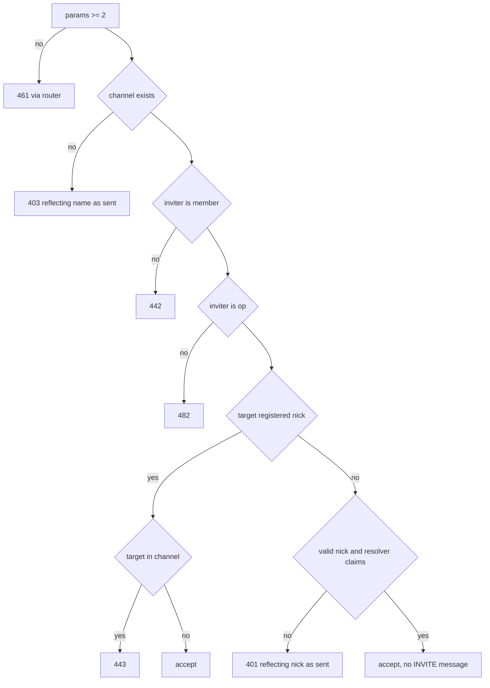

# Design: ircd-agent-commands

## Overview

This spec adds `AWAY`, `WHOIS` and `INVITE` to `apps/ircd` (`DESIGN.md` §3, "Command → agent mapping"), plus the hooks the future runner needs and four fixes from review. Everything is built on what `ircd-core` already ships: `CommandRouter`, `ChannelRegistry`, `ConnectionManager`, `EventBus`, `clampTrailing` and `Numerics`. Nothing in `apps/runner` changes.

| Command | What an operator sees | What the runner will later do |
|---|---|---|
| `AWAY` | `301` on a private message to a busy agent | Call `VirtualClient.setAway()` while a tool runs |
| `WHOIS` | nick, user, host, channels with `@`/`+`, model/tools/credits lines, idle time | Supply `whoisExtra()` when creating its virtual client |
| `INVITE` | `341` for the inviter, `INVITE` to the target | Subscribe to `irc.invite` and claim unconnected agent nicks through the `InviteResolver` |

Findings from reading the source that shape the design:

- `Client.away` already exists, and `handlers/message.ts` already emits `301` for a private `PRIVMSG` and suppresses it for `NOTICE` (`reportErrors: false`) and for channels. The away path only needs clamping and a shared builder.
- `Client` has no real name, sign-on time or last-activity time. `handleUser` receives the real name and drops it.
- There is no clock on `RouterContext`. The only injectable clock is `SessionLimits.now`, which feeds the flood `TokenBucket` of network sessions. Virtual clients have no `SessionLimits`, so a context-level clock is added.
- The reflected-input numerics (`401`, `403`, `441`) are built by per-file `numeric()` helpers that never clamp. `join.ts` can reflect up to ~500 bytes of user text in a `403`.
- `NetworkClient.close` arms a destroy timer even when the wire is already destroyed, because `Wire` cannot report that state.
- `normalizeHost` does not exist. `socket.remoteAddress` goes straight into `client.host`. A server bound to `::` reports IPv4 peers as `::ffff:127.0.0.1` and `::1` as a host starting with `:`, which breaks `nick!user@host` parsing.

```
 WHOIS/AWAY/INVITE ──▶ CommandRouter ──▶ handlers/{away,whois,invite}.ts
                                              │ reads            │ writes
                                              ▼                  ▼
                              ConnectionManager / ChannelRegistry (channel.invited)
                                              │
              replies.ts: numeric · reflectedReply · awayReply  (all clamp via clampTrailing)
                                              │
                         EventBus: irc.invite {channel, inviter, target, ts}
                                              ▲
                  InviteResolver (sync, optional) ◀── asked only after the op checks pass
```

## Architecture

### Pipeline

The three new commands use the unchanged router pipeline (`LineFramer` → `parse()` → `CommandRouter` → handler). Registration gating already returns `451` for any command outside `PRE_REGISTRATION_COMMANDS`, so Req 1.9, 2.10 and 5.10 need no handler code.

### Decisions

| Decision | Choice | Why |
|---|---|---|
| `InviteResolver` sync vs async | **Synchronous**: `(target, channel, inviter) => boolean` | The router and every handler are synchronous, and per-client reply order is a protocol property. An async resolver would let later commands overtake an `INVITE` reply. The resolver only has to decide "is this a known agent name?", which is a roster lookup. Slow work (spawning an ACP session) belongs to the `irc.invite` subscriber, which runs after the reply. |
| Resolver timeout | **None** | A synchronous call cannot be interrupted, and Req 6 asks for none. The contract says the resolver must be a pure, fast lookup. |
| Resolver returns a Promise anyway | Treated as a defect: `401`, error logged, a `.catch` is attached so no unhandled rejection escapes | Covers Req 6.6 "rejects". Only `=== true` counts as a claim. |
| Clock | `RouterContext.now?: () => number` (ms), default `Date.now`; `createServer` also feeds it to `SessionLimits.now` | One injected clock drives sign-on, activity, idle and event `ts`. Tests stay deterministic. |
| Time units | `signonAt` and `lastActivityAt` stored as **whole Unix seconds** | Req 4.1 wants seconds and "last activity equal to sign-on" at registration. Idle is `max(0, nowSec - lastActivityAt)`. |
| Where activity is stamped | In `deliverMessage`, on the `"delivered"` result only | `PRIVMSG` and `NOTICE`, network and virtual, share this path. `no-such-nick`, `no-such-channel` and `cannot-send` never stamp (Req 4.6). Rate-limit rejection ends the connection before dispatch. |
| Virtual client away | New `VirtualClient.setAway(text?: string)` instead of an `away` setter | An accessor typed `string \| undefined` is not assignable to `away?: string` under `exactOptionalPropertyTypes`. A method keeps `Client` unchanged and gives one place to clamp (Req 1.7). |
| Reflected-param clamp | One helper, `reflectedReply`, built on `clampTrailing` | Req 9.5 forbids a second truncation implementation. See "Reflected input". |
| 319 splitting | Extract the packing loop of `names.ts` into `packEntries()` and use it for `353` and `319` | The loop is already correct and tested by ircd-core P9. A copy would drift. |
| Invite on invalid nick | A target that fails `isValidNick` is never offered to the resolver; it gets `401` | A claimed nick goes into `341` as a middle parameter. An invalid nick (spaces, leading `:`) would make `serialize()` throw. A registered nick is always valid, so `401` is consistent with Req 5.8. |

## Components and Interfaces

### `@seance/irc-protocol`

`Numerics` gains `RPL_WHOISIDLE: "317"` and `RPL_WHOISSPECIAL: "320"` (Req 11.1). `320` is not in RFC 2812; it is the de facto numeric for free-text `WHOIS` lines in ircu, UnrealIRCd and Ergo. All other numerics used (`301`, `305`, `306`, `311`, `312`, `318`, `319`, `341`, `401`, `403`, `431`, `442`, `443`, `461`, `482`) are already exported.

### `Client` (`client.ts`)

```ts
interface Client {
  // ...existing fields...
  /** Real name from USER (set by handleUser). */
  realname?: string;
  /** Whole Unix seconds at registration completion. */
  signonAt?: number;
  /** Whole Unix seconds of the last accepted PRIVMSG/NOTICE; starts at signonAt. */
  lastActivityAt?: number;
  /** Optional extra WHOIS lines (model, tools, credits). Untrusted data. */
  whoisExtra?(): readonly string[];
}
```

`NetworkClient` leaves `whoisExtra` unimplemented (Req 3.6).

### `clock.ts` (new)

```ts
export const nowMs = (ctx: RouterContext): number => (ctx.now ?? Date.now)();
export const nowSeconds = (ctx: RouterContext): number => Math.floor(nowMs(ctx) / 1000);
```

`RouterContext` gains `now?: () => number` and `inviteResolver?: InviteResolver`.

### `replies.ts` (new, shared reply helpers)

```ts
export function numeric(ctx, client, code, ...rest: readonly string[]): void;
export function prefixOf(ctx, client): string;           // nick!user@host
export function reflectedReply(
  ctx: RouterContext, client: Client, code: string,
  reflected: readonly string[], text: string,
): void;
export function awayReply(ctx: RouterContext, to: Client, target: Client): IrcMessage;
```

New handlers import these. The existing per-file `numeric()` copies stay for replies that reflect nothing; only the `401/403/441/442/443/482` call sites switch to `reflectedReply`.

#### Reflected input (Req 9)

`reflectedReply` sends `:<server> <code> <me> <reflected...> :<text>`. For each reflected value it calls the existing `clampTrailing`:

```ts
const clamped = clampTrailing(ctx.serverName, code, [me, ...done, ...later, text], value);
```

Passing the other tokens as `leading` makes `clampTrailing` compute a budget equal to the real one: the line has the same tokens, the same number of spaces, and one colon either way. No new byte arithmetic is written. Properties:

- A value that already fits is returned unchanged, so the reply is byte-identical to the unclamped one (Req 9.3).
- `clampBytes` cuts on code point boundaries, so no partial character and no U+FFFD (Req 9.1).
- After clamping, the value is made a legal middle parameter: spaces (only reachable through the `:trailing` input form) become `_`, a leading `:` becomes `_`, and an empty value becomes `*`. `serialize()` would otherwise throw and the reply would vanish. Legal values are untouched.
- The budget is positive in practice: nick ≤ 30 bytes, canonical channel ≤ 50 characters (≤ 200 bytes, `MAX_CHANNEL_LENGTH`), server name is a hostname. Only the unvalidated reflected value shrinks.

`awayReply` builds `301` as `[me, target.nick, clampTrailing(server, "301", [me, nick], target.away)]` and is used by both `message.ts` (replacing the unclamped call at line 94) and `WHOIS`.

### `text-limits.ts`

Adds `AWAYLEN = 200` and `stripControl(text)`, which replaces CR, LF and NUL with a space so untrusted text can never make `serialize()` throw. It is used for `whoisExtra` lines and `setAway`.

### `entry-lines.ts` (new, extracted from `names.ts`)

```ts
export function packEntries(
  entries: readonly string[],
  build: (joined: string) => IrcMessage,
): readonly IrcMessage[];
```

Same algorithm as today's `buildNamesReplies` loop: measure `serialize(build(""))`, add entries separated by a space, start a new line before the limit is crossed, never split an entry. No entries gives no lines. If one entry cannot fit alone it is cut with `clampBytes` instead of throwing; this is unreachable with current bounds (the longest `319` entry is about 201 bytes). `names.ts` is changed to call `packEntries`, so the `353` behavior and ircd-core P9 stay as they are.

### `handlers/away.ts` (new)

`AWAY [:text]`, `minParams: 0`.

1. `text = msg.params[0] ?? ""`.
2. Non-empty: `client.away = clampBytes(text, AWAYLEN)`, reply `306 :You have been marked as being away` (Req 1.1).
3. Empty: `delete client.away`, reply `305 :You are no longer marked as being away` (Req 1.2).

`005` gets the token `AWAYLEN=200` in `onRegistrationComplete` (Req 1.3). `005` then carries 8 tokens, inside the 15-parameter limit.

### `VirtualClient` (`virtual-client.ts`)

```ts
interface VirtualClient extends Client {
  /** Mark away (clamped to AWAYLEN bytes, control characters stripped) or clear with undefined/"". No wire reply. */
  setAway(text?: string): void;
}
interface VirtualClientOptions {
  // ...existing...
  /** Called exactly once per WHOIS of this client; its lines become 320 replies. */
  readonly whoisExtra?: () => readonly string[];
}
```

`VirtualClientImpl` assigns `this.whoisExtra` only when the option is given (`exactOptionalPropertyTypes`). The runner will call `setAway()` when a tool starts and `setAway()` with no argument when it ends.

### `handlers/whois.ts` (new)

`WHOIS [<server>] <nick>{,<nick>}`, `minParams: 0`.

1. Pick the nick: `params.length >= 2 ? params[1] : params[0]`, then the first element of the comma list (Req 2.2, 2.14). Missing or empty gives `431` and no `318` (Req 2.9).
2. `getByNick(nick)` not found or not registered: `401` then `318`, nothing else (Req 2.8). Both go through `reflectedReply`, because the nick is raw input.
3. Otherwise `buildWhoisReplies(ctx, target, extra, nowSec)` returns the replies in the Req 2.1 / 3.2 order, and the handler sends them.

Reply order for a registered target:

| # | Numeric | Parameters | Condition |
|---|---|---|---|
| 1 | `311` | `<me> <nick> <user> <host> * :<realname>` | always |
| 2 | `319` | `<me> <nick> :<entries>` | one or more lines, only if the target is in a channel |
| 3 | `312` | `<me> <nick> <server> :<description>` | always |
| 4 | `320` | `<me> <nick> :<line>` | one per `whoisExtra()` string |
| 5 | `301` | via `awayReply` | target has away text |
| 6 | `317` | `<me> <nick> <idle> <signon> :seconds idle, signon time` | always |
| 7 | `318` | `<me> <nick> :End of /WHOIS list` | always, exactly once |

- `319` entries come from `ctx.channels.channelsOf(target.id)`: `@name` for ops, `+name` for voiced non-ops, bare otherwise (Req 2.4). They go through `packEntries` (Req 2.5).
- `idle = max(0, nowSec - (target.lastActivityAt ?? nowSec))` (Req 4.7). `signon = target.signonAt ?? nowSec`.
- `whoisExtra()` runs exactly once, inside `try`. Each line goes through `stripControl` and `clampTrailing` (Req 3.3). An empty result or a missing method produces no `320`. If it throws, the handler logs `{ command: "WHOIS", clientId, targetId, error }`, skips the `320` lines, and still sends the rest including `318` (Req 3.7).
- `311` text is clamped with `clampTrailing`. Host is `target.host ?? ctx.serverName`.

`handleUser` now stores `client.realname = realname` after `setUser` succeeds.

### Activity and sign-on (`registration.ts`, `message.ts`)

- `onRegistrationComplete` sets `signonAt = lastActivityAt = nowSeconds(ctx)` once per client, for network and virtual clients alike (Req 4.1, 4.4).
- `deliverMessage` sets `client.lastActivityAt = nowSeconds(ctx)` when the result is `"delivered"` (Req 4.2, 4.6). Other commands never touch it (Req 4.3).

### `handlers/invite.ts` (new)

`INVITE <nick> <channel>`, `minParams: 2` (the router sends `461 INVITE`, Req 5.4).



This is the Req 5.12 order. The first failing check sends exactly one error and stops (Req 5.11).

Accept path for a registered target:

1. `ctx.channels.invite(channel.name, target.nick)` records the invite (Req 7.1).
2. Send the target `:<inviter prefix> INVITE <target.nick> <channel.name>` (Req 5.2).
3. Send the inviter `341 <me> <target.nick> <channel.name>` (Req 5.1).
4. `ctx.events?.publish("irc.invite", { channel, inviter, target, ts: nowMs(ctx) })` (Req 5.3).

Accept path for a claimed nick: same, except step 2 is skipped and `target` is the nick as sent (Req 6.3).

Resolver call (Req 6.2, 6.5–6.8):

```ts
type InviteResolver = (target: string, channel: string, inviter: string) => boolean;
```

It runs only when no registered client has the nick, the nick passes `isValidNick`, and all earlier checks passed. It receives three plain strings (canonical channel name, inviter nick), so it holds no reference to IRCd state. A throw, or a non-`true` return that is thenable, is logged with the command and client id and answered with `401`. No event, no record. Other clients are unaffected because the handler is wrapped in `try/catch` like `KICK` and `MODE`.

### `ChannelRegistry` (`channel-registry.ts`)

```ts
type Channel = { /* ... */ readonly invited: Set<string> };   // keys are irc_lower(nick)

join(clientId: string, name: string, nick?: string): JoinResult;  // deletes irc_lower(nick) from invited
invite(name: string, nick: string): boolean;                      // false if channel missing
isInvited(name: string, nick: string): boolean;
```

A new channel starts with an empty `invited` set (Req 7.8). Deleting the channel on last part discards the set (Req 7.3). A `Set` keyed by the case-mapped nick gives single entries for case or rfc1459 variants (Req 7.4, 7.6). The invite set is not consulted by `join` (Req 7.5, no `+i`). `JOIN` passes `client.nick`.

### `normalizeHost` (`host.ts`, new)

```ts
export function normalizeHost(address: string | undefined): string | undefined;
```

| Input | Output | Req |
|---|---|---|
| `undefined` | `undefined` | 8.4 |
| `""` | `""` | 8.11 |
| `::ffff:` (any case) + dotted-quad (each octet 0–255) | the dotted-quad | 8.1 |
| `::ffff:` + anything else, or any other address starting with `:` | `"0" + address` | 8.2, 8.10 |
| anything else | unchanged | 8.3 |

Idempotent: the output is a dotted-quad, starts with `0`, or was unchanged and does not start with `:`. None of those matches either rule on a second pass. `TcpTransport.accept` calls `normalizeHost(socket.remoteAddress)` and `WsTransport` calls `normalizeHost(request.socket.remoteAddress)`, both from this one module (Req 8.5–8.7).

### `NetworkClient.close` and `Wire` (`network-client.ts`)

`Wire` gains `isDestroyed(): boolean` (TCP: `socket.destroyed`; WS: `socket.readyState === socket.CLOSED`).

```ts
close(reason: string): void {
  if (this.closed) return;                       // Req 10.3
  if (this.wire.isDestroyed()) {                 // Req 10.1
    this.closed = true;
    return;
  }
  try { this.send({ command: "ERROR", params: [`Closing Link: ${reason}`] }); }
  finally {
    this.closed = true;
    this.wire.end();                             // once (Req 10.2)
    this.destroyTimer = this.timers.setTimeout(/* destroy, clear handle */, this.limits.closeGraceMs);
  }
}
```

`dispose()` (called from `ConnectionSession.closed()`) already clears the timer when the wire is destroyed during the grace period (Req 10.4). The timer callback already clears its handle and calls `destroy()` once (Req 10.5).

### `EventBus` (`event-bus.ts`)

```ts
export type IrcInviteEvent = {
  readonly channel: string;   // canonical name
  readonly inviter: string;   // nick
  readonly target: string;    // nick (registered nick as stored, or claimed nick as sent)
  readonly ts: number;        // ms since Unix epoch, from ctx.now
};
// EventMap gains: readonly "irc.invite": IrcInviteEvent;
```

### `server.ts`

```ts
export interface ServerOptions {
  readonly now?: () => number;
  readonly inviteResolver?: InviteResolver;
}
createServer(config, logger, options: ServerOptions = {}): IrcServer
```

`createRouter()` also registers `AWAY`, `WHOIS` and `INVITE`. `ctx.now` and `limits.now` both take `options.now`. The resolver is stored on `ctx`. The default is no resolver (Req 6.1).

### README

A new "Supported commands and numerics" section lists the implemented commands including `AWAY`, `WHOIS`, `INVITE`, states `AWAYLEN=200`, and lists numerics including `317` and `320` (noting `320` is not in RFC 2812) (Req 11.3, 11.4).

## Data models

```ts
// apps/ircd
type InviteResolver = (target: string, channel: string, inviter: string) => boolean;

type IrcInviteEvent = { channel: string; inviter: string; target: string; ts: number };

// Client additions
//   realname?: string; signonAt?: number; lastActivityAt?: number; whoisExtra?(): readonly string[]
// Channel addition
//   invited: Set<string>   // irc_lower(nick)
// RouterContext additions
//   now?: () => number; inviteResolver?: InviteResolver
// Wire addition
//   isDestroyed(): boolean
// Constants
//   AWAYLEN = 200
```

Only `Client` gains new data. No persistence changes; invite records live in memory with the channel.

## Correctness Properties

A property is a characteristic that should hold across all valid executions of the system, a formal statement of what the system should do. Properties bridge human-readable requirements and machine-verifiable tests.

Reflection on overlap: the `319` split, the `320` clamp, the away clamp and the reflected clamp all reduce to "every reply fits and is legal", so they are folded into P1. Req 2.4 and 2.5 are folded into P2 with 2.12. Req 1.1, 1.2 and 1.4 are the model in P3. Req 8.1–8.3 and 8.10 are examples inside P4's generators. Req 7.1, 7.4 and 7.6 share P6. Everything else is an example test.

| # | Property | Covers |
|---|---|---|
| P1 | Every reply from `WHOIS`, `AWAY` and `INVITE` serializes to ≤ 512 bytes. | Req 1.1, 1.7, 1.8, 2.5, 2.13, 3.3, 5.14 |
| P2 | `WHOIS` ends with exactly one `318`; `319` lists exactly the target's memberships with correct prefixes. | Req 2.4, 2.5, 2.11, 2.12 |
| P3 | Away state model: `301` iff the last `AWAY` had non-empty text. | Req 1.1, 1.2, 1.4, 1.10 |
| P4 | `normalizeHost` is idempotent and never yields a leading `:` or a leftover `::ffff:` for mapped IPv4. | Req 8.1–8.3, 8.8, 8.9 |
| P5 | Reflected-param clamp is the identity when the reply fits, and otherwise a valid code point prefix that fits. | Req 9.1, 9.3 |
| P6 | Invited set holds one entry per rfc1459-equivalent nick. | Req 7.1, 7.4, 7.6 |

### Property 1: Reply line bound

For any nick, channel name, away text and list of `whoisExtra` lines, including multi-byte UTF-8 and control characters, every message sent to the requester, the inviter or the target by `WHOIS`, `AWAY` and `INVITE` passes `serialize()` without throwing and is at most 512 bytes including CRLF.

**Validates: Requirements 1.1, 1.7, 1.8, 2.5, 2.13, 3.3, 5.14**

### Property 2: WHOIS terminator and membership listing

For any target with any set of channel memberships (flags `op` and `voice`, multi-byte channel names, enough channels to force a split), any away text and any `whoisExtra` output, the reply stream to `WHOIS` ends with exactly one `318`, and the union of entries across all `319` lines equals the set of channels the target is in, each with `@` for an op, `+` for a voiced non-op and no prefix otherwise, with no entry split across lines. This also holds when the nick names no registered client (`401` then `318`, no `319`).

**Validates: Requirements 2.4, 2.5, 2.11, 2.12**

### Property 3: Away state model

For any non-empty sequence of `AWAY` commands (each with arbitrary text or none) sent by one registered client, a `PRIVMSG` to that client afterwards produces `301` if and only if the last `AWAY` in the sequence carried non-empty text.

**Validates: Requirements 1.1, 1.2, 1.4, 1.10**

### Property 4: Host normalization shape

For any peer address string (IPv4, IPv6 with or without a leading `:`, `::ffff:` mapped with a dotted-quad or hex remainder, any case of `ffff`), `normalizeHost(normalizeHost(a))` equals `normalizeHost(a)`, the output does not start with `:`, and for a dotted-quad IPv4-mapped input the output does not contain `::ffff:`.

**Validates: Requirements 8.1, 8.2, 8.3, 8.8, 8.9**

### Property 5: Reflected clamp identity and bound

For any reflected value and any numeric reply shape among `401`, `403`, `441`, `442`, `443` and `482`: if the unclamped reply fits in 512 bytes, `reflectedReply` produces exactly that reply; otherwise the reflected value is a prefix of the input ending on a code point boundary, contains no U+FFFD that the input did not contain, and the reply is at most 512 bytes.

**Validates: Requirements 9.1, 9.3**

### Property 6: Invited set uniqueness

For any sequence of invites, joins and channel removals over nicks drawn from a pool that includes case variants and rfc1459 equivalents (`[`/`{`, `]`/`}`, `\`/`|`, `~`/`^`), the channel's `invited` set size equals the number of distinct `irc_lower` values invited and not yet joined, and a recreated channel starts empty.

**Validates: Requirements 7.1, 7.2, 7.4, 7.6, 7.8**

## Error handling

- Each new handler is wrapped like `KICK`: an exception is caught, logged with the command and client id, and never reaches other clients (the router also contains it).
- `whoisExtra()` throwing is logged with `WHOIS`, the client ids and the error; the remaining replies still go out (Req 3.7).
- `InviteResolver` throwing, returning a thenable, or returning anything but `true` is logged and answered with `401`. No event and no invite record are produced (Req 6.6).
- `whoisExtra` lines and virtual away text are untrusted. CR, LF and NUL are replaced before clamping, so one bad line cannot make `serialize()` throw and drop the reply. They are only ever placed in a trailing parameter and never parsed or executed.
- Every reflected value goes through `reflectedReply`. A clamped reply keeps the connection open and logs nothing at error level (Req 9.4).
- A rejected `INVITE` mutates nothing: no invite record, no event, nothing sent to the target (Req 5.11). `INVITE` needs `+o` because invited agents spend credits (Req 5.7).
- `normalizeHost` is total: any string maps to a string; it never throws.
- `NetworkClient.close` on a destroyed wire only marks the client closed, so shutdown leaves no stray timer (Req 10.1).
- `Wire.isDestroyed` is required, not optional, so a transport cannot silently omit it.

## Testing strategy

Tests live in `apps/ircd/test/`, next to the existing ircd tests.

**Unit tests (vitest)**

- `away.test.ts`: `306` and `305`, clamp at 200 bytes on a multi-byte boundary, `005` contains `AWAYLEN=200`, `301` for `PRIVMSG` to a nick, none for `NOTICE` and channel `PRIVMSG`, `setAway` clamp and clear, unregistered gets `451`.
- `whois.test.ts`: full reply order, `WHOIS server nick`, comma list, `401`+`318`, `431`, `451`, `319` split with many channels, `320` order, empty or missing `whoisExtra`, `whoisExtra` called once, throwing `whoisExtra` logged and `318` still sent, `317` with a fake clock including a backwards clock.
- `activity.test.ts`: sign-on and activity stamps for network and virtual clients; stamped by `PRIVMSG`/`NOTICE` only; not stamped by `PING`, `JOIN`, `MODE` or by rejected sends.
- `invite.test.ts`: success path (`341`, `INVITE` to target, one event with `ts`), each rejection with exactly one reply and no side effects, check order with several simultaneous failures, case-mapping, resolver claim / no claim / throw / thenable / not asked for registered targets / three plain string args / not asked for invalid nicks, no resolver.
- `channel-invite.test.ts`: `invited` cleared on `JOIN`, discarded with the channel, empty on recreation, unaffected by non-invited joins, invites do not gate joins.
- `reflected-clamp.test.ts`: one oversized-input case per handler that sends `401`, `403`, `441`, `442`, `443`, `482` (JOIN, PART, TOPIC, MODE, KICK, PRIVMSG, INVITE, WHOIS); connection stays open; logger spy sees no error.
- `network-client-close.test.ts`: fake `Wire` and fake timers for Req 10.1–10.5.
- Existing tests that need updating: the `005` expectation in registration tests, and fake `Wire` objects (new `isDestroyed`). The `numerics` test in `irc-protocol` gains `317` and `320`.
- A source check asserts no string-literal numerics in `handlers/away.ts`, `whois.ts` and `invite.ts` (Req 11.2).

**Transport tests** (`transports.test.ts`, extended; port `0`, closed in `afterEach`)

For both TCP and WebSocket, register a client and read its own `host` from `WHOIS` (`311`) or its `JOIN` prefix:

| Case | How | Expected host |
|---|---|---|
| IPv4 | connect to `127.0.0.1` on an IPv4 listener | `127.0.0.1` |
| IPv4-mapped | server bound to `::`, connect to `127.0.0.1` | `127.0.0.1` |
| `::1` | connect to `::1` (skipped if IPv6 loopback is unavailable) | `0::1` |
| Full IPv6 | `normalizeHost` unit table, e.g. `2001:db8::1`, `fe80::1` | unchanged |

A `vi.mock` of `host.js` wrapping the real function asserts that each transport calls the same `normalizeHost` with the raw `remoteAddress` and stores its result in `client.host` (Req 8.5–8.7). Full IPv6 cannot be produced with a loopback socket, so it is covered by the unit table, P4 and this wiring check.

**Property tests (fast-check)**

P1–P6 live in `agent-commands.property.test.ts` and `host.property.test.ts`. Rules:

- Each property runs at least 100 iterations (`numRuns: 100` or more).
- Each test carries a tag comment, for example `// Feature: ircd-agent-commands, Property 1: every WHOIS/AWAY/INVITE reply serializes to <= 512 bytes`.
- Virtual clients do not serialize on `send`, so P1 and P5 call `serialize()` on every received message. A throw fails the property.
- Arbitraries mix ASCII with 2-, 3- and 4-byte characters. Byte length differs from string length, which is the classic bug (`testing.md`).
- Virtual clients with an injected `now` and `inviteResolver` keep the properties deterministic and free of sockets or sleeps.

Property-based testing applies to the pure and in-memory parts: `normalizeHost`, the clamp helper, the reply builders and the away and invite state. It does not apply to transport wiring or `NetworkClient.close`, which are covered by the example tests above.
