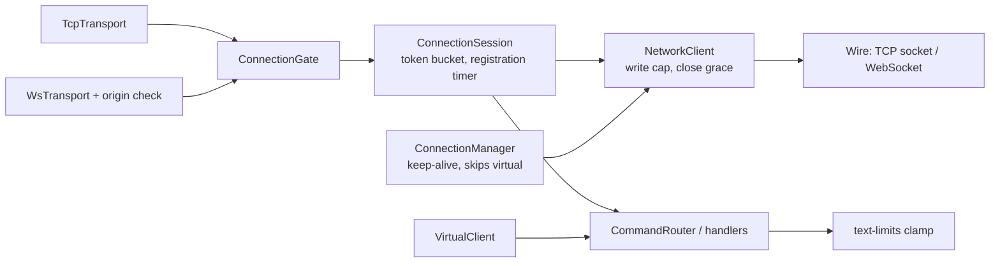

# Design Document

## Overview

Seven localized fixes in `apps/ircd`. No change to `@seance/irc-protocol`. New code is small and pure where possible so it can be tested without sockets.

## Architecture

All changes stay inside `apps/ircd` and respect the existing layering: transports (`tcp-transport.ts`, `ws-transport.ts`) feed a `ConnectionSession`, which feeds the `CommandRouter` and handlers; `ConnectionManager` owns keep-alive; `ChannelRegistry` owns IRC state. Virtual clients bypass the transport and session layers and call `dispatch` directly.



Flood, timeout and overflow all end in `quitClient`, so peers see a `QUIT` and the nick is released at once.

## Components and Interfaces

| Finding | Change |
| --- | --- |
| 1 | `Client` gains `readonly virtual?: boolean`. `ConnectionManager.add` and `touch` skip keep-alive for virtual clients. `VirtualClientImpl.close` marks itself closed, then calls `quitClient` (idempotent via its `WeakSet`). |
| 2 | New `src/text-limits.ts`: `clampBytes`, `clampTrailing(prefix, command, leading, text)`, `TOPICLEN`, `KICKLEN`. Handlers compute the prefix first, then clamp the free text against the remaining budget. `005` adds `TOPICLEN`/`KICKLEN`. |
| 3 | `registration.ts` uses `safeEqual(a, b)`: `timingSafeEqual(sha256(a), sha256(b))`. |
| 4 | `validateUser(user, realname)` in `registration.ts`; failure closes the connection (no standard numeric exists for a bad username). |
| 5 | `Wire` gains `destroy()` and `bufferedBytes()`. `NetworkClient.close` ends the wire and arms a destroy timer. `ConnectionSession.receive` returns early when the client is closed. |
| 6 | `src/token-bucket.ts`, `src/limits.ts` (`ConnectionGate`, `SessionLimits`). `ConnectionSession` owns the bucket and the registration timer; `NetworkClient.send` enforces the write cap. Both transports share one gate. |
| 7 | `src/origin.ts`: `parseAllowedOrigins`, `isOriginAllowed`. `WsTransport` passes `verifyClient`. |

### Interfaces

```ts
// text-limits.ts
export const TOPICLEN: number; // 300
export const KICKLEN: number; // 300
export function clampBytes(text: string, maxBytes: number): string;
export function clampTrailing(
  prefix: string,
  command: string,
  leading: readonly string[],
  text: string,
): string;

// origin.ts
export function parseAllowedOrigins(raw: string | undefined): readonly string[];
export function isOriginAllowed(
  origin: string | undefined,
  allowed: readonly string[],
): boolean;

// token-bucket.ts
export interface TokenBucket {
  take(): boolean;
}

// limits.ts
export interface ConnectionGate {
  tryAcquire(): boolean;
  release(): void;
}

// Wire additions
interface Wire {
  destroy(): void;
  bufferedBytes(): number;
}
```

`TimerApi` (`setTimeout`/`clearTimeout`) is injected into `ConnectionManager`, `NetworkClient`, and `ConnectionSession` so tests can use fake timers.

## Data Models

No persistent data changes. New in-memory state:

| State | Owner | Shape |
| --- | --- | --- |
| `virtual` flag | `Client` | `boolean`, optional, default `false` |
| Token bucket | `ConnectionSession` | `{ tokens: number, lastRefill: number }`, capacity `floodBurst`, refill every `floodRefillMs` |
| Connection count | `ConnectionGate` | `number`, bounded by `maxConnections`, shared by TCP and WS |
| Registration timer | `ConnectionSession` | timer handle, cleared on registration or close |
| Destroy timer | `NetworkClient` | timer handle, armed on `close`, cleared when the wire closes |
| Allowed origins | `WsTransport` | `readonly string[]` of normalized origins, or `["*"]` |

### Configuration

| Env var | Field | Default |
| --- | --- | --- |
| `IRCD_FLOOD_BURST` | `floodBurst` | 10 |
| `IRCD_FLOOD_REFILL_MS` | `floodRefillMs` | 1000 |
| `IRCD_MAX_CONNECTIONS` | `maxConnections` | 1000 |
| `IRCD_REGISTRATION_TIMEOUT_MS` | `registrationTimeoutMs` | 60000 |
| `IRCD_MAX_WRITE_BUFFER_BYTES` | `maxWriteBufferBytes` | 262144 |
| `IRCD_CLOSE_GRACE_MS` | `closeGraceMs` | 2000 |
| `IRCD_WS_ALLOWED_ORIGINS` | `wsAllowedOrigins` | empty |

## Key decisions

- **Clamp budget is computed, not fixed.** Host length varies (IPv6, virtual hosts), so the budget is `510 - bytes(head) - 2` where `head` is the exact prefix, command and leading params. `TOPICLEN`/`KICKLEN` (300) bound what is stored and advertised; the computed clamp is the safety net.
- **`QUIT` is included** in the clamp list. It has the same failure mode as the findings listed.
- **Virtual clients are exempt from flood control** because they never pass through `ConnectionSession`. Their limit is `dispatch`, which already rejects over-long messages.
- **Overflow is a hard destroy.** A peer that cannot drain 256 KiB will not read an `ERROR` either. The client is marked closed first so `close()` does not re-enter `send`.
- **Flood, timeout and overflow go through `quitClient`** so peers see a `QUIT` and the nick is released at once, not when the socket finally closes.
- **Origin default is closed for browsers.** Absent `Origin` means a non-browser client, which is accepted; a present `Origin` must be listed. Deployments with the web client set `IRCD_WS_ALLOWED_ORIGINS`.
- **Timers are injectable** (`TimerApi`) so tests use fake timers, per `testing.md`.

## Correctness Properties

- **P1 (Requirement 1):** For any virtual client, no keep-alive timer is ever scheduled, and calling `close` any number of times yields exactly one `QUIT` broadcast per peer and a released nick.
- **P2 (Requirement 2):** For any sender prefix, command and Unicode text, the serialized relayed line is at most 512 bytes including CRLF, and the clamped text is a valid UTF-8 prefix of the input (no split code point).
- **P3 (Requirement 2):** For any text whose line already fits, the clamp returns it unchanged (idempotent: `clamp(clamp(t)) == clamp(t)`).
- **P4 (Requirement 3):** For any two strings `a` and `b`, `safeEqual(a, b)` is true if and only if `a === b`.
- **P5 (Requirement 4):** For any `USER` input, registration succeeds if and only if the username and real name satisfy the documented rules.
- **P6 (Requirement 5):** After `close`, a network client routes no further input, and the wire is destroyed no later than the grace period unless it closed earlier.
- **P7 (Requirement 6):** For any sequence of arrivals, the token bucket never allows more than `floodBurst` lines at once and never more than burst plus refill over time; active connections never exceed `maxConnections`; queued bytes never exceed `maxWriteBufferBytes`.
- **P8 (Requirement 7):** `isOriginAllowed` accepts an `Origin` if and only if it is absent, listed (case-insensitive), or the list holds `*`.

## Error Handling

| Condition | Behaviour |
| --- | --- |
| Invalid `USER` username or real name | Close with `Invalid username` / `Invalid realname`; nothing registered. |
| Flood (bucket empty) | `quitClient` with `Excess Flood`; further input ignored. |
| Registration not completed in time | `quitClient` with `Registration timeout`. |
| Write buffer would exceed the cap | Drop the line, mark closed, destroy the wire, `quitClient` with `SendQ exceeded`. |
| Connection limit reached | TCP: `ERROR :Closing Link: Too many connections`; WebSocket: close code 1013. No state kept. |
| Disallowed `Origin` | HTTP 403; no client created. |
| Invalid env value (limit or origin entry) | Fail at startup with an error naming the variable and the offending value. |
| Over-long relayed text | Clamp at a code point boundary and deliver; no error is logged. |
| `close` on an already-closed client | No-op. |

Errors are never swallowed: every close path carries a reason string that reaches the peer (where the transport allows) and the log.

## Testing Strategy

Each requirement gets a test that fails before the fix: virtual keep-alive and close with fake timers; relayed lines at the boundary with multi-byte text; `PASS` with equal and different-length passwords; `USER` validation table; close with fake timers and a fake `Wire`; token bucket unit and session flood test; gate unit and a TCP test with `maxConnections=1`; registration timeout and write cap with a fake `Wire`; origin parser unit and a WebSocket test that checks 403. Existing suites must stay green.

- **Unit tests (vitest):** `clampBytes`/`clampTrailing`, `safeEqual`, `validateUser`, token bucket, `ConnectionGate`, `parseAllowedOrigins`/`isOriginAllowed`.
- **Property tests (fast-check):** P2 and P3 (line length and code point integrity over arbitrary Unicode), P4, P7 (bucket invariants), P8.
- **Integration tests:** TCP with `maxConnections=1`; WebSocket upgrade returning 403 for a disallowed origin; flood and registration timeout through `ConnectionSession` with fake timers and a fake `Wire`.
- **Regression first:** each fix starts with a test that fails on the current code, per `tech.md`.
- **Gate:** `pnpm typecheck` and `pnpm test` must pass, and existing suites stay green.
