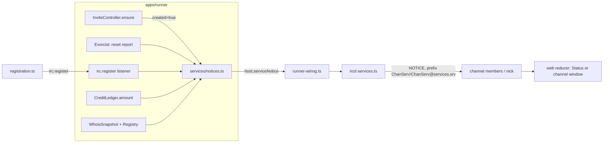
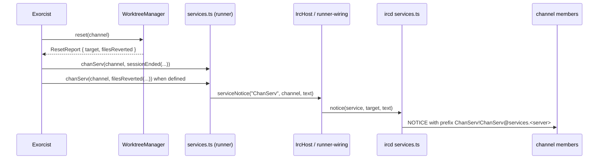

# Design Document

## Overview

`runner-services` adds a small, one-way voice to the runner: `ChanServ` and `NickServ` notices. The Ircd owns delivery and the reserved nicks. The Runner owns the facts and the wording. The web client learns one routing rule.



### Sources read

| Source | Result |
|---|---|
| Talk-to-Figma `8p9g0i9k`: `get_node_info` 1:2153 (02 Status), 1:1093 (01 Main), 1:4655 (03 Kick) | the six texts in `requirements.md` |
| `apps/runner/src/runner.ts`, `ports.ts`, `invite/invite-controller.ts`, `exorcism/exorcism.ts`, `credits/ledger.ts`, `whois/*`, `worktree/worktree-manager.ts`, `session/*-store.ts`, `registry/*` | where each fact lives |
| `apps/ircd/src/handlers/registration.ts`, `virtual-client.ts`, `runner-wiring.ts`, `event-bus.ts` | nick path, welcome hook, host adapter |
| `apps/web/src/irc/reducer.ts` (`onChat`), `components/ChatLine.tsx` | how a NOTICE with a user prefix is routed and drawn today |
| `spikes/acp/FINDINGS.md` | `session/load` is "not tested" (decision D6) |
| `apps/runner/test/fixtures/fake-agent.ts`, `apps/ircd/test/runner/integration.ts` | the Fake_Agent step `{ gate: "hold" }` keeps a turn in flight, `{ metadata: { credits } }` reports credits, and `startIntegration`, `ManualClock`, `closeAllFixtures` are the fixture helpers; the Fake_Agent cannot write files |
| `apps/runner/src/index.ts` | what the ircd can import from `@seance/runner` |

## Architecture

### Responsibilities

- **Ircd:** owns the reserved nicks, the Service_Notice delivery and the `irc.register` event. It decides nothing about content and never calls the Runner.
- **Runner:** owns every fact and every wording. It reaches the Ircd only through the `IrcHost` port (`serviceNotice`, `irc.register`).
- **Web client:** routes a service notice to the right window; it does not format or interpret it.

### Flows



The other two triggers use the same path: the invite pipeline sends `worktree ready` after `ensure` with `created === true`, and the `irc.register` listener sends the NickServ roster to the new nick. A failed step (reset, short sha, delivery) sends nothing and is logged.

## Decisions

| # | Decision | Why |
|---|---|---|
| D1 | Services are prefixes, not clients. `apps/ircd/src/services.ts` builds `ChanServ!ChanServ@services.<server>` and sends straight to members. | A pseudo client in `ConnectionManager` would show up in `NAMES`, `WHOIS`, `LIST` counts and the channel member limits. The mockup nick list has no service. |
| D2 | Delivery does not publish `irc.message`. | The runner builds prompts from `irc.message` only (design D1 of `agent-runner`). A service line therefore cannot become prompt text or a prompt-injection path, and it is not logged as human chat. |
| D3 | Reserved nick answers `432` with `Nickname is reserved for network services`. | `432` is the standard numeric for a refused nick; the web client already maps `432` to its "erroneous" connect error. `433` would say the nick is merely taken. No new numeric. |
| D4 | The second kick line reads `N files reverted · X.XX credits used`, not `credits released`. | A kick does not release credits: `CreditLedger` keeps the pair total so that "kick + invite does not reset the cap". "Released" would be false. The wording is one constant (`CREDITS_WORD`) in `notices.ts`. **Open Point 1.** |
| D5 | The worktree line shows `<basename of SEANCE_WORKSPACES>/<sanitized channel>` (for example `workspaces/fix-bug-123`), not the mockup's `.seance/wt/...` and never an absolute path. | The real layout is `SEANCE_WORKSPACES/<channel>`. An absolute path would hand the server's directory tree to every channel member, including agents' channel logs. Two segments keep the mockup's shape and stay true. |
| D6 | The line `N sessions restored from last séance: ...` is **omitted**. No persistence is added. | (1) `MemorySessionStore` forgets everything on restart, so a count would be invented. (2) A file store would restore credit totals and record ids, but not the agent's conversation: ACP `session/load` is untested (FINDINGS "not tested"), so a revived session starts a new ACP session. "Restored" would overstate that. (3) Revival is lazy (on the next message), so no session is actually open at connect time. A persisted store needs its own spike and spec (`SEANCE_WORKSPACES/_state`, atomic write, load validation). **Open Point 2.** |
| D7 | "agents online" lists every Registry agent. | Agents are invitable as soon as the runner has started (`inviteResolver` claims their nicks only while running). Their virtual clients are created lazily at the first invite, so a stricter meaning ("has a client") would list nobody after boot, which is not what the mockup shows. Statuses use the `WHOIS` status function. |
| D8 | `worktree ready` only for `created === true`; session end notices only after a successful reset and only for `kick`/`part`. | Each is the moment the fact becomes true. Repeats (second agent, re-invite) add noise and say nothing new. |
| D9 | `coder touched N files outside topic scope` is not built. | There is no scope rule. Any number would be a guess (Requirement 7.1). |
| D10 | `IrcServer` exposes a readonly `services` member; `runner-wiring.ts` adapts it to the `IrcHost.serviceNotice` port. | The runner never imports `@seance/ircd`; the adapter's return annotation turns any port drift into a typecheck error. |
| D11 | All notice wording lives in pure functions in the Runner (`services/notices.ts`). | One place to test, one place to change `CREDITS_WORD`, and the Ircd stays free of product text. |
| D12 | New dependencies of existing components (`services` in the invite controller, `chanServ` and `creditsOf` in the exorcist) are optional. | Existing tests and embedders keep working without change; the notice code runs only when the runner wires it. |

## Components and Interfaces

### `@seance/irc-protocol`

```ts
// packages/irc-protocol/src/services.ts (pure)
export const SERVICE_NICKS = ["ChanServ", "NickServ"] as const;
export type ServiceNick = (typeof SERVICE_NICKS)[number];
export function isServiceNick(nick: string): boolean; // irc_lower compare
```

### Ircd (`apps/ircd`)

- `src/services.ts`: `createServices(ctx): { notice(service, target, text): boolean }`.
  - Channel target: `ctx.channels.get(name)` then `ctx.connections.get(id)?.send(msg)` for each member.
  - Nick target: `ctx.connections.getByNick(nick)` if `registered`.
  - Text: `stripControls`, then `clampBytes` so `serialize(msg)` fits 512 bytes (budget = 512 − 2 − byteLength(prefix, command, target) − 4).
  - Errors are caught and logged; the return value is false.
- `src/handlers/registration.ts`:
  - `handleNick` calls `isServiceNick(nick)` after `isValidNick`, before `setNick`; replies `numeric(ctx, client, Numerics.ERR_ERRONEUSNICKNAME, nick, "Nickname is reserved for network services")`. The `432` text for invalid syntax stays `Erroneous nickname`.
  - `onRegistrationComplete` publishes `irc.register` as its last step.
- `src/event-bus.ts`: new event `irc.register: { nick: string; virtual: boolean }`.
- `src/runner-wiring.ts`: `serviceNotice(service, target, text)` calls `server.services.notice(...)`. `IrcServer` gains `readonly services`; `IrcServer` in `src/server.ts` gains the readonly `services` member in both the interface and the implementation.

### Runner (`apps/runner`)

`ports.ts`:

```ts
export type ServiceName = "ChanServ" | "NickServ";
export interface HostEvents { /* ... */ "irc.register": { nick: string; virtual: boolean } }
export interface IrcHost { /* ... */ serviceNotice(service: ServiceName, target: string, text: string): boolean }
```

`apps/runner/src/index.ts` exports `ServiceName` and `ResetReport` so `apps/ircd` can import them from `@seance/runner`.

`src/services/notices.ts` (pure, no I/O):

```ts
export const CREDITS_WORD = "used"; // Open Point 1
export const NOTICE_MAX_BYTES = 400;
export function worktreeReady(dir: string, sha: string): string;
export function sessionEnded(o: { cancelled: boolean; sha: string }): string;
export function filesReverted(o: { files: number; credits: number }): string | undefined; // undefined when both are zero
export function agentsOnline(agents: readonly { nick: string; status: AgentStatus }[]): string;
export function worktreeNoticeDir(workspaces: string, channel: string): string; // two segments
```

`src/services/services.ts`: `createServices({ host, logger })` returns `{ chanServ(channel, text), nickServ(nick, text) }`. It wraps `host.serviceNotice`, logs failures, never throws.

`whois/render.ts`: export the existing private `status()` as `agentStatus(entry)`; `renderWhois` keeps calling it.

`worktree/worktree-manager.ts`:

- `shortHead(channel): Promise<string | undefined>`: `git rev-parse --short=7 HEAD` in the worktree; `undefined` on failure.
- `reset(channel): Promise<ResetReport>` with `ResetReport = { target: string; filesReverted: number }`. `filesReverted` counts records of `git status --porcelain=v1 -z --untracked-files=all --no-renames` before the reset; `target` is `git rev-parse --short=7 <target>`. Existing callers that ignore the value still compile.

`exorcism/exorcism.ts`: `ExorcismDeps` gains an optional `chanServ?: (channel: string, text: string) => void` and `creditsOf?: (agent: string, channel: string) => number`. In `run`, after step (c) succeeds and `trigger !== "quit"`:

1. `wasPrompting` is captured before step (a).
2. `chanServ(channel, sessionEnded({ cancelled: wasPrompting, sha: report.target }))`.
3. `const second = filesReverted({ files: report.filesReverted, credits: creditsOf(agent, channel) })`; send when defined.

`invite/invite-controller.ts`: after `ensure`, when `info.created`, `const sha = await d.worktrees.shortHead(channel)`; if defined, `d.services?.chanServ(channel, worktreeReady(...))`. A new optional dep `services` (Pick of the object above) keeps existing tests valid.

`runner.ts`: builds `services`, passes `chanServ`/`creditsOf` to the exorcist, and subscribes:

```ts
host.subscribe("irc.register", (e) => {
  if (shuttingDown || e.virtual) return;
  const groups = registry.all().map((p) => ({ nick: p.nick, status: agentStatus(snapshot.get(p.nick)) }));
  services.nickServ(e.nick, agentsOnline(groups));
});
```

`agentStatus(undefined)` is `idle` (an agent that has never been invited has no snapshot entry). `registry/agent-profile.ts`: after `isValidNick`, `if (isServiceNick(nick)) throw new AgentProfileError(file, "nick", ...)`.

### Web (`apps/web`)

`irc/reducer.ts`, `onChat`: after the server-prefix branch and before the query logic:

```ts
if (isNotice && isServiceNick(from) && isOwnNick(state, target)) {
  return done(appendStatus(state, { kind: "notice", text: raw, from }, nowMs));
}
```

Channel targets use the existing branch. `ChatLine` already draws `-<Nick>- text` for `kind: "notice"` with a `from`; no component change.

## Notice formats

| Function | Output | Example |
|---|---|---|
| `worktreeReady` | `worktree ready: <dir> @ <sha>` | `worktree ready: workspaces/fix-bug-123 @ a1b2c3d` |
| `sessionEnded` | `session cancelled, worktree reset to <sha>` or `session closed, worktree reset to <sha>` | `session cancelled, worktree reset to a1b2c3d` |
| `filesReverted` | `<N> file(s) reverted · <X.XX> credits <CREDITS_WORD>` | `6 files reverted · 4.10 credits used`, `1 file reverted · 0.00 credits used` |
| `agentsOnline` | `agents online: <groups>`, groups joined by `; ` | `agents online: coder, reviewer, researcher (idle)`; `agents online: coder (prompting); reviewer, researcher (idle)` |

Credits use two decimals like `WHOIS`. The mockup's `4.1` is sample data. The middle dot is U+00B7, as in the mockup and the web client's existing text.

## Data Models

Nothing is persisted. All data is in memory or on the wire.

```ts
export type ServiceName = "ChanServ" | "NickServ";            // ports.ts
export type AgentStatus = "idle" | "prompting" | "cooldown" | "away"; // whois/render.ts
export type ResetReport = { readonly target: string; readonly filesReverted: number }; // worktree-manager.ts
export interface RegisterEvent { readonly nick: string; readonly virtual: boolean }     // irc.register payload
```

| Item | Shape | Notes |
|---|---|---|
| Service_Notice | `{ prefix: "<Service>!<Service>@services.<server>", command: "NOTICE", params: [target, text] }` | built in `apps/ircd/src/services.ts`; text stripped of CR, LF, NUL and cut to the 512-byte budget |
| Roster group | `{ nick: string; status: AgentStatus }[]` input of `agentsOnline` | one entry per Registry agent, Registry order |
| Notice inputs | `{ dir, sha }`, `{ cancelled, sha }`, `{ files, credits }` | all pure values; no host path other than `Worktree_Notice_Dir` |
| Web line | `{ kind: "notice", text, from: <service nick> }` | appended to Status for a notice to the own nick; channel notices use the existing path |

## Correctness Properties

All property tests use fast-check, at least 100 runs, and are named after the property ID.

### Property 1: Notice bounds

For any dir, sha, counts, credits and agent list, every formatter output has no CR, LF, NUL or other C0/C1 control, at most `NOTICE_MAX_BYTES` UTF-8 bytes, and `serialize` of the full `NOTICE` (longest prefix, `#` plus 49 characters of channel) is at most 512 bytes. Multi-byte nicks included.

**Validates: Requirements 2.3, 5.4, 7.4**

### Property 2: Roster is exact

For any non-empty registry (distinct nicks, random statuses): each nick appears exactly once, in registry order within its group, groups are ordered by first appearance, and the statuses printed equal `agentStatus` of the input.

**Validates: Requirements 4.2, 4.4**

### Property 3: Credits agree with WHOIS

For any ledger amounts, the `X.XX` of `filesReverted` equals the `used` number in `renderWhois(...)`'s `credits: <channel> <used> / total <total>` line for the same channel.

**Validates: Requirements 6.3, 7.3**

### Property 4: Reservation

For any case variant of a Service_Nick (including `[]\^` for `{}|~`) `isServiceNick` is true; for any valid nick that is not equal after `irc_lower`, false. `NICK` with a variant never registers a client.

**Validates: Requirements 1.1, 1.2, 1.3**

### Property 5: Gating

With a fake `WorktreeManager`, `worktree ready` is sent iff `created === true` and `shortHead` resolves. Session end notices are sent iff the reset resolved and the trigger is `kick` or `part`. Model-based over random sequences of invites and kicks.

**Validates: Requirements 5.1, 5.2, 5.5, 6.1, 6.4, 6.5, 7.1**

### Property 6: Web routing

For any service nick variant, text and own nick, a service `NOTICE` to the own nick appends exactly one `notice` line to Status, keeps `order` unchanged and opens no query window.

**Validates: Requirements 8.1, 8.2, 8.3**

## Error handling

| Failure | Behaviour |
|---|---|
| `host.serviceNotice` throws or returns false | log at `warn`/`error` with service, target, cause; the invite, exorcism or registration continues |
| `shortHead` fails | log; no `worktree ready` line (R5.3) |
| `reset` fails | existing error report; no service line (R6.4) |
| channel is gone when the notice is due | `serviceNotice` returns false; logged at `debug` |
| text longer than the budget | cut at a code point boundary (R2.3) |
| `irc.register` listener throws | logged; the registration is unaffected |
| agent profile uses a service nick | `AgentProfileError` naming file and `nick`; the other profiles still load |

## Testing strategy

- **Unit** (`apps/runner/test/services-notices.test.ts`): the mockup shapes with two decimals and the D4/D5 wording, singular and plural, the zero case, control characters in nick and channel, the forbidden trademark term built from two fragments (R9.5).
- **Property:** `services-notices.property.test.ts` (P1 to P3); `isServiceNick` in `packages/irc-protocol/test` (P4, protocol half); the gating model P5 in `apps/runner/test`; P6 with the reducer tests.
- **Runner unit with fakes:** `invite-services.test.ts` (fake WorktreeManager: notice once when `created`, none when reused, none when `shortHead` is undefined or `ensure` rejects) and additions to `exorcism.test.ts` (notices after a successful reset for `kick` and `part`, none for `quit`, none when `reset` rejects, `cancelled` only when the session was `prompting`, no second line when files and credits are zero); `registry.test.ts` rejects a profile with nick `nickserv`; `worktree.test.ts` covers `shortHead` and `ResetReport`.
- **Ircd** (`apps/ircd/test/services.test.ts`): reserved `NICK` on TCP, WebSocket and virtual client, with the ircd half of P4 (`P4 reserved nick never registers`); `WHOIS ChanServ` and `PRIVMSG NickServ` give `401`; delivery to channel members and to a nick; no `irc.message` (bus spy); `+m` channel still delivers; overlong text clamps; one `irc.register` per registration, none on `464`.
- **Integration** (`apps/ircd/test/runner/services.integration.test.ts`): uses `startIntegration` with a `ManualClock` and `closeAllFixtures`, as `exorcism.integration.test.ts` does. A turn that stays in flight uses `{ gate: "hold" }`, credits come from a metadata step, and the test writes three files into the worktree itself. Cases: `worktree ready` once for two invites with the temp repo's short sha; roster `idle`, then `coder (prompting)` while held; `session cancelled` versus `session closed`; `3 files reverted`; credits equal the `320` line of `WHOIS`; no "restored" notice; no NickServ notice without a started runner. Rebuild the runner first, because ircd tests import it from `dist`.
- **Web** (`reducer.services.test.ts`, P6; one `ChatLine` render test): Status line for NickServ, channel line for ChanServ.
- Verification per package as in `tasks.md`; root `pnpm test` may time out in this environment.

## Open Points

1. **Credits wording.** The mockup says `credits released`. The runner cannot release credits (D4), so the line says `used`. If the product should release them (a refund-style reset of the pair on kick), that is a behaviour change to the cap and needs its own spec; then change `CREDITS_WORD`. Decision needed from the user.
2. **Restored sessions.** Omitted (D6). To build it later: a `FileSessionStore` under `SEANCE_WORKSPACES/_state` behind an opt-in variable, plus an ACP `session/load` spike (S12). Only then would `N sessions restored from last séance: ...` be true. Until then the line must not appear.
3. **Out-of-scope notice** (`touched N files outside topic scope`): needs a product rule before any code.
