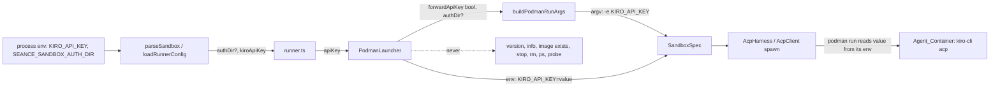
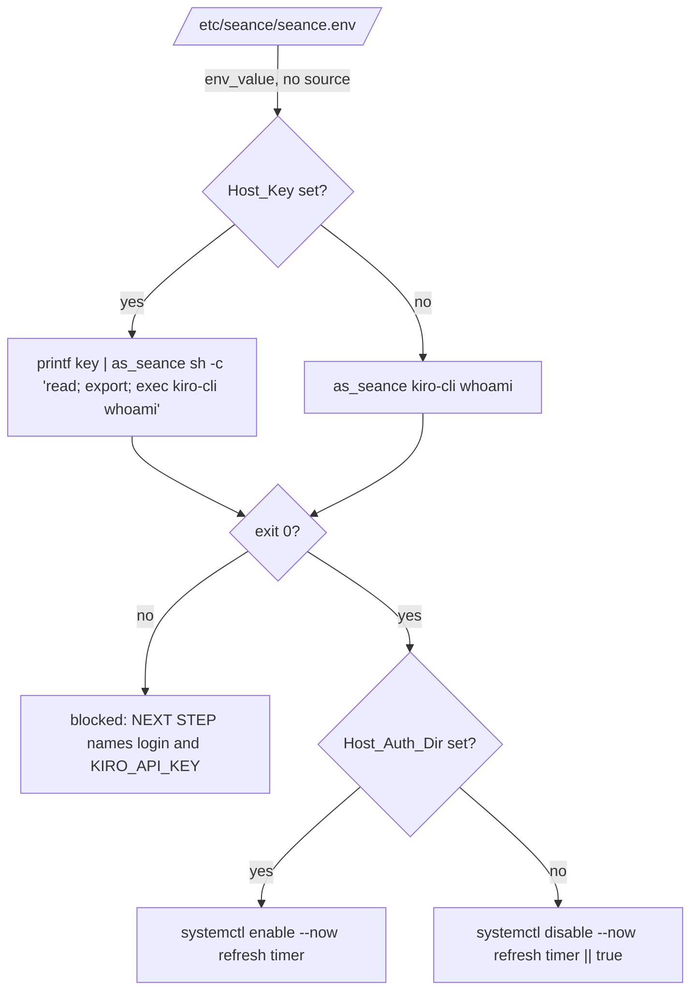

# Design Document

## Overview

In podman mode the Runner today authenticates Kiro only through the read-only `SEANCE_SANDBOX_AUTH_DIR` mount and drops `KIRO_API_KEY`. This design adds a second credential path: the key reaches `kiro-cli acp` inside the Agent_Container through a name-only `-e KIRO_API_KEY` flag, while the value travels only in the environment of the spawned `podman run` process. The Auth_Dir becomes optional when the key is set.

Design decisions:

- **Name-only forwarding.** Podman reads the value of `-e NAME` from its own environment. The argv never holds the value (Requirements 1, 2). No `podman exec` is introduced; the single `podman run` stays.
- **One dedicated input for the key.** The key is not a `forwardEnv` entry. `forwardEnv` keeps rejecting `KIRO_API_KEY` (Requirement 1.6). The builder gets an explicit boolean `forwardApiKey`, so the builder never sees the value at all. That makes "key never in argv" true by construction.
- **The Launcher owns the value.** `LauncherOptions.apiKey` carries it. Only `spec()` places it in the Spawn_Spec env. `podmanEnv()` keeps stripping `KIRO_API_KEY`, which already covers every other invocation (Requirement 1.5, 5.3).
- **Optional Auth_Dir by a single `undefined`.** `PodmanSandboxConfig.authDir` becomes `string | undefined`. Each consumer branches on it once: config validation, builder, path checks, preflight, and secret reading.
- **Login precedence is documented and warned about, not enforced.** Kiro itself prefers a login over the key. Setting both is allowed but logs one warning (Requirement 4.5).
- **Redaction needs almost no new code.** `AcpClient.secrets()` already reads `opts.env["KIRO_API_KEY"]`, and `runner.ts` already puts `config.kiroApiKey` in the shared `SecretRedactor`. Once the Spawn_Spec env holds the key, both apply. No Spawn_Spec masking helper exists any more: the Runner never logs a Spawn_Spec, so the earlier `redactSpawnSpec` is removed (Requirements 2.4, 10.1).
- **Keep the key unreadable and unspeakable for the agent (Requirement 8).** The key is in the container environment, so the shell Deny_List gets a Key_Reader_Command check that sits next to `referencesAuthPath` and uses the same `protected-path` reason. `decide` also rejects Environ_Paths for file tools. The Secret_Redactor already handles Key_Variants and fragments; the design pins that behavior with tests and makes sure every output path shares one instance. Both layers match text only; the real bound on a leak is a dedicated, low-limit, rotatable key (Requirement 11).
- **A blank key is no key (Requirement 9).** `readString`-style trimming for the key happens once in the Config_Loader, after the control-character check.

Research summary: the requirements document records the verified kiro-cli 3.2.1 behavior (starts with only `KIRO_API_KEY`, v2 engine `session/new` and `session/prompt` work, `_kiro.dev/metadata` still has `meteringUsage`, login takes precedence). The follow-up design is grounded in the existing code: `apps/runner/src/permissions/deny-list.ts` (`matchDenyList`, `referencesAuthPath`, `isAuthPath`, `simpleCommands`, `baseName`), `permissions/policy.ts` (`decide`, step 2b for auth paths), `output/secret-redactor.ts` (`variantsOf`, `MIN_FRAGMENT = 8`), `runner.ts` (`new SecretRedactor([config.kiroApiKey, ...authSecrets])`, passed as `redactor` to the channel dependencies), `config.ts` (`readString`, `parseSandbox`, `sandboxAuthWarnings`) and `apps/ircd/test/runner/sandbox.integration.test.ts`. No external research was needed.

## Architecture



Data flow of the key: environment, `RunnerConfig.kiroApiKey`, `LauncherOptions.apiKey`, `SandboxSpec.env`, the podman process environment, the container environment. It appears in no argv.

## Components and Interfaces

### `apps/runner/src/config.ts`

- `PodmanSandboxConfig.authDir: string | undefined` (doc comment updated: optional when `KIRO_API_KEY` is set).
- `PodmanSandboxConfig.ignored` becomes `readonly "SEANCE_KIRO_BIN"[]`. `KIRO_API_KEY` is no longer reported (Requirement 4.6).
- `parseSandbox(env, harness)`:
  - `authDir`: unset or whitespace-only gives `undefined`; otherwise `assertMountSafe` as today (Requirement 3.3).
  - `apiKey = readString(env, "KIRO_API_KEY")`, with an empty string counting as unset. If it contains NUL, CR or LF, throw `ConfigError("KIRO_API_KEY", "KIRO_API_KEY contains a NUL, CR or LF character")` without the value (Requirement 2.6).
  - If `authDir === undefined && apiKey === undefined`, throw `ConfigError` whose `variable` is `SEANCE_SANDBOX_AUTH_DIR` and whose message names both `SEANCE_SANDBOX_AUTH_DIR` and `KIRO_API_KEY` and says one is required (Requirement 4.1).
- `validateRunnerPaths`: runs the directory and realpath checks only when `sandbox.authDir !== undefined` (Requirement 3.3).
- New pure export `sandboxAuthWarnings(config: RunnerConfig): readonly { message: string; fields: { variables: readonly string[] } }[]` returning exactly one entry when the mode is `podman`, `authDir` is set and `kiroApiKey` is set. The message names `KIRO_API_KEY` and `SEANCE_SANDBOX_AUTH_DIR`, states login precedence, and never includes the value (Requirement 4.5). Keeping it pure makes it testable without a logger.
- Mode `none`: unchanged (Requirement 4.7). `kiroApiKey` is still read for both modes.

### `apps/runner/src/sandbox/podman-args.ts`

- `PodmanRunInput.config.authDir` becomes `string | undefined`.
- New field `forwardApiKey: boolean`.
- `checkPath("the auth directory", ...)` and `assertMountPaths` receive `authDir` only when defined.
- The `--mount` for the Auth_Dir is spread in conditionally, in its existing position, so the argv is unchanged when it is set (Requirement 3.1, 5.1).
- After the `...i.forwardEnv.flatMap(...)` entries and before the image: `...(i.forwardApiKey ? ["-e", "KIRO_API_KEY"] : [])` (Requirement 1.1, 2.2, 5.2).
- `NEVER_FORWARDED` still contains `KIRO_API_KEY`, so `forwardEnv` rejects it (Requirement 1.6).
- `buildProbeArgs` is untouched: it has no key input.

### `apps/runner/src/sandbox/paths.ts`

`MountPaths.authDir` becomes optional. `assertMountPaths` skips the two auth overlap checks when it is undefined; all other checks stay (Requirement 3.5). `resolveMountPaths` passes it through.

### `apps/runner/src/sandbox/launcher.ts`

- `LauncherOptions.apiKey?: string`. An empty string is treated as unset in the constructor.
- `preflight()`: the `stat(authDir)` block and the `auth-missing` error run only when `authDir !== undefined`. Version, rootless, image and probe checks are unchanged (Requirement 3.4).
- `spec()`:
  - passes `authDir` conditionally to `resolveMountPaths`;
  - passes `forwardApiKey: this.#apiKey !== undefined` to the builder;
  - builds `env = this.podmanEnv(extra)` and, when the key is set, adds `env["KIRO_API_KEY"] = key`. `podmanEnv` still never emits the key, so every other `#podman(...)` call (version, info, image exists, stop, rm, ps, probe `run`) stays key-free (Requirement 1.5, 5.3).
- `HOST_ONLY` keeps `KIRO_API_KEY`, so `extraEnv` cannot smuggle a second copy.
- `redactSpawnSpec` is **removed** from this file (Requirements 2.4, 10.1). It was unused: no code logs a Spawn_Spec, a Podman_Process_Env or a podman argv. The rule is now "never log them", enforced by review and by Property 5.
- Errors and logs: no code path interpolates the key. `SandboxError` messages are unchanged and `scrubDetail` still processes podman stderr; `spec()` also passes podman stderr text through `redactValues` with the key where stderr is logged or embedded, covering a podman error that echoes its environment.

### `apps/runner/src/runner.ts`

- Pass `apiKey: config.kiroApiKey` to `new PodmanLauncher(...)`.
- Remove the `KIRO_API_KEY` branch of the `ignored` warning loop.
- Log each entry of `sandboxAuthWarnings(config)` with `logger.warn` at startup.
- Call `readAuthSecrets` only when `sandboxConfig.authDir !== undefined`; otherwise `authSecrets = []`. The shared `SecretRedactor([config.kiroApiKey, ...authSecrets])` already covers the key (Requirement 2.5, 5.4).

### `apps/runner/src/config.ts` (whitespace-only key, Requirement 9)

`readString(env, name)` returns `undefined` for `undefined` and `""` only. A new local helper `readApiKey(env)` is used by both `parseSandbox` and `loadRunnerConfig` so they cannot disagree:

1. `raw = env["KIRO_API_KEY"]`; if `undefined` or `""`, return `undefined`.
2. If `raw` contains NUL, CR or LF, throw `ConfigError("KIRO_API_KEY", "KIRO_API_KEY contains a NUL, CR or LF character")` without the value. This runs first, so `" \n"` fails here (9.4).
3. If `raw.trim() === ""` (JS `trim` strips all Unicode whitespace), return `undefined` (9.1).
4. Otherwise return `raw` unchanged, with its leading and trailing whitespace (9.3).

Because `parseSandbox` and `loadRunnerConfig` both call it, `kiroApiKey` is `undefined` for a blank key in both modes (9.5), and a podman config with a blank key and no Auth_Dir fails with the Requirement 4.1 error (9.2). `sandboxAuthWarnings` and `buildSpawnSpec` (`harness/spawn.ts`) keep their `key !== undefined && key !== ""` guard (9.6); it is now redundant for config output but stays for callers that build a config by hand.

### `apps/runner/src/permissions/deny-list.ts` (Requirement 8.1, 8.2, 8.4)

A new exported pure function `referencesKeyReader(command: string): boolean`, called from `matchDenyList` right after `referencesAuthPath`, returning `{ reason: "protected-path" }`. It follows `referencesAuthPath`: a textual floor that never performs I/O.

- **Normalised view:** `plain = command.replace(/["'\\]/g, "").toLowerCase()` (8.2). This also handles `/proc/self/en\viron` and `"/proc"/self/environ`.
- **Variable by name:** `plain.includes("kiro_api_key")` catches `$KIRO_API_KEY`, `${KIRO_API_KEY}`, `printenv KIRO_API_KEY` and `grep KIRO` is covered by the `env` rule below.
- **Environ file:** the regex `/\/proc\/(?:self|thread-self|\d+|\*|[^/\s]*[*?[][^/\s]*)\/environ/` on `plain`, plus a looser `/\/proc\/[^\s]*environ/`. The second form is intentionally broad (fail closed) so `/proc/*/environ`, `/proc/1*/environ` and `/proc/s*lf/environ` all match.
- **Reader commands:** for each word list from the existing `simpleCommands(command)` (which already splits on `; & | < > ( ) \` { }` and newlines and strips quotes and backslashes), skip wrapper words: any leading word whose `baseName` is `command`, `exec`, `sudo`, `xargs`, `nohup`, `time`, `builtin`, then options starting with `-` of those wrappers. Let `name = baseName(firstRemainingWord)` (so `/usr/bin/env` becomes `env`, 8.2). Then:
  - `printenv` and `export` always match (`export -p` and bare `export` list the environment; `export FOO=1` is harmless but also matches, accepted as fail closed since an agent has no need for it in a one-shot command).
  - `declare` or `typeset` match when an argument is `-x`, `-p` or a flag cluster containing `x`; `set` matches when it has no arguments.
  - `env` matches **unless** it has a command operand: scan the words after `env`, skipping options (`-i`, `-u NAME`, `--`, anything starting with `-`) and `NAME=value` assignments; if a further word remains, that is a command operand and `env` does not match on its own (8.4). The operand command is itself one of the later words of that simple command list and is checked by the other deny rules; if the operand is again a reader (`env env`, `env printenv`), the loop re-checks from that word.
- `sudo` and `xargs` can be chained (`xargs -0 env`), so the scan restarts at the next non-option word after every wrapper.
- `env FOO=1 git status` passes (8.4); `git status` and `cat /proc/cpuinfo` pass because `/proc/cpuinfo` does not end in `environ`.

The check runs on every shell command in every mode (it sits before step 6 of `evaluate`, with the other deny rules), including `op`. Limits, documented in Requirement 8.9: scripts (`python -c`), encoded names and constructed strings are not recognised.

### `apps/runner/src/permissions/policy.ts` (Requirement 8.3)

`deny-list.ts` gains `isEnvironPath(path: string): boolean`: normalises backslashes to `/`, lower-cases, splits into non-empty segments, and returns true when some segment `environ` is directly preceded by a segment that is `self`, `thread-self`, all digits, or contains a glob character (`*`, `?`, `[`) and an earlier segment is `proc`. `evaluate` step 2b is extended: for each path, `isAuthPath(p.raw) || isAuthPath(p.resolved) || isEnvironPath(p.raw) || isEnvironPath(p.resolved)` returns `reject("protected-path")`. Step 2b runs before confinement and mode, so it holds for `op`, `voice` and `none`, for read and write tools alike. The resolved path may be undefined; the existing code rejects that earlier as `unresolved-path`.

### `apps/runner/src/output/secret-redactor.ts` and `runner.ts` (Requirement 8.5 to 8.8)

No logic change is needed; the behavior is already what the requirements specify and is pinned by tests:

- `variantsOf(secret)` returns raw, base64 (padded and unpadded), base64url (padded and unpadded) and hex in both cases (8.6). The constructor indexes every `MIN_FRAGMENT = 8` window of every variant and replaces whole variants longest first.
- For a secret shorter than `MIN_SECRET = 8`, the constructor adds only the whole value and indexes no windows (8.7).
- `runner.ts` builds one `new SecretRedactor([config.kiroApiKey, ...authSecrets])` and passes the same instance as `redactor` into the channel dependencies. The design requires that every agent output path (channel text, AWAY text, whois text, tool notices) takes that instance; the `secrets: [config.kiroApiKey]` list that goes to the older raw-key redaction path stays as a second layer. A test drives each path with a base64 form of the key (12.4). If a path is found that redacts only the raw key, it is changed to use `redactor` (8.8).

### `apps/ircd/test/runner/sandbox.integration.test.ts` (Requirement 10.3, 10.4)

The test currently sets `KIRO_API_KEY=kiro-canary` and expects `KIRO_API_KEY=<unset>` from the in-container probe `env:SEANCE_SECRET_CANARY,KIRO_API_KEY`. New contract:

- Title: `hides host secrets, forwards KIRO_API_KEY as set, has no git metadata, cannot reach the metadata endpoint`.
- The probe output must show only a marker. The probe is changed to print `set` or `<unset>` for `KIRO_API_KEY` and never the value (a probe option such as `env:SEANCE_SECRET_CANARY` for values plus `envset:KIRO_API_KEY` for the marker, or one probe that masks any name listed after a `!`). The assertion becomes `toContain("SEANCE_SECRET_CANARY=<unset> KIRO_API_KEY=set")`, and a second assertion `not.toContain("kiro-canary")` checks that the value never reaches the channel.
- The Runner in the scene has `kiroApiKey` set from the environment, so the Launcher forwards it. The `it.skipIf(!available)` guard stays.
- The Fake_Agent probe lives with the other fixtures; the same change is made in its source and checked by the fake-podman path of the ircd tests.

### Documentation and spec notes (Requirements 6, 10.5 to 10.7, 11)

- `docs/DEPLOY.md` section 5: remove "the host has no `KIRO_API_KEY`"; state that the login is the default and `KIRO_API_KEY` is the documented alternative; add the Requirement 11 guidance (dedicated key, usage limit at or below the acceptable loss, the credits counter plus the limit bound the cost of a leak, rotation steps, revoke after January 29, 2027, no personal login on a public host).
- `docs/SANDBOX.md`: the same guidance in full, the "readable inside the container" statement, the egress allow-list note, and the text-only limit of the Deny_List and Secret_Redactor (8.9).
- `README.md` and `deploy/seance.env.example`: one line each pointing at `docs/SANDBOX.md`.
- `.kiro/specs/agent-sandbox/design.md`: D18 in the decision table, the D10 sentence "`KIRO_API_KEY` is not forwarded at all (D18)", the `authDir` comment ("required (D18)"), the mount-section sentence "`KIRO_API_KEY` never appears (D18)", and Open Point 2 (credential exposure) each keep their original text and get an added note "Superseded by `sandbox-api-key-auth` (Requirements 1 to 4)". Property 3's key sentence gets the same note.
- `.kiro/specs/agent-sandbox/requirements.md`: criterion 4 of the configuration requirement (line 68, the `KIRO_API_KEY SHALL NOT count as a credential source` sentence) and criterion 4 of the environment requirement (line 135) are kept and marked "Superseded by `sandbox-api-key-auth` Requirements 1 and 4".

### Deny-list gap closure (Requirement 13)

This section refines the `referencesKeyReader` description above; the earlier text stays valid for the checks it describes.

`apps/runner/src/permissions/deny-list.ts`:

- **`shellWords(part: string): string[]`** replaces the quote-stripping word split in the key-reader path. It is quote-aware: quotes and backslash escapes are removed, and a quoted group stays one word (`sh -c "git status"` yields `["sh", "-c", "git status"]`). An unterminated quote ends at the end of the part.
- **`referencesKeyReader(command: string, depth = 0): boolean`**:
  - Plain checks on `plain` (quotes and backslashes removed, lower-cased): `kiro_api_key`; `/proc` together with `environ`; and new (13.6): when `plain` mentions `/proc`, any path segment (split on `/` and whitespace) that contains `*`, `?` or `[` and for which `globMatches(segment, "environ")` is true returns true. This covers `/proc/self/envi*`, `/proc/self/env?ron`, `/proc/self/*` and `/proc/self/[e]nviron`. `cat /proc/cpuinfo` has no glob segment and passes.
  - Then, for each part of `command.split(/[;&|<>()`{}\n]+/)`, run `isKeyReaderWords(shellWords(part), depth)`.
- **`isKeyReaderWords(words, depth)`**: skips leading assignments and wrappers (existing rules), then:
  - `printenv`, `export`, `declare`, `typeset`, `set`: unchanged.
  - `env`: no command operand returns true; with an operand (13.5), recurse `isKeyReaderWords(rest.slice(j), depth)`, so `env printenv` is denied and `env FOO=1 git status` is allowed.
  - Shell names `sh`, `bash`, `zsh`, `dash`, `ksh`, `ash` (by lower-cased base name): find the first option word matching `/^-[A-Za-z]*c[A-Za-z]*$/`; the script is the next word. If `depth >= 4`, return true (fail closed, 13.2). Otherwise return `referencesKeyReader(script, depth + 1)` (13.1). No `-c` option returns false.
  - Nesting: depth 0 is the top-level command, so `sh -c "sh -c \"sh -c env\""` (depth 2) is denied, a reader at depth 4 is denied by the check, and a depth-5 wrapper is denied by the depth rule even around a harmless command.
- **`isEnvironPath`** (13.7): also returns true when a `proc` segment precedes the last segment and the last segment contains `*`, `?` or `[` and `globMatches(last, "environ")`. `decide` is unchanged and rejects it as `protected-path`.

Runner-level redaction test (13.9, 13.10): an ircd integration test in `apps/ircd/test/runner` using `startIntegration` with the Fake_Agent script. `KIRO_API_KEY` is passed through the runner env. The fake agent emits the raw key and its base64 form as agent text, as a tool-call title or notice, and on an error or notice path. The test collects every IRC line and asserts none contains either form. The implementer must first check which Fake_Agent script steps exist and add any missing step (for example a tool-call title with free text, an error path) to the fixture.

Docs and spec notes (13.11 to 13.15):

- `docs/SANDBOX.md` and `docs/DEPLOY.md`: `podman inspect` of a running Agent_Container and the host `/proc/<pid>/environ` of the podman process expose the key to the `seance` user and root; list the remaining text-deny-list limits (`python -c`, `node -e`, `awk` with `ENVIRON`, `perl`, other encodings, names built at run time by concatenation or command substitution); state that a dedicated, low-limit, rotatable key is the main mitigation.
- `.kiro/specs/deploy-aws/design.md`: decision D7 ("No `KIRO_API_KEY` on the host") keeps its text and gets the note "Superseded by `sandbox-api-key-auth`".
- `.kiro/specs/deploy-aws/requirements.md`: criterion 1 of the Kiro login requirement (line 69, "`KIRO_API_KEY` SHALL NOT be used") keeps its text and gets the note "Superseded by `sandbox-api-key-auth` Requirements 1, 4 and 10".
- `apps/web/next-env.d.ts` is not touched (13.17).

### Final deny-list hardening (Requirement 14)

This section extends the Requirement 13 text above; earlier rules stay valid. All changes are in `apps/runner/src/permissions/deny-list.ts`. `SCRIPT_SHELLS` (now including `mksh` and `fish`), `MAX_SCRIPT_DEPTH` (4) and `KEY_READER_WRAPPERS` are the existing constants.

**Separator-aware split.** `referencesKeyReader` splits with the capturing regex `/([;&|<>()`{}\n]+)/`, so each part keeps the separator before and after it. A part is `piped` when its preceding separator contains `|` (any `|`, including `||`; fail closed). A part is here-string fed when its following separator starts with `<<` (`bash <<< env`, `sh << EOF`). The signature becomes `isKeyReaderWords(words, depth, piped)`, where `piped` is true for a piped or `<<`/`<<<` fed part. Recursive calls (`env` operand, `eval`, `-c` script) pass `false`, because a nested script text is not itself fed by a pipe.

**Wrapper option values (14.5, 14.6).** A new constant:

```ts
const WRAPPER_OPTIONS_WITH_ARG: Map<string, Set<string>> = new Map([
  ["sudo", new Set(["-u","-g","-C","-D","-h","-p","-r","-t","-U","-T",
    "--user","--group","--close-from","--chdir","--host","--prompt","--role",
    "--type","--other-user","--command-timeout"])],
  ["exec", new Set(["-a"])],
  ["xargs", new Set(["-I","-L","-n","-P","-s","-d","-E","-a",
    "--max-args","--max-procs","--delimiter","--arg-file"])],
  ["time", new Set(["-f","-o","--format","--output"])],
]);
```

`nohup`, `command` and `builtin` have no entry. After a wrapper, the loop consumes words that start with `-`. For each such word the option name is the whole word, or for a long form the part before `=`. If the name is in the wrapper's set and the word has no inline `=value`, the next word is consumed too. `--` ends the options. The first remaining word is the Command_Word, so `sudo -u root env`, `exec -a x env`, `xargs -I {} printenv`, `time -o out.txt printenv` and `sudo --user=root printenv` are denied.

**`eval` (14.1 to 14.3).** New case in `isKeyReaderWords`: `case "eval": if (depth >= MAX_SCRIPT_DEPTH) return true; return referencesKeyReader(rest.join(" "), depth + 1);`. Chains deeper than 4 levels fail closed (14.2).

**Shell without `-c` (14.4).** Shell names compared by lower-cased base name over the extended list. If a `-c` option group exists, behaviour is unchanged (recurse into the script). Otherwise the first non-option word is a Script_File_Operand and the result is false (`sh script.sh`). If there is none (only options such as `-s`, `-i`, `-l`) the result is `piped`: true for `echo env | sh`, `printf 'env' | bash`, `bash <<< env`, `cat x | bash -s`; false for a bare `bash` or `git log | sort` (not a shell). The script text is never inspected.

**Proc globs (14.7, 14.8).** A shared helper `hasProcEnvironSegments(segments)` returns true when some segment `i` equals `proc` or (contains `*`, `?` or `[` and `globMatches(seg, "proc")`), and some later segment `j > i` equals `environ` or (contains a glob char and `globMatches(seg, "environ")`). `referencesKeyReader` runs it on every whitespace-separated token of `plain`, split into `/` segments, and the check does not depend on a literal `/proc` in the command; it only fires with a matching later segment, so `cat /proc/cpuinfo` and `cat /pr?c/self/status` pass. `isEnvironPath` calls the same helper in addition to its existing checks, so `/pr?c/self/environ`, `/p*/self/environ` and `/[p]roc/1/environ` are rejected by `decide` as `protected-path`. The existing simpler checks are kept.

**Tests and docs (14.9 to 14.11).** `apps/runner/test/key-reader.test.ts` lists every denied example of criteria 1 to 8 in DENIED, the allowed `sh script.sh`, `bash -c "git status"` and `git log | sort`, `isEnvironPath` assertions for the three Proc_Glob paths, and a rejected `eval` chain nested deeper than 4. `docs/SANDBOX.md` gets one line: the deny list is best-effort and the dedicated low-limit key is the real control. `apps/web/next-env.d.ts` is not touched.

### API-key-only deploy hosts (Requirement 15)

Today `bootstrap.sh` assumes a Kiro login: `ready_for_agents` (L444-480) runs `as_seance kiro-cli whoami`, which has no `KIRO_API_KEY` because `as_seance` starts with `env -i`; `main` (L482-510) enables `seance-kiro-refresh.timer` in two places (L501 and in the combined `enable --now` at L505); `update.sh` (L79-83) enables the timer when the agents were running; `seance-ircd.service` carries `ConditionDirectoryNotEmpty=/home/seance/.local/share/kiro-cli`, which silently skips the unit on a key-only host (no login directory); `seance-kiro-refresh.sh` fails when there is no login database. Research: none external. The kiro-cli behavior (`KIRO_API_KEY=<key> kiro-cli whoami` exits 0 with no login) is recorded in Requirement 15.6.



Decisions:

- **D-A: one helper, `env_value NAME FILE`, in POSIX `sh`.** It lives in a new file `deploy/env-value.sh`, sourced by `bootstrap.sh` and `update.sh` (both run from `/opt/seance/deploy`; `# shellcheck source=` directives keep CI green). The refresh script is installed alone to `/usr/local/sbin`, so it carries an inline copy of the same function; a test extracts both texts and asserts they are identical, so they cannot drift. The function reads the file line by line with `IFS= read -r`, keeps the value of the last line that starts with `NAME=` (a commented line cannot match the prefix), strips one pair of surrounding `"` or `'`, prints nothing when the result has no non-whitespace character (blank is unset, Requirement 9), and returns 0 when the file is missing or unreadable. No `source`, no `eval`, no `grep` with the name in a regex, nothing from the file is ever expanded. The same file also defines `sync_refresh_timer` (D-C), which uses `log` and `ENV_FILE` of the caller; `update.sh` gains `ENV_FILE=/etc/seance/seance.env`. Known limit: a line with leading whitespace before the name is ignored (systemd would accept it); the rendered file never has one.
- **D-B: the key reaches `kiro-cli whoami` through stdin, not argv or the root shell environment.** The gate becomes a function `kiro_credential_ok` called by `ready_for_agents`:

  ```bash
  kiro_credential_ok() {
    local key
    key=$(env_value KIRO_API_KEY "$ENV_FILE")
    if [ -z "$key" ]; then
      as_seance kiro-cli whoami >/dev/null 2>&1
      return
    fi
    # printf is a builtin: the key is in no argv. The child reads it from stdin into its own
    # environment and execs kiro-cli, so only the kiro-cli process holds it. The trailing newline
    # is required: read returns non-zero at EOF without one.
    printf '%s\n' "$key" |
      as_seance sh -c 'IFS= read -r KIRO_API_KEY || exit 1; export KIRO_API_KEY; exec kiro-cli whoami' >/dev/null 2>&1
  }
  ```

  `as_seance` is `( cd ... && runuser -u seance -- env -i ... "$@" )`; its stdin is inherited, `env -i` clears root's variables and the child shell script text is a constant, so `sudo`, `runuser`, `env` and `sh` see no key. `IFS=` and `-r` keep leading and trailing spaces and backslashes exactly as the Runner would see them. Output and errors of `whoami` go to `/dev/null` (whoami prints the account name), so the log `/var/log/seance-bootstrap.log` and the terminal get only the fixed lines below; this also covers a CLI that would echo its environment. The script never enables `set -x` (a test asserts it), and `key` is a local, never exported. When the check fails with a key set, the NEXT STEP text names `KIRO_API_KEY` and `/etc/seance/seance.env` and never the value; with no key it names both options (the device-flow login commands as today, or setting `KIRO_API_KEY`). If both a login and a key exist, `whoami` uses whichever kiro-cli prefers (the login), which matches the Runner's precedence rule.
- **D-C: the refresh timer follows `SEANCE_SANDBOX_AUTH_DIR`.** `sync_refresh_timer` (in `deploy/env-value.sh`): if `env_value SEANCE_SANDBOX_AUTH_DIR "$ENV_FILE"` is non-empty, `systemctl enable --now seance-kiro-refresh.timer`; otherwise it logs one line ("no SEANCE_SANDBOX_AUTH_DIR: the Kiro login refresh timer stays off") and runs `systemctl disable --now seance-kiro-refresh.timer || true` (the `|| true` covers a timer that is not installed or not enabled). In `bootstrap.sh`, L501 becomes `sync_refresh_timer`, and the L505 line is split: `systemctl enable --now seance-sandbox-nft.service seance-egress-refresh.timer`, then `sync_refresh_timer`. In `update.sh` the single `systemctl enable --now seance-kiro-refresh.timer` inside the `AGENTS_WERE_ACTIVE` branch becomes `sync_refresh_timer`. The units and the script keep being installed on every host (cheap, and switching later needs no reinstall). Switching a host from a login to the key: unset `SEANCE_SANDBOX_AUTH_DIR`, run `bootstrap.sh` again; the teardown of `docs/DEPLOY.md` section 9 already disables the timer first.
- **D-D: `seance-kiro-refresh.sh` exits early without an Auth_Dir.** Before the user check and before any file access: if `SEANCE_SANDBOX_AUTH_DIR` is unset or blank in the process environment, read it from `${SEANCE_ENV_FILE:-/etc/seance/seance.env}` with the inline `env_value`; if still blank, `log "no SEANCE_SANDBOX_AUTH_DIR: nothing to refresh"` and `exit 0` (exactly one line starting `seance-kiro-refresh:`; nothing under `HOME` is created, because the early exit runs before `mktemp`, `flock` and the `.refresh.lock` open). The file is `0600` root, so as `seance` it is not readable: `env_value` returns nothing for an unreadable file. To keep login hosts working, `seance-kiro-refresh.service` gains `EnvironmentFile=-/etc/seance/seance.env`, which systemd reads as root; the refresh script already runs `kiro-cli whoami` under `env -i`, so a `KIRO_API_KEY` in its environment never reaches a child. The unit has no `Environment=` line with `KIRO_API_KEY` (Requirement 15.15). An unreadable file on a manual run therefore means "unset": the safe side (the login is untouched). The existing `AUTH_DIR=${AUTH_DIR:-...}` default stays for tests and manual runs that pass `AUTH_DIR`.
- **D-E: the ircd unit checks the login directory only when one is configured.** `ConditionDirectoryNotEmpty=` is removed (it also skipped key-only hosts silently). `EnvironmentFile=/etc/seance/seance.env` is already present and applies to `ExecStartPre`, which runs as `User=seance`. Add, after `ExecStart`'s siblings and before `ExecStart`:

  ```ini
  # bootstrap.sh and the Runner at start (Requirement 4, criterion 1) check the credential. This is a
  # second, cheap check for a login host: with SEANCE_SANDBOX_AUTH_DIR set, the directory must not be empty.
  ExecStartPre=/bin/sh -c 'case "$$SEANCE_SANDBOX_AUTH_DIR" in *[![:space:]]*) [ -n "$$(ls -A -- "$$SEANCE_SANDBOX_AUTH_DIR" 2>/dev/null)" ] ;; esac'
  ```

  `$$` is systemd's escape for a literal `$`; without it systemd would substitute the variable itself and split words. A `case` with no matching branch returns 0, so an unset or blank variable exits 0, a set directory with entries exits 0, a set but empty or missing directory exits non-zero and the unit fails (Restart=on-failure retries every 5 s, as for any start failure). Because systemd cannot branch on the env file contents, this shell is the only branch.
- **D-F: `seance.env.example` keeps `SEANCE_SANDBOX_AUTH_DIR` uncommented.** Login is the default path in `docs/DEPLOY.md` and the rendered file must start in a working state for it; commenting it would make a fresh host fail Requirement 4.1 until the operator edits it. The comment changes to: optional when `KIRO_API_KEY` is set; it also enables the login refresh timer; for a key-only host delete or blank the line and set `KIRO_API_KEY`. The `KIRO_API_KEY` placeholder stays commented (Requirement 6.6, 15.22). No existing test reads `seance.env.example` (searched `apps/**/*.ts`), so only the new assertions apply.
- **`docs/DEPLOY.md` section 5** gets the key-only path, the "`bootstrap.sh` checks the key with `kiro-cli whoami` as `seance`, key not in argv" sentence, and the switch-from-login steps (Requirements 15.19 to 15.21).

Test notes (`apps/runner/test/sandbox-files.test.ts`; the dev Mac cannot run systemd, so nothing here starts a unit; shell tests run `sh`/`bash` with fake commands on `PATH` in a temp dir, like the existing SQLite helper test):

- **Static (text of the files):** `bootstrap.sh` passes the key through the environment of the `kiro-cli` process (`IFS= read -r KIRO_API_KEY`, `exec kiro-cli whoami`), no line puts `KIRO_API_KEY=` followed by an expansion on a line that also has `sudo`, `su`, `runuser` or `env`, and the file has no `set -x`, `bash -x` or `xtrace` (15.23). Both scripts call `sync_refresh_timer` (or contain the guarded enable) and contain `systemctl disable --now seance-kiro-refresh.timer`; no `systemctl enable ... seance-kiro-refresh.timer` appears outside a branch guarded by the `SEANCE_SANDBOX_AUTH_DIR` check (15.25). The existing assertions at `sandbox-files.test.ts` L287-L300 (two `systemctl enable ... seance-kiro-refresh.timer` lines after `main() {`, `elif ready_for_agents; then` followed by an `enable --now ... seance-kiro-refresh.timer`, `update.sh` guarded `systemctl enable --now seance-kiro-refresh.timer`) are rewritten to the new structure: one guarded enable inside `sync_refresh_timer`, a call to it in `main()` after both start paths, and a call to it in the `AGENTS_WERE_ACTIVE` branch of `update.sh`. The ircd unit has no `ConditionDirectoryNotEmpty=` and has the `ExecStartPre=` line (15.16, 15.17, 15.18, 15.27). The refresh unit has no `Environment=` line containing `KIRO_API_KEY` (15.15). `docs/DEPLOY.md` section 5 and `deploy/seance.env.example` contain the statements of 15.19, 15.20, 15.22.
- **Executable:** (1) `env_value` (Property 19) with `sh` on a temp file; (2) the credential check (Property 20): the test extracts `env_value` and `kiro_credential_ok` plus `as_seance` stubbed by a fake `runuser` that drops its first arguments up to `--` and runs the rest, with fake `kiro-cli` writing its argv and `KIRO_API_KEY` to a file; the child is run with `bash -x` to prove the trace is clean (the function runs under `{ bash -x; } 2>&1` capture, `set -x` allowed in the test only); (3) the refresh script run with `SEANCE_SANDBOX_AUTH_DIR` unset and blank, `HOME` pointing at an empty temp dir, `SEANCE_ENV_FILE` pointing at a non-existent path: exit 0, one `seance-kiro-refresh:` line, directory still empty (15.26); (4) the `ExecStartPre` shell string, extracted from the unit and with `$$` turned into `$`, run with an unset variable, a blank one, an empty directory and a directory with an entry: exit 0, 0, non-zero, 0; (5) the two `env_value` texts are identical.
- **shellcheck:** CI already runs `shellcheck --severity=style deploy/*.sh`, which will include `deploy/env-value.sh`. Run it locally if installed; otherwise report it as not run (15.28, 15.29). Note `local key` and `local` in a `#!/usr/bin/env bash` script are fine; the refresh script is `#!/bin/sh`, so its inline `env_value` uses no `local` and no `[[ ]]`.
- `pnpm typecheck` and `pnpm test` pass and `apps/web/next-env.d.ts` stays unmodified (15.30); per the repo memory, run `pnpm` verification through `execute_bash`, not turbo-backgrounded.

### `apps/runner/src/harness/spawn.ts`

Comment update only: the key is no longer "never placed in the environment" in podman mode; it is in the podman process env, not in argv.

### Documentation

`README.md` (runner table, Secrets), `DESIGN.md` (harness section near line 190), `docs/SANDBOX.md`, `deploy/seance.env.example` change as listed in Requirement 6. Content points: name-only forwarding with the value in the podman process env; `SEANCE_SANDBOX_AUTH_DIR` optional with a key, required otherwise; login beats key when both exist; no statement that the key is never forwarded; the key is readable inside the Agent_Container, so use a dedicated key with a usage limit and revoke it after January 29, 2027; the example env file lists `KIRO_API_KEY=` with a placeholder only.

## Data Models

```ts
// config.ts
interface PodmanSandboxConfig {
  readonly mode: "podman";
  readonly authDir: string | undefined;            // was string
  readonly ignored: readonly "SEANCE_KIRO_BIN"[];  // KIRO_API_KEY removed
  /* other fields unchanged */
}

// podman-args.ts
interface PodmanRunInput {
  readonly config: Pick<PodmanSandboxConfig, "image" | "authDir" | "memory" | "cpus" | "pids" | "timeoutS" | "kiroBin">;
  readonly forwardApiKey: boolean;                 // new; the value is never an input
  /* other fields unchanged */
}

// paths.ts
type MountPaths = { /* ... */ readonly authDir?: string };

// launcher.ts
type LauncherOptions = { /* ... */ readonly apiKey?: string };
```

The Api_Key credential matrix (podman mode):

| Auth_Dir | Api_Key | Result | Argv | Spawn_Spec env |
|---|---|---|---|---|
| unset | unset | `ConfigError` naming both | n/a | n/a |
| unset | set | accepted | `-e KIRO_API_KEY`, no auth mount | has key |
| set | unset | accepted (current behavior) | auth mount, no key flag | no key |
| set | set | accepted plus one warning | auth mount and key flag | has key |

## Correctness Properties

*A property is a characteristic or behavior that should hold true across all valid executions of a system-essentially, a formal statement about what the system should do. Properties serve as the bridge between human-readable specifications and machine-verifiable correctness guarantees.*

Reflection: 1.1, 2.1, 2.2, 5.2 collapse into one argv property. 3.1 and 3.2 collapse into one auth-mount property. 4.1 to 4.4 collapse into one credential-matrix property. 1.2 and 1.3 collapse into one spec-env property. 1.5 and 5.3 collapse into one property. Requirement 9 yields Properties 9 and 10; 8.1 and 8.2 collapse into Property 11; 8.5, 8.6 and 12.3 into Property 14. Old Property 6 is removed with `redactSpawnSpec`. The remaining criteria are examples or smoke checks (see Testing Strategy).

### Property 1: Key never in argv

*For any* valid builder input and *for any* non-empty key string without NUL, CR or LF (including multi-byte UTF-8), when `forwardApiKey` is true the argv has no element containing the key text, and it equals the argv built with `forwardApiKey` false plus exactly one `-e` / `KIRO_API_KEY` pair placed before the image and without `=`.

**Validates: Requirements 1.1, 2.1, 2.2, 5.1, 5.2**

### Property 2: Auth mount present exactly when Auth_Dir is set

*For any* valid builder input, the argv contains exactly one auth `--mount` (destination at the auth mount point) when `authDir` is defined, and none when it is `undefined`, and in the undefined case no auth path validation runs, so no error mentions the auth directory.

**Validates: Requirements 3.1, 3.2, 4.4**

### Property 3: Spawn_Spec env carries the key, argv does not

*For any* key (or none) and any valid session, the Spawn_Spec env has `KIRO_API_KEY` equal to the key when the key is set and has no `KIRO_API_KEY` entry otherwise, and no element of the Spawn_Spec args contains the key.

**Validates: Requirements 1.2, 1.3**

### Property 4: Only the agent run receives the key

*For any* key, across `preflight`, `quickCheck`, `remove`, `sweep` and the probe `run`, no recorded podman invocation (argv or env) contains the key or a `KIRO_API_KEY` variable.

**Validates: Requirements 1.5, 5.3**

### Property 5: Launcher never leaks the key in logs or errors

*For any* key, no log record emitted and no `SandboxError` message or detail produced by the Launcher during preflight, spec, remove and sweep (including with failing fake podman calls whose stderr echoes the key) contains the key.

**Validates: Requirements 2.3**

### Property 6: Removed

Removed. It tested `redactSpawnSpec`, which is deleted (Requirements 2.4, 7.7, 10.1). The number is kept so later references stay stable. Property 5 covers "the key is not in logs or errors".

**Validates: Requirements 2.4, 7.7, 10.1**

### Property 7: Credential matrix at startup

*For any* podman environment with valid other variables, any Auth_Dir presence and any key presence (non-empty, control-free), `loadRunnerConfig` throws a `ConfigError` naming `SEANCE_SANDBOX_AUTH_DIR` and `KIRO_API_KEY` without the key value when neither is set, and otherwise returns a config whose `ignored` list lacks `KIRO_API_KEY`; `sandboxAuthWarnings` returns exactly one warning, free of the key value, when both are set and none otherwise.

**Validates: Requirements 4.1, 4.2, 4.3, 4.4, 4.5, 4.6**

### Property 8: Control characters in the key are rejected

*For any* key that contains at least one NUL, CR or LF at any position, `loadRunnerConfig` in podman mode throws a `ConfigError` for `KIRO_API_KEY` whose message does not contain the key.

**Validates: Requirements 2.6**

### Property 9: Whitespace-only key is unset, other keys are kept

*For any* string made only of Unicode whitespace characters (without NUL, CR, LF), `loadRunnerConfig` yields `kiroApiKey === undefined` in both modes, and in podman mode without an Auth_Dir it throws the Requirement 4.1 `ConfigError`. *For any* control-free key with at least one non-whitespace character, `kiroApiKey` equals the input exactly, including leading and trailing whitespace.

**Validates: Requirements 9.1, 9.2, 9.3, 9.5**

### Property 10: Control characters win over the blank check

*For any* string that contains a NUL, CR or LF, even if every other character is whitespace, `loadRunnerConfig` throws a `ConfigError` for `KIRO_API_KEY` without the value in the message.

**Validates: Requirements 9.4**

### Property 11: Key readers are denied

*For any* generated command built from a reader template (`env`, `printenv [NAME]`, `export -p`, `declare -x`, `set`, `cat /proc/<self|digits|*>/environ`, `echo $KIRO_API_KEY`, `${KIRO_API_KEY}`), any path prefix on the command name (`/usr/bin/`), any wrapper chain from `command`, `exec`, `sudo`, `xargs`, any quoting or backslash insertion inside the names, and any placement as one simple command of a list, pipeline or substitution, `matchDenyList` returns `{ reason: "protected-path" }`.

**Validates: Requirements 8.1, 8.2**

### Property 12: Harmless env use and ordinary commands pass

*For any* `env` call with generated options and `NAME=value` assignments followed by a command operand that is not itself a reader (for example `git status`), `matchDenyList` returns `undefined`. The same holds for commands from a generated allow set that do not mention a reader (`git status`, `cat /proc/cpuinfo`, `ls src`).

**Validates: Requirements 8.4**

### Property 13: Environ paths are rejected for every mode

*For any* policy mode (`op`, `voice`, `none`), *for any* read or write tool kind, and *for any* path whose segments are `proc`, then `self`, `thread-self`, digits or a glob segment, then `environ` (raw or resolved, any letter case, with extra `.` or `/` noise), `decide` returns `reject_once` with reason `protected-path`.

**Validates: Requirements 8.3**

### Property 14: Redactor removes every Key_Variants form and its fragments

*For any* key of at least 8 characters (including multi-byte UTF-8), *for any* form in `variantsOf(key)` and any surrounding text, `SecretRedactor([key]).redact(text)` does not contain that form, and does not contain any 8-character fragment of it.

**Validates: Requirements 8.5, 8.6, 12.3**

### Property 15: Short keys are redacted whole only

*For any* key shorter than 8 characters, the redactor removes every whole occurrence, and leaves text that contains only a fragment (a strict substring of the key) unchanged.

**Validates: Requirements 8.7**

### Property 16: Shell -c scripts are checked recursively

*For any* generated nesting of wrappers (`command`, `exec`, `sudo`, `xargs`, `nohup`, `time`), `env` with options and assignments, and `sh|bash|zsh|dash|ksh|ash -c` / `-lc` / `-ec` layers around a Key_Reader_Command, with total shell-script Nesting_Depth of at most 4, `matchDenyList` returns `{ reason: "protected-path" }`. *For any* such nesting around a harmless command (`git status`, `env FOO=1 git status`) with depth at most 4, it returns `undefined`. *For any* nesting of 5 or more shell `-c` levels, around any command, it returns `{ reason: "protected-path" }`.

**Validates: Requirements 13.1, 13.2, 13.3, 13.4, 13.5**

### Property 17: /proc environ globs are denied

*For any* glob segment generated from `environ` (characters replaced by `?`, a suffix replaced by `*`, a character wrapped in `[ ]`, or a bare `*`) for which `globMatches(segment, "environ")` is true, `matchDenyList` rejects `cat /proc/self/<segment>` with `protected-path`, and `isEnvironPath("/proc/self/<segment>")` returns true.

**Validates: Requirements 13.6, 13.7**

### Property 18: Stdin-fed shells, eval and wrapper option values are denied

*For any* generated stdin-fed shell, either `<producer> | <wrapper><shell> <opts>` (producer from `echo`, `printf`, `cat`; optional wrapper; shell from `sh|bash|zsh|dash|ksh|mksh|ash|fish`; opts from none, `-s`, `-i`, `-l`) or `<shell> <<< <word>`, `matchDenyList` returns `{ reason: "protected-path" }`. *For any* `eval` form around a Key_Reader_Command (nesting up to 4, and any `eval` chain deeper than 4 around any command), and *for any* wrapper from Requirement 14.5 followed by one of its option-with-value forms and then a Key_Reader_Command, it returns `{ reason: "protected-path" }`. *For any* shell invoked with a Script_File_Operand and no pipe (`<shell> script.sh`), it returns `undefined`.
**Validates: Requirements 14.1, 14.2, 14.3, 14.4, 14.5, 14.6**

### Property 19: env_value reads the last uncommented assignment, quotes stripped, blank is unset

*For any* env file made of generated lines (comments, blank lines, assignments of other names, and zero or more assignments `NAME=<value>` with the value bare, double-quoted or single-quoted, containing any printable characters including `$`, backticks, `;` and spaces but no newline or NUL), `env_value NAME FILE` prints the value of the last `NAME=` line with one pair of surrounding quotes removed, prints nothing when no such line exists or when the value is empty or whitespace-only, never executes any part of the file, and always exits 0.

**Validates: Requirements 15.4, 15.5, 15.12**

### Property 20: The credential check keeps the key out of argv, output and trace

*For any* generated key (non-blank, no NUL, CR or LF, may contain `$`, quotes, spaces and multi-byte UTF-8) in a fake env file, running the credential-check function with fake `runuser`, `kiro-cli` and `systemctl` on `PATH` records an argv for every fake command that does not contain the key, produces stdout and stderr (also with `bash -x` forced on the child) that do not contain the key, and the fake `kiro-cli` sees `KIRO_API_KEY` equal to the key exactly (including leading and trailing spaces) in its environment.

**Validates: Requirements 15.1, 15.2, 15.3, 15.6**

## Error Handling

- Neither credential in podman mode: `ConfigError` at startup (Requirement 4.1). The Runner does not start.
- Key with NUL, CR or LF: `ConfigError`, value omitted from the message (Requirement 2.6).
- `forwardEnv` containing `KIRO_API_KEY`: `SandboxError("invalid-input")` from the builder, unchanged.
- Auth_Dir set but missing: `ConfigError` in `validateRunnerPaths` and `auth-missing` in `preflight`, as today. When unset, neither fires.
- Both credentials set: startup warning, not an error. If the login is stale, Kiro still prefers it; the warning tells the operator so.
- A podman failure whose stderr echoes the environment: `scrubDetail` plus `redactValues` with the key before the text reaches a log or `SandboxError.detail`.
- The key is readable inside the Agent_Container. Code lowers the odds (Deny_List, Environ_Path rejection, Secret_Redactor), but both layers match text only. The accepted residual risk is bounded by a dedicated, low-limit, rotatable key (Requirements 6.5, 8.9, 11).
- A shell command that is a Key_Reader_Command: `reject_once` with `protected-path`; the agent sees a refusal and no output. A tool path that is an Environ_Path: the same.
- Whitespace-only key: treated as unset, never an error by itself (Requirement 9). With no Auth_Dir it surfaces as the Requirement 4.1 error. A key with CR, LF or NUL fails first.
- Deny-list internal failure: `decide` already catches and rejects (`unclassified`), so a bug in `referencesKeyReader` fails closed.
- Shell `-c` nesting deeper than 4: rejected with `protected-path` (fail closed, Requirement 13.2). An unterminated quote ends at the end of its command part, so malformed input cannot hide a reader.
- Integration test without podman: skips itself, as today.
- Key-only host (Requirement 15): a failed `kiro-cli whoami` blocks the ircd and prints a NEXT STEP without the key value; an unreadable or missing env file counts as "no key" and "no Auth_Dir" (the safe side); a failed `systemctl disable --now` of a missing timer is ignored (`|| true`); `ExecStartPre` fails the ircd start only when `SEANCE_SANDBOX_AUTH_DIR` is set and the directory is empty or missing.

## Testing Strategy

Property-based testing applies: the builder, the config credential matrix, the Launcher env handling and the masking helper are pure or fake-driven logic with large input spaces. The library is `fast-check` with `vitest`, as the repo already uses. Each property is one test, runs at least 100 iterations, and is tagged `Feature: sandbox-api-key-auth, Property N: <text>` in a comment. Test titles start with the spec ID, for example `P1 key never in argv` (Requirement 7.5). Generators include multi-byte UTF-8 characters. Tests use fakes (`PodmanExec`, recording logger, in-memory env) and never start `podman` or `kiro-cli` (Requirement 7.8).

Files:

- `apps/runner/test/podman-args.test.ts`: P1 (key never in argv), P2 (auth mount), plus examples: flag present name-only when set and absent when not (7.1), auth mount absent/present (7.2), `forwardEnv` rejects `KIRO_API_KEY` (1.6), existing golden argv unchanged (5.1).
- `apps/runner/test/launcher.test.ts` (or the existing launcher test file): P3, P4, P5 with a fake `PodmanExec` (7.3, 7.4); examples: no `exec` subcommand ever recorded (1.4), preflight with unset Auth_Dir skips the stat check and still runs the probe (3.4).
- `apps/runner/test/paths.test.ts`: examples for `assertMountPaths` with `authDir` undefined (3.5).
- `apps/runner/test/sandbox-config.test.ts`: P7, P8, and examples for each combination (7.6): neither (both names, value absent), key only, Auth_Dir only, both (accepted, warning), CR/LF key rejected; mode `none` unchanged (4.7).
- `redactSpawnSpec` and its tests (old P6) are deleted; `sandbox-api-key.test.ts` drops the unused import and anything else unreferenced, and `pnpm typecheck` must pass (10.1, 10.2). An example shows `SecretRedactor([key])` strips the key from agent text when no Auth_Dir is set (2.5, 5.4).
- `apps/runner/test/deny-list.test.ts` (or the existing deny-list test file): P11 and P12, plus the exact examples of Requirement 12.1: rejected `env`, `printenv`, `printenv KIRO_API_KEY`, `cat /proc/self/environ`, `cat /proc/1/environ`, `cat /proc/*/environ`, `tr '\0' '\n' < /proc/self/environ`, `echo $KIRO_API_KEY`, `/usr/bin/env | grep KIRO`, `ls; env`; accepted `env FOO=1 git status`, `git status`, `cat /proc/cpuinfo`.
- `apps/runner/test/deny-list.test.ts` (Requirement 13): P16 and P17, plus the examples of 13.3 to 13.7 (`sh -c env`, `bash -c printenv`, `env sh -c env`, `bash -lc "export -p"`, the depth-3 nested `sh -c`, the depth-5 rejection, `env printenv`; accepted `sh -c "git status"`, `bash -c "env FOO=1 git status"`, `cat /proc/cpuinfo`; rejected `cat /proc/self/envi*`, `env?ron`, `/proc/self/*`, `[e]nviron`) and `isEnvironPath` examples for glob last segments (13.8). The P16 generator builds commands by construction (reader or harmless leaf wrapped in generated layers), with no oracle that re-implements the matcher; shell quoting of nested scripts is done with a small escaping helper in the test.
- `apps/ircd/test/runner/` (Requirement 13.9, 13.10): the redaction integration test with the Fake_Agent, using fakes only and no real podman or kiro-cli. It is an example-based test (PBT does not apply to the I/O layer).
- `apps/runner/test/policy.test.ts`: P13 and the `decide` example for a read tool in `op` mode (12.2).
- `apps/runner/test/secret-redactor.test.ts`: P14 (at least 100 cases, 12.3) and P15 (8.7). A runner-level test (12.4) configures a key, has the fake agent emit its base64 form on each output path (channel text, AWAY, whois, tool notice), and asserts the form is removed (8.5, 8.8).
- `apps/runner/test/sandbox-config.test.ts`: P9 and P10, plus the examples of 12.5: whitespace-only key in podman mode with and without `SEANCE_SANDBOX_AUTH_DIR`, in `none` mode, and a key with surrounding whitespace kept unchanged.
- `apps/ircd/test/runner/sandbox.integration.test.ts`: updated per 10.3 and 10.4; the in-container check prints only `set` or `<unset>`.
- Spec-note checks (10.5 to 10.7) and the docs (6, 11) are smoke checks by review: `grep` the Sandbox_Docs and `docs/DEPLOY.md` for "never forwarded" and "no `KIRO_API_KEY`", and check that D18 and the superseded criteria remain visible with the supersede note.
- PBT does not apply to the documentation, the integration test or the spec notes; they use examples and review. Fast-check generators for P11 use template, wrapper and quoting arbitraries so every generated command is a true reader by construction (no oracle that re-implements the matcher).
- Documentation (Requirement 6) is a smoke check by review; a `grep` for "never forwarded" in the Sandbox_Docs confirms 6.4.
- `apps/runner/test/sandbox-files.test.ts` (Requirement 15): P19 and P20 as fast-check properties (at least 100 runs, `sh` or `bash` child processes with fakes, no systemd, no real `kiro-cli`), plus the static and example tests listed in the "API-key-only deploy hosts" section. PBT applies only to the shell helper and the credential check; unit file contents, docs and timer wiring are static or example tests.
- Final gate: `pnpm typecheck` and `pnpm test` at the repository root pass, and `apps/web/next-env.d.ts` is unmodified (7.9).
