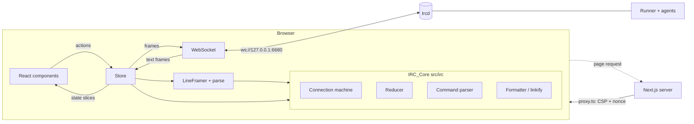
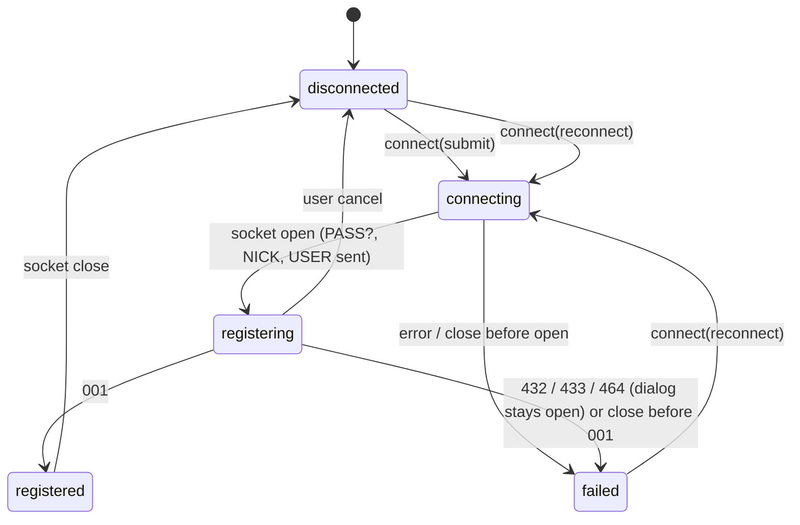
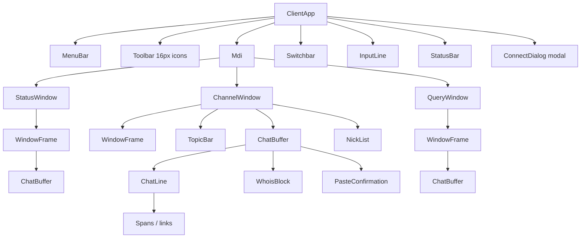

# Design Document

## Overview

`web-client-basic` is the M2 web client of Séance: a retro, keyboard-first, 1995-style IRC client in `apps/web`. The browser opens a WebSocket straight to the Ircd listener (default `ws://127.0.0.1:6680`, one IRC line per text frame). There is no IRC proxy, no API route and no route handler. The only request-level server code is the Next.js 16 request proxy (`proxy.ts`), which sets a Content-Security-Policy header with a per-request nonce.

The design splits the client in three layers:

1. **IRC_Core** (`src/irc`): pure, framework-free TypeScript. Connection machine, reducer, command parser, paste splitter, formatter, linkifier, nick ordering, mention detection, WHOIS collector. No React, no DOM, no timers, no Node imports. Everything above it is testable with vitest and fast-check.
2. **Store** (`src/store`): one Zustand store that owns the WebSocket, the `LineFramer`, the paste timer and `localStorage`. It feeds parsed messages to the reducer and executes the effects the core returns.
3. **UI** (`src/components`, `app/`): thin React components that read from the Store and dispatch actions. They hold no IRC state.

### Key design decisions

| Decision | Rationale |
|---|---|
| Core returns data (`state`, `send`, `notify`), never performs effects | Keeps R11 (pure core, Store owns I/O and timers) and makes every behaviour a function test. |
| Time is an input (`nowMs`) to the reducer, not read inside it | No clock in the core (R7.21, R11.1); timestamps are formatted in the UI (R6.1). |
| One window map keyed by `irc_lower(name)` | The same case-mapping rule applies to channels, nicks and queries (R6.9, R12.1). |
| Members stored as a map keyed by `irc_lower(nick)` | Duplicate nicks under rfc1459 are impossible by construction (R12.1). |
| CSP built by a pure function used by `proxy.ts` and by the Connect_Dialog | The origins the dialog accepts and the origins `connect-src` allows come from one source (R3.2, R3.3, R15.9). |
| No inline `style` attributes anywhere in the UI | `style-src` carries no `'unsafe-inline'`, so layout and colours come from classes and CSS variables (R8.16, R15.8). |
| End-to-end test builds and serves the production app on fixed free ports | `NEXT_PUBLIC_IRCD_WS_URL` is inlined at build time, and the CSP test must run against real production output (R17.17, R17.10). |

### Research summary

- **Next.js 16 proxy**: `middleware.ts` is renamed `proxy.ts`, and the exported function is named `proxy` (Next.js docs, [Content Security Policy guide](https://github.com/vercel/next.js/blob/v16.2.9/docs/01-app/02-guides/content-security-policy.mdx)). The documented pattern generates a nonce per request, sets `Content-Security-Policy` and `x-nonce` on the request headers (so Next.js can nonce its own scripts) and sets the CSP on the response. A nonce requires dynamic rendering. A `matcher` skips `_next/static`, `_next/image`, `favicon.ico` and prefetches. The latest `next` on npm at design time is 16.4.5.
- **Tailwind CSS 4**: tokens are CSS variables declared in an `@theme` block after `@import "tailwindcss"`. A variable `--color-ghost-bg` yields utilities such as `bg-ghost-bg` and `text-ghost-bg`, and also a runtime variable `var(--color-ghost-bg)` ([theme docs](https://github.com/tailwindlabs/tailwindcss.com/blob/main/src/docs/theme.mdx)). There is no `tailwind.config.js`.
- **Zustand 5**: typed stores use the curried form `create<T>()((set, get) => ...)`. `createStore` from `zustand/vanilla` gives a store with `getState`, `setState`, `getInitialState` and `subscribe` and no React dependency ([Zustand docs](https://github.com/pmndrs/zustand/blob/main/docs/reference/apis/create-store.md)). The design builds the store with `createStore` (testable without React) and binds it to React with `useStore`.
- **Protocol package browser safety** (read from source): `parse`, `serialize`, `LineFramer`, `Numerics`, `irc_lower`, `isValidNick` and `isValidChannel` use no Node module, no `Buffer`, no `process` and no timers. They use only the global `TextEncoder` and `TextDecoder`, which every browser provides. The package is ESM with `exports["."]` pointing to `dist/index.js` and `dist/index.d.ts`, so `next build` resolves it from the workspace once `build` of the package has run (Turborepo `^build` dependency).
- **Ircd facts** (read from source): the WebSocket listener defaults to port 6680 and has a `verifyClient` hook that calls `isOriginAllowed(origin, IRCD_WS_ALLOWED_ORIGINS)`; a missing `Origin` header is accepted, a present one must match (case-insensitive, or `*`), otherwise the upgrade is refused with HTTP 403. Binary frames close the socket with code 1003. `maxPayload` is 64 KiB. Text frames go through a per-connection `LineFramer`.
- **Runner facts** (read from source): the exorcism text `*** <agent> has been exorcised` is sent as the reason of a `PART` by the agent when it leaves for a reason other than a kick; a human `/kick` removes the agent first, so the client sees a `KICK` and no exorcism `PART`. The web client therefore renders the exorcism line itself for a `KICK` of a Known_Agent (R8.18), with no runner change (see Open Points). Tool notices are channel `NOTICE`s with text `using tool: <title>`. Denied operations are `NOTICE`s with text `ops: <agent> denied <label>: <reason>`. Agent chat lines are `PRIVMSG`s whose text is wrapped in a colour code: `\x03` + two digits (`12` for `coder`), the sentence, then `\x0F`.

## Architecture



The Next.js server serves the page and static assets. IRC traffic never touches it.

### Data flow for an inbound frame

```mermaid
sequenceDiagram
  participant WS as WebSocket
  participant S as Store
  participant F as LineFramer
  participant R as reduce()
  WS->>S: text frame (<= 64 KiB)
  S->>F: push(frame)
  F-->>S: line events
  loop each line
    S->>S: parse(line)
    alt parse error
      S->>S: status diagnostic line
    else message
      S->>R: reduce(state, msg, nowMs)
      R-->>S: { state, send[], mention }
      S->>WS: send each outbound message (serialize)
      S->>S: set(state); play sound if mention and enabled
    end
  end
```

### Connection machine



`433`, `432` and `464` keep the dialog open with an inline error. The machine moves to `failed` for them as well, so the Reconnect button path is the same, but the dialog offers a changed nick through the normal submit path (R3.8, R3.9).

## Components and Interfaces

### File layout of `apps/web`

```
apps/web/
  package.json            @seance/web, exact versions, scripts dev/build/start/typecheck/test/lint/test:e2e
  tsconfig.json           extends ../../tsconfig.base.json (adds DOM lib and jsx only; no strictness change)
  next.config.ts          no rewrites, no API; reactStrictMode
  postcss.config.mjs      @tailwindcss/postcss
  vitest.config.ts        unit + property tests (src/**/*.test.ts[x]); excludes e2e/
  eslint.config.mjs       next core-web-vitals + local rules (no innerHTML, no eval, no hex in components)
  .env.example            NEXT_PUBLIC_IRCD_WS_URL, IRCD_WS_ALLOWED_ORIGINS (documentation only)
  README.md               run against local Ircd, origin setting, tests, e2e
  proxy.ts                Next.js 16 request proxy: CSP + nonce only
  proxy.test.ts           proxy unit test (two responses, distinct nonces, headers)
  app/
    layout.tsx            async server layout: fonts, reads nonce, passes connect config
    page.tsx              renders <ClientApp/> (client component)
    globals.css           @import "tailwindcss"; @theme tokens; bevel utilities
  src/
    config/
      connect-src.ts      pure: computeConnectSrc(env) -> {defaultUrl, allowedOrigins}; validateServerUrl
      connect-src.test.ts
      csp.ts              pure: buildCsp({nonce, wsOrigins, dev}) -> string
      csp.test.ts
    irc/                  IRC_Core (no React / DOM / Node / Zustand imports)
      types.ts            ClientState, Window, Line, Member, ConnectionPhase, WhoisPending, ...
      casemap.ts          re-export irc_lower, isValidNick from @seance/irc-protocol; keyOf()
      connection.ts       Connection machine: step(phase, event) -> phase
      reducer.ts          reduce(state, msg, nowMs) -> ReduceResult
      reducer.members.ts  member set operations (JOIN/PART/KICK/QUIT/NICK/MODE/NAMES)
      reducer.whois.ts    WHOIS collector
      reducer.route.ts    numerics and notices routing to windows
      command-parser.ts   parseInput(text, ctx) -> InputResult
      paste.ts            splitPaste(text) -> {lines, droppedHint}; PASTE_LIMITS
      formatter.ts        formatMirc(text) -> Span[]
      linkify.ts          linkify(text) -> Segment[]
      nick-order.ts       sortMembers(members) -> Member[]
      mention.ts          isMention(text, ownNick)
      classify.ts         KNOWN_AGENTS, isKnownAgent(nick), classifyLine(...) -> Classification (tool, denied, exorcised, exorcised-kick, kick, ...)
      buffer.ts           appendLine(lines, line, cap) -> Line[]
      history.ts          pushHistory / navigate (bounded 100)
      complete.ts         completeNick(input, caret, nicks, cycle) -> Completion
      framing.ts          decodeFrames(framer, frame) -> lines | overlong (thin wrapper over LineFramer)
      time.ts             formatClock(epochMs, offsetMinutes) -> "HH:MM"
      index.ts            public exports
      *.test.ts           unit tests next to each file
      *.property.test.ts  fast-check properties (P1..P20)
    store/
      client-store.ts     createStore<ClientStore>(); actions; owns socket, framer, timers
      socket.ts           WebSocketLike port + browser adapter (injected for tests)
      storage.ts          nick/server persistence port (injected for tests)
      client-store.test.ts  fake socket, fake timers, fake storage
      react.ts            useClientStore(selector) via zustand useStore
    components/
      ClientApp.tsx       composition root (client component)
      MenuBar.tsx  Toolbar.tsx  Switchbar.tsx  InputLine.tsx  StatusBar.tsx
      Mdi.tsx             MDI container (CSS grid; no inline styles)
      WindowFrame.tsx     Win95 title bar + close control
      ChannelWindow.tsx   TopicBar + ChatBuffer + NickList
      QueryWindow.tsx  StatusWindow.tsx
      TopicBar.tsx  ChatBuffer.tsx  ChatLine.tsx  Spans.tsx  NickList.tsx
      WhoisBlock.tsx      grouped WHOIS block
      PasteConfirmation.tsx
      ConnectDialog.tsx   modal, focus trap, inline errors
      *.test.tsx          component tests (jsdom)
  e2e/
    playwright.config.ts  opt-in config; globalSetup starts the stack
    harness/stack.ts      in-process Ircd + Runner + Fake_Agent, free ports, Next prod build/start
    harness/free-port.ts  probes a free TCP port
    flow.spec.ts          connect, join, invite coder, +v, coloured reply, kick, nick list
    csp.spec.ts           production response carries the CSP (nonce differs between two requests)
```

`tsconfig.json` extends `tsconfig.base.json` and only adds `"lib": ["ES2022", "DOM", "DOM.Iterable"]`, `"jsx": "preserve"`, the Next.js plugin and `"module": "ESNext"` with `"moduleResolution": "Bundler"` as Next.js requires. It does not change any strictness option. This is the one package where NodeNext does not apply, because the bundler resolves modules. The relative-import rule with the `.js` extension is kept for `src/irc` so that the core remains runnable by Node tools. The IRC_Core must stay free of DOM types: a `tsconfig.core.json` (used by the typecheck script) compiles `src/irc` with `lib: ["ES2022"]` and `types: []` so that any DOM or Node reference fails typechecking (R11.1).

### IRC_Core interfaces

```ts
// reducer.ts
export interface ReduceResult {
  readonly state: ClientState;
  /** Messages the Store must send, in order (PONG, nothing else in M2). */
  readonly send: readonly IrcMessage[];
  /** True when a line flagged as Mention was appended (drives the optional sound). */
  readonly mention: boolean;
}
export function reduce(state: ClientState, msg: IrcMessage, nowMs: number): ReduceResult;

// command-parser.ts
export type InputResult =
  | { readonly kind: "send"; readonly messages: readonly IrcMessage[]; readonly echo: readonly EchoLine[] }
  | { readonly kind: "local"; readonly action: LocalAction }
  | { readonly kind: "error"; readonly text: string }          // local error line, nothing sent
  | { readonly kind: "confirm-paste"; readonly lines: readonly string[]; readonly target: string };
export function parseInput(text: string, ctx: InputContext): InputResult;

// formatter.ts
export interface Span { readonly text: string; readonly fg?: number; readonly bg?: number;
                        readonly bold: boolean; readonly underline: boolean; }
export function formatMirc(text: string): readonly Span[];

// linkify.ts
export type Segment = { readonly kind: "text"; readonly text: string }
                    | { readonly kind: "link"; readonly text: string; readonly href: string };
export function linkify(text: string): readonly Segment[];

// connection.ts
export type ConnectionEvent =
  | { readonly type: "connect" } | { readonly type: "socket-open" }
  | { readonly type: "welcome" } | { readonly type: "reject"; readonly reason: RejectReason }
  | { readonly type: "socket-closed"; readonly cleanly: boolean } | { readonly type: "user-cancel" };
export function stepConnection(phase: ConnectionPhase, ev: ConnectionEvent): ConnectionPhase;

// config/connect-src.ts
export function validateServerUrl(raw: string, allowedOrigins: readonly string[]):
  { readonly ok: true; readonly url: string } | { readonly ok: false; readonly error: string };
```

`InputContext` carries the own nick, the Active_Window (`kind` and `target`), and the member list of the window for `/kick` default targets. `reduce` is total: unknown commands and numerics are appended to the Status_Window as text.

#### Reducer routing rules (summary)

| Input | Effect on state |
|---|---|
| `001` | phase `registered`; Status_Window created; first line added |
| `002`-`005`, `372`, `375`, `376`, server `NOTICE`, unknown | line in Status_Window |
| `JOIN` (own nick) | open Channel_Window, activate it, reset member set, empty topic |
| `JOIN` (other) | add member; line in channel (green join style) |
| `PART` (own) / `KICK` (own) | close Channel_Window, keep its lines in `closedLines` for reopening, drop member set (R12.3), activate Status_Window if it was active |
| `PART`, `QUIT`, `KICK`, `NICK`, `MODE` (other) | update members of every affected channel; QUIT/NICK also touch open Query_Windows |
| `KICK` of a Known_Agent (any case) | member removed as above; channel line of kind `exorcised-kick` carrying the agent, kicker and reason (R8.18) |
| `KICK` of any other nick | member removed as above; channel line of kind `kick` (R8.14) |
| `353`/`366` | members from NAMES (prefix `@` op, `+` voice); user-issued `/names` also prints one line |
| `331`/`332`/`TOPIC` | topic bar text or placeholder |
| `PRIVMSG`/`NOTICE` to channel | line in channel; Mention flag when text contains own nick as a whole word and sender is not own nick |
| `PRIVMSG`/`NOTICE` to own nick | open Query_Window (not activated) and add the line; server `NOTICE` goes to Status_Window |
| `311`/`319`/`312`/`320`/`317`/`301` | collected into `whoisPending[nickKey]`; `318` emits the block into the Active_Window; `401` replaces it with an error line |
| `322`/`323` | `/list` rows in Status_Window |
| `305`/`306`, `INVITE` to own nick, `4xx`/`5xx` after a user command | line in the Active_Window |
| `PING` | `send: [PONG :token]`, no line anywhere |
| `432`/`433`/`464` while `registering` | `connectError` set, phase `failed`; no line in a window |

The reducer sets `unread` on a non-active window for every appended line and `mentioned` additionally for a Mention (R5.12).

### Store interface

```ts
export interface ClientStore {
  readonly client: ClientState;                 // IRC_Core state (the only IRC state)
  readonly ui: UiState;                         // dialogs, history, input draft, mention-sound flag
  // actions
  connect(params: { nick: string; serverUrl: string; password: string | undefined }): void;
  reconnect(): void;
  submitInput(text: string): void;              // parseInput -> send / local / error / confirm
  confirmPaste(accept: boolean): void;
  setActiveWindow(key: string): void;
  closeWindow(key: string): void;
  activateByIndex(n: number): void;             // Alt+n
  quit(): void;
  setMentionSound(enabled: boolean): void;
}
export function createClientStore(deps: StoreDeps): StoreApi<ClientStore>;
```

`StoreDeps` injects `createSocket(url): WebSocketLike`, `storage: Storage`-like, `now(): number`, `setTimeout`/`clearTimeout`, `audio`, `defaultServerUrl` and `allowedOrigins`. The browser entry passes the real implementations; tests pass fakes and fake timers. The Store is the only module that owns a WebSocket, a `LineFramer` and a timer (R11.5).

Store responsibilities:

- On `connect`: validate nick (`isValidNick`) and URL (`validateServerUrl`); on failure set inline errors and stop. Otherwise create the socket, apply `socket-open` → send `PASS` (only if set), `NICK`, `USER`.
- On each frame: reject non-string frames (diagnostic line, ignore); a string frame longer than 64 KiB (`TextEncoder` byte length, checked before framing) closes the socket and writes an error line (R15.4); then `LineFramer.push`, `parse`, `reduce`, send outbound messages with `serialize` (one frame per message).
- `LineFramer` overlong events and `parse` errors produce a diagnostic line in the Status_Window and processing continues (R11.8).
- `try`/`catch` around `reduce` and around each effect: on failure write `error: <step> failed on <COMMAND>: <message>` to the Status_Window and continue (R15.7).
- Paste queue: `submitInput` of a multi-line paste places messages in `pasteQueue`; the first is sent at once, the next every 500 ms by a Store-owned `setTimeout` chain. More than 5 lines creates a `pendingPaste` and a `PasteConfirmation` line; `confirmPaste(true)` queues the first 5 lines and writes how many were dropped; `confirmPaste(false)` or a socket close empties the queue and writes how many messages were not sent (R7.18-R7.20).
- After sending a `PRIVMSG` the Store appends the own line to the Active_Window (R7.26), because the Ircd does not echo to the sender.
- Persistence: when phase becomes `registered` write nick and server URL to `localStorage`; never the password (R4). Reading validates every value (`isValidNick`, `validateServerUrl`) and falls back to defaults.
- On reconnect the Store calls the pure `resetForReconnect(state)` which clears members, topics and pending WHOIS data and keeps every Window's lines (R3.15).

### Component tree



Only the Active_Window is expanded at full size in the MDI area; inactive windows are listed in the Switchbar (their title bars use the inactive chrome style). The MDI container is a CSS grid with Tailwind classes, so no inline `style` is needed.

### Figma frame mapping

Frame names are from `.kiro/steering/web-ui.md`. The mapping is derived from the frame names and the requirements; the exact layout details are read from the frames with the Figma tooling at implementation time (see Open Points).

| Figma frame | M2 scope | Components | Requirements |
|---|---|---|---|
| `00 Style guide` | token reference | `app/globals.css` `@theme` tokens, bevel utilities, fonts in `layout.tsx` | R8.16, R8.17, R14.1 |
| `01 Main` | in | `ClientApp`, `MenuBar`, `Toolbar`, `Mdi`, `WindowFrame`, `ChannelWindow`, `TopicBar`, `ChatBuffer`, `ChatLine`, `NickList`, `Switchbar`, `InputLine`, `StatusBar` | R5, R6, R7, R8, R13 |
| `02 Connect` | in | `ConnectDialog` (nick, server URL, optional password, inline errors, Reconnect button) | R3, R4, R14.5, R14.6 |
| `03 Kick` | in | `ChatLine` kick and exorcism styles via `classifyLine` (`exorcised-kick` line for a kicked Known_Agent, plain `kick` otherwise), `NickList` after the agent leaves | R8.13, R8.14, R8.18, R13.5 |
| `04 Whois+Options` | Whois panel only | `WhoisBlock` rendered inside `ChatBuffer` | R9.2, R9.3, R13.4 |
| `04 Whois+Options` (Options dialog, model picker) | out, M3 | none | n/a |
| `05 Channel list` | out, M3 | none (`/list` output goes to the Status_Window) | R9.4 |
| `06 Classic` | out, M3 | none | n/a |

### Typography and tokens

`app/layout.tsx` loads IBM Plex Mono, Arimo and VT323 with `next/font/google`, which self-hosts the font files at build time (no runtime CDN request, R1.6) and exposes CSS variables `--font-plex-mono`, `--font-arimo`, `--font-vt323`. `globals.css` declares:

```css
@import "tailwindcss";

@theme {
  --font-chat: var(--font-plex-mono), monospace;
  --font-chrome: var(--font-arimo), sans-serif;
  --font-title: var(--font-vt323), monospace;

  --color-chrome-face: #c0c0c0;
  --color-chrome-highlight: #ffffff;
  --color-chrome-shadow: #808080;
  --color-chrome-outline: #000000;
  --color-title-from: #000080;
  --color-title-to: #1084d0;

  --color-ghost-bg: #0b0b0f;
  --color-ghost-text: #d8d4c8;
  --color-ghost-orange: #c8761f;
  --color-ghost-green: #6a9955;
  --color-ghost-purple: #9a80c2;

  --color-nick-coder: #3b78ff;
  --color-nick-reviewer: #4caf50;
  --color-nick-researcher: #9a80c2;
  --color-nick-human: #c8761f;
  /* 16 IRC palette entries: --color-irc-0 ... --color-irc-15 */
}
```

All hex values live in this file only; components use utilities such as `bg-ghost-bg` and `text-nick-coder` (R8.16). Spans from the formatter map `fg` to a class from a fixed table (`text-irc-0` … `text-irc-15`) so there is no inline style. Because Tailwind generates class names statically, the table lists the 16 class names as full literals.

The Win95 bevel is a small set of utility classes defined once with `@utility` (`bevel-raised`, `bevel-sunken`) using the highlight and shadow tokens, and the active title gradient is `bg-linear-to-r from-title-from to-title-to`.

### Server URL, allowed origins and the Connect_Dialog

```ts
// config/connect-src.ts (pure)
export interface ConnectConfig {
  readonly defaultUrl: string;               // NEXT_PUBLIC_IRCD_WS_URL or "ws://127.0.0.1:6680"
  readonly allowedOrigins: readonly string[]; // [origin(defaultUrl)] (+ ws://127.0.0.1:6680 in development)
}
export function computeConnectConfig(env: { NEXT_PUBLIC_IRCD_WS_URL?: string; NODE_ENV?: string }): ConnectConfig;
```

`computeConnectConfig` throws a descriptive error when `NEXT_PUBLIC_IRCD_WS_URL` is set but is not a `ws:` or `wss:` URL, so a bad build fails early. Both `proxy.ts` (for `connect-src`) and `app/layout.tsx` (for the dialog props) call it. The layout is a server component; it passes `defaultUrl` and `allowedOrigins` as serialisable props to `ClientApp`, so the browser knows the allowed origins at runtime (R3.3) without reading `process.env` in client code. `validateServerUrl` parses the URL with the `URL` class, requires the scheme `ws:` or `wss:` and a host, and accepts it only when `url.origin`-equivalent (`scheme://host[:port]`, lower-case) is in `allowedOrigins`. A rejected URL yields an inline error that names the allowed origins (R3.2). A stored URL that fails validation is ignored (R4.4).

When the socket fails before `001`, the dialog error says the server could not be reached and lists likely causes, including "the Ircd may have refused this page's origin (check `IRCD_WS_ALLOWED_ORIGINS`)". The browser does not expose the HTTP 403 of a refused upgrade, so the message always names the origin check as a possible cause (R16.4).

### CSP design

`proxy.ts`:

```ts
import { NextResponse, type NextRequest } from "next/server";
import { buildCsp } from "./src/config/csp";
import { computeConnectConfig } from "./src/config/connect-src";

export function proxy(request: NextRequest): NextResponse {
  const nonce = btoa(crypto.randomUUID());           // fresh per request
  const dev = process.env.NODE_ENV === "development";
  const { allowedOrigins } = computeConnectConfig(process.env);
  const csp = buildCsp({ nonce, connectOrigins: allowedOrigins, dev });

  const requestHeaders = new Headers(request.headers);
  requestHeaders.set("x-nonce", nonce);
  requestHeaders.set("Content-Security-Policy", csp);

  const response = NextResponse.next({ request: { headers: requestHeaders } });
  response.headers.set("Content-Security-Policy", csp);
  return response;
}

export const config = {
  matcher: [{
    source: "/((?!_next/static|_next/image|favicon.ico).*)",
    missing: [
      { type: "header", key: "next-router-prefetch" },
      { type: "header", key: "purpose", value: "prefetch" },
    ],
  }],
};
```

The proxy sets headers only and never reads or forwards IRC traffic (R15.10). It uses the Web Crypto API (`crypto.randomUUID`), not a Node module, so it also runs on the Edge-like proxy runtime. (The documented example uses `Buffer`; `btoa` avoids relying on it.)

`buildCsp` (pure) returns a single-line header value with these directives:

| Directive | Production value | Development value |
|---|---|---|
| `default-src` | `'self'` | `'self'` |
| `script-src` | `'self' 'nonce-<nonce>' 'strict-dynamic'` | adds `'unsafe-eval'` (React dev tooling) |
| `style-src` | `'self' 'nonce-<nonce>'` | `'self' 'unsafe-inline'` with no nonce (webpack dev injects `<style>` tags without a nonce, and a nonce would make browsers ignore `'unsafe-inline'`) |
| `connect-src` | `'self'` + each origin of the Connect_Src | the same plus `ws://127.0.0.1:6680` |
| `img-src` | `'self' data:` | same |
| `font-src` | `'self'` | same |
| `object-src` | `'none'` | same |
| `base-uri` / `form-action` | `'self'` | same |
| `frame-ancestors` | `'none'` | same |

Production output holds neither `'unsafe-inline'` nor `'unsafe-eval'` in `script-src` (R15.8). `connect-src` is exactly `'self'` plus the origin of `NEXT_PUBLIC_IRCD_WS_URL` (which defaults to `ws://127.0.0.1:6680`); in development it also lists `ws://127.0.0.1:6680` (R15.9). The CSP-relevant directive set contains no `upgrade-insecure-requests`, because the documented local default is plain `ws://` and that directive would block it; a TLS deployment sets a `wss://` URL, which satisfies the same `connect-src`.

**Dynamic rendering.** A nonce is only usable when the page is rendered per request. `app/layout.tsx` is an async server component that awaits `headers()` (reading `x-nonce`), which opts the route into dynamic rendering and lets Next.js attach the nonce to its own scripts. Consequences: no static optimisation or CDN caching of the HTML, a (small) server render per page load, and `next build` reports the route as dynamic. Static assets under `/_next/static` stay cached. This is acceptable for a single page that is mostly client code.

**Inline style rule.** Because `style-src` carries no `'unsafe-inline'`, no component may use a `style={{...}}` attribute (browsers block inline style attributes under such a policy). A lint rule (`react/forbid-dom-props` for `style`) enforces it.

### Turbo and pnpm wiring

- `pnpm-workspace.yaml` already covers `apps/*`; `@seance/web` joins automatically.
- Dependencies: `@seance/irc-protocol` as `workspace:*`; `next`, `react`, `react-dom`, `zustand`, `tailwindcss`, `@tailwindcss/postcss`, `typescript`, `@types/react`, `@types/react-dom`, `vitest`, `fast-check`, `jsdom`, `@testing-library/react`, `eslint`, `eslint-config-next` and `@playwright/test` (dev only, for the opt-in e2e), all pinned to exact versions at install time (`next` at 16.4.5 or the then-current 16.x). For the e2e harness the package also has `@seance/runner` as a `workspace:*` dev dependency; the Ircd is imported by relative path as the Ircd's own runner integration tests do (see Open Points).
- Scripts:

| Script | Command | Notes |
|---|---|---|
| `dev` | `next dev` | persistent, not cached |
| `build` | `next build` | `outputs: [".next/**", "!.next/cache/**"]` |
| `start` | `next start` | used by the e2e harness |
| `typecheck` | `tsc -p tsconfig.json --noEmit && tsc -p tsconfig.core.json --noEmit` | second run guards the pure core |
| `test` | `vitest run` | unit, property and component tests; never runs e2e |
| `lint` | `eslint .` | includes the no-innerHTML, no-inline-style and no-hex rules |
| `test:e2e` | `playwright test -c e2e/playwright.config.ts` | opt-in, not in turbo |

- `turbo.json`: add `.next/**` (without the cache folder) to `build.outputs`, make `dev` depend on `^build` so the protocol `dist` exists, and keep `test:e2e` out of the pipeline (no task named `test:e2e` in turbo, and the vitest config excludes `e2e/`). `typecheck` and `test` already depend on `^build`, which builds `@seance/irc-protocol` first.
- The web package has a `lint` script, matching the runner package pattern; the root `pnpm lint` runs it through turbo.

### Documentation changes

- `DESIGN.md` section 11: replace "Next.js 15" with "Next.js 16" in the `apps/web` line (R1.7). Also `.kiro/steering/tech.md` states Next.js 15; it is updated to 16 in the same change to keep the steering consistent.
- `apps/web/README.md`: how to run against a local Ircd (`IRCD_WS_ALLOWED_ORIGINS=http://localhost:3000 pnpm --filter @seance/ircd dev`, then `pnpm --filter @seance/web dev`), the required origin setting, unit tests and the e2e command.
- `apps/web/.env.example` (and a matching line in the root README): `NEXT_PUBLIC_IRCD_WS_URL=ws://127.0.0.1:6680` and `IRCD_WS_ALLOWED_ORIGINS=http://localhost:3000`, no secret values, with a comment that changing `NEXT_PUBLIC_IRCD_WS_URL` changes the CSP `connect-src` and that the origin of that URL is the only non-local WebSocket origin the CSP and the Connect_Dialog accept (R16.1, R16.5). The browser `Origin` of the dev server is `http://localhost:3000` when opened by that name and `http://127.0.0.1:3000` when opened by IP; the README says to list the one in use.
- `docs/KIRO_USAGE.md`: entry for this spec (R18.1).

## Data Models

All state types live in `src/irc/types.ts`. Types are `readonly` and the reducer returns new objects (structural sharing for unchanged windows).

```ts
export type ConnectionPhase =
  | "disconnected" | "connecting" | "registering" | "registered" | "failed";

export interface ConnectParams {
  readonly nick: string;
  readonly serverUrl: string;
  readonly password?: string;      // memory only (R4.2)
}

export type LineKind =
  | "message" | "action" | "notice" | "join" | "part" | "quit" | "nick" | "mode"
  | "topic" | "kick" | "exorcised" | "exorcised-kick" | "tool" | "tool-denied"
  | "system" | "error" | "motd" | "numeric" | "local";

/** Structured pieces of an exorcism-by-kick line (R8.18). All fields are untrusted plain text. */
export interface ExorcismParts {
  readonly agent: string;    // target nick as sent by the server, original case
  readonly kicker: string;   // nick of the KICK prefix
  readonly reason: string;   // raw KICK reason, may hold control codes; "" when absent
}

export interface Line {
  readonly id: number;             // monotonically increasing per client, stable React key
  readonly at: number;             // epoch ms; formatted [HH:MM] by the UI
  readonly kind: LineKind;
  readonly from?: string;          // nick for message-like kinds
  readonly text: string;           // raw text incl. mIRC control codes, untrusted
  readonly exorcism?: ExorcismParts; // set only when kind is "exorcised-kick"
  readonly mention: boolean;       // R10.1
  readonly own: boolean;           // sent by the own nick
}

export type WindowKind = "status" | "channel" | "query";

export interface Window {
  readonly key: string;            // "status", or irc_lower(channel / nick)
  readonly kind: WindowKind;
  readonly name: string;           // display name with original case
  readonly lines: readonly Line[]; // <= BUFFER_CAP (1000)
  readonly unread: boolean;
  readonly mentioned: boolean;
  readonly topic?: string;                     // channel only; undefined = none set
  readonly members?: Readonly<Record<string, Member>>; // channel only, key = irc_lower(nick)
}

export interface Member {
  readonly nick: string;           // display case
  readonly op: boolean;
  readonly voice: boolean;
}

export interface WhoisPending {
  readonly nick: string;
  readonly user?: { user: string; host: string; realname: string };
  readonly server?: { name: string; info: string };
  readonly channels: readonly string[];
  readonly away?: string;
  readonly special: readonly string[];       // 320 lines (model, tools, credits)
  readonly idle?: { seconds: number; signon: number };
}

export interface PasteState {
  readonly queue: readonly IrcMessage[];     // owned by the Store timer, mirrored for UI
  readonly pending?: { readonly lines: readonly string[]; readonly target: string }; // awaiting confirmation
}

export interface ClientState {
  readonly phase: ConnectionPhase;
  readonly connectError?: { readonly code: "in-use" | "erroneous" | "password" | "socket" | "origin-or-network"; readonly text: string };
  readonly ownNick: string;
  readonly server?: string;
  readonly windows: Readonly<Record<string, Window>>;   // by key
  readonly order: readonly string[];                    // switchbar order
  readonly activeKey: string;                           // "status" by default
  readonly closedLines: Readonly<Record<string, readonly Line[]>>; // R5.5, reopen in session
  readonly whoisPending: Readonly<Record<string, WhoisPending>>;   // key = irc_lower(nick)
  readonly nextLineId: number;
  readonly paste: PasteState;
  readonly expectingNames: readonly string[];           // channels whose NAMES came from /names
}
```

### Constants

```ts
export const BUFFER_CAP = 1000;           // R5.13, R15.5
export const FRAME_MAX_BYTES = 64 * 1024; // R15.4
export const HISTORY_MAX = 100;           // R7.23
export const PASTE_MAX_LINES = 5;         // R7.19
export const PASTE_INTERVAL_MS = 500;     // R7.18
export const LINE_MAX_BYTES = 512;        // R7.11
```

### Member operations (reference semantics)

Member sets are `Record<irc_lower(nick), Member>`. The reducer's operations, which the reference model of P2 repeats in a simpler data structure, are:

| Message | Operation |
|---|---|
| `JOIN #c` by X | add X (no flags) if absent; if present keep as is |
| `PART #c` by X | remove X from `#c` |
| `KICK #c X` | remove X from `#c` |
| `QUIT` by X | remove X from every channel |
| `NICK` X → Y | in every channel containing X: replace the key and display nick, keep flags; if Y already exists (server should prevent it) keep one entry |
| `MODE #c ±o/±v X` | set or clear the flag when X is in `#c`; ignore otherwise (R12.5) |
| own `PART`/`KICK` | drop the whole member set and close the window (R12.3) |

### Line classification

`classifyLine` is a pure function over the incoming message and context, executed in the reducer when a line is created:

| Condition | `LineKind` | Text marker (R14.10) |
|---|---|---|
| `NOTICE` from a non-server nick, text starts with `using tool:` | `tool` | `[tool]` |
| `NOTICE`, text starts with `ops:` and contains `denied` | `tool-denied` | `[denied]` |
| `PART` with reason matching `*** <nick> has been exorcised` | `exorcised` | `[exorcised]` |
| `KICK` whose target is not a Known_Agent | `kick` | `[kick]` |
| `KICK` whose target is a Known_Agent (compared under `irc_lower`) | `exorcised-kick` | `[exorcised]` |
| line with `mention: true` | unchanged kind, mention style | `[mention]` |
| `PRIVMSG` with CTCP ACTION | `action` | none (`* nick text`) |

Markers are rendered as text in `ChatLine` next to the colour or background, so the state never depends on colour alone.

#### Known agents and the exorcism-by-kick line (R8.14, R8.18)

Decision: a separate kind `exorcised-kick` (not an extra field on `exorcised`). The existing `exorcised` kind is a `PART` whose reason is the runner's fixed sentence, shown as received text. The kick variant is composed by the client from three untrusted pieces, so it needs structured data and a different render path. Keeping two kinds keeps both `switch` statements exhaustive and both styles identical (the exorcism highlight).

```ts
// classify.ts (pure, no DOM)
export const KNOWN_AGENTS = ["coder", "reviewer", "researcher"] as const;
export function isKnownAgent(nick: string): boolean;   // irc_lower(nick) is in KNOWN_AGENTS

export interface Classification {
  readonly kind: LineKind;
  readonly exorcism?: ExorcismParts;                    // present only for "exorcised-kick"
}
export function classifyLine(input: ClassifyInput): Classification;
// ClassifyInput is a discriminated union over the inbound command:
//   { command: "KICK"; kicker: string; target: string; reason: string }
//   | { command: "PART"; nick: string; reason: string }
//   | { command: "NOTICE"; from: string; text: string }  (tool, denied, other)
//   | ...
```

`KNOWN_AGENTS` is the single source for the nick colour mapping (`coder`, `reviewer`, `researcher` tokens) and for the kick classification; the colour lookup imports `isKnownAgent` and does not repeat the list. For a `KICK`, `classifyLine` returns `{ kind: "exorcised-kick", exorcism: { agent: target, kicker, reason } }` when `isKnownAgent(target)`, otherwise `{ kind: "kick" }`. The agent nick is stored as sent (a `Coder` kick shows `Coder`); only the comparison is case-mapped.

Rendering rule: `ChatLine` never concatenates strings into markup. For `exorcised-kick` it renders React text nodes for the fixed pieces (`*** `, ` has been exorcised by `, ` (`, `)`) and runs each of `agent`, `kicker` and `reason` through `formatMirc`, rendering the resulting spans. The reason part (separator, spans, closing parenthesis) is rendered only when `formatMirc(reason)` yields at least one visible character after control codes are stripped; an empty reason, or one made only of control codes, gives the line without the parenthesis. Control codes in the kicker or reason therefore never reach the DOM and never alter the fixed text. The `[exorcised]` marker and the exorcism highlight style apply to this kind and to `exorcised` alike.

### Colour palette table

`formatMirc` maps `\x03` followed by 1-2 digits (0-15) to `fg`, and `,` plus 1-2 digits to `bg`. A value above 15 is parsed but treated as no colour change for that field (the digits are consumed, not shown). `\x02` toggles bold, `\x1f` toggles underline, `\x0f` resets everything, `\x03` with no digits resets colours. Tab becomes a space; every other code below 0x20 and 0x7f is dropped. Italic (`\x1d`), reverse (`\x16`) and strikethrough (`\x1e`) are dropped as control characters in M2.

## Correctness Properties

*A property is a characteristic or behavior that should hold true across all valid executions of a system-essentially, a formal statement about what the system should do. Properties serve as the bridge between human-readable specifications and machine-verifiable correctness guarantees.*

Reflection on redundancy: the prework produced about 40 testable items. Redundant items were merged: the reducer totality and non-mutation checks share one generator and became P1; JOIN, PART, KICK, QUIT, NICK, MODE, own-leave and non-member MODE all fall under the single model-based P2; the two formatter criteria stay separate (P4 about visible text, P5 about control codes) because they fail for different bugs; the 512-byte limit (P8) is kept apart from the control-character property (P7) because the first needs multi-byte generators and the second needs control-character generators. The kick classification criteria (R8.14, R8.18) became P21. Timer, UI, documentation and wiring criteria are covered by example, smoke and integration tests in the Testing Strategy.

### Property 1: Reducer is total and pure

For any client state and any parsed message (including unknown commands and numerics, missing parameters, empty strings, empty prefixes, up to 15 parameters, and arbitrary Unicode), `reduce` returns without throwing, returns a state whose invariants hold (each window key equals the lower-cased key of its name, `order` lists exactly the window keys, `activeKey` is a key of `windows`), and leaves the deep-frozen input state and message unchanged.

**Validates: Requirements 11.3, 11.6, 17.2**

### Property 2: Member sets match a reference model

For any sequence of `JOIN`, `PART`, `KICK`, `QUIT`, `NICK`, `MODE` (`±o`, `±v`) and `353` messages over a small pool of nicks with case variants, after each message the member set of every open channel equals the set computed by a simple reference model (a list of `{nick, op, voice}` with linear lookup under `irc_lower`), contains no two nicks that are equal under `irc_lower`, is dropped when the own nick leaves by `PART` or `KICK`, and is unchanged by a `MODE` for a nick that is not a member.

**Validates: Requirements 6.4, 6.7, 6.8, 6.9, 6.10, 12.1, 12.2, 12.3, 12.5, 17.3**

### Property 3: Nick list ordering is a permutation grouped by rank

For any list of members, `sortMembers` returns a permutation of the input (same multiset, nothing missing or repeated), with all operators first, then all voiced non-operators, then all others, and within each group ordered by `irc_lower(nick)`. The rendered prefix is `@` for operators, `+` for voiced and empty otherwise; an operator that is also voiced shows `@`.

**Validates: Requirements 6.5, 6.6, 12.4, 13.1**

### Property 4: Formatter preserves every visible character

For any input string, the concatenation of the `text` of all spans returned by `formatMirc` equals the input with every colour sequence (`\x03` and its digits), `\x02`, `\x1f`, `\x0f`, every other control character below 0x20 and 0x7f removed, and tab replaced by a space.

**Validates: Requirements 8.4, 8.5, 17.4**

### Property 5: Formatter emits no control codes

For any input string, no span returned by `formatMirc` contains a character below 0x20 or the character 0x7f, and every `fg` or `bg` value present is an integer from 0 to 15.

**Validates: Requirements 8.1, 8.4, 8.6, 17.4**

### Property 6: Parsed input round-trips through the protocol

For any submitted text and context, every IRC message in a `send` result satisfies `parse(serialize(m))` deep-equals `m` (command upper-case, same parameters).

**Validates: Requirements 7.4, 7.12, 17.5**

### Property 7: No produced line contains CR, LF or NUL

For any submitted text (including text with CR, LF, CRLF and NUL anywhere, with and without a leading `/`), every serialized line of every message in a `send` result contains none of CR, LF and NUL except the single terminating CRLF, and a submission that contains NUL, a multi-line command or a Raw_Command with control characters yields an `error` result with no messages.

**Validates: Requirements 7.13, 7.14, 7.15, 7.16, 7.22, 17.14**

### Property 8: Byte limit is enforced in UTF-8 bytes

For any submitted text built from ASCII and multi-byte characters with lengths around the limit, every message in a `send` result serializes to at most 512 UTF-8 bytes including CRLF, and any submission whose message would exceed 512 bytes yields an `error` result that names the byte limit and sends nothing.

**Validates: Requirements 7.11**

### Property 9: Multi-line paste splits into plain messages

For any multi-line text without NUL whose first line does not start with a single `/`, `parseInput` yields one `PRIVMSG` per non-empty line, in order, with the line text unchanged, to the Active_Window target, even for lines that start with `/`, and the messages are never interpreted as commands. For more than five lines the result is `confirm-paste` and no message.

**Validates: Requirements 7.17, 7.19**

### Property 10: Unknown slash commands pass through unchanged

For any command name made of ASCII letters that is not a known command, and for any argument string without CR, LF and NUL, `parseInput` of `/<name> <args>` yields one message whose command is `name` in upper case and whose arguments equal the arguments split by the protocol rules unchanged.

**Validates: Requirements 7.9**

### Property 11: Framing is independent of chunking

For any list of IRC lines (with multi-byte characters) and any partition of their concatenated CRLF-terminated text into frames, feeding the frames to `decodeFrames` in order yields the same sequence of lines as feeding the whole text as one frame.

**Validates: Requirements 2.5**

### Property 12: Buffers stay capped and keep the newest lines

For any sequence of appended lines and any cap from 1 to 50 (the production cap is 1000), `appendLine` returns at most `cap` lines, and those lines are the last `min(n, cap)` appended lines in their original order.

**Validates: Requirements 5.13, 15.5**

### Property 13: Mention detection is whole-word and case-mapped

For any own nick and any text, `isMention(text, nick)` is true exactly when the nick appears in the text delimited on both sides by a start, an end or a character that cannot be part of a nick, comparing under rfc1459 case-mapping; a line whose sender is the own nick never carries `mention: true`.

**Validates: Requirements 10.1, 10.2**

### Property 14: Linkify keeps the text and links only http and https

For any input text, the concatenation of all segments equals the input, every `link` segment starts with `http://` or `https://` and has an `href` that parses with the `URL` class and a protocol of `http:` or `https:`, and a URL with any other scheme (for example `javascript:` or `data:`) appears only inside a `text` segment.

**Validates: Requirements 8.8, 8.9**

### Property 15: Server URL is accepted only for allowed origins

For any raw URL string and any list of allowed origins, `validateServerUrl` returns `ok` exactly when the string parses as a `ws:` or `wss:` URL whose lower-cased `scheme://host[:port]` is in the list, and otherwise returns an error whose text names every allowed origin.

**Validates: Requirements 3.1, 3.2, 4.4, 17.18**

### Property 16: CSP header holds the required nonce and origins

For any nonce string and any valid `ws:` or `wss:` server URL, `buildCsp` in production mode returns a header whose `script-src` contains `'nonce-<nonce>'` and neither `'unsafe-inline'` nor `'unsafe-eval'`, and whose `connect-src` equals exactly `'self'` plus the origin of the URL; in development mode `connect-src` additionally lists `ws://127.0.0.1:6680`. For any two calls of the `proxy` function the nonces differ.

**Validates: Requirements 15.3, 15.8, 15.9, 15.10, 17.17**

### Property 17: PING is answered silently

For any state and any `PING` token (including empty, with spaces, and multi-byte), `reduce` returns `send` equal to a single `PONG` message whose trailing parameter is the token, and returns a state in which no window gained a line.

**Validates: Requirements 3.13**

### Property 18: Reconnect reset keeps text and drops membership

For any client state, `resetForReconnect` returns a state in which every window has the same `lines` as before, every channel has an empty member set and no topic, `whoisPending` is empty and the phase is `connecting`.

**Validates: Requirements 3.15**

### Property 19: Unread and mention flags follow the active window

For any state and any `PRIVMSG` or `NOTICE` delivered to a window other than the active one, that window has `unread = true` afterwards, and `mentioned = true` exactly when the line is a Mention; a line delivered to the active window sets neither flag.

**Validates: Requirements 5.12**

### Property 20: Command history is bounded

For any sequence of pushed entries and `Up`/`Down` moves, the history holds at most 100 entries, the navigation index stays within the entries or at the draft position, and `Up` after pushing returns the most recently pushed entry.

**Validates: Requirements 7.23**

### Property 21: Kick classification follows the Known_Agent set

For any `KICK` (any kicker nick, any target nick drawn from the Known_Agent names in every case variant, from unrelated nicks and from near misses such as `coder2`, and any reason including empty strings and control codes), `classifyLine` returns kind `exorcised-kick` exactly when the target equals a Known_Agent under rfc1459 case-mapping, and kind `kick` otherwise. For an `exorcised-kick`, the visible text of the rendered line (the concatenated span text of the agent, kicker and reason pieces plus the fixed text) contains the agent nick as sent and the kicker, contains the reason in parentheses exactly when the reason has at least one visible character after control codes are stripped, and contains no control character.

**Validates: Requirements 8.14, 8.18**

## Error Handling

| Situation | Behaviour | Requirement |
|---|---|---|
| Nick fails validation | Inline error in dialog, no socket opened | R3.7 |
| Server URL outside Connect_Src | Inline error naming allowed origins, no socket | R3.2 |
| Socket error or close before `001` | Phase `failed`, inline error with likely causes (server down, wrong URL, origin check), Reconnect button | R3.10, R16.4 |
| `433`, `432`, `464` while registering | Inline error with the numeric text; dialog stays open | R3.8, R3.9 |
| Socket closes after `registered` | Status line "connection closed", Reconnect button, paste queue emptied with a count line | R3.11, R7.20 |
| Binary frame | Ignored, diagnostic line in Status_Window | R11.7 |
| Frame larger than 64 KiB | Socket closed, error line in Status_Window | R15.4 |
| Overlong line (`LineFramer` `overlong`) or `parse` error | Line discarded, diagnostic line, continue | R11.8 |
| Exception in `reduce` or an effect | Error line naming the step and the command; later messages still processed; state not replaced by the failed result | R15.7 |
| Command with missing arguments | Local error line with usage, nothing sent | R7.10 |
| Line over 512 bytes, NUL, control characters in a command | Local error line, nothing sent | R7.11, R7.14-R7.16 |
| `serialize` throws (defence in depth) | Caught by the Store, local error line, nothing sent | R2.6, R15.7 |
| Status-window input with no channel | Local line "no channel or query is active" | R7.2 |
| Invalid stored nick or URL | Ignored; defaults used | R4.4 |
| `NEXT_PUBLIC_IRCD_WS_URL` invalid | `computeConnectConfig` throws at build or request time with a message naming the variable | R15.6 |

Errors always say what failed and why. Nothing is swallowed silently: every catch writes a line to the Status_Window. Secrets (the `PASS` value) are never put into an error line, a log or storage; `serialize` errors for `PASS` mention only the command name.

Security-relevant handling:

- Every IRC-derived string is rendered as a React text node; links are built from `linkify` segments with `target="_blank"` and `rel="noopener noreferrer"` and only for `http`/`https` (R8.7-R8.9, R15.1).
- Agent output is displayed only. No code path passes message text to `parseInput`, `eval` or `Function` (R15.2).
- The CSP blocks inline scripts and any connection other than `'self'` and the configured WebSocket origin.

## Testing Strategy

### Dual approach

Unit and example tests cover concrete behaviour (state-machine transitions, routing of numerics, UI semantics). Property tests cover the universal properties above. Both are required. Property-based testing applies to the IRC_Core and the pure config functions, which are pure functions with large input spaces. It does not apply to the React layout, the Win95 rendering, the Store's timers and sockets (tested with fakes and examples), the Playwright flow or the documentation; those use example, component, snapshot-free semantic checks and integration tests.

### Tools

- **vitest** (`vitest run`) for all unit, property and component tests; **fast-check** for properties; **jsdom** with Testing Library for components; **Playwright** for the opt-in e2e.
- Every property is a single `fc.assert(fc.property(...), { numRuns: 100 })` (at least 100 runs) in a `*.property.test.ts` file next to its source. The test name carries the property ID and the tag, for example `P2 member sets match reference model` with the comment `// Feature: web-client-basic, Property 2: Member sets match a reference model`.
- No test opens a network connection or sleeps on the wall clock (R17.8). Sockets, storage, audio and timers are injected. Paste pacing uses `vi.useFakeTimers()` (R17.16).
- Arbitraries use multi-byte characters, the full control-character range, and nick pools with rfc1459 case variants (`[`, `]`, `\`, `~` and their lowercase partners).
- Tests sit next to their sources (`src/irc/reducer.ts` → `src/irc/reducer.test.ts`).

### Unit and example tests (non-property)

| Area | Examples |
|---|---|
| Connection machine | every transition in the state diagram, including `failed` from each failure and `disconnected` from close (R3.4-R3.12) |
| Registration sequence | with and without password: frames in order `PASS`, `NICK`, `USER` (R3.5) |
| Command mapping | every command in R7.4 with defaults from the Active_Window, `#` prepend, `/me` CTCP wrap, `/query` local action, `//text` (R7.1-R7.8) |
| Formatter colour table | each code 0-15, background pair, bare `\x03`, out-of-range digits (R8.1-R8.3) |
| Linkify | `https://a.b/c?d`, trailing punctuation, `javascript:alert(1)`, `data:text/html,x` stay text (R8.8, R8.9) |
| WHOIS grouping | replies interleaved with channel lines, `318` emits one block, `401` replaces it (R9.2, R9.3, R13.4) |
| Routing | `/list`, `/names`, `305/306`, `INVITE`, `NOTICE` to own nick, unknown numeric (R9) |
| Classification | tool, denied, exorcised, kick, action, mention (R8.11-R8.15, R13.3) |
| Exorcism by kick (R17.19) | (a) kick of `coder` by `op1` with reason `begone` renders `*** coder has been exorcised by op1 (begone)` in the exorcism style with the `[exorcised]` marker; (b) no reason, or a reason holding only control codes, renders `*** coder has been exorcised by op1` with no parentheses; (c) case variant `Coder` is classified as `exorcised-kick` and shows `Coder` as sent; (d) kick of a non-agent nick such as `alice` stays kind `kick` with the ordinary kick highlight and `[kick]` marker; (e) control codes in the kicker and in the reason (colour, bold, CR-free C0 characters) are stripped from the visible text and do not change the fixed text; (f) markup-like text such as `<b>x</b>` in kicker or reason is rendered as literal text |
| Contrast | computed WCAG ratio for each documented text and background token pair (R14.1) |
| Paste (fake timers) | first message at once, one per 500 ms, more than 5 lines needs confirmation, 5 sent and drop count, decline and disconnect empty the queue (R7.18-R7.21, R17.15, R17.16) |
| Raw refusal | Raw_Command with CR, LF or NUL, NUL anywhere, multi-line command (R17.15) |
| Store boundary | binary frame, 65 KiB frame, unparsable line, faulty reducer injected (R11.7, R11.8, R15.4, R15.7) |
| Storage | nick and URL written on `001`; password never present in any `setItem` call; invalid stored values ignored (R4) |
| Connect_Dialog | refuses URL outside Connect_Src, ignores stored URL outside Connect_Src, inline errors linked by `aria-describedby`, focus on first empty field (R14.5, R14.6, R17.18) |
| Components | `role="log"` and `aria-live="polite"`, nick list `role="list"` with name including channel and count, switchbar button names with unread state, `Alt+n`, `Esc`, `Tab` completion with `: ` suffix (R5.10, R5.11, R7.24, R7.25, R14) |
| Static checks | no `dangerouslySetInnerHTML`, `innerHTML`, `eval`, inline `style`, hex colours in components and no "mIRC" in `app/` and `src/` (R1.8, R8.7, R8.16); IRC_Core imports only `@seance/irc-protocol` and relative files (R11.1) |
| Proxy | calling `proxy` twice with a production environment returns the CSP header on both responses with distinct nonces (R17.17) |

### E2E test (Playwright, opt-in)

`pnpm --filter @seance/web test:e2e` runs `e2e/playwright.config.ts`. `pnpm test` never runs it (R17.9).

Global setup (`e2e/harness/stack.ts`):

1. Find two free TCP ports (probe with a listener on port 0, read the port, close it): the web port and the WebSocket port. Ports for the Ircd TCP listener and everything else use port 0.
2. Start the Ircd in process and the Runner exactly as the Ircd integration tests do: `loadConfig({ IRCD_TCP_PORT: "0", IRCD_WS_PORT: <wsPort>, IRCD_HOST: "127.0.0.1", IRCD_WS_ALLOWED_ORIGINS: "http://127.0.0.1:<webPort>" })`, `createServer`, `createIrcHost`, `createRunner` with `SEANCE_KIRO_BIN` = `apps/runner/test/fixtures/fake-kiro`, a temporary target repository and workspaces directory, a copy of `agents/`, a `ManualClock`-free real clock, and a `childEnv` function that passes through only the `FAKE_AGENT_*` variables from `process.env`. `FAKE_AGENT_SCRIPT` holds a scripted turn that replies to the human message with a short sentence (R17.10).
3. Run `next build` with `NEXT_PUBLIC_IRCD_WS_URL=ws://127.0.0.1:<wsPort>` and start `next start -p <webPort>` as a child process. The browser Origin is `http://127.0.0.1:<webPort>`, which matches the Ircd allow-list.
4. Teardown stops `next start`, the runner and the server, and removes temporary directories (R17.13).

Spec `flow.spec.ts` (R17.11, R17.12):

1. Open the page, fill nick `op1`, keep the default server URL, submit; expect the dialog to close and the Status_Window to show the welcome line.
2. `/join #flow`; expect the Channel_Window and `op1` with `@` in the Nick_List.
3. `/invite coder #flow`; expect `coder` to join; then `/mode #flow +v coder`; expect `+coder` in the Nick_List.
4. Send a message that matches the scripted turn; expect a line from `coder` whose nick element carries the `coder` colour class (the test asserts the class that maps to `--color-nick-coder` and not a pixel colour).
5. `/kick coder begone`; expect the exorcism line `*** coder has been exorcised by op1 (begone)` with the `[exorcised]` text marker, and `coder` absent from the Nick_List.

Spec `csp.spec.ts` (R17.17): two requests to `/` against `next start`; both carry `Content-Security-Policy`; the nonces differ; `script-src` has the nonce and no `'unsafe-inline'` or `'unsafe-eval'`; `connect-src` equals `'self' ws://127.0.0.1:<wsPort>`. The browser also has no CSP violation console message during the flow.

Because Playwright launches real browsers and the build takes time, these specs run only through the opt-in script. The existing Playwright MCP server (`.kiro/settings/mcp.json`) is used by developers for manual checks against the Figma frames.

### Mapping of requirements to tests

| Requirement | Main tests |
|---|---|
| R1, R2 | smoke (build, typecheck), static checks, P11 |
| R3, R4 | machine examples, P15, P17, P18, storage examples |
| R5 | reducer examples, P12, P19, component tests |
| R6, R12 | P2, P3, reducer examples |
| R7 | P6, P7, P8, P9, P10, P20, paste examples |
| R8 | P4, P5, P14, P21, classification and component tests |
| R9, R13 | routing and WHOIS examples, e2e |
| R10 | P13, sound example |
| R11 | P1, static import check |
| R14 | component tests, contrast test |
| R15 | P16, store boundary examples, proxy test, csp e2e |
| R16 | existing Ircd origin tests, e2e |
| R17, R18 | the suite itself (R17.19 exorcism unit tests, P21), README review |

## Open Points

These were found while reading the code and need a decision or a check during implementation.

1. **No exorcism line on `/kick` (resolved).** The runner sends `*** <agent> has been exorcised` only as a `PART` reason when the agent leaves on its own initiative, and a human `/kick` produces a `KICK` and no exorcism `PART`. Resolution: the client renders the exorcism line itself for a `KICK` of a Known_Agent (`*** <agent> has been exorcised by <kicker>`, R8.18), so no Ircd or runner change is needed. A `KICK` of any other nick keeps the ordinary kick highlight (R8.14), and an exorcism `PART` is still highlighted if it arrives (R8.13). The e2e asserts the "has been exorcised by" line (R17.12).
2. **MOTD text.** The Ircd sends `375`, `372` and `376` from a configurable MOTD, but a search of the Ircd source found no "Server is haunted" text. The Status_Window shows whatever the server sends; the jack-o'-lantern art is out of scope (M3).
3. **`NEXT_PUBLIC_*` is inlined at build time.** Changing `NEXT_PUBLIC_IRCD_WS_URL` needs a rebuild of the web app, while the proxy reads `process.env` at request time. The `computeConnectConfig` function reads `NEXT_PUBLIC_IRCD_WS_URL` in both places, and Next.js inlines the value in the proxy bundle too, so the two stay in sync. This is why the e2e builds the app per run after choosing the free ports. The README must say so (R16.5).
4. **Ircd is not a library package.** `apps/ircd` has no `exports`. The e2e harness imports `createServer`, `loadConfig` and `createIrcHost` by relative path, as the Ircd's own runner integration tests import runner fixtures by relative path (test-only; no package cycle). If Playwright's TypeScript loader cannot resolve the `.js` specifiers that point at `.ts` files in `apps/ircd/src`, the fallback is to spawn the Ircd as a child process with the same environment variables and read its listening ports from its start-up log line. This is not in-process in the strict sense of R17.10, so the first option is preferred and has to be confirmed in a spike at the start of the e2e task.
5. **Runner child environment.** The runner's default child environment is an allow-list (`PATH`, `HOME`, `LANG`, `LC_*`, `TERM`, `TMPDIR`), so `FAKE_AGENT_SCRIPT` must be passed through the `childEnv` option of `createRunner`, as the Ircd integration helper does. The harness reuses that pattern.
6. **Agent chat colour.** The runner wraps agent lines as `\x03` + two digits + text + `\x0F` (colour 12 for `coder`), so the e2e could assert either the nick colour (steering says `coder` is `#3b78ff`) or the span colour of the text. The requirement asks for "the colour of the `coder` nick" (R17.11); the test asserts the nick element class. The IRC palette entry 12 and the `coder` token are different colours in the style guide; the Figma frame decides which one the message text uses, and the formatter honours the code in the message either way.
7. **`typecheck` and lib.** `tsconfig.base.json` sets `lib: ["ES2022"]` and `types: ["node"]`. The web package must add the DOM lib and the Next.js TypeScript plugin; this does not loosen any strictness option. The separate `tsconfig.core.json` keeps the DOM and Node types out of `src/irc`.
8. **Figma details not yet read.** This design maps frames by name and requirement. Exact dimensions, icon set (16 px toolbar), the layout of the Connect dialog and the Whois panel have to be read from the Figma file (Figma power) when the components are built. If a frame contradicts a requirement, the requirement wins and the discrepancy is noted in the task.
9. **Exact dependency versions.** The npm registry lookups for React, Tailwind, Zustand, Playwright and ESLint timed out during design. `next` 16.4.5 was confirmed. The first implementation task pins the others with `pnpm add --save-exact` and records them.
10. **Steering text.** `.kiro/steering/tech.md` still says "Next.js 15"; it is updated together with `DESIGN.md` section 11 so the guidance stays consistent.
