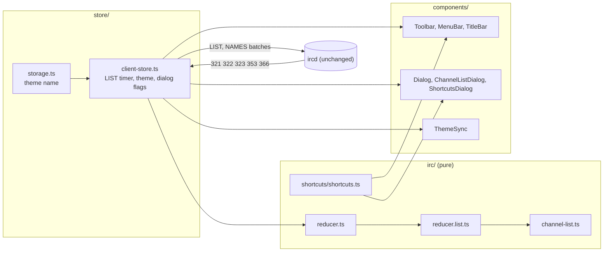

# Design Document: web-client-extras

## Overview

Six additions to `apps/web` and one fix in `apps/runner`. `apps/ircd` is **not** changed. The design matches the implementation in the repository.

| Area | Where |
|---|---|
| Channel list data | `irc/channel-list.ts` (pure helpers), `irc/reducer.list.ts`, `ClientState.list` |
| Channel list UI | `components/Dialog.tsx`, `components/ChannelListDialog.tsx` |
| Theme | `app/globals.css` (`html[data-theme="classic"]`), `store/storage.ts`, `components/ThemeSync.tsx` |
| Shortcuts | `shortcuts/shortcuts.ts`, `components/ShortcutsDialog.tsx` |
| Disabled reasons | `MenuEntry.reason`, `CaptionButton.description`, `Toolbar`, `TitleBar` |
| Runner label | `apps/runner/src/whois/tools-label.ts`, `InviteControllerDeps.sandboxMode` |

### Figma sources

Read through Talk-to-Figma (channel `8p9g0i9k`) and the Figma power (`get_design_context`, once, for frame 06).

- 05 Channel list, node 1:3814. Dialog node 1:4392 (860x470 at frame x290, y190). Title "Channels List — seance.local", `?` and `X` buttons 16x14. "Match text:" field, "Min agents:" spin box 60x21 (default 0), checkbox "Hide channels without a topic", "Apply filter" 92x23. Columns Channel 170, Agents 80, Users 70, Topic 496, headers 20 tall raised. Rows: 22 px pitch, IBM Plex Mono 13 px; selected row `#000080` with white text; a ghost icon before a non-zero agent count. Footer "6 channels · 9 agents · listed 23:48". Buttons Join (default, 90x25), Refresh (88x23), Close (88x23).
- 06 Classic, node 1:1623: same layout as 01, light chat surfaces. Chrome is identical to the ghost frame.
- 04 Whois+Options, node 1:2947. Options dialog node 1:3593 (540x478) is the style for dialogs with no frame of their own (Keyboard shortcuts): navy gradient title bar, white bold 12 px title, `?` and `X` buttons, bevelled body, default button.

## Architecture

The client keeps its three layers. The pure core (`irc/`) knows nothing of React or the DOM; the store owns the socket and timers; components only read the store.



Flow of one channel list request: a toolbar or menu click calls `openChannelList()`. The store sets `ui.channelListOpen`, calls `startList` on the client state, sends `LIST` and starts a 15 s timer. The reducer collects `322` rows while `list.status` is `loading`. At `323` it fills agent counts from joined windows and returns `NAMES` batches in `send`; `353` and `366` replies finish the remaining counts.

### Option comparison: the Agents column

`322` carries `<channel> <users> :<topic>` and must not change (Requirement 2.1). Three ways to get an agent count:

| Option | Server change | Cost | Problem |
|---|---|---|---|
| A. ISUPPORT token plus a custom numeric (agents per channel) | ircd handler, new numeric, tests | one extra reply per channel | A custom numeric for something `NAMES` already says. It counts only in-process virtual clients, a different definition from the nick list. |
| B. Extend the `322` topic or users field | ircd | none | Breaks the format. Rejected by Requirement 2.1. |
| **C. The client counts Known_Agents through `NAMES`** | none | N extra replies, batched | See below. |

**Choice: C.** It needs no server change and uses the same `isKnownAgent` definition as the nick list and window titles (`coder`, `reviewer`, `researcher`), so the number in the dialog equals the number in the channel. Drawbacks, accepted:

- One `353` and `366` pair per channel. Channels are batched as `NAMES #a,#b,...`, each line at most 400 bytes (limit 512 with CRLF), so the batch count is small. The ircd answers a comma list one channel at a time (`handlers/names.ts`).
- A human whose nick is `coder` counts as an agent, exactly as in the nick list today.
- The definition is a fixed nick list, not a server-side property. Replacing it later means changing `isKnownAgent` only.
- Joined channels need no request: the window already holds the members.

State machine: `list.status` is `loading` until `323`. At `323`, rows with a joined window get their count; the rest go into `pendingNames` and the reducer returns the `NAMES` batches in `send`. A `353` for a channel in `pendingNames` adds to `counting[key]`; its `366` writes `agents` into the row and removes the key. Replies for other channels are ignored by the list and keep their old handling (no window, dropped). The list is `ready` after `323`; counts fill in afterwards. A stale `pendingNames` entry simply leaves the cell at a dash.

## Components and Interfaces

### Store (`store/client-store.ts`)

```ts
interface UiState {
  // existing fields ...
  channelListOpen: boolean;
  shortcutsOpen: boolean;
  theme: Theme;               // "ghost" | "classic"
}
interface ClientStore {
  openChannelList(): void;     // no-op unless registered; sends LIST
  refreshChannelList(): void;
  closeChannelList(): void;
  joinFromList(channel: string): void;   // submits the join command, then closes
  openShortcuts(): void;
  closeShortcuts(): void;
  setTheme(theme: Theme): void;
  toggleTheme(): void;
}
export const LIST_TIMEOUT_MS = 15_000;
```

- The list timer uses `deps.setTimeout`; it is stopped on refresh, close, socket close, quit and `dispose`. A late `323` after the timeout is ignored because `list.status` is no longer `loading`.
- A new connection removes the old list (`startConnection`); `resetForReconnect` does the same.
- `StoreDeps.storage` (`ClientStorage`) gets `readTheme()` and `writeTheme(theme)`. `readTheme` returns `null` for an absent, invalid or unreadable value. `writeTheme` throws when the backend refuses; the store turns that into a Status error line and keeps the chosen theme.

### Pure helpers (`irc/channel-list.ts`)

- `parseListRow(params)`: validates a `322`; returns `undefined` for a bad row.
- `filterRows(rows, {text, minAgents, hideEmptyTopics})`: compares `irc_lower(plain(...))`; unknown counts pass Min agents.
- `sortRows(rows, sort)` and `nextSort(current, column)`: stable sort; ascending, then descending, then server order; unknown agent counts sort last in both directions.
- `batchNames(names, maxBytes)`: comma lists whose `NAMES <list>` line stays within `maxBytes` UTF-8 bytes. The byte length is computed by hand because the core has no `TextEncoder`.
- `summarise(rows)`: channel and known-agent totals for the footer.

### Reducer (`irc/reducer.list.ts`)

`startList`, `failList`, `clearList`, `onListReply` (321, 322, 323 while loading), `countListNames` (353), `finishListNames` (366). `reducer.ts` routes the numerics: while no request is loading, `322` and `323` still go to the Status window exactly as before, so `reducer.route.test.ts` and `reducer.whois.test.ts` stay unchanged.

### Dialogs

- `Dialog` renders the frame 04 chrome: fixed overlay, `role="dialog" aria-modal`, bevelled body, navy gradient title bar (`from-title-from to-title-to`), 16x14 caption buttons, Tab trap, Esc closes (key name from the shortcut registry), focus returns to the opener. The caption `?` button is optional.
- `ChannelListDialog` keeps a draft and an applied filter; only Apply filter or Enter in a field copies the draft. Header cells are buttons with `aria-sort`. Rows use a roving tabindex; Enter and double-click join. Topics are shown through `plain()`. The `?` button toggles a hint line, so it is not a dead control. Join is explained (`title`, `aria-description`) while no row is selected.
- `ShortcutsDialog` has only a close button and renders one row per `SHORTCUTS` entry plus the paste note.

### Theme

- `ThemeSync` sets `document.documentElement.dataset.theme` in a layout effect. There is no inline script, so the CSP and `proxy.ts` are unchanged. `ClientApp` renders the stateful tree after hydration, so the store already holds the stored theme when `ThemeSync` first runs; the server-rendered shell is empty.
- Tailwind v4 emits `var(--color-...)` in utilities, so `html[data-theme="classic"] { --color-...: ... }` overrides recolour every component. Only tokens whose Classic value differs are overridden; chrome, title bars and bevels are identical in both themes.
- The mention row fill is a token, `--color-mention-fill`. Its Ghost value is `color-mix(in oklab, var(--color-ghost-orange) 20%, transparent)`, which is what `bg-ghost-orange/20` produced, so Ghost output and its baselines do not change. Classic sets it to `#ffe2b0`.
- The selected channel list row uses the existing `title-from` token (`#000080`) with the white chrome highlight.

### Classic colours (read from frame 06; lifted where 4.5:1 fails)

Lifts reduce brightness only (same hue), checked against white and the mention fill `#ffe2b0`.

| Use | Token | Frame 06 | Value | Note |
|---|---|---|---|---|
| Chat, topic, nick list, input surface | `ghost-bg` | `#ffffff` | `#ffffff` | |
| Text | `ghost-text` | `#000000` | `#000000` | |
| Timestamps, tool lines, topic "(+mnt):" | `timestamp-dim`, `tool-grey` | `#7f7f7f` | `#676767` | lifted, 4.0 to 5.66 (4.51 on the mention fill) |
| Event lines `***` | `event-green` | `#009300` | `#007800` | lifted, 4.06 to 5.70 |
| Action and away lines | `action-purple` | `#9c009c` | `#9c009c` | ok, 7.26 |
| Coder | `nick-coder` | `#0b4fd6` | `#0b4fd6` | ok, 6.77 |
| Reviewer | `nick-reviewer` | `#2e7d32` | `#2b752f` | lifted for the mention fill (4.54) |
| Researcher | `nick-researcher` | `#7b3fb5` | `#7b3fb5` | ok, 6.52 |
| Human nick | `nick-human` | `#c45a00` | `#a74c00` | lifted, 4.37 to 5.71 |
| Away nick in the list | `away-grey` | `#a0a0a0` | `#676767` | lifted, 2.6 to 5.66 |
| Accent: focus, kick and exorcised lines, service nick | `ghost-orange` | `#c45a00` | `#9f4900` | lifted so it also reaches 4.5:1 on its own 20 % fill (4.54) |
| Green, purple, links | `ghost-green`, `ghost-purple`, `link-blue` | not in frame | `#007800`, `#7b3fb5`, `#0b4fd6` | chosen to match the frame palette |
| Mention fill and bar | `mention-fill`, `mention-bar` | `#ffe2b0`, `#c45a00` | same | bar is non-text (3:1 on white) |
| Channel list empty topic | not drawn | `#808080` | uses `timestamp-dim` | lifted, 3.9 to 5.66 |

`irc-fg-N` (IRC colours without a background) are recomputed for white and the mention fill by `scripts/irc-palette.mjs --classic`; each lifted value is commented in `globals.css`. The Ghost output of the script is unchanged.

### Shortcuts (`shortcuts/shortcuts.ts`)

Exports `MENU_DEFS` (menu id, label, mnemonic index), `INPUT_KEYS` (`Tab`, `ArrowUp`, `ArrowDown`, `Enter`), `CLOSE_KEY`, `windowSwitchIndex(event)` (Alt+1 to 9, using `code` because Alt changes `key`), `menuIndexForMnemonic`, `mnemonicOf`, `pasteNote()` (built from `PASTE_MAX_LINES` and `PASTE_INTERVAL_MS`) and `SHORTCUTS` (`{id, group, keys, action}`). `Shell` (Alt+digit), `MenuBar` (menus built from `MENU_DEFS`, `Alt+mnemonic`, `aria-keyshortcuts`), `InputLine` and `Dialog` import from it, and the dialog renders from `SHORTCUTS`.

### Explained disabled controls

- `MenuEntry` items get `reason?: string`; `MenuPopup` renders it as `title` and `aria-description` when the item is disabled. The type does not force a reason; the generic test does.
- `CaptionButton` gets `description` (used as `title` when no `title` is given and as `aria-description`).
- `Toolbar` buttons get `reason`; the tooltip reads the label, a colon and the reason. The Agents button is disabled outside a channel window in every layout, because the nick list exists only there.
- Options and Favorites were removed on 2026-11-10 (task 9): the toolbar has no Options button and the dead separator next to it is gone, `MENU_DEFS`/`MENU_SLOTS` list six menus, and no control carries "Coming soon" any more. `MenuBar` computes everything from `MENU_DEFS`, so the Alt keys (F, V, T, C, W, H are unique), the arrow-key wrap and the Shortcuts dialog follow without a special case. The title-bar Maximise button toggles full screen (`TitleBar.tsx`: `useSyncExternalStore` on `fullscreenchange`, availability from `document.fullscreenEnabled`, both `false` on the server so hydration matches; a rejected or throwing request is swallowed; the icon switches to the restore drawing in full screen).
- Reasons used: "Disconnect first" (Connect while registered), "Connect first", "Switch to a channel window first", "Already connected" and "Already connecting" (Reconnect), "Already the last window", "Already the first window", "The Status window cannot be closed", "Not available in a browser tab" (title bar minimise and maximise), "Not connected" (title bar close), and the restore button's existing explanation.
- `jsx-a11y` does not know `aria-description` (a global ARIA 1.3 attribute), so a disable comment with this reason sits above the `<button>` in `CaptionButton` and `Toolbar`.

### Runner label

`toolsLabel(raw, mode)` rewrites the `shell(...)` token of the profile text (or a bare `shell`) to `shell(host)` for `none` and `shell(sandbox)` for `podman`, and leaves other text alone. `InviteController` applies it where it registers the profile in the Whois_Snapshot, using `sandboxMode` from its deps; `runner.ts` passes `config.sandbox.mode`.

### Silent WHOIS for the credits counter (tasks 10.20 to 10.22, R8.18 to R8.24)

The counter sums `ClientState.credits`, which only a `320` credits line writes. The client now asks by itself:

- **Reducer.** `silentWhois: readonly string[]` holds `keyOf(nick)` of requests in flight. `beginSilentWhois` adds (no duplicates, capped at `MAX_WHOIS_PENDING`), `claimSilentWhois` removes. Replies are collected into `whoisPending` as for any WHOIS and `320` updates `credits` unchanged; `onEndOfWhois` and `onErrorNumeric` (401, 402, 406) drop the entry and the collected replies and append nothing. A 301 for a silent nick never becomes a visible away line. Collecting (instead of discarding at once) lets a user `/whois` take over a request whose first replies already arrived.
- **Store.** One trigger: `scheduleSilentWhois` on an agent's channel line (`SILENT_WHOIS_DELAY_MS` = 2 s), then `sendSilentWhois`, on the injected `setTimeout`/`now`. Limits: `SILENT_WHOIS_INTERVAL_MS` (30 s per agent, `silentSentAt`), `SILENT_WHOIS_MAX_IN_FLIGHT` (3), no request while one for the nick is pending; extra triggers are dropped. Each sent request gets a `SILENT_WHOIS_TIMEOUT_MS` (10 s) timer in `silentTimeouts`; when it fires, `endSilentWhois` drops the entry and its collected replies, printing nothing; a 318 or a swallowed error clears the timer. A typed `/whois` for a silent nick younger than 10 s is not sent again (the Store claims the in-flight request); an older one is ended first and the WHOIS is sent normally, so a late timer never swallows it. `stopSilent` (in `release` and `onClose`: connect, reconnect, quit, disconnect, dispose) clears both timer maps, the send times, `silentWhois` and `silentMessaged`; `resetForReconnect` clears both lists too.
- **Late replies (R8.24, task 10.22).** The timeout calls `expireSilentWhois`, which moves the key to `silentExpired` instead of forgetting it. `onWhoisReply` ignores every reply for such a key except `320` (credits only, nothing collected); `route` drops a `301` for it before `onAwayReply`; `onEndOfWhois` and `onErrorNumeric` remove the key without a line. A typed `/whois` or a new silent request calls `forgetSilentExpired` first. `pruneSentAt` keeps `silentSentAt` to entries in flight or younger than the 30 s rate limit. Remaining race: a `/whois` typed after the timeout but before the late replies arrive makes the late and the new replies one pending entry, so the first `318` prints the block and the second set prints another; with the 10 s timeout this needs a server more than 10 s late.
- **The user's own errors (R8.23).** `noteUserMessage` marks a silent nick in `silentMessaged` (`markSilentMessaged`) when the user sends it a PRIVMSG or NOTICE (typed or pasted, comma lists included). `onErrorNumeric` then shows the 401/402/406 line and still ends the silent entry; without the mark it swallows the error as before.
- **Removed triggers (task 10.21).** The triggers on the user's own KICK of an agent and on ChanServ's `… credits used` were removed: verified on the deployed host on 2026-11-10, a WHOIS of an agent that is in no channel has no `credits:` line (only model, tools, skills, status, budget), so those requests never changed the counter. The ChanServ number is not used either: it names no agent and `X` is `CreditLedger.amount(agent, channel)`, a cumulative per-channel value.

### Audit fixes (task 10)

- **Commands.** `textCommand` builds `/notice` and `/privmsg`; `COMMAND_HELP` and `helpLines()` generate `/help` from the `COMMANDS` keys; `LocalAction` gained `active-lines`, `clear` and `channel-list`. `/ban` and `/unban` are table commands producing `MODE`.
- **Store.** `update()` re-selects the active window when it was removed (next non-minimised in Switchbar order, else Status un-minimised). The last confirmed nick is kept in `last` and `ui.storedNick`; on a first registration after a non-registered phase the store sends `JOIN` for every channel window. `ClientState.expectingModes` marks channels whose next `324` came from a user `/mode #chan`; after the `324` the entry becomes `created|<key>` so an optional `329` prints. `announceAgents()` prints the agent count.
- **Nick list.** `NickList` stays store-free: `onAction(action, nick)` and `canModerate` props; `useNickActions` (`components/nick-actions.ts`) maps actions to commands through `submitInput`. Rows are buttons only when `onAction` is given; the menu is `MenuPopup`.
- **Runner colour.** `stripControls` removes `\x03` with its digits and optional `,NN` before the other C0 controls.
- **Bans.** The ircd keeps `Channel.bans` (`ban-mask.ts`); the mode event carries the mask, and the runner subscriber adds or removes agent nicks (`banNickOf`) in its `BanList`.

## Data Models

```ts
interface ListRow {
  name: string;              // 1..200 characters, no spaces or commas
  users: number;             // from /^\d{1,9}$/
  topic: string;             // raw text, clipped to 512, untrusted
  agents: number | null;     // null = unknown, shown as a dash
}
interface ChannelList {
  status: "loading" | "ready" | "failed";
  rows: readonly ListRow[];  // at most 500
  truncated: boolean;
  requestedAt: number;
  listedAt?: number;
  pendingNames: readonly string[];            // channelKey() values still counting
  counting: Readonly<Record<string, number>>; // null-prototype record
}
```

- `ClientState.list?: ChannelList`; absent until the first request and after a reconnect.
- Constants in `irc/types.ts`: `LIST_ROWS_MAX = 500`, `LIST_NAME_MAX = 200`, `LIST_TOPIC_MAX = 512`, `NAMES_BATCH_MAX_BYTES = 400`.
- Persistence: only the string `ghost` or `classic` under `seance.theme`. Nothing else about the list or dialogs is stored.

## Correctness Properties

### Property 1: Filter is a subset and idempotent

For any rows and any filter, `filterRows` returns only rows of the input, in input order, and filtering the result again changes nothing.

**Validates: Requirements 1.6, 2.3**

### Property 2: Sort is a permutation

For any rows and any sort state, `sortRows` returns the same rows in a different order, equal keys keep server order, and unknown agent counts come last.

**Validates: Requirements 1.7, 2.3**

### Property 3: The row cap never exceeds 500

For any number of `322` replies while loading, the stored rows number `min(n, 500)` and `truncated` is true exactly when more than 500 arrived.

**Validates: Requirements 1.4**

### Property 4: Batches stay within the byte limit and cover every channel in order

For any channel names (including multi-byte ones) and any limit of 100 to 400 bytes, every `NAMES <batch>` line fits the limit, and the batches joined back give the input names in order.

**Validates: Requirements 2.2**

## Error Handling

- A `322` with a bad name or count is dropped without an error line; the list continues.
- No `323` within 15 s: `list.status` becomes `failed`, partial rows stay visible, the footer says the list is incomplete and Refresh retries. A send failure of `LIST` fails the list at once.
- A closed socket closes the dialog and fails a loading list; a new connection or reconnect removes it.
- Unknown agent counts stay a dash; they never block the dialog.
- A stored theme other than the two names is ignored. A failed theme write keeps the chosen theme for the session and adds an error line to the Status window; it is never swallowed.
- A reducer exception still becomes an error line in the Status window through `reduce`.
- Untrusted text (topics, channel names) goes through `plain()` or `IrcText`; the dialog uses no `dangerouslySetInnerHTML` and no inline style.

## Testing Strategy

- Unit: `channel-list.test.ts` (row table, filter, sort, batches), `reducer.list.test.ts` (flow, validation, cap, ignore-when-not-loading, reconnect), `store/extras.test.ts` (actions, timer, theme storage), `a11y/contrast.test.ts` (Classic pairs on white and the mention fill), `apps/runner/test/tools-label.test.ts`.
- Property (fast-check): the four properties above, named `P1` to `P4` in the tests.
- Component: `components/extras.test.tsx` covers the dialog, the shortcut drift checks (one row per registry entry, matcher, mnemonics, Input_Line keys) and the generic explained-disabled test over six client states (fresh, connecting, status, channel, two channels, dropped). `Toolbar.test.tsx` changes only where behaviour changed intentionally, with comments.
- Integration: `apps/ircd/test/runner/credits.integration.test.ts` expects `shell(host)` with sandbox none.
- E2E: Classic app baseline `06-classic.png` at five sizes (fixture with `seance.theme=classic` set by `addInitScript`; the fixture store reads only that key), a CSP check, and the frame 06 comparison against `e2e/figma/06-classic-1440x900.png` (limit 0.0156, measured 0.01298). `components/theme-hydration.test.tsx` hydrates server Ghost markup with "classic" stored and asserts no hydration error.

## Open Points

1. **Frame 06 export: closed.** The user saved `apps/web/e2e/figma/06-classic-1440x900.png` (Figma REST export of node 1:1623, 1440x900). Measured on 2026-11-08: 16,827 of 1,296,000 pixels differ (0.01298) with the Classic masks; `FIGMA_MAX_DIFF_RATIO_06` is 0.0156 (measured plus 20 %).
2. **Theme flash and hydration.** The store always starts as Ghost, like the server render, so the first client render matches the server markup; `ThemeSync` applies the stored name through `loadStoredTheme()` in a layout effect, after hydration and before the first paint (review finding 7, `theme-hydration.test.tsx`). The page background is the chrome face until the app mounts. An inline script would remove that too but needs a CSP nonce change; out of scope.
3. **Agent definition.** `isKnownAgent` is a fixed nick list; a server-side agent flag would be the long-term fix.
4. **Agents button.** It is disabled outside a channel window in every layout (it used to be a silent no-op there). If a status-window use for it appears later, the reason text changes with it.
