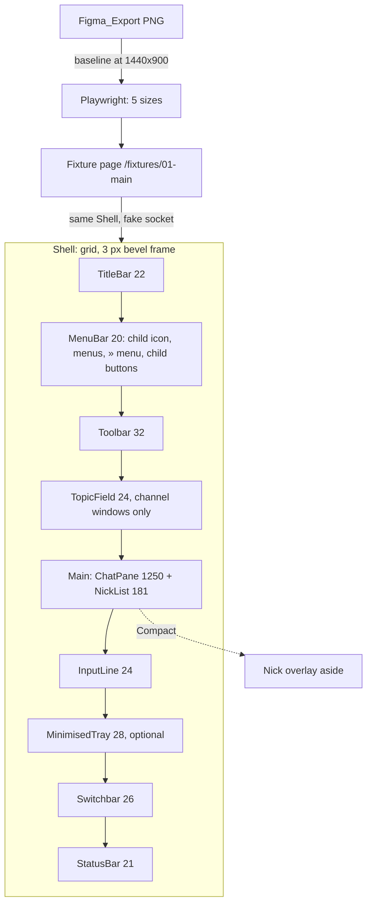
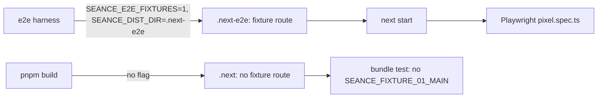

# Design Document

## Overview

The work has three layers. A **layout shell** gives the window the Frame_01 proportions and merges the maximised child into the frame. An **asset layer** swaps in the exact Figma icons and a Win95 scrollbar built from their slices. A **responsive layer** adds the Medium and Compact layouts Figma does not draw. Two small behaviour changes ride along (event colour, readable IRC colours), one protocol change (`+n`, `+t`), and a test-only fixture proves all of it with screenshots.



### Sources read

| Source | What it gave |
|---|---|
| Figma power `get_design_context`, node 1:1093 (once) | Region boxes and offsets in percentages, chat line colours per span (`#6a9955` event, `#9a80c2` action, `#e08a2e` human nick, `#d8d4c8` text), nick list rows, tray and switchbar geometry |
| Talk-to-Figma `get_node_info`: 1:1093, 1:4831 (colours and type), 1:4969 (components), 1:2947 (frame 04) | Absolute boxes, toolbar positions, tokens, button states, scrollbar parts, the WHOIS separator rows |
| Talk-to-Figma `export_node_as_image` 1:1093 and the screenshot `/tmp/seance-pixel/app-01-main-1440.png` | The visual comparison that produced the gap list |
| `/tmp/seance-pixel/figma-icons/*.svg` (23 files) | Copied byte for byte to `apps/web/design/figma-icons/` |
| `apps/web/src/components/*`, `app/globals.css`, `e2e/harness/stack.ts`, `next.config.ts`, `src/config/csp.ts`, `static-safety.test.ts`, `apps/ircd/src/handlers/{mode,topic,message}.ts` | Current structure and constraints |
| `apps/web/node_modules/next/dist/docs/` (`distDir.md`, `not-found.md`) | Present; `pageExtensions` and `distDir` are re-read in task 0.2 (the web `AGENTS.md` warns that this Next.js differs from older versions) |

## Architecture

### Layers

- **Layout shell:** a CSS grid driven by layout tokens. It is pure markup and classes. JavaScript is used in three places only: `useFit` (menu overflow), the nick overlay state, and `useVisualViewport`.
- **Asset layer:** icon components generated from the committed SVGs, and the scrollbar parts as CSS data URIs built from the same path data.
- **Rules layer:** pure functions in `src/irc` (`EVENT_LINE_KINDS`, the empty-line gate, `readableClass`) and the ircd channel-mode change. These are the parts covered by property tests.
- **Verification layer:** the fixture page and the Playwright projects.

### Breakpoints

| Name | Width | What changes |
|---|---|---|
| Desktop | 1024 px and up | Frame_01 metrics; fixed menu slot widths; nick list 181 px |
| Medium | 768 to 1023 px | nick list 140 px; status bar panels scale |
| Compact | below 768 px | nick list becomes an overlay; menus fit by width with a `»` menu; toolbar label hidden; status bar shows connection and agents only; switchbar scrolls inside its row; topic truncates; coarse-pointer hit areas of 32 px |

The breakpoints are Tailwind classes (`md:` 768, `lg:` 1024). No JavaScript decides a layout except the three places above.

### Build variants



### Compact interaction

- The toolbar `agents` button calls `setNickOverlay(!open)`; `NickOverlay` renders the `aside`, moves focus to the list on open and back to the button on close.
- `useVisualViewport` listens to `visualViewport` `resize` and `scroll`, writes `--app-height`, and the shell height follows it, so the input line stays above the on-screen keyboard.

## Frame_01 measurements (relative to the 1440x900 frame)

| Region | x | y | w | h | Notes |
|---|---|---|---|---|---|
| Outer bevel | 0 | 0 | 1440 | 900 | 3 px |
| Title bar | 3 | 3 | 1434 | 22 | icon 10x16 at x+6, y+3.3; caption buttons 16x14 at x 1385, 1401, 1419 (2 px gap between max and close) |
| Menu bar | 3 | 25 | 1434 | 20 | child icon 14x14 at x+5, y+3; buttons 16x14 at x 1385, 1401, 1419 |
| Toolbar | 3 | 45 | 1434 | 32 | buttons 26x24 at y 49 |
| Topic field | 3 | 79 | 1434 | 24 | text 14 px |
| Chat pane | 3 | 105 | 1250 | 686 | text starts x 13; scrollbar 16 px at x 1235 |
| Nick list | 1256 | 105 | 181 | 686 | rows 22 px pitch from y 114; footer 12 px at y 767 |
| Input line | 3 | 793 | 1434 | 24 | text starts x 11, caret orange 2x15 |
| Tray | 3 | 819 | 1434 | 28 | bar 176x24 at x+6, y+2 |
| Switchbar | 3 | 849 | 1434 | 26 | buttons 156x22, pitch 160, first at x+2, y+2; credits 160x22 at x 1275 |
| Status bar | 3 | 876 | 1434 | 21 | text at x 11, 575, 719, 983 |

Heights add up: 3+22+20+32+2+24+2+686+2+24+2+28+2+26+1+21+3 = 900.

Toolbar x positions (frame-relative): connect 7, separator 37, options 42, separator 72, channel list 77, agents 104, separator 134, logs 139, separator 169, theme 174, label ends at 1437−33.

**Changed 2026-11-10 (web-client-extras task 9, tidying the dead controls).** The Options button and its separator are gone from the toolbar, and the Favorites menu is gone from the menu bar, so the app no longer matches Frame_01 at those places: the toolbar items after connect sit 30 px further left (channel list 47, agents 74, separator 104, logs 109, separator 139, theme 144) and the menu labels after View move 75 px left (Tools 115, Commands 164, Window 233, Help 289). The slot widths are now `[42, 42, 49, 69, 56, 56]`. The Figma comparison masks (`e2e/pixel.spec.ts`) keep covering the whole menu bar and toolbar rows, and the Figma export tests still pass within their limits. Measured on 2026-11-10 (macOS Chromium, 1440x900): Frame 01 17,861 pixels (ratio 0.01378, was 0.01309, limit 0.0157) and Frame 06 Classic 17,728 pixels (ratio 0.01368, was 0.01298, limit 0.0156), so the limits stay. The ten app baselines (`e2e/__screenshots__/<project>/01-main.png` and `06-classic.png` for the five projects) were regenerated with `--update-snapshots=all --grep-invert "Figma export"`; only the toolbar and menu bar rows differ (about 1,870 pixels at desktop, 1,630 in compact).

Menu x positions: File 31, View 73, Favorites 115, Tools 190, Commands 239, Window 308, Help 364. *(Superseded by web-client-extras task 9 on 2026-11-10: Favorites was removed, so there are six menus and the labels after View sit 75 px further left; see the note above.)*

Chat colours in Frame_01 (all from the design context): event `#6a9955`, action `#9a80c2`, message text `#d8d4c8`, coder `#3b78ff`, reviewer `#4caf50`, researcher `#9a7fd1`, human `#e08a2e`, `-ChanServ-` `#c8761f`, timestamp `#7a756b`.

## Decisions

| # | Decision | Why |
|---|---|---|
| D1 | A flex column shell: each region has its token height and a `mt-0.5` (2 px) or `mt-px` (status bar) gap class; the chat row is `flex-1`. (Changed from a CSS grid during implementation.) | Rows that are absent (topic for Status and query, the tray) take their gap with them, so no grid template has to change; the sum stays testable (P7) and the region boxes are pinned by the 1440 e2e check. |
| D2 | The child header is deleted; the menu bar carries the child icon and buttons. | This is how Frame_01 draws a maximised child. The Client always has exactly one maximised child, so no mode switch is needed. |
| D3 | The topic field moves from `ChannelWindow` into the shell. | With no child frame the topic field is a full-width row under the toolbar. Status and query windows have no such row. |
| D4 | Icon components are generated from the SVG files by a script, and the generated files are committed. | Fidelity is checkable (P1), review sees the diff, and no SVG loader or dependency is needed. |
| D5 | The scrollbar stays the native `::-webkit-scrollbar`, with arrow buttons, pressed states and thumb as CSS `background-image` data URIs built from the sliced Figma paths. | Native scrolling, wheel, touch and keyboard keep working; the look is exact in Chromium and Safari. Firefox keeps the `scrollbar-color` fallback. CSP `img-src` already allows `data:`. |
| D6 | The thumb uses a 4-layer inset `box-shadow` with the Figma thumb's 2 px edge colours (changed from the planned `border-image` 9-slice; see Open Point 6). | Works on any thumb length with no image, and reuses the bevel tokens. |
| D7 | The WHOIS separator rows stay exactly as today (`sep-top`, `sep-bottom` in `WhoisLines`). | Frame 04 draws them (1:3541, 1:3550); decided by the product owner on 2026-11-08. The empty-line gate (D8) runs in the reducer, so it cannot touch them. |
| D8 | The "no empty lines" rule lives in the reducer, not in `ChatLine`. | A line that is never stored cannot take a row, count as unread or trigger a sound. |
| D9 | Contrast fixes change the `--color-irc-N` tokens for the ghost surface, and a pure `readableClass(fg, bg)` handles colour pairs. | No inline style is allowed, so the choice must end in a class name from a fixed list. |
| D10 | Channel flags `n` and `t` default to on. | This is how the server already behaves. Defaulting them off would let outsiders write to channels that agents read. |
| D11 | The fixture route exists only in a build made with `SEANCE_E2E_FIXTURES=1`, through `pageExtensions`, and that build goes to its own `distDir`. | `NODE_ENV=test` is never set in a production bundle, and the e2e stack builds production. A page extension keeps the route and its code out of every normal build. |
| D12 | `visualViewport` height goes to `--app-height` through `documentElement.style.setProperty`. | CSP restricts inline style attributes and `<style>` elements, not CSSOM writes; the static test only forbids `style={`. The e2e CSP spec verifies it. |
| D13 | At 1440x900 a separate test compares with the Figma_Export (masks for the lifted colours) and skips with a reason while the export file is missing; an app baseline covers 1440x900 like the other sizes. | The Figma comparison is the only way to claim "pixel-close to Figma" with a test, but the export is a manual input (task 0.1), so it must not block the suite. |
| D14 | Menu slot widths (42, 42, 75, 49, 69, 56, 56) are the same at every width; on Compact `useFit` moves the menus that do not fit into the `»` list. | One set of widths keeps `fitCount` and the drawn bar identical; the `»` list already gives Compact the space it needs. |

## Components and Interfaces

### Layout

- `app/globals.css`: a `@theme` block `--layout-*` with the nine heights, the 3 px frame, the 2 px gap, the nick list widths (181, 140, 240) and breakpoints used in classes (`md` 768, `lg` 1024). Utilities `.bevel-frame`, `.bevel-field` (sunken two-step), `.bevel-etched` stay the single source of bevel styling.
- `ClientApp.tsx` `Shell`: `div.bevel-frame` flex column (D1) with `p-(--layout-frame)` and `h-[var(--app-height,100dvh)]`; closes the nick overlay when the active window or the breakpoint changes.
- `MdiChild.tsx`: reduced to the `section` wrapper with `aria-label`; no header. `childTitleOf` stays (the tray uses it); `ChildIcon` picks the 14 px child icon.
- `ChannelWindow.tsx`: topic field, then the chat row (chat pane and nick list, or the Compact overlay). See Open Point 10.
- `TopicBar.tsx` (name kept): sunken field, channel / `(modes)` / topic spans as in R2.6.
- `CaptionButton.tsx` (new): one 16x14 button drawn by the Figma button icon, swapping to the pressed drawing on `:active`; used by the title bar, the menu bar and the tray.
- `MenuBar.tsx`: left child icon, menus with slot widths, the `»` overflow (Compact), right child buttons. Slot widths and reserve live in `src/layout/metrics.ts` (`MENU_SLOTS`, `MENU_RESERVE`, `MENU_OVERFLOW`).
- `Toolbar.tsx`: item list `connect | channels agents | logs | theme` (the `options` button was removed on 2026-11-10), separators as a distinct item kind, 26x24 buttons, offsets by classes.
- `MinimisedTray.tsx`: bar 176x24.
- `ConnectDialog.tsx` (follow-up 2026-11-10): rendered through the shared `Dialog.tsx` (bevelled `bevel-frame` with `p-0.5`, an 18 px full-width caption bar, the title `Connect to Séance` with `id="connect-title"`, and the caption `X` button, `aria-label` "Close", `title` "Close (Esc)", which calls the same `close` as Cancel). `Dialog` gained `overlayClassName` so the Connect dialog keeps its `z-10 bg-ghost-bg/70` overlay, and `captionClass` is exported. The form is a `p-2`, `gap-2` body under the caption; `w-96 max-w-full` is unchanged. Focus: `Dialog` owns the Tab trap, Esc and the initial focus (the first empty field carries `data-autofocus`); `ConnectDialog` only returns focus to the Input_Line when it closes. The caption `X` is the first Tab stop, as in every other dialog. No screenshot test covers the Connect dialog (the fixture page hides it), so no baseline changed.
- `Switchbar.tsx`, `CreditsCounter.tsx`: new icons and the 160x22 panel.
- `StatusBar.tsx`: panel grid by widths; Compact hides lag and filler.
- `NickOverlay.tsx` (new, Compact): the `aside` and its open state `ui.nickOverlayOpen` in the store, toggled by the toolbar agents button. Closing on Escape, outside tap and window change.
- `src/components/layout-hooks.ts` (new): `useVisualViewport` sets `--app-height` (no-op when `visualViewport` is missing); `useFit` returns the count that fits using `fitCount` from `src/layout/fit.ts`, with `ResizeObserver` when present and window `resize` otherwise; `useCompact` reads the Compact media query.

### Pressed and disabled look (Figma components 1:5054 to 1:5092)

- Pressed button: sunken bevel, label moves 1 px down and 1 px right.
- Disabled: label `#808080` with a 1 px white copy offset by 1,1 (class `[text-shadow:1px_1px_0_var(--color-chrome-highlight)]`).
- Default button (dialog OK): extra 1 px black outline. Not needed on Frame_01; listed for the dialogs spec.

### Interfaces

```ts
// src/layout/metrics.ts (same numbers as the CSS tokens)
export const LAYOUT = {
  frame: 3, gap: 2, title: 22, menu: 20, toolbar: 32, topic: 24, chat: 686,
  input: 24, tray: 28, switchbar: 26, status: 21,
  nickList: { desktop: 181, medium: 140, overlay: 240 },
} as const;
export function totalHeight(withTray: boolean): number; // 900 with the tray, 870 without

// src/irc/classify.ts
export const EVENT_LINE_KINDS: readonly LineKind[]; // join, part, quit, nick, mode, topic, invite

// src/irc/colors.ts
export function readableClass(fg: number, bg: number | undefined): string;

// src/components/useFit.ts
export function fitCount(containerWidth: number, itemWidths: readonly number[], reserve: number): number;

// store
interface UiState { /* ... */ readonly nickOverlayOpen: boolean }
interface ClientStore { /* ... */ setNickOverlay(open: boolean): void }

// apps/ircd/src/handlers/mode.ts
export function groupChanges(
  changes: readonly { mode: "o" | "v" | "m" | "n" | "t"; adding: boolean; nick?: string }[],
): readonly string[]; // MODE params after the channel, e.g. ["+mn"] or ["+o-v", "coder", "bob"]
```

## Icons

Source of truth: `apps/web/design/figma-icons/*.svg` (committed). The script `apps/web/scripts/gen-icons.mjs` writes `src/icons/*.tsx`, `src/icons/index.ts`, `src/icons/sources.ts` and `app/scrollbar.css`. The components live in `src/icons/`, not `src/components/icons/`, because they keep the Figma hex colours verbatim and `static-safety.test.ts` forbids hex under `src/components/`; the ESLint hex rule has a matching narrow exception for `src/icons/**` and `src/irc/colors.ts`.

| File | Component | Size | Colour rule | Used by |
|---|---|---|---|---|
| `app-candle` | `AppCandle` | 10x16 | own colours | title bar |
| `tool-connect` | `ToolConnect` | 10x15 | own | toolbar |
| `tool-options` | `ToolOptions` | 16x16 | own | toolbar *(removed with the Options button by web-client-extras task 9; the SVG, the component and its manifest entry are gone)* |
| `tool-channels` | `ToolChannels` | 12x14 | own | toolbar |
| `tool-agents` | `ToolAgents` | 12x16 | own | toolbar |
| `tool-logs` | `ToolLogs` | 12x14 | own | toolbar |
| `tool-theme` | `ToolTheme` | 13x13 | own | toolbar |
| `btn-min`, `btn-max`, `btn-restore`, `btn-close` | `BtnMin` ... | 16x14 | own | title bar, menu bar, tray |
| `mdi-child-channel` | `MdiChildChannel` | 14x14 | `currentColor` (`#000080`) | menu bar |
| `switch-status` | `SwitchStatus` | 12x12 | own | switchbar |
| `switch-channel` | `SwitchChannel` | 12x12 | `currentColor` (black) | switchbar |
| `switch-query` | `SwitchQuery` | 10x13 | own | switchbar, menu bar (`mdi-child-query`) |
| `tray-status` | `TrayStatus` | 14x13 | own | tray, menu bar |
| `nick-agent-coder` | `NickAgentCoder` | 11x14 | own | nick list |
| `nick-agent-reviewer` | `NickAgentReviewer` | 11x14 | own | nick list |
| `nick-agent-researcher-away` | `NickAgentAway` | 11x14 | own | nick list (any away agent), exorcism line |
| `credits-candle` | `CreditsCandle` (slice) | 10x10 | own | credits panel |
| `scrollbar-vertical`, `scrollbar-horizontal` | `ScrollArrow{Up,Down,Left,Right}` (slices), `ScrollThumb` | 16x16 | own | scrollbar CSS (data URIs) |
| `caption-buttons` | none | | | duplicate of the three button files |

**Added icons** (not in the 23 files; drawn 16 px, same palette `#c0c0c0 #ffffff #dfdfdf #808080 #000000`):

| Icon | Reason |
|---|---|
| `nick-agent-researcher` | The set has only the away variant of the researcher; an active researcher ghost is needed (`#9A7FD1`, same path as the coder ghost). |
| `btn-min-pressed`, `btn-max-pressed`, `btn-restore-pressed`, `btn-close-pressed` | The Figma buttons carry their raised bevel in the drawing; the pressed state needs the sunken one. |
| `scroll-arrow-{up,down,left,right}-pressed` | Same reason, for the scrollbar. |
| `overflow-chevrons` | `»` button of the Compact menu bar. |
| `mdi-child-query` | The 14 px ghost for a query window in the menu bar (the set has 10x13 `switch-query` for the switchbar). |

The added icons are kept as SVG files in `apps/web/design/figma-icons-extra/` and go through the same generator as the 23 source files.

`credits-candle.svg` is kept verbatim in `design/` but contains `<text>` and an inline `style`; the component uses only the circle path, so the shipped markup has neither. Raw files are never imported by the app.

## Behaviour changes

### Event colour and invite lines

A single constant `EVENT_LINE_KINDS = ["join","part","quit","nick","mode","topic","invite"]` (in `irc/classify.ts`) feeds `ChatLine.lineClass` and the test. `341` is handled in `reducer.ts`: `341 <me> <target> <channel>` appends kind `invite`, text `<me> invited <target>`, to the channel window (or Status). The existing `INVITE` handler also uses kind `invite`.

### No empty lines

`appendTo`/`appendStatus` call `hasVisibleText(spec.text)` (pure, from `irc/formatter`) for kinds `message`, `action`, `notice`, `tool`, `tool-denied`, `local`; an invisible line returns the state unchanged. `WhoisLines` keeps `sep-top` and `sep-bottom`; a unit test pins them.

### Human nick colour

`--color-nick-human` becomes `#e08a2e` (7.34:1 on `#0b0b0f`). `--color-ghost-orange` (`#c8761f`) stays for mentions, notices, kick lines and the focus ring. `.kiro/steering/web-ui.md` changes the "Accent orange ... human nicks" row so that it no longer names human nicks, and the `Humans` row of the nick colour table to `#e08a2e`.

### Readable colours

- A script `scripts/irc-palette.mjs` computes, for each index that fails 4.5:1 on `#0b0b0f`, the lightest-change shade in OKLCH (keep hue and chroma, raise lightness in 0.01 steps until the ratio is met). The output is pasted into `globals.css` with a comment per token naming the original value; the script is not run at build time.
- `readableClass(fg, bg)` (`irc/colors.ts`): returns `text-irc-<fg>` if `contrast(palette[fg], palette[bg]) >= 4.5`, else `text-irc-0` or `text-irc-1`, whichever contrasts more. `Spans.spanClass` uses it when a background is present.

### Channel modes `n` and `t`

- `ChannelRegistry`: `modes: { moderated, noExternal, topicLock }`, new channels `{ false, true, true }`; `canSpeak(channel, clientId)` becomes: member → `!moderated || op || voice`; non-member → `!noExternal && !moderated`.
- `mode.ts`: `ModeChange.mode` widens to `"o"|"v"|"m"|"n"|"t"`; `n`, `t` and `m` are flags without arguments. Changes that do not alter state are dropped. One `MODE` message per command is broadcast, built by `groupChanges` (pure): sign runs, flags in input order, arguments after the flags in the same order.
- `irc.mode` events are published for `o`, `v`, `m` only (the runner port types stay valid).
- `324`: `+` followed by the flags in alphabetical order.
- `topic.ts`: the op check applies only when `topicLock` is on.
- `registration.ts`: `004` channel modes become `mntov`.

## Verification fixture

- `app/fixtures/01-main/page.fixture.tsx` renders `<FixtureShell />` from `src/fixtures/shell.tsx`. `FixtureShell` builds a `ClientStore` with a `FakeSocket` and a fixed `now`, feeds `FIGMA_01_MAIN` (an array of IRC lines in `src/fixtures/figma-01-main.ts`), minimises Status, then renders `Shell`.
- `next.config.ts`: `pageExtensions` is `["tsx","ts"]`, plus `"fixture.tsx"` when `SEANCE_E2E_FIXTURES === "1"`; `distDir` is `process.env.SEANCE_DIST_DIR ?? ".next"`. `.next-e2e` is added to `.gitignore`.
- The page carries the string `SEANCE_FIXTURE_01_MAIN` in a comment-free constant so the bundle test can find it.
- `e2e/harness/stack.ts` sets both variables for `next build` and `next start`.
- The fixture is the same code path as the product (`Shell`); only the store input differs. The e2e flow specs keep using the real stack.

### Fixture content (from Frame_01)

Channel `#fix-bug-123`, topic `Fix NPE on login when email is null`, modes `+mnt`; members `@bayu`, `@coder` (agent), `+reviewer` (agent), `researcher` (agent, away `reading docs`); windows `Status` (minimised), `#fix-bug-123` (active), `#landing-page` (unread), `coder` (query); credits `42.70` (the store value; the panel shows it with two decimals since 2026-11-10, Frame_01 draws `42.7` with one, Requirement 8.3); connection `seance.local:6697` with TLS; lag 0.12 s. Lines in order are those of nodes 1:1352 to 1:1379, with the Client's own wording where it differs (the `-tool-` rows are fed as agent notices and may differ in wording; the mask list says which rows).

## Screenshot test plan

| Project | Viewport | Flags | Baseline |
|---|---|---|---|
| `desktop-1440` | 1440x900 | | generated; plus a separate Figma comparison against `e2e/figma/01-main-1440x900.png`, skipped with "Figma export missing" while that file is absent |
| `desktop-1024` | 1024x768 | | generated |
| `medium-768` | 768x1024 | | generated |
| `compact-390` | 390x844 | `isMobile`, `hasTouch`, DPR 3 | generated |
| `compact-360` | 360x740 | `isMobile`, `hasTouch`, DPR 3 | generated |

Common: `timezoneId: "UTC"`, `locale: "en-US"`, `reducedMotion: "reduce"`, `colorScheme: "light"`, wait for `document.fonts.ready`, `caret: "hide"`, `animations: "disabled"`.

Procedure to set the tolerance at 1440x900: run once with `maxDiffPixelRatio: 1`, read the measured ratio from the report, set the limit to that value plus 20 percent, write the number into this file (Open Point 7), then keep it. Masks: timestamp column, nick list footer, the away nick row, the status bar lag text (colour lifted for contrast, Finding 4). The human nick is no longer masked: its colour now matches Figma.

Platform: baselines are generated on the maintainer's macOS Chromium (Playwright 1.65). `snapshotPathTemplate` has no platform suffix. Another OS needs `--update-snapshots` once, and the 1440 comparison to Figma then uses the larger tolerance of that OS; this is Open Point 5.

Other scripted checks per size: overflow walk, region boxes (1440 only), hit areas (touch sizes), CSP violation listener (no `securitypolicyviolation` event).

## Data Models

Nothing is persisted. All data is in memory, in CSS, or in committed files.

```ts
type Breakpoint = "desktop" | "medium" | "compact";

type LineKind = /* existing kinds */ | "invite";             // new kind, Event_Token colour

interface ChannelModes {                                       // apps/ircd channel-registry.ts
  moderated: boolean; noExternal: boolean; topicLock: boolean; // new channels: false, true, true
}

type ToolbarItem =
  | { kind: "button"; id: "connect" | "options" | "channels" | "agents" | "logs" | "theme"; label: string; disabled: boolean } // "options" removed by web-client-extras task 9
  | { kind: "separator" };

interface MenuDef { id: string; label: string; slotWidth: number; entries: readonly MenuEntry[]; disabled: boolean }

interface FixtureScript {                                      // src/fixtures/figma-01-main.ts
  readonly nowMs: number;                                      // fixed clock
  readonly lines: readonly string[];                           // IRC lines fed through the fake socket
  readonly minimised: readonly string[];                       // window keys
}
```

| Item | Where | Notes |
|---|---|---|
| Layout tokens | `app/globals.css` `@theme` and `src/layout/metrics.ts` | equal by test (P7) |
| IRC palette | `--color-irc-0` to `--color-irc-15` | replaced values carry the original in a comment |
| Icon sources | `apps/web/design/figma-icons/` (23 files), `figma-icons-extra/` | generated components are committed |
| Baselines | `apps/web/e2e/__screenshots__/<project>/` and `apps/web/e2e/figma/01-main-1440x900.png` | no platform suffix |
| Tolerance | `design.md` Open Point 7 | written after the first measured run |

## Correctness Properties

All property tests use fast-check, at least 100 runs, named after the property ID.

### Property 1: Icon fidelity

For every source SVG, the rendered component contains the same sequence of `d` attributes and `fill`/`stroke` values as the file (after sorting out `currentColor` cases), and the output has no `style`, `width=`, `height=` or `<text`. Example-based over the 23 files.

**Validates: Requirements 3.1, 3.2, 3.3, 3.4, 3.8**

### Property 2: Readable colours

For every `fg` in 0..15 on the ghost background, and for every pair (`fg`, `bg`), `contrast(colour(readableClass(fg,bg)), colour(bg)) >= 4.5`; `readableClass` returns a class from the fixed list.

**Validates: Requirements 10.1, 10.2, 10.3, 10.4**

### Property 3: Event colour

For any `Line` kind, `lineClass` contains `text-event-green` exactly when the kind is in `EVENT_LINE_KINDS`; kinds `kick`, `exorcised`, `exorcised-kick`, `message`, `notice` never do.

**Validates: Requirements 6.1, 6.3**

### Property 4: No empty lines

For arbitrary strings built from control codes, whitespace and zero-width characters, feeding them as `PRIVMSG`, `NOTICE` and action text appends no line; for any string with a visible character, the line is appended.

**Validates: Requirements 9.2, 9.3**

### Property 5: Modes

A reference model of `(m, n, t, members, ops, voices)` against random command sequences (`MODE` with any flag mix, `PRIVMSG`, `TOPIC` by members and non-members): the numerics and delivery of the server equal the model's. Includes `grouped MODE` output equal to the model's state difference.

**Validates: Requirements 12.2, 12.3, 12.4, 12.5**

### Property 6: Menu fit

For any container width and item widths, `fit(...)` returns a count `k` such that the first `k` items fit, item `k+1` does not (or `k` is all), shown plus overflow equals the menu list in order, and `k` is monotonic in the width.

**Validates: Requirements 11.4**

### Property 7: Layout sum

The layout tokens sum to 900 with the tray and to 870 without it.

**Validates: Requirements 1.1, 1.8**

## Error handling

| Case | Behaviour |
|---|---|
| `ResizeObserver` missing (jsdom) | `useFit` measures once and re-measures on `window` resize |
| `visualViewport` missing | `--app-height` is not set; the CSS falls back to `100dvh` |
| Firefox | `scrollbar-color` fallback; no pixel claim |
| Fixture route requested on a normal build | not found (route is not compiled) |
| `RPL_INVITING` for an unknown channel window | line goes to Status |
| A palette index with no readable shade | impossible by construction (white or black always meets 4.5 against any `bg` except mid-grey pairs, where the higher of the two is taken) |

## Testing strategy

- **Unit** (`vitest`): layout tokens, menu data and slot widths, toolbar item list and offsets, `fit`, `readableClass`, `groupChanges`, reducer rules (invite, empty line, WHOIS rows), icon generator output.
- **Property:** P1 to P7 as above.
- **Component** (`@testing-library/react`): child icon and buttons in the menu bar, no child header, Favorites item *(superseded: web-client-extras task 9 removed it)*, toolbar order and separators, status bar panels per breakpoint (class based), overlay open and close with focus handling, `»` menu.
- **Ircd** (`apps/ircd/test`): `n`, `t`, grouped `MODE`, `324`, `004`; updated old expectations.
- **E2E** (`apps/web/e2e/pixel.spec.ts`): the five projects above.
- **Manual:** side-by-side check list in `tasks.md`.
- Verify per package: `pnpm --filter @seance/web typecheck`, `test`, `lint`; `pnpm --filter @seance/ircd test`; then `pnpm test:e2e` in `apps/web`.

## Open Points

Decisions of 2026-11-08 (product owner): points 1, 2, 3 and 4 to 9 are closed as listed. Only the measured value of point 7 is still to be written in.

1. **WHOIS separators.** Decided: kept exactly as Frame 04 draws them (nodes 1:3541, 1:3550). The earlier request to remove them was withdrawn.
2. **Default `+nt`.** Decided: kept. New channels report `+nt`, so the title shows `(+nt)` after the first join and `(+mnt)` after `+m`; the Figma sequence with `+mnt` as the first mode line is a known difference.
3. **Human nick colour.** Decided: `#e08a2e` from Figma, in the token and in the steering (7.34:1).
4. **Menu slot widths.** Accepted: derived from the Figma x positions; Help is text width plus 31 px.
5. **Baseline platform.** Accepted: macOS Chromium baselines only.
6. **Scrollbar (spike 0.3, 2026-11-08).** Static page in Playwright's Chromium (1.65, scrollbars shown) with two variants:
   - `::-webkit-scrollbar-button:single-button` draws **no** arrow buttons in Chromium.
   - The plain `::-webkit-scrollbar-button` (with `display: block`), `:vertical:start:decrement` and `:vertical:end:increment` draws the Figma arrows, also when nothing overflows; `:start:increment` and `:end:decrement` are hidden. `globals.css` uses this form.
   - The thumb is a 4-layer inset `box-shadow` (white, light, shadow, black) instead of `border-image`; it draws the Figma 2 px edge on any thumb length. Track `#dcdcdc`.
   - Not verified: the pressed arrows (`:active`), because a synthetic mouse-down in headless Chromium does not reach the scrollbar (the box did not scroll either), and Safari (WebKit is not installed in this environment). Both stay for the manual check.
7. **1440 tolerance.** Re-measured on 2026-11-08 after the Frame_01 text fixes of point 12 (macOS Chromium, Playwright 1.65, masks below): **16,960 of 1,296,000 pixels differ, ratio 0.01309** (first measurement before those fixes: 22,083, 0.01704). Limit: **`maxDiffPixelRatio: 0.0157`** (measured + 20 %), in `e2e/pixel.spec.ts` (`FIGMA_MAX_DIFF_RATIO`). The ratio was read from a run with the limit set to 0, because a passing run at 1 does not report it. Masks: timestamp column (also covers the session-start row, which uses the dim token), nick list footer, away nick row, lag panel. Playwright paints masks on the actual screenshot only, so the test paints the same boxes in `#FF00FF` on its copy of the export. Re-measure after any intended visual change.
10. **Topic field placement (D3).** Implemented inside `ChannelWindow` (first row of the window section), not mounted by the shell. With no child frame the drawn result is the same full-width row under the toolbar, absent for Status and query, and the topic stays inside the window's labelled region.
11. **Tray bar buttons.** Frame_01 draws minimise, maximise and close on the minimised bar. The Client shows restore, maximise (also restores, since the client keeps one maximised window) and close, because minimising a minimised window does nothing. Open: follow Figma's drawing or keep restore.
12. **Gap list after the Figma export (task 0.4, 2026-11-08).** Compared the 1440 fixture with `e2e/figma/01-main-1440x900.png` region by region (share of differing pixels before the fixes: total 11.1 %, tray 91 %, status 34 %, toolbar 8 %, chat 9 %).
    - Fixed in this pass, all inside existing requirements:
      - Chat text started at x 20: the ChatLine mention bar (3 px plus 4 px) came on top of the 8 px padding. It now starts at x 13 (R1, measurements table).
      - The arrow buttons were missing (spike result above, R7.2).
      - Menu text sat 4 px low; it is now at the top of the bar as drawn.
      - The `Theme: Ghost` label sat 3 px low.
      - The etched line between menu bar and toolbar was missing.
      - The tray row background is now `#808080` (the empty MDI area).
      - The fixture now holds the typed command `/kick coder scope creep` in the input line, as Frame_01 shows.
    - Decided and implemented in the follow-up of 2026-11-08 (product owner), each with tests:
      - a. Tool rows read `-tool- <text>` in upright `tool-grey`; the runner's `using tool: ` lead-in is not shown, and the `[tool]` marker is dropped because `-tool-` is the text cue. `tool-denied` rows are unchanged.
      - b. Notices colour only the `-nick-` part (and the `-server-` part of server notices) in the accent orange; the text uses `ghost-text`.
      - c. Chat prefixes use the sender's mode when the line arrived: `appendTo` stores `Line.nickPrefix` for channel message lines, and `ChatLine` falls back to the current members only for lines without it.
      - d. Session start reads `--- Session start: Fri Nov 06 23:38:02 2026` (local time, English names). The away-return line reads `is back (gone hh:mm:ss)` when the client kept the nick's `is away (…)` line, and plain `is back` otherwise (marked by `301`, or the line left the buffer).
      - e. The status bar reads `Connected to <host>:<port> (TLS) as <nick>`; this supersedes the web-client-polish R6.2 order. Panel edges still differ by 1 to 3 px.
      - f. The tray caption is the window name only (`Status`). It stays black on the inactive gradient for contrast; the buttons are covered by point 11.
    - Still open:
      - g. Switchbar text sits about 2 px further right in Figma.
8. **Restore button.** Accepted: disabled in the maximised state.
9. **Compact nick list.** Accepted: overlay opened by the toolbar button, no swipe gesture.
