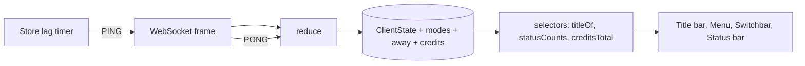
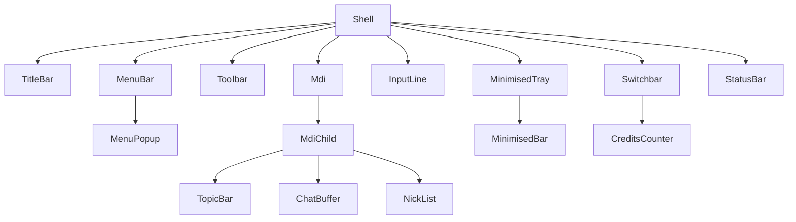

# Design Document

## Overview

`web-client-polish` restyles the M2 client to the Figma frames and adds the small state the new chrome needs. The IRC_Core stays pure and the layers of `web-client-basic` stay the same: core (`src/irc`), Store (`src/store`), UI (`src/components`). New derived data lives in pure selectors in the core so it can be tested without React.

### Sources read

| Source | Status |
|---|---|
| Talk-to-Figma, channel `8p9g0i9k`: `get_node_info` for `01 Main` (1:1093), `export_node_as_image` for 1:4830, 1:1093, 1:2153, 1:4655, 1:2947 | read |
| `get_node_info` for 1:4830, 1:2153, 1:4655, 1:2947 | not read; those frames were taken from the exported images only |
| Figma power `get_design_context` for 1:1093 | **not called**: the request contained the placeholder `<FIGMA_FILE_URL>` instead of a file URL, so no file key was available |

### Layout measured in `01 Main` (1440×900, face `#c0c0c0`)

| Region | y | h | Notes |
|---|---|---|---|
| Title bar | 3 | 22 | icon 10×16 at x 6; title Arimo Bold 12 white; caption buttons 16×14 at the right |
| Menu bar | 25 | 20 | MDI icon 14×14 at x 5; menus Arimo 12 at x 28, 70, 112, 187, 236, 305, 361; child buttons at the right |
| Toolbar | 45 | 32 | buttons 26×24 at x 4, 39, 74, 101, 136, 171; separators 2×22; `Theme: Ghost` at x 1324 |
| Topic bar | 79 | 24 | IBM Plex Mono 14, channel in `#c8761f` |
| Chat pane | 105 | 686 | 1250 wide, scrollbar 16 px, rows 21 px, text 15/19.5 |
| Nick list | 105 | 686 | 181 wide, rows 22 px pitch, footer text 12 px |
| Input line | 793 | 24 | orange caret 2×15 |
| Minimised tray | 819 | 28 | bar with icon, bold title, three 16×14 buttons |
| Switchbar | 849 | 26 | buttons 156×22 every 160 px; credits panel at the right |
| Status bar | 877 | ~18 | panels at x 5, 570, 715, 978 |

Values not listed (exact grey of the inactive gradient, link blue, bevel greys of the switchbar) are read with `get_node_info` during task 1 and written into `@theme`.

## Architecture



### Key decisions

| Decision | Rationale |
|---|---|
| Derived text (title, counts, credits total) comes from pure selectors in `src/irc/selectors.ts` | Property-testable, no DOM, one definition for the Title_Bar, the document title and the tests. |
| Lag is measured in the Store, not the Reducer | It needs the clock and a timer. The Reducer only reports a matching `PONG` token through `ReduceResult.pong`. |
| Modes are stored as sorted flag strings without arguments | The ircd models only `m` today (`324` returns `+m` or `+`); the client shows what the server reports, so `(+mnt)` in the mockup appears only when the server sends it. |
| Away comes from `301`, inbound `AWAY` and `305/306`; no WHOIS polling | Polling would add traffic and rate-limit risk. The ircd does not broadcast `AWAY` to channels yet, so `N away` stays low until it does (Open Point 2). |
| Minimise is UI state (`ui.minimised`), not window state | It must not touch routing, unread or reconnect logic (R4.7). |
| Exorcised rows are a window UI field, not members | The Reducer member model stays exact (P2 of `web-client-basic`). |
| Credits are parsed from the runner's `320` text `credits: <chan> <used> / total <total>` | This is what `apps/runner/src/whois/render.ts` emits. The mockup text `credits used: 9.6 / 25.0` differs; the client renders the text as received and only parses the runner form. |
| Floating ghosts and scanlines are not built | Out of scope; no motion means no reduced-motion branch. |

## Components and Interfaces

### Core additions (`src/irc`)

```ts
// types.ts additions
interface Window { /* existing */ readonly modes?: string; readonly exorcised?: readonly string[]; }
interface ClientState {
  /* existing */
  readonly userModes: string;                          // "" when unknown
  readonly away: Readonly<Record<string, string>>;     // irc_lower(nick) -> text, null-prototype, max 200
  readonly credits: Readonly<Record<string, number>>;  // irc_lower(agent) -> latest total, max 50
}

// selectors.ts (pure)
titleOf(state: ClientState, host: string): string
modeSuffix(modes: string): string                       // "" for "" or "+", else " (+mnt)"
statusCounts(state: ClientState, scope: "active" | "all"): { agents: number; away: number; ops: number; users: number }
creditsTotal(state: ClientState): number
parseCreditsLine(text: string): { channel: string; used: number; total: number } | undefined
exorcismText(parts: ExorcismParts): { agent: string; kicker: string; reason: string | undefined }
```

- `reducer.modes.ts`: `324`, `221`, channel and user `MODE`; flags with parameters never enter `modes`.
- `reducer.away.ts`: `301`, `305`, `306`, inbound `AWAY`; follows `NICK`/`QUIT`; bounded record helpers from `record.ts`.
- `reducer.whois.ts`: on a `320` line that parses, store `credits[agent] = total`.
- `reducer.ts`: `KICK` of a Known_Agent adds the nick to `exorcised` of that window; a `JOIN` of the same nick removes it; own leave drops the field.
- `classify.ts`: remove the `[exorcised]` marker for `exorcised-kick`; `exorcismText` applies the empty-reason or reason-equals-kicker rule.
- `ReduceResult` gets `pong?: string` (token of an inbound `PONG`).

### Store additions

```ts
interface UiState { /* existing */ readonly minimised: readonly string[]; readonly lagSeconds: number | null; }
interface ClientStore {
  /* existing */
  minimiseWindow(key: string): void;
  restoreWindow(key: string): void;
  insertCommand(prefix: string): void;   // fills the Input_Line draft and requests focus
}
```

- After own `JOIN` the Store sends `MODE <channel>` (once per join).
- While `registered` a 30 s timer sends `PING :seance-lag-<n>`; `onMessage` matches `pong` against the outstanding token and sets `lagSeconds = (now - sentAt) / 1000`. Timer and token are cleared in `release`, `dispose`, `closeAfterQuit` and reconnect.
- `minimised` keeps only keys of open windows (pruned on close).
- A draft slot (`ui.draft`) lets menu items prefill the Input_Line; `InputLine` consumes and clears it.

### UI tree



| Component | Change |
|---|---|
| `TitleBar` (new) | R1; also sets `document.title` in an effect. |
| `MenuBar` | Rewritten: seven menus, roving tabindex, popups, mnemonics, `aria-disabled` items (R2). The old three buttons move into File and View. |
| `MenuPopup` (new) | Menu list with `role="menu"`, `menuitem`, `menuitemcheckbox`. |
| `Toolbar` | 16 px icons, separators, theme label, disabled buttons (R3). |
| `Icon` (new) | Inline SVG set from the style guide (connect, options, channels, agents, logs, theme, status, hash, ghost). |
| `WindowFrame` | Becomes `MdiChild`: child title bar and three buttons (R4). |
| `MinimisedTray`, `MinimisedBar` (new) | R4.3, R4.8. |
| `Switchbar` | Taskbar buttons with icons and states; `CreditsCounter` (R5). |
| `StatusBar` | Four panels (R6). |
| `TopicBar` | New format (R7). |
| `ChatLine` | `***` prefix, `(user@host)`, `<@nick>`, exorcism line without label (R10, R11). |
| `NickList` | Agent icons, away look, footer, exorcised rows (R12). |
| `WhoisBlock` | Replaced by `WhoisLines` (R13). |
| `ChatBuffer` | Bottom anchoring and scrollbar classes (R10.7, R15). |

### Styling

All new colours are `@theme` tokens in `globals.css`; scrollbars are one `@layer components` block; no inline `style`. The ghost icons are SVG components using `currentColor` with token classes.

## Data Models

`Line` gains `prefix?: { user: string; host: string }` for join, part and quit lines so `ChatLine` can print `(user@host)`; it is set by the Reducer from the message prefix and rendered through `IrcText`. `LineSpec` carries it. No other `Line` field changes.

### Constants

`LAG_INTERVAL_MS = 30_000`, `AWAY_MAX = 200`, `CREDITS_MAX = 50`, `EXORCISED_MAX = 20`.

## Correctness Properties

### Property 1: Title derivation
For any state and host, `titleOf` begins with `Séance — [`, ends with `]`, contains `(<modes>)` only when `modes` is neither empty nor `+`, contains `: <topic>` only when a topic is set, and never contains a control character. **Validates: R1.2 to R1.5**

### Property 2: Status counts
For any set of channel windows, `statusCounts("active")` equals the counts computed by a reference over the member map: `agents` = Known_Agent members, `ops` = members with `op`, `away` = members whose key is in `away`; `users` equals the member count; exorcised nicks are never counted. **Validates: R6.4, R12.4**

### Property 3: Credits total
For any sequence of `320` lines, `creditsTotal` equals the sum of the last parsed `total` per distinct agent nick; lines that do not match `credits: <chan> <used> / total <total>` change nothing; the total is finite and non-negative. **Validates: R5.5 to R5.7**

### Property 4: Exorcism text
For any agent, kicker and reason, the parenthesised reason is present exactly when the reason has visible text and is not equal to the kicker under rfc1459 case-mapping; the rendered text never contains `[exorcised]`. **Validates: R11.1, R11.2**

### Property 5: Mode tracking
For any sequence of channel `MODE` messages, `modes` contains only letters of flags without arguments, is sorted without duplicates, and equals a reference model that applies `+` and `-` per letter; malformed input never throws. **Validates: R8.1 to R8.5**

### Property 6: Lag pairing
For any interleaving of sent pings and inbound `PONG`s, a `PONG` updates `lagSeconds` only when its token equals the outstanding token, and the value equals `(receivedAt - sentAt) / 1000`. **Validates: R6.5**

### Property 7: Away bookkeeping
For any sequence of `301`, `AWAY`, `NICK` and `QUIT` messages, the away record has at most `AWAY_MAX` entries, keys are `irc_lower` nicks, a `NICK` moves the mark, a `QUIT` removes it, and prototype names (`constructor`, `__proto__`) behave like any other nick. **Validates: R9.1 to R9.3**

### Property 8: Chat prefix
For any member flags, the chat line prefix is `@` for an op, `+` for a voiced non-op, nothing otherwise, and the nick text is the member's display nick. **Validates: R10.2**

## Error Handling

- A malformed `324`, `221`, `AWAY` or `320` line is ignored and logged as a diagnostic line, as other unparseable input is today.
- A `PONG` without an outstanding token is ignored.
- A failed send of `MODE` or `PING` goes through the existing `sendMessage` error line.
- Menu items whose command needs a connection are disabled, never silently dropped.

## Testing Strategy

- Unit tests: selectors, mode and away reducers, credits parser, exorcism text, `ChatLine` snapshots by text, `MenuBar` keyboard behaviour (testing-library), `Switchbar` states, `StatusBar` text, minimise/restore in the Store.
- Property tests P1 to P8 with fast-check (`P1 title derivation` and so on in the test names).
- Existing tests that assert the old behaviour (`[exorcised]` marker, boxed WHOIS, three-button menu) are changed in the task that changes the behaviour.
- E2E: extend `e2e/flow.spec.ts` and `e2e/csp.spec.ts` as in R18.1.
- Visual check with the Playwright MCP against the exported frames (manual, R18.2).

## Open Points

1. **Figma power call.** `get_design_context` for `01 Main` was requested but the file URL was a placeholder. Run it once with the real URL during task 1 if exact CSS values are wanted; the spec does not depend on it.
2. **Away broadcast.** The ircd stores `AWAY` but does not send it to channel peers. Until an ircd change (IRCv3 `away-notify` style `AWAY` broadcast) lands, `N away` and the grey agent icon reflect `301` replies only. A separate ircd spec is needed.
3. **Channel and user modes.** The ircd reports only `+m`/`+` for channels and no `221`. The mockup values `(+mnt)` and `(+iw)` appear when the server sends them.
4. **Credits text.** The runner emits `credits: <chan> <used> / total <total>`; the mockup shows `credits used: 9.6 / 25.0 in #chan`. The client follows the runner. A per-channel limit is not sent today.
5. **Status/MOTD frame.** `Connected to <host> (TLS)` lines depend on the URL scheme only; the TLS handshake lines of the mockup are server text.
