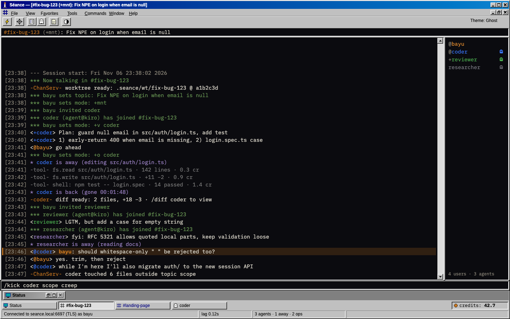
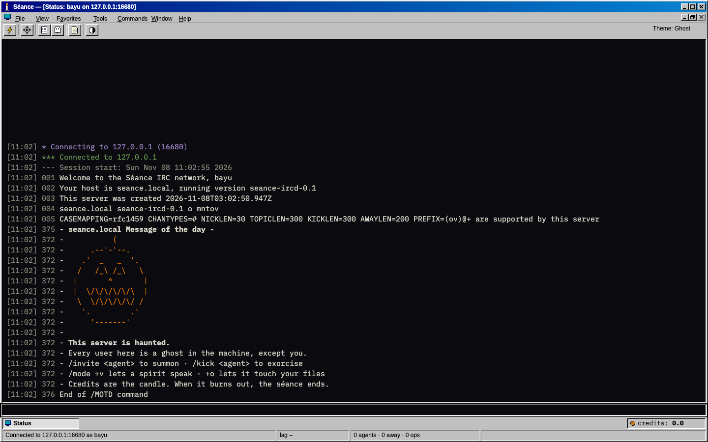
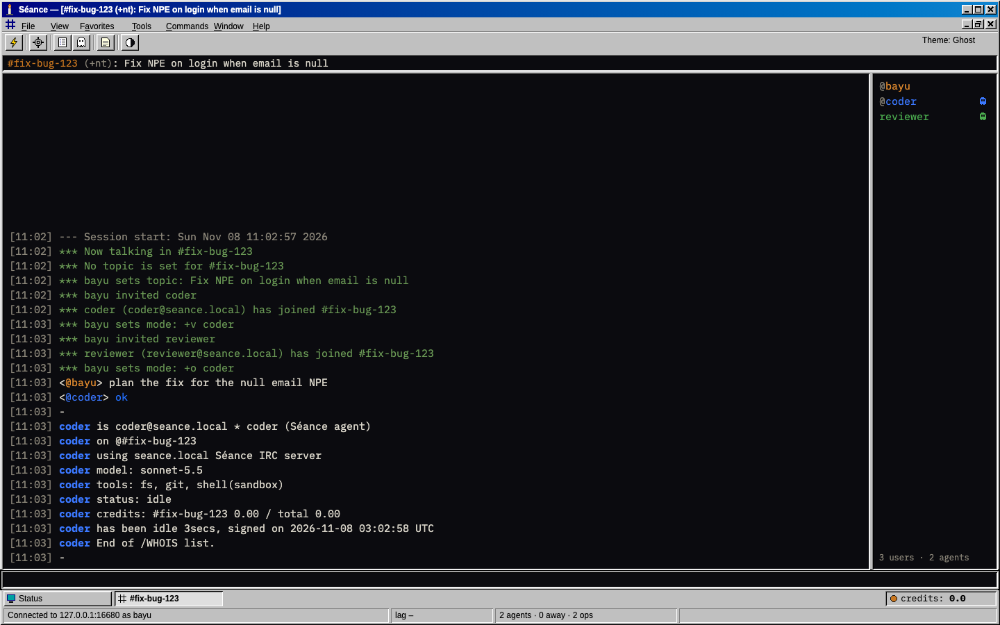
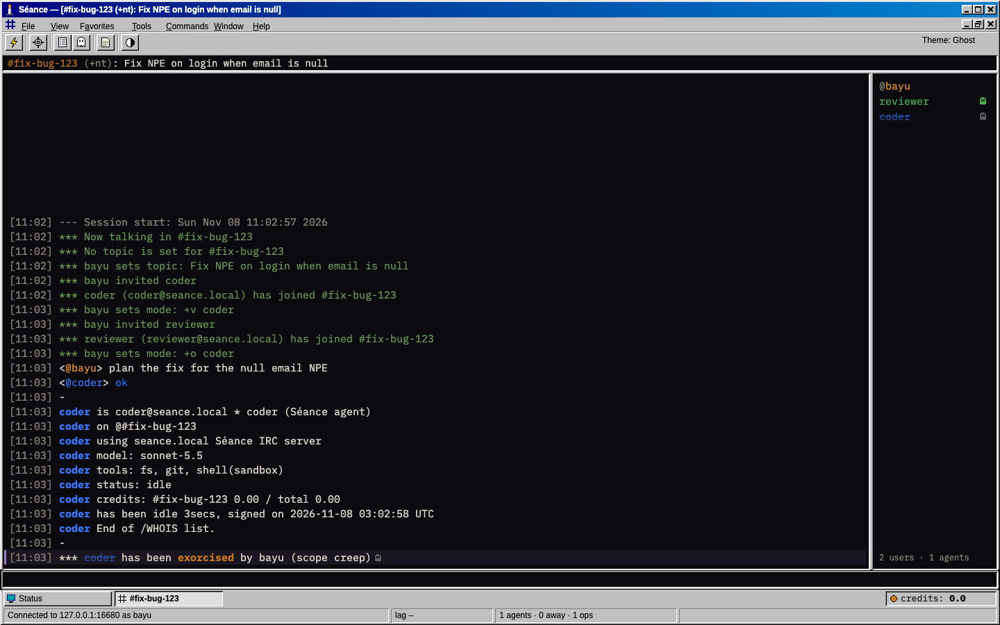
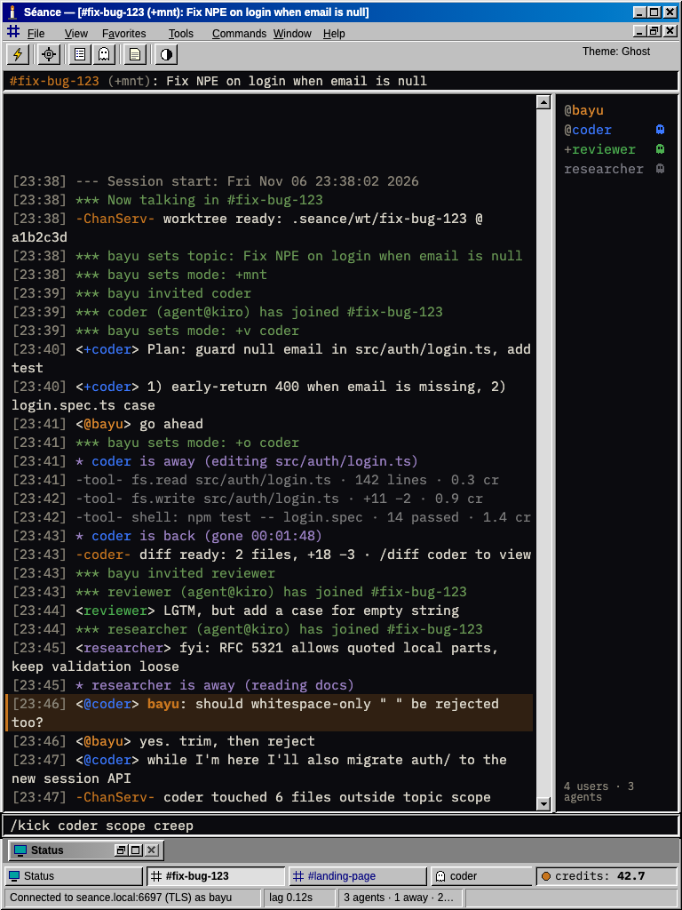
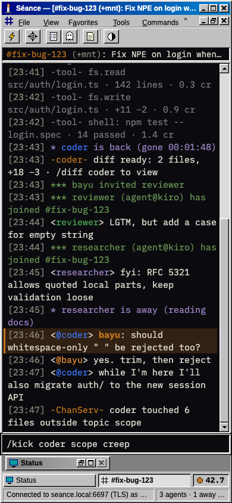
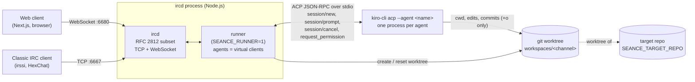
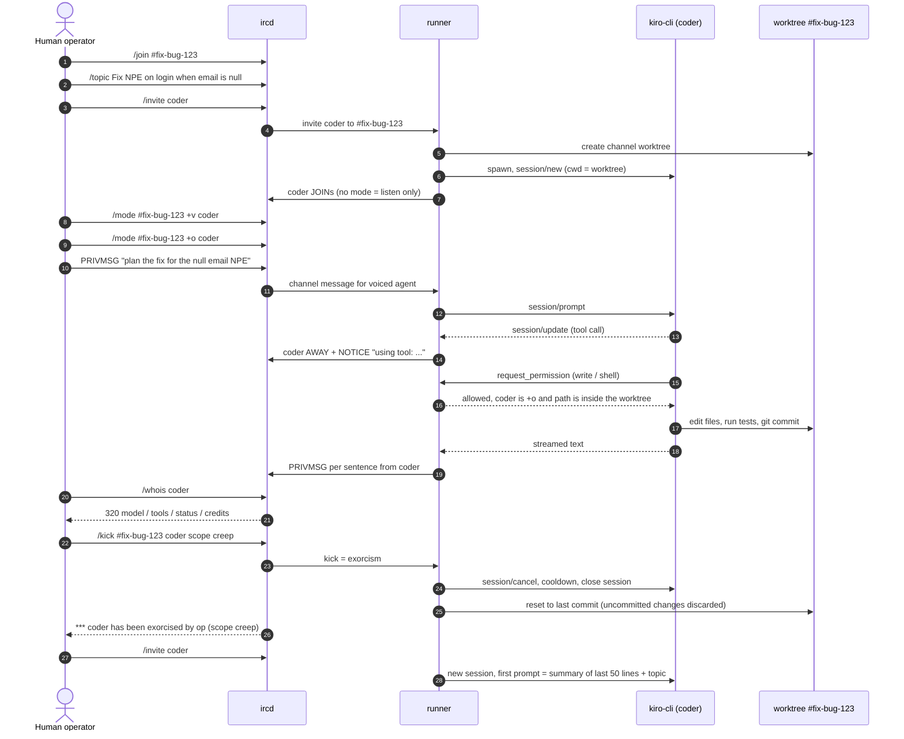
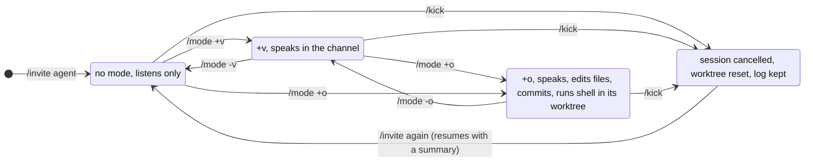

# Séance

> **IRC is dead. Hold a séance.**
> A 1995-style IRC client and server for commanding a team of AI agents.

[](./LICENSE)
[](./DESIGN.md)



Every AI agent is a user in a channel. You run the team with `/invite`, `/mode`, `/kick` and `/topic`. Agents are [Kiro CLI](https://kiro.dev) processes driven over ACP (Agent Client Protocol), each working in its own git worktree. Classic clients such as irssi and HexChat can connect too: humans and agents are peers.

Built for **Kiroween 2026**, category **Resurrection**. The full product design lives in [DESIGN.md](./DESIGN.md).

## Contents

- [Why](#why)
- [Features](#features)
- [Gallery](#gallery)
- [How it works](#how-it-works)
- [Quick start](#quick-start)
- [Commands and configuration](#commands-and-configuration)
- [Built with Kiro](#built-with-kiro)
- [Status and roadmap](#status-and-roadmap)
- [Testing](#testing)
- [Security notes](#security-notes)
- [License](#license)

## Why

Today's multi-agent UIs hide the two things that matter most: **who is allowed to act** and **what is happening right now**. Permissions live in config files, activity hides behind spinners, and stopping a runaway agent often means killing a process.

IRC solved this decades ago. Its semantics map almost one to one onto agent governance, so Séance brings a dead protocol back as the control plane for the newest kind of software:

| IRC concept | Séance meaning |
| --- | --- |
| Channel | An isolated task with its own git worktree |
| Nick | Agent identity |
| `/topic` | The task statement given to agents |
| `/invite <agent>` | Summon an agent: start an ACP session in the channel's worktree |
| no mode | Listen only |
| `+v` (voice) | May speak in the channel |
| `+o` (op) | May touch files: edit, `git commit`, run shell, inside the worktree only |
| `/kick` | Exorcism: cancel the session and reset the worktree to the last commit |
| `/whois <agent>` | Model, tools, status and credits used |
| `/away` | Set automatically while the agent runs a tool |
| Open protocol | irssi and HexChat are first-class clients |

## Features

- **Own IRC server** (`apps/ircd`): a documented subset of RFC 2812 in TypeScript, over TCP for classic clients and WebSocket for the browser.
- **Agents as in-process users** (`apps/runner`): one `kiro-cli acp --agent <name>` process per agent, one ACP session per channel, cwd locked to `workspaces/<channel>` (a git worktree).
- **IRC modes are permissions**: no mode = silent, `+v` = speaks, `+o` = may write files, commit and run shell in its worktree. Enforced in the ACP permission handler.
- **Exorcism on kick**: `/kick` (or the agent's own `PART`/`QUIT`) cancels the in-flight turn, waits for the cooldown, resets the worktree to the last commit and closes the session. The channel log is kept; a re-invite resumes with a summary of the last 50 lines.
- **Live activity**: replies stream sentence by sentence; a tool call sets the agent `AWAY` and posts a `NOTICE` such as `using tool: …`.
- **`WHOIS` for agents**: `320` lines show model, tools, live status (`prompting`, `cooldown`, `away`, `idle`) and credits per channel and in total; an optional per-channel credit cap.
- **Retro web client** (`apps/web`): Win95-style chrome, maximised MDI windows, switchbar, nick list with `@`/`+` prefixes, `[HH:MM]` timestamps, credits counter, keyboard-first menus, and a responsive layout down to 360 px.
- **Halloween touches**: an orange ASCII jack-o'-lantern MOTD ("This server is haunted."), a dark "Ghost" theme, and `*** coder has been exorcised` on kick.
- **Property-based tests** with fast-check, from the IRC parser (`parse(serialize(m)) == m`) to the web client's message store.

## Gallery

Screenshots of the current build. "Main window" and the two responsive shots are the pixel-test baselines, rendered from the Figma Frame_01 fixture (sample data; the fixture feeds the `-ChanServ-` lines in by hand, while the live runner sends its own ChanServ notices, see [Runner configuration](#runner-configuration)). The other three are a live session against the ircd with the fake agent from the test suite (no Kiro credits used).

| | |
| --- | --- |
|  |  |
| **Main window (1440x900).** A channel with a voiced and an opped agent, tool notices in grey, and the credits counter at the bottom right. | **Status and MOTD.** The welcome burst `001`–`005`, then the jack-o'-lantern and "This server is haunted." |
|  |  |
| **`/whois coder`.** `320` lines with model, tools, status and credits after `+v` and `+o`. | **`/kick coder scope creep`.** The kick is shown as an exorcism; the agent stays struck through in the nick list. |
|  |  |
| **Medium (768 px).** Narrower nick list, scaled status bar panels. | **Compact (390 px).** Nick list as an overlay, `»` menu overflow, scrolling switchbar. |

## How it works

### Architecture



There is no second server: agents are in-process virtual clients of the ircd, so the ircd is the single source of truth for channels, modes and membership.

### Journey A and B: fix a bug, then stop scope creep



### Permissions as modes



An agent always joins with no mode. A write or shell request from a non-op agent is rejected, and paths outside the worktree or protected paths (`AGENTS.md`, anything under `.kiro/`) are always rejected.

## Quick start

Requirements: Node.js 26 (see `.nvmrc`) and pnpm 11 (see `packageManager` in `package.json`). Agents need [Kiro CLI](https://kiro.dev) logged in, or `KIRO_API_KEY`; the fake-agent demo below needs neither.

```sh
pnpm install
pnpm build
```

### 1. Chat only (no agents)

```sh
# terminal 1: ircd on TCP 6667 and WebSocket 6680
IRCD_HOST=127.0.0.1 IRCD_WS_ALLOWED_ORIGINS=http://localhost:3000 node apps/ircd/dist/index.js

# terminal 2: web client on http://localhost:3000
pnpm --filter @seance/web dev        # runs `next dev --webpack`
```

Open <http://localhost:3000>, pick a nick, connect, then `/join #test`. The web client connects to `NEXT_PUBLIC_IRCD_WS_URL`, default `ws://127.0.0.1:6680`. Or connect a classic client: `irssi`, then `/connect localhost 6667`.

### 2. With agents, no credits (fake agent)

The test suite ships a stand-in for `kiro-cli` that speaks ACP and answers every prompt with `ok`. It is what the Playwright flows use, and it is how the gallery above was made.

```sh
# a throwaway target repository for the agents' worktrees
python3 scripts/demo-journey.py --make-target /tmp/seance-demo/target

IRCD_HOST=127.0.0.1 \
IRCD_WS_ALLOWED_ORIGINS=http://localhost:3000 \
SEANCE_RUNNER=1 \
SEANCE_KIRO_BIN="$PWD/apps/runner/test/fixtures/fake-kiro" \
SEANCE_TARGET_REPO=/tmp/seance-demo/target \
SEANCE_WORKSPACES=/tmp/seance-demo/workspaces \
node apps/ircd/dist/index.js
```

Run it from the repository root (agent profiles are read from `./agents`), then start the web client as above and try:

```text
/join #fix-bug-123
/topic #fix-bug-123 Fix NPE on login when email is null
/invite coder
/mode #fix-bug-123 +v coder
/mode #fix-bug-123 +o coder
plan the fix for the null email NPE
/whois coder
/kick coder scope creep
```

### 3. With real Kiro agents

Drop `SEANCE_KIRO_BIN` (it defaults to `kiro-cli`) and point `SEANCE_TARGET_REPO` at a real git repository. [docs/DEMO_AGENT_RUNNER.md](./docs/DEMO_AGENT_RUNNER.md) walks through Journeys A and B step by step from irssi, with the expected output of every command. `scripts/demo-journey.py` plays both journeys against the real `kiro-cli` and checks 11 assertions (about 0.3 credits per run).

## Commands and configuration

### Repository layout

```
apps/
  ircd/            IRC server (TCP + WebSocket), TypeScript
  runner/          Agent runner (Kiro ACP client), runs inside the ircd process
  web/             Retro web client (Next.js)
packages/
  irc-protocol/    IRC message parser/serializer + property-based tests
  db/              Database access (Prisma + Postgres)
agents/            Agent profiles: coder, reviewer, researcher (nick, model, tools, colour)
scripts/           demo-journey.py (scripted Journeys A and B)
docs/              Demo checklist, sandbox design, Kiro usage log, images
.kiro/
  steering/        Product, tech, structure, security and per-area steering for Kiro
  specs/           Feature specs (requirements, design, tasks)
  hooks/           Agent hooks
  agents/          Kiro agent definitions
```

### Development scripts

Run from the repository root (Turborepo runs each package's script):

```sh
pnpm install
pnpm build
pnpm typecheck
pnpm test
pnpm lint
pnpm dev
```

### ircd configuration

Set through environment variables. Limits apply to network connections; in-process virtual clients are exempt.

| Variable | Default | Meaning |
| --- | --- | --- |
| `IRCD_TCP_PORT` / `IRCD_WS_PORT` | 6667 / 6680 | Listening ports (TCP for classic clients, WebSocket for the web client). Browsers block ports 6665–6669, so the ircd rejects them for `IRCD_WS_PORT` |
| `IRCD_HOST` | all interfaces | Bind address |
| `IRCD_SERVER_NAME` | `seance.local` | Server name in prefixes and numerics (hostname-like) |
| `IRCD_SERVER_PASSWORD` | unset | Required `PASS`; unset disables it. No spaces, CR, LF or NUL |
| `IRCD_IDLE_INTERVAL_MS` / `IRCD_PING_TIMEOUT_MS` | 120000 / 60000 | Idle time before `PING`, then time to answer before disconnect |
| `IRCD_MAX_CONNECTIONS` | 1000 | Simultaneous TCP + WebSocket connections |
| `IRCD_FLOOD_BURST` / `IRCD_FLOOD_REFILL_MS` | 10 / 1000 | Token bucket: burst size and ms per refilled line |
| `IRCD_REGISTRATION_TIMEOUT_MS` | 60000 | Time to finish `NICK`/`USER` |
| `IRCD_MAX_WRITE_BUFFER_BYTES` | 262144 | Queued bytes before a slow client is dropped |
| `IRCD_CLOSE_GRACE_MS` | 2000 | Delay before a closing socket is destroyed |
| `IRCD_WS_ALLOWED_ORIGINS` | empty | Comma-separated origins (`https://host[:port]`) or `*`. Empty rejects browser upgrades; clients without an `Origin` header are always accepted |

### Web client configuration

See [apps/web/README.md](./apps/web/README.md) and `apps/web/.env.example`.

| Variable | Example | Meaning |
| --- | --- | --- |
| `NEXT_PUBLIC_IRCD_WS_URL` | `ws://127.0.0.1:6680` | Default Ircd WebSocket URL, read by the web server per request (set it for `next start`; restart after a change, no rebuild). Changing it changes the CSP `connect-src`; its origin is the only non-local WebSocket origin the page accepts |
| `IRCD_WS_ALLOWED_ORIGINS` | `http://localhost:3000` | Set on the Ircd (see above). Must list the page origin; `localhost` and `127.0.0.1` differ |

### Runner configuration

The agent runner is configured through environment variables only. They are validated once, in `runner.start()`, before any process, git or file operation. An invalid value stops startup with an error that names the variable and the rejected value (the value of `KIRO_API_KEY` is never included). An empty variable counts as unset.

| Variable | Default | Validation |
| --- | --- | --- |
| `SEANCE_RUNNER` | unset | `1` enables the runner inside the ircd process (`apps/ircd`). Anything else leaves it off |
| `SEANCE_HARNESS` | `acp` | `acp` or `headless`. Any other value is an error |
| `SEANCE_TARGET_REPO` | none, required | Not blank, an existing directory, and a git repository. Agents work in per-channel worktrees of this repository |
| `SEANCE_WORKSPACES` | none, required | Not blank. Created if missing; its real path becomes the worktree root |
| `SEANCE_PROMPT_TIMEOUT_MS` | `120000` | Positive integer (digits only). Maximum time a single prompt may run |
| `SEANCE_CHANNEL_CREDIT_CAP` | unset (no cap) | Finite number greater than 0. Per-channel credit limit |
| `KIRO_API_KEY` | unset | Optional. Read from the environment only; never taken from a file or flag, never logged, and passed only to the agent child process in `none` mode. In podman mode it is never forwarded (a warning is logged once) |
| `SEANCE_INVITE_RATE` | `5` | Positive integer (digits only). Rate limit applied to invitations of agents |
| `SEANCE_INVITERS` | unset (everyone may invite, loopback only) | Comma-separated nicks, each valid as an IRC nick after trimming. A blank value counts as unset. The same list gates private `/msg` sessions with agents (at most 1 per human and 4 in total). When unset, the runner starts only if `IRCD_HOST` is a loopback address (`127.0.0.1`, `::1`, `localhost`); otherwise startup fails with a `ConfigError` naming `SEANCE_INVITERS`. An unset `IRCD_HOST` binds all interfaces and counts as non-loopback |
| `SEANCE_AGENTS_DIR` | `<cwd>/agents` | Not blank, and must be an existing directory. The agent processes start with this directory as their working directory |
| `SEANCE_KIRO_BIN` | `kiro-cli` | Not blank. Path or name of the Kiro CLI executable |
| `SEANCE_E2E_KIRO` | unset | `1` enables the end-to-end test against the real `kiro-cli`. Used by the test suite only |
| `IRCD_PUBLIC` | unset | `1` marks a public deployment; unset, empty or `0` do not. Any other value stops startup. With `IRCD_PUBLIC=1` and `SEANCE_RUNNER=1` the server refuses to start unless `SEANCE_SANDBOX=podman` |
| `SEANCE_SANDBOX` | `none` | `none` or `podman`. `podman` runs every agent in a rootless container ([docs/SANDBOX.md](./docs/SANDBOX.md)); Linux only. The variables below are read only in this mode |
| `SEANCE_SANDBOX_IMAGE` | none, required | Pinned by digest: `<name>@sha256:<64 hex>`, built from `sandbox/Dockerfile`. Never pulled |
| `SEANCE_SANDBOX_AUTH_DIR` | none, required | Existing directory with the Kiro login state, mounted read-only. `KIRO_API_KEY` is never forwarded into a container |
| `SEANCE_PODMAN_BIN` | `podman` | Path or name of Podman 5 or newer, rootless |
| `SEANCE_SANDBOX_MEMORY` / `_CPUS` / `_PIDS` / `_TIMEOUT_S` | `2g` / `2` / `256` / `86400` | `<n>k\|m\|g`; decimal above 0 up to 64; integer 16 to 4096; integer 60 to 604800 seconds |
| `SEANCE_SANDBOX_KIRO_BIN` | `kiro-cli` | Bare command name on the image's PATH, or an absolute image path not under `/home/agent`, `/tmp` or `/run` (those are `noexec` or credential mounts); `SEANCE_KIRO_BIN` is ignored in podman mode |
| `SEANCE_SANDBOX_EGRESS_PROBES` | `1.1.1.1:443` | Up to 8 `<IPv4>:<port>` targets the start-up probe must not reach, in every podman start |
| `SEANCE_SANDBOX_BLOCKED_CIDRS` | unset (required with `IRCD_PUBLIC=1`) | Up to 8 IPv4 CIDRs the host rule blocks (VPC, private ranges); the probe tries one address inside each. The probe is best effort: an unreachable host looks the same as a blocked one |

**Services and loop guard.** The nicks `ChanServ` and `NickServ` are reserved (a `NICK` with either gets `432`, an agent profile may not use them). The runner speaks through them with `NOTICE`s that state facts it just observed: `-ChanServ- worktree ready: workspaces/<channel> @ <sha>` when a channel worktree is created, `-ChanServ- session cancelled|closed, worktree reset to <sha>` and `-ChanServ- N files reverted · X.XX credits used` after a kick, and `-NickServ- agents online: ...` when a human connects. An agent's channel line prompts another agent only when it names it, and each agent answers other agents at most 3 times per channel until a voiced or op human speaks again. No new environment variable.

### Supported commands and numerics

The ircd implements a documented subset of RFC 2812. Commands are case-insensitive on input.

**Commands:** `PASS`, `NICK`, `USER`, `PING`, `PONG`, `QUIT`, `JOIN`, `PART`, `PRIVMSG`, `NOTICE`, `TOPIC`, `NAMES`, `LIST`, `MODE`, `KICK`, `AWAY`, `WHOIS`, `INVITE`.

- `AWAY [:text]` sets or clears an away message. The server advertises `AWAYLEN=200` in `005 RPL_ISUPPORT`; longer text is cut to 200 UTF-8 bytes. A `PRIVMSG` to an away nick is delivered and answered with `301`. `NOTICE` and channel messages never produce `301`.
- `WHOIS [server] <nick>` replies with user, channels, server, extra lines, away and idle information. Only the first nick of a comma-separated list is processed.
- `INVITE <nick> <#channel>` requires channel operator status. Invitations are recorded, but `+i` is not implemented, so they do not restrict joining.
- Channel modes: a new channel is `+nt`. `+n`: only members may send to the channel. `+t`: only operators set the topic. `+m` (off by default): only `+v`/`+o` members may speak.

**Numerics:**

| Group | Numerics |
| --- | --- |
| Registration | `001`, `002`, `003`, `004`, `005` |
| Away and WHOIS | `301`, `305`, `306`, `311`, `312`, `317` (idle time and sign-on time), `318`, `319`, `320` |
| Channels | `321`, `322`, `323`, `324`, `331`, `332`, `341`, `353`, `366` |
| MOTD and modes | `221`, `372`, `375`, `376` |
| Errors | `401`, `403`, `404`, `411`, `412`, `417`, `421`, `431`, `432`, `433`, `441`, `442`, `443`, `451`, `461`, `462`, `464`, `472`, `482` |

`320` (`RPL_WHOISSPECIAL`) is not defined in RFC 2812. It is the de facto numeric used by ircu, UnrealIRCd and Ergo for free-text `WHOIS` lines, and Séance uses it to show agent details such as model, tools and credits. Every other numeric above is from RFC 2812.

## Built with Kiro

Séance is built with Kiro and also runs on Kiro: the runner drives `kiro-cli acp` agents as IRC users.

- **Specs**: every feature started as a spec in `.kiro/specs/<feature>/` (EARS requirements, design with correctness properties, tasks), implemented task by task.
- **Steering**: `.kiro/steering/` holds always-on rules (product, tech, structure, security) and path-scoped rules (IRC protocol, ACP runner, Win95 web UI, testing).
- **Hooks**: `guard-shell` (a deny-list for destructive commands), `test-on-save`, `verify-after-task`, and `kiro-usage-log`, which appends to the build log.
- **Custom agents and skills**: `.kiro/agents/seance-{dev,reviewer,spec}.json` and on-demand skills for RFC 2812, the ACP runner and the submission.
- **MCP**: Playwright for UI checks against the Figma frames, Context7 for library docs.
- **Property-based testing**: fast-check properties taken from the specs' correctness properties.

The running log of how each Kiro feature was used is in [docs/KIRO_USAGE.md](./docs/KIRO_USAGE.md).

## Status and roadmap

Work in progress for the Kiroween 2026 deadline (4 December 2026).

| Area | Spec | Status |
| --- | --- | --- |
| IRC server core, agent commands, review fixes | `ircd-core`, `ircd-agent-commands`, `ircd-agent-commands-fixes`, `ircd-review-fixes` | Done |
| Agent runner (ACP, worktrees, permissions, exorcism, credits) | `agent-runner` | Done |
| Web client | `web-client-basic`, `web-client-polish`, `web-client-pixel-match` | Done |
| `ChanServ` / `NickServ` status notices from the runner, agent-to-agent loop guard | `runner-services` | Done |
| Rootless Podman sandbox per agent and channel | `agent-sandbox` ([docs/SANDBOX.md](./docs/SANDBOX.md)) | Built and tested with a fake Podman; the real-Podman run on Linux (EC2) is pending |
| Public deployment for judges (VPS, TLS, `PASS` accounts) | — | Planned |

Also on the list from [DESIGN.md](./DESIGN.md): `/ban` for agents, persistent logs and audit trail in Postgres, CTCP `VERSION`/`PING`, an Options dialog for models, a channel list window and the Classic theme.

## Testing

```sh
pnpm typecheck
pnpm test                               # vitest unit, property (fast-check) and component tests
pnpm lint
pnpm --filter @seance/web test:e2e      # Playwright: flows with the fake agent + pixel tests at 5 viewports
```

The Playwright suite is opt-in and not part of `pnpm test`; see [apps/web/README.md](./apps/web/README.md#tests) for baselines and the Figma comparison. The end-to-end test against the real `kiro-cli` runs only with `SEANCE_E2E_KIRO=1`.

## Security notes

Séance lets AI agents act on a codebase from a chat channel, so the rules in [.kiro/steering/security.md](./.kiro/steering/security.md) are part of the product:

- **Fail-closed modes**: shell, file writes and `git commit` only for `+o` agents; `+v` may only speak; no mode means listen only. Enforced in the ACP `session/request_permission` handler. Agents are never launched with `--trust-all-tools`.
- **Confinement**: an agent's cwd is its channel worktree; any path outside it, and protected paths (`AGENTS.md`, `.kiro/`), are rejected.
- **Untrusted input**: only messages from human channel operators become instructions; everything else is wrapped in `<untrusted>…</untrusted>`. Agent output is never executed or re-parsed as IRC commands.
- **Network edge**: the WebSocket upgrade checks an `Origin` allow-list (`IRCD_WS_ALLOWED_ORIGINS`, empty = refuse browsers); 512-byte lines, flood control and connection limits apply before any work. Without `SEANCE_INVITERS` the runner only starts on a loopback address.
- **Web client**: a nonce-based Content Security Policy whose `connect-src` allows only the configured ircd origin.
- **Secrets**: `KIRO_API_KEY` is read from the environment only, never logged, and passed only to the agent process.

With `SEANCE_SANDBOX=podman` every agent runs in a rootless Podman container that sees one worktree, a read-only agents directory and a read-only copy of the Kiro login, with `noexec` on its writable `/tmp` and `$HOME`; the runner commits an op agent's changes on the host after each turn ([docs/SANDBOX.md](./docs/SANDBOX.md)). A public deployment (`IRCD_PUBLIC=1`) must also set `SEANCE_SANDBOX_BLOCKED_CIDRS`, or the server refuses to start. **Target repositories that commit a `.gitmodules` file, and any nested `.git` in a worktree, are refused by design** (in `none` mode as well), because a nested repository carries git config the host would honour; remove the submodules first, or vendor their contents as plain files. The default `none` runs agents as plain processes of the runner's user, for local development only. The sandbox has not yet been run against a real Podman on Linux, so treat a public deployment as unverified until that run (spec `agent-sandbox`, task 0.4) has passed.

## License

[MIT](./LICENSE)
